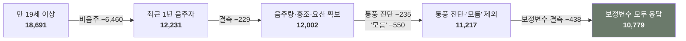

# 🍺 음주 관련 안면홍조 이력에 따른 음주량–고요산혈증 연관성의 차이

**Alcohol Flushing, Drinking, and Hyperuricemia · KNHANES 2019–2021**

> 한국 성인 현재 음주자에서의 성별 효과수정 분석


과학적 사고와 의학연구 **6조** · 조별 연구계획 (2026. 11. 2. 발표)

| 조원 | 지도교수 |
|---|---|
| 김민상 · 조용찬 · 이예은 · 박채완 · 김정윤 · 김준현 | 손민국 교수님 |

---

## 📑 목차

1. [연구 배경](#1-연구-배경)
2. [선행연구](#2-선행연구)
3. [연구 질문과 가설](#3-연구-질문과-가설)
4. [연구 방법](#4-연구-방법)
5. [예비 분석](#5-예비-분석)
6. [예상 결과와 의의](#6-예상-결과와-의의)
7. [연구 일정](#7-연구-일정)
8. [함께 작업하는 방법](#8-함께-작업하는-방법)
9. [참고문헌](#9-참고문헌)

---

## 1. 연구 배경

### 얼굴이 빨개지면 술이 더 해로울까?


- **동아시아인 상당수는 아세트알데히드 분해효소(ALDH2)가 약하다.**
  그래서 아세트알데히드가 쌓여, 한두 잔에도 얼굴이 빨개진다(안면홍조).
- **흔히 홍조가 있으면 술이 더 해롭다고 인식한다.**
  - 식도암: 빨개지는 사람에서 음주의 위험이 더 큼 (Brooks 외, 2009)
  - 지방간: 빨개지는 사람에서 음주와 지방간의 관련이 더 강함 (Kang & Oh, 2023)
- **술이 요산을 올리는 이유**
  알코올을 분해할 때 에너지 물질(ATP)이 많이 쓰이고, 그 분해 산물로 요산이 더 만들어진다 (Faller & Fox, 1982).

> 💡 **통념: 홍조 = 더 해롭다.** 요산(고요산혈증)에서도 그럴까?

---

## 2. 선행연구

### ① 홍조에 따라 음주의 영향이 달랐다

| 연구 | 자료 | 주요 결과 | 한계 | 본 연구에 주는 시사점 |
|---|---|---|---|---|
| **김어진 (2015 · 2016)**<br/>학술지 · 학위논문 | 대학병원 건강검진 남성<br/>(2015년 702명 · 2016년 845명) | 2015: 덜 마시는데도 요산은 비슷 (주 7.5 vs 12.5잔)<br/>2016: 홍조군은 주 2잔 미만에서도 위험 3.33배, 비홍조군은 주 8잔 초과부터 위험 2.61배 | 한 병원 · 남성만<br/>2016년 논문은 학위논문(학술지 미게재)<br/>2015년 논문의 원래 주제는 요산–호모시스테인 관계 | 홍조군은 더 적은 양에서도 위험할 수 있다 |
| **Kang & Oh (2023)**<br/>*Nutrients* | 국민건강영양조사 2019–2021<br/>남성 5,134명 | 음주자의 지방간 가능성: 비홍조 1.90배, 홍조 2.35배<br/>지방간 판정법 3가지 중 1가지에서만 차이가 뚜렷 | 남성만 · 마시는 횟수로만 구분<br/>과거·현재 홍조를 구분하지 않음 | 같은 자료로 홍조별 음주 영향을 비교한 선례 |

### ② 홍조 이력과 성별 차이

| 연구 | 자료 | 주요 결과 | 본 연구에 주는 시사점 |
|---|---|---|---|
| **Jeon 외 (2022)**<br/>*Sci Rep* | 지역사회건강조사 2019<br/>현재 음주자 139,380명 | 지금 빨개지는 사람: 우울 가능성 1.23배<br/>예전에만 빨개졌던 사람: 차이 없음 | 과거·현재 홍조를 나눠 본 선례 (단, 혈액검사 없음) |
| **Jee 외 (2019)**<br/>*Int J Rheum Dis* | 한국인 암예방연구 바이오뱅크<br/>(유전자 분석 11,678명) | 많이 마실수록 고요산혈증이 많음 (남녀 모두)<br/>유전자를 이용한 분석: 남성에서만 약한 인과 근거<br/>홍조 유전자 자체는 고요산혈증과 관련 없음 | 남녀를 나눠 볼 근거 (단, 홍조 이력은 다루지 않음) |

> 🔍 **남아 있는 빈 곳**
> 홍조에 따라 음주량과 고요산혈증의 관계가 달라지는지, 전국 자료로 직접 본 근거는 아직 부족하다.

---

## 3. 연구 질문과 가설

### 🎯 주질문: 지속 홍조군과 비홍조군의 연관성이 다른가

> **남녀 각각에서, 성별 기준으로 나눈 음주 수준과 고요산혈증의 관계는 비홍조군과 지속 홍조군 사이에 연관성이 다른가?**

**가설:** 같은 성별 기준의 음주 수준이 높아질 때, 지속 홍조군은 비홍조군보다 고요산혈증 위험이 더 크게 늘어날 것이다.

- **비홍조군**: 처음 마시던 시기와 지금 모두 얼굴이 빨개지지 않는 사람
- **지속 홍조군**: 처음 마시던 시기와 지금 모두 얼굴이 빨개지는 사람

### 부질문

| # | 질문 | 가설 |
|---|---|---|
| 1 | **홍조 이력**: 남녀 각각에서, 성별 기준으로 나눈 음주 수준과 고요산혈증의 관계는 현재 홍조가 없는 사람 가운데 *홍조 소실군*과 *비홍조군* 사이에 다른가? | 소실군과 비홍조군은 음주량–고요산혈증 연관성에서 차이를 보일 것이다.<br/>(소실군과 지속 홍조군의 비교는 탐색적으로, 가능성을 살펴보는 수준) |
| 2 | **성별**: 비홍조군과 지속 홍조군 사이의 연관성 차이가 남녀 사이에서도 다른가? | 홍조에 따른 연관성의 차이는 성별에 따라 다른 양상을 보일 것이다.<br/>근거: 선행연구는 남성만 분석했다. 여성은 여성호르몬이 요산 배설을 돕는다. 음주가 요산의 원인이라는 근거는 남성에서만 보였다 (Jee 외, 2019). |

> 음주 수준을 성별 기준으로 나누므로, 부질문 2는 "같은 양을 마셨을 때"가 아니라 "각 성별 안에서 많이 마시는 편일 때"의 남녀 비교다.

---

## 4. 연구 방법

### 4.1 연구 대상: 국민건강영양조사 2019–2021 성인 음주자



**최종 분석 대상: 남 5,411명 · 여 5,368명**

제외 기준의 이유
- **통풍 진단자**: 치료로 요산 수치가 달라질 수 있어 제외
- **통풍 진단 '모름'·무응답**: 결측으로 보고 함께 제외
- 정보가 빠진 사람은 제외하고, 그 인원은 보고서에 제시

> n은 실제 응답자 수(가중치 적용 전)이며, 제외 집계는 생성형 AI(Claude)를 활용해 R(survey 패키지)로 산출한 뒤 조원이 검토함.

### 4.2 변수

#### ① 노출: 음주량 / 결과: 고요산혈증

**주당 음주 잔 수 = 음주 빈도(회/주) × 1회 음주량(잔)**

| 설문 문항 | 응답 → 대푯값 |
|---|---|
| 2-1 음주 빈도 (①은 비음주로 제외) | 월 0.5회 · 월 1회 · 월 3회 · 주 2.5회 · 주 5.5회 |
| 2-2 1회 음주량 | 1.5잔 · 3.5잔 · 5.5잔 · 8잔 · 기입값* |

\* 10잔 이상은 직접 적은 잔 수(2-1 문항) 사용

**음주 수준은 남녀 각각의 기준으로 나눈다** (저음주가 기준범주). 절단점은 조원 논의로 확정한다.

| 후보 기준 | 남자 (주당 잔 수) | 여자 (주당 잔 수) | 근거 |
|---|---|---|---|
| 성별 삼분위 | 2.4 · 10 | 0.4 · 2.5 | 이 표본의 가중 분포를 1/3씩 나눔 |
| 절주 지침 환산 | 적정 상한 16 | 적정 상한 8 | 한국 홍조 기반 절주 지침(Lee 외, 2019)을 국건영 1잔 ≈ 7 g으로 환산 |
| (참고) 계획 발표 기준 | 3.5 · 14 | 3.5 · 14 | 남녀 공통 |

> 후보 기준별 질문 p값은 `/knhanes_ptest` 스킬로 비교한다. 시도한 기준은 모두 `output/21_ptest/ptest_log.csv`에 기록되며, 보고서에는 시도한 기준 전체를 밝힌다.

**결과: 고요산혈증** (검진 혈액검사 혈청 요산)
- 남 **7.0 mg/dL 이상**, 여 **6.0 mg/dL 이상**
- 여성은 사례가 적어 요산 수치 자체도 함께 분석

> 대푯값 설정 방식은 분석 전에 정하되, 값을 바꿔도 결과가 비슷한지 확인한다(민감도 분석).

#### ② 현재 홍조와 홍조 이력

| | 현재 홍조 없음 (아니요) | 현재 홍조 있음 (가끔·자주·늘) |
|---|---|---|
| **과거 홍조 없음** | 비홍조<br/>남 3,181 · 여 3,273 | 신규 홍조*<br/>남 301 · 여 400 |
| **과거 홍조 있음** | 홍조 소실<br/>남 341 · 여 236 | 지속 홍조<br/>남 1,588 · 여 1,459 |

\* 지금 새로 생긴 홍조는 홍조 이력 3군이 아니어서 이력 분석에서 제외

- **주분석**: 비홍조 vs 지속 홍조 (홍조 이력 3군 중 두 군)
- **부질문 1**: 홍조 소실 vs 비홍조 (현재 홍조가 없는 두 군)
- 홍조 이력 3군(비홍조 · 소실 · 지속)을 한 모형에 넣고, 비홍조군을 기준으로 두 비교를 함께 본다.
- 홍조를 설문으로 재는 근거: 두 문항이 유전자로 확인한 홍조 체질의 약 90%를 찾아냄 (Brooks 외, 2009). 과거 문항은 홍조에 익숙해진 사람(홍조 소실)을 찾기 위한 것.

#### 보정변수

- **기본**: 나이, 교육, 소득, 조사연도, 흡연, 신체활동
- **추가**: 체질량지수, 고혈압, 당뇨병, 콩팥 기능

### 4.3 분석 방법

#### 분석 ①: 남녀를 나눠, 홍조에 따라 음주 영향이 다른지 확인

1. **가중치 적용**: 조사된 일부가 전 국민을 대표하도록 가중치 적용 (3년 자료 통합)
2. **남녀 따로 로지스틱 회귀분석**: 저음주에 비해 고요산혈증일 가능성이 몇 배인지 (교차비, OR)
3. **홍조 이력에 따라 음주 영향이 다른가 (상호작용)**: 지속 홍조군과 비홍조군(주질문), 소실군과 비홍조군(부질문 1)의 OR을 나란히 보고, 그 차이가 우연이 아닌지 검정

```
고요산혈증 여부  ~  음주 수준(성별 기준) + 홍조 이력 + 음주 수준 × 홍조 이력 (← 핵심) + 보정변수(기본 → 추가)
                   홍조 이력: 비홍조(기준) · 홍조 소실 · 지속 홍조
                   주질문 = 음주 수준 × 지속 홍조 항, 부질문 1 = 음주 수준 × 홍조 소실 항
```

> 분석 프로그램: R (survey 패키지) · p값이 0.05보다 작으면 의미 있는 차이 · 결과는 OR과 95% 신뢰구간으로 제시

#### 분석 ②: 홍조 이력, 남녀 비교, 여성 요산 수치

| 분석 | 방법 | 성격 |
|---|---|---|
| 홍조 이력 | 비홍조군을 기준으로 같은 모형에서 소실군 vs 비홍조군을 봄 | 소실 vs 지속은 탐색적 |
| 남녀 비교 | 지속 홍조 vs 비홍조의 차이가 남녀에서 다른지 확인 (음주 수준 × 홍조 이력 × 성별) | 각 성별 기준 안의 상대적 음주 수준 비교 |
| 현재 홍조 2군 | 계획 발표 때의 주분석(현재 홍조 vs 현재 비홍조)도 함께 제시 | 참고 |
| 여성 요산 수치 | 선형회귀분석 · 저음주에 비해 요산이 평균 몇 mg/dL 높은지 | 탐색적 (사례가 적어서) |

**빠진 자료와 민감도 분석**
- 필요한 정보가 모두 있는 사람만 분석하고, 빠진 사람과 남은 사람의 특성을 비교
- 대푯값이나 통풍 제외 기준을 바꿔도 결과가 비슷한지 확인 (민감도 분석)

---

## 5. 예비 분석

**홍조군은 술을 덜 마신다** (주당 잔 수, 가중치 적용 평균)

| 집단 | 주당 잔 수 |
|---|---|
| 남 · 비홍조 | 15.5 |
| 남 · 홍조 | 8.5 |
| 여 · 비홍조 | 4.8 |
| 여 · 홍조 | 3.0 |

**현재 홍조 × 음주 수준 (실제 응답자 수)**

| | 저음주 | 중음주 | 고음주 |
|---|---:|---:|---:|
| 남 · 비홍조 | 1,040 | 1,333 | 1,149 |
| 남 · 홍조 | 1,081 | 501 | 307 |
| 여 · 비홍조 | 2,440 | 812 | 257 |
| 여 · 홍조 | 1,478 | 286 | **95** |

- 현재 홍조: 남 35.0% · 여 33.6%
- 고음주(주 14잔 이상): 남 26.7% · 여 6.8%
- 고요산혈증: 남 23.6% (1,201명) · 여 7.7% (427명)

> ✅ **남성은 모든 칸이 충분하다.**
> ⚠️ **여성 홍조군 고음주는 95명 → 고요산혈증 예상 약 8명.** 여성 결과는 불확실성(신뢰구간)이 클 것이므로 조심스럽게 해석한다.

> n은 실제 응답자 수, %는 가중치 적용. 음주·홍조별 요산 결과는 분석 전까지 보지 않음. 생성형 AI(Claude)를 활용해 R(survey 패키지)로 산출한 뒤 조원이 검토함.

---

## 6. 예상 결과와 의의

### 6.1 결과 시나리오

| 시나리오 | 모습 | 의미 |
|---|---|---|
| **A. 홍조군에서 더 가파름** | 같은 양에도 홍조군이 요산에 더 민감 | 김어진(2016)과 같은 방향 → 음주 상담에서 홍조를 물어볼 근거 |
| **B. 비홍조군에서 더 가파름** | 안 빨개지는 사람이 오히려 영향이 큼 | Yokoyama(2016)과 같은 방향 → '안 빨개지니 괜찮다'를 재검토 |
| **C. 차이 없음** | 홍조가 연관성을 바꾸지 않음 | 신뢰구간이 좁으면 '차이가 작다', 넓으면 '자료 부족'으로 구분 |

> 여성과 홍조 이력 분석은 인원이 적어, p값보다 결과의 방향과 크기를 중심으로 해석한다.

### 6.2 예상되는 한계와 대응

| 한계 | 왜 문제인가 | 대응 |
|---|---|---|
| **현재 음주자만 분석** | 홍조 때문에 술을 끊은 사람이 빠짐 → 홍조군이 '술을 견디는' 사람 위주일 수 있음 | 해석 범위를 현재 음주자로 한정 |
| **홍조는 본인 응답** | 예전 홍조는 기억이 틀릴 수 있음. 홍조가 사라진 것이 음주의 결과일 수도 있음 | 사라진 원인은 판단하지 않고 관련성만 보고 |
| **인원이 적은 집단** | 여성 홍조군 고음주 95명 (고요산혈증 예상 약 8명) | 신뢰구간 중심 해석 · 여성·이력 분석은 탐색적 |

그 밖에: 한 시점 자료라 원인 판단 불가, 술 종류 정보 없음, 요산을 올리는 약(이뇨제)은 보정 못 함 → 보고서에 기술

### 6.3 기대효과

- **학술적**: 전국 자료에서 과거·현재 홍조 이력과 실제로 잰 혈청 요산을 연결한 근거
- **임상적**: 음주 상담에서 예전 홍조까지 물어보는 것이 도움이 되는지 검토할 기초자료 (검사 대상을 고르는 데 쓰려면 추가 검증 필요)
- **후속 연구**: 유전자 검사나 여러 번 측정한 자료로 홍조 이력의 의미와 원인–결과 순서를 확인하는 출발점

---

## 7. 연구 일정

매주 월·수 공식 모임 (일정이 부족하면 주말 추가 모임, 조원 협의)

| 주차 | 기간 | 단계 | 할 일 |
|---|---|---|---|
| 1주 | 11/2(월) – 11/4(수) | 피드백 반영 | 계획 발표 → 피드백 정리, 담당 정하기 · 계획서 수정본 확인, 선행연구 재검색 공유 |
| 2주 | 11/9(월) – 11/11(수) | 분석 검증 | 변수 정의를 지침서와 대조, 공식 통계와 비교 · 분석을 2번 실행해 같은 결과인지 확인 |
| 3주 | 11/16(월) – 11/18(수) | 결과표 · 그림 | 대상자 특성표, 음주–고요산혈증 표, 남녀 비교표 · 대상자 선정 흐름도, 교차비(OR) 그림 |
| 4주 | 11/23(월) – 11/25(수) | 보고서 초안 | 결과 해석 토론, 서론·방법 초안 · 결과·고찰 초안, 한계 정리 |
| 5주 | 11/30(월) – 12/2(수) | 최종 완성 | 수치 · 참고문헌 최종 확인 · 발표 자료 · 리허설 → 12/6 보고서 완성 |

> 각 모임에는 직전 모임 이후의 결과물을 가져온다.

---

## 8. 함께 작업하는 방법

조원 모두가 이 저장소를 함께 꾸밉니다. **다른 조원의 확인(Pull Request) 없이 `main`에 바로 올립니다.**

1. **조원 초대 받기**: 저장소 주인에게 GitHub 아이디를 알려주고, 메일로 온 초대를 수락합니다. 초대를 받아야 올릴 수 있습니다.
2. **작업 전 받아오기**: 작업을 시작하기 전에 다른 조원이 올린 내용을 받아옵니다. (`git pull`)
3. **작업 후 커밋**: 무엇을 바꿨는지 알 수 있게 커밋 메시지를 씁니다. (예: `대상자 특성표 초안 추가`)
4. **바로 올리기**: `main`에 바로 올립니다. (`git push`) Git이 없으면 사이트에서 **Add file → Upload files**로 올려도 됩니다.

> 💡 올리면 확인 없이 바로 반영됩니다. 올리기 전에 올라갈 파일을 확인하세요. (`git status`)
> 같은 파일의 같은 부분을 동시에 고치면 충돌이 생깁니다. 맡은 부분을 미리 정해 두세요.
> 잘못 올려도 변경 기록에서 이전 버전으로 되돌릴 수 있습니다.

---

## 9. 참고문헌

1. 김어진 외. 음주 시 안면홍조에 따른 혈중 요산과 호모시스테인 농도관계의 변화. *Korean J Health Promot.* 2015;15(3):91–97.
2. 김어진. 음주량에 따른 고요산혈증의 발생에서 알코올 연관 안면 홍조의 역할 [박사학위논문]. 대전: 충남대학교 대학원; 2016.
3. Kang D, Oh SN. Association between alcohol consumption and metabolic dysfunction-associated steatotic liver disease based on alcohol flushing response in men: KNHANES 2019–2021. *Nutrients.* 2023;15(18):3901.
4. Jeon S, Kang H, Cho I, Cho SI. The alcohol flushing response is associated with the risk of depression. *Sci Rep.* 2022;12(1):12569.
5. Jee YH, Jung KJ, Park YB, et al. Causal effect of alcohol consumption on hyperuricemia using a Mendelian randomization design. *Int J Rheum Dis.* 2019;22(10):1912–1919.
6. Faller J, Fox IH. Ethanol-induced hyperuricemia: evidence for increased urate production by activation of adenine nucleotide turnover. *N Engl J Med.* 1982;307(26):1598–1602.
7. Yokoyama A, Yokoyama T, Mizukami T, et al. Alcohol dehydrogenase-1B (rs1229984) and aldehyde dehydrogenase-2 (rs671) genotypes and alcoholic ketosis are associated with the serum uric acid level in Japanese alcoholic men. *Alcohol Alcohol.* 2016;51(3):268–274.
8. Brooks PJ, Enoch MA, Goldman D, Li TK, Yokoyama A. The alcohol flushing response: an unrecognized risk factor for esophageal cancer from alcohol consumption. *PLoS Med.* 2009;6(3):e50.
9. 질병관리청. 국민건강영양조사 제8기(2019–2021) 원시자료 이용지침서.

---

<sub>예비 분석 수치는 생성형 AI(Claude)를 활용해 R 4.6.0(survey 패키지)으로 산출했으며, 분석 코드는 조원이 검토했습니다.</sub>
