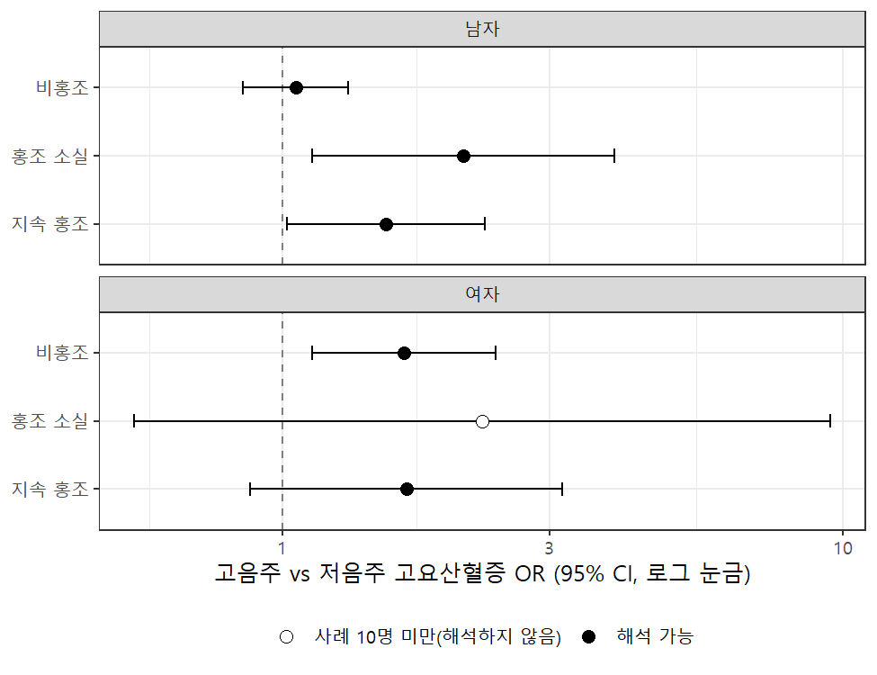
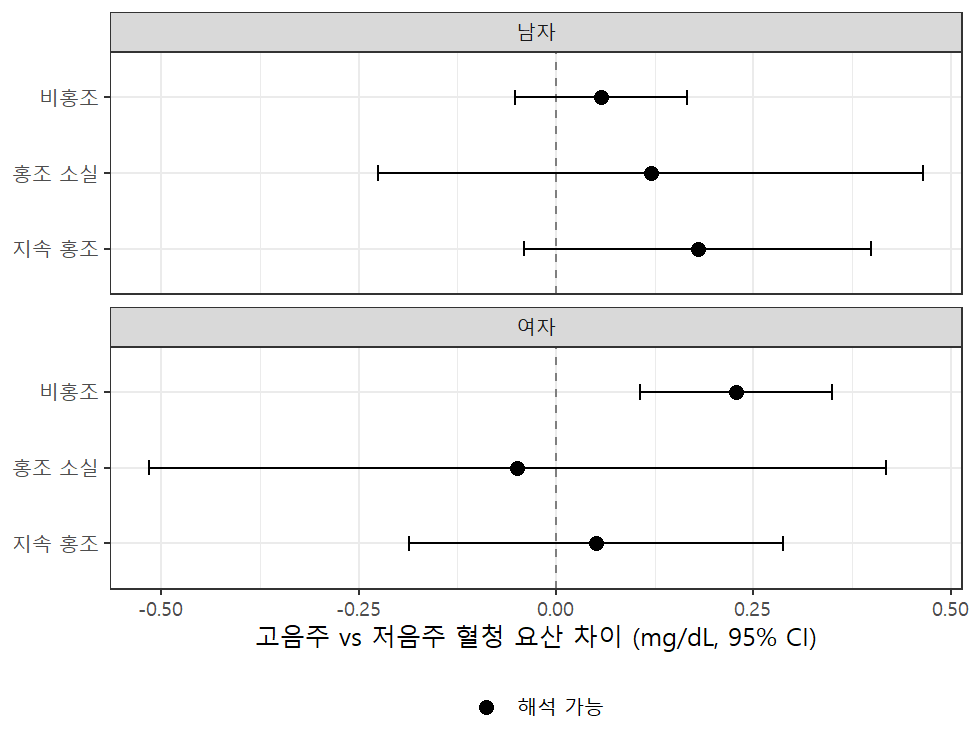
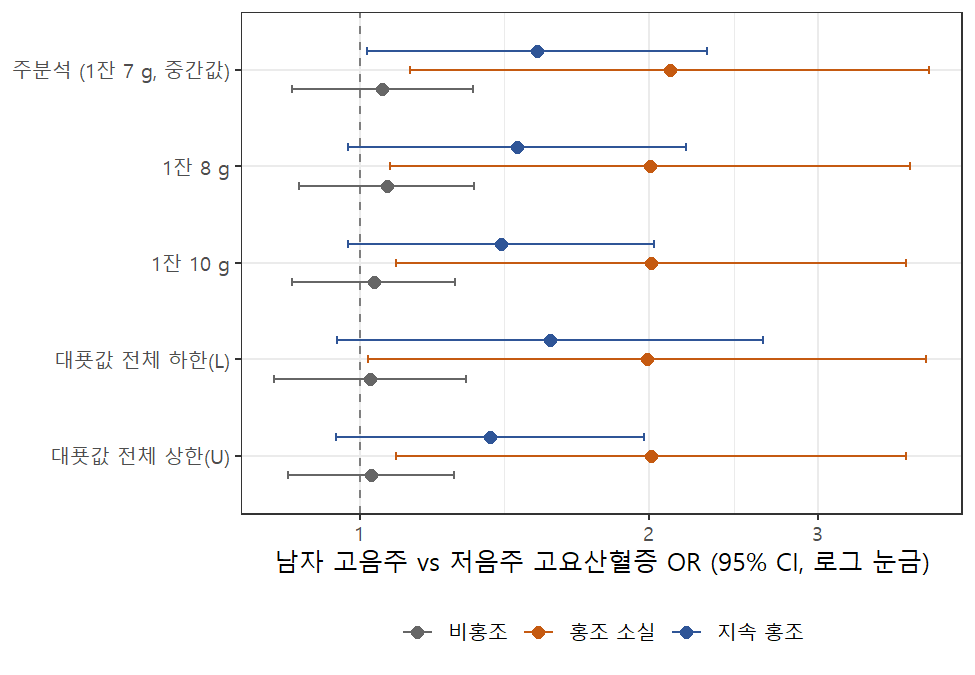

# 주분석 결과: 음주량 × 안면홍조 이력 → 고요산혈증 (확정 기준, 2026-11-23)

작성: 2026-11-23 · team06donga(김준현 요청). 생성형 AI(Claude)로 분석 코드 실행과 정리를 도왔으며, 조원 검토가 필요합니다.

- **분석 코드:** `code/final_analysis.R`(주분석 스위치 켬) → 결과 `output/final_analysis/` → 이 문서 `code/39_main_report.R`
- **표기:** n은 가중치를 적용하지 않은 표본 수, %·평균·OR·β는 복합표본설계(가중치 wt_itvex × 1/3, 층 kstrata, 집락 psu)를 반영한 추정치입니다.
- **기호:** \* p < 0.05 · † 비교하는 칸에 고요산혈증 사례가 10명 미만이라 해석하지 않음

## 0. 한눈에 보는 결과

1. **주질문(지속 홍조 vs 비홍조): 남녀 모두 유의하지 않음.** 남자 p = 0.100, 여자 p = 0.979. 남자 고음주 OR은 비홍조 1.05 (0.85–1.31), 지속 홍조 1.53 (1.02–2.30)로 지속 홍조 쪽이 크지만 그 차이는 통계적으로 확인되지 않았습니다.
2. **부질문(홍조 소실 vs 비홍조): 남자에서 p = 0.043.** 남자 홍조 소실군의 고음주 OR은 2.10 (1.13–3.92)로 비홍조군 1.05 (0.85–1.31)보다 컸습니다. 여자는 소실군 고음주 사례가 5명이라 해석하지 않습니다(†).
3. **보조: 혈청 요산(다중회귀)에서는 남녀 모두 효과수정이 없음.** 주질문 p = 남 0.305, 여 0.204 · 부질문 p = 남 0.734, 여 0.248.
4. **민감도(1잔 8·10 g, 대푯값 하한·상한):** 남자 홍조 소실군의 고음주 OR은 네 분석 모두 약 2.0으로 주분석과 같았고 신뢰구간도 1을 넘었습니다. 다만 부질문 p는 0.063(8 g), 0.042(10 g), 0.068(하한), 0.041(상한)로 경계 근처이며, 4개 중 2개만 0.05 미만입니다.
5. **음주와 고요산혈증 자체:** 남자 비홍조군에서는 고음주(16 g/일 이상)와 고요산혈증이 연관되지 않았고(OR 1.05 (0.85–1.31)), 여자는 비홍조군에서도 연관이 있었습니다(OR 1.65 (1.13–2.40)).
6. **해석:** 가설(지속 홍조군에서 음주–고요산혈증 연관이 더 강함)은 통계적으로 지지되지 않았습니다. 남자 홍조 소실군의 결과는 효과의 방향과 크기가 민감도에서도 일관되지만 p가 경계 근처이고, 분석 조건을 여러 결과를 본 뒤 확정했으므로 확증이 아니라 가설을 만드는 결과로 보고합니다.

## 1. 확정한 분석 조건

| 항목 | 내용 |
| --- | --- |
| 연구 질문 | 주질문(지속 홍조 vs 비홍조), 부질문(홍조 소실 vs 비홍조). 남녀 각각 |
| 주결과 | 고요산혈증(남 ≥ 7.0, 여 ≥ 6.0 mg/dL). 복합표본 로지스틱 회귀 |
| 보조 결과 | 혈청 요산(mg/dL, 연속형). 같은 모형 구조의 복합표본 다중 선형회귀 |
| 음주 기준 | S2: 남 16 g/일, 여 8 g/일 이상을 고음주(2군). Lee 2019 한국인 홍조 기반 절주 지침의 65세 이하 비홍조군 적정 상한(주 8·4표준잔 × 14 g ÷ 7일) |
| 1잔의 알코올 | 7 g(g/일 = 주당 잔 수) |
| 주 모형(Model 2) | 연령, 교육, 소득, 조사연도, **흡연 3범주(비흡연·과거·현재)**, 유산소 신체활동, 폐경 상태(여자만) |
| 효과수정인자 | 홍조 이력 3군: 비홍조(기준) · 홍조 소실 · 지속 홍조. 신규 홍조는 제외. 곱셈 척도 교호작용의 Wald 검정(1 df) |
| 민감도 분석 | 1잔 8 g · 10 g, 음주 대푯값 전체 하한(L) · 전체 상한(U) |
| 하지 않는 분석 | 경향성 분석(이전 부질문 2·3), Model 3, 다른 음주 기준 등. 시도했던 기준은 `output/21_ptest/ptest_log.csv`에 남아 있음 |

## 2. 연구 대상

| 단계 | n | 남 | 여 | 제외 |
| --- | --- | --- | --- | --- |
| 2019-2021 기본DB 전체 | 22559 | 10354 | 12205 |  |
| 가중치 있음(wt_itvex) | 21543 |  9850 | 11693 | 1016 |
| 만 19세 이상 | 17903 |  7942 |  9961 | 3640 |
| 최근 1년 음주자(BD1_11 = 2-6) | 12231 |  6281 |  5950 | 5672 |
| 음주량 계산 가능·과거/현재 홍조 응답·요산 측정 | 12002 |  6152 |  5850 | 229 |
| 통풍 의사진단 없음(진단·모름·무응답 제외) | 11217 |  5628 |  5589 | 785 |
| 보정변수 모두 있음 | 10779 |  5411 |  5368 | 438 |

홍조 이력 분석에는 신규 홍조(남 301명, 여 400명)와 폐경 상태 결측 여자 2명을 빼서 **남 5,110명, 여 4,966명**이 들어갑니다.

## 3. 홍조 이력별 특성

| 성별 | 홍조이력 | n | 나이(세) | 현재흡연 % | 음주 g/일 | 고음주 n (%) | 고요산혈증 n (%) | 혈청 요산 mg/dL |
| --- | --- | --- | --- | --- | --- | --- | --- | --- |
| 남자 | 비홍조 | 3181 | 44.47 (0.34) | 34.1 (1.0) | 15.2 (0.4) | 1000 (30.6) | 765 (25.5) | 6.16 (0.03) |
| 남자 | 홍조 소실 |  341 | 51.74 (0.98) | 42.6 (2.9) | 18.1 (1.2) | 123 (39.6) | 80 (23.8) | 6.06 (0.08) |
| 남자 | 지속 홍조 | 1588 | 44.75 (0.43) | 33.4 (1.4) | 6.4 (0.4) | 194 (11.2) | 294 (19.9) | 6.00 (0.04) |
| 여자 | 비홍조 | 3271 | 43.61 (0.30) | 6.4 (0.5) | 4.8 (0.2) | 529 (17.7) | 273 (8.2) | 4.54 (0.02) |
| 여자 | 홍조 소실 |  236 | 52.11 (1.30) | 9.6 (2.5) | 4.4 (0.5) | 44 (19.1) | 16 (6.8) | 4.56 (0.07) |
| 여자 | 지속 홍조 | 1459 | 43.43 (0.46) | 7.4 (0.9) | 2.3 (0.2) | 108 (7.3) | 102 (6.2) | 4.49 (0.03) |

괄호 안: 나이·음주·요산은 가중 평균(SE), 흡연·고음주·고요산혈증은 가중 %. 전체 특성표는 `output/final_analysis/03_table1.csv`.
성별 전체 고요산혈증: 남 1201명(가중 23.6%), 여 427명(가중 7.7%).

## 4. 주분석: 고요산혈증

### 4-1. 칸별 인원과 가중 유병률

| 성별 | 홍조이력 | 저음주 n (사례, 가중 %) | 고음주 n (사례, 가중 %) |
| --- | --- | --- | --- |
| 남자 | 비홍조 | 2181 (523, 25.8) | 1000 (242, 25.1) |
| 남자 | 홍조 소실 | 218 (43, 18.3) | 123 (37, 32.3) |
| 남자 | 지속 홍조 | 1394 (250, 19.4) | 194 (44, 24.2) |
| 여자 | 비홍조 | 2742 (204, 7.2) | 529 (69, 12.8) |
| 여자 | 홍조 소실 | 192 (11, 5.5) | 44 (5, 12.0) † |
| 여자 | 지속 홍조 | 1351 (87, 5.9) | 108 (15, 11.0) |

저음주: 남 16 g/일 미만, 여 8 g/일 미만. 고음주: 그 이상.

### 4-2. 홍조 이력별 고음주의 OR (저음주 대비)

| 성별 | 홍조이력 | 보정 없음 | **Model 2 (주 모형)** |
| --- | --- | --- | --- |
| 남자 | 비홍조 | 0.96 (0.78–1.19) | 1.05 (0.85–1.31) |
| 남자 | 홍조 소실 | 2.13 (1.15–3.93) | 2.10 (1.13–3.92) |
| 남자 | 지속 홍조 | 1.33 (0.89–1.98) | 1.53 (1.02–2.30) |
| 여자 | 비홍조 | 1.88 (1.33–2.67) | 1.65 (1.13–2.40) |
| 여자 | 홍조 소실 | 2.32 (0.58–9.32) † | 2.27 (0.54–9.52) † |
| 여자 | 지속 홍조 | 1.99 (1.06–3.74) | 1.66 (0.88–3.16) |

### 4-3. 효과수정 검정 p (Wald, 1 df)

| 질문 | 성별 | 보정 없음 | **Model 2 (주 모형)** |
| --- | --- | --- | --- |
| 주질문 | 남자 | 0.157 | 0.100 |
| 주질문 | 여자 | 0.884 | 0.979 |
| 부질문 | 남자 | 0.019* | 0.043* |
| 부질문 | 여자 | 0.774† | 0.660† |
| 탐색: 소실 vs 지속 | 남자 | 0.210 | 0.403 |
| 탐색: 소실 vs 지속 | 여자 | 0.844† | 0.691† |

- 주질문 = 음주 × 지속 홍조, 부질문 = 음주 × 홍조 소실(모두 비홍조 대비, 곱셈 척도). 소실 vs 지속은 탐색으로만 봅니다.

## 5. 보조: 혈청 요산 다중회귀

고음주 vs 저음주 혈청 요산 차이(mg/dL, 95% CI):

| 성별 | 홍조이력 | 보정 없음 | **Model 2** |
| --- | --- | --- | --- |
| 남자 | 비홍조 | -0.00 (-0.11, 0.10) | 0.06 (-0.05, 0.17) |
| 남자 | 홍조 소실 | 0.16 (-0.20, 0.52) | 0.12 (-0.23, 0.47) |
| 남자 | 지속 홍조 | 0.08 (-0.16, 0.31) | 0.18 (-0.04, 0.40) |
| 여자 | 비홍조 | 0.26 (0.14, 0.38) | 0.23 (0.11, 0.35) |
| 여자 | 홍조 소실 | -0.01 (-0.48, 0.46) | -0.05 (-0.52, 0.42) |
| 여자 | 지속 홍조 | 0.09 (-0.15, 0.33) | 0.05 (-0.19, 0.29) |

효과수정 검정 p:

| 질문 | 성별 | 보정 없음 | **Model 2** |
| --- | --- | --- | --- |
| 주질문 | 남자 | 0.531 | 0.305 |
| 주질문 | 여자 | 0.218 | 0.204 |
| 부질문 | 남자 | 0.395 | 0.734 |
| 부질문 | 여자 | 0.267 | 0.248 |
| 탐색: 소실 vs 지속 | 남자 | 0.701 | 0.778 |
| 탐색: 소실 vs 지속 | 여자 | 0.720 | 0.709 |

## 6. 민감도 분석

| 민감도 | 바꾼 가정 |
| --- | --- |
| 1잔 8 g | 1잔의 알코올 7 g → 8 g(Lee 2023 국건영 환산) |
| 1잔 10 g | 7 g → 10 g |
| 대푯값 전체 하한(L) | 빈도·1회량을 범주 하한으로(예: 주2-3회 → 주 2, 1-2잔 → 1잔) |
| 대푯값 전체 상한(U) | 빈도·1회량을 범주 상한으로(예: 주4회이상 → 주 7, 1-2잔 → 2잔) |

고요산혈증 효과수정 p:

| 분석 | 남 주질문 | 남 부질문 | 여 주질문 | 여 부질문 | 남 소실군 OR | 남 비홍조 OR |
| --- | --- | --- | --- | --- | --- | --- |
| 주분석 | 0.100 | 0.043* | 0.979 | 0.660† | 2.10 (1.13–3.92) | 1.05 (0.85–1.31) |
| 민감도: 1잔 8 g | 0.164 | 0.063 | 0.960 | 0.645† | 2.00 (1.07–3.74) | 1.07 (0.87–1.32) |
| 민감도: 1잔 10 g | 0.143 | 0.042* | 0.930 | 0.439† | 2.01 (1.09–3.70) | 1.03 (0.85–1.26) |
| 민감도: 대푯값 전체 하한(L) | 0.121 | 0.068 | 0.745 | 0.604† | 1.99 (1.02–3.88) | 1.02 (0.81–1.29) |
| 민감도: 대푯값 전체 상한(U) | 0.176 | 0.041* | 0.859 | 0.481† | 2.01 (1.09–3.70) | 1.03 (0.84–1.25) |

- 대푯값 정의: `Result/2026-11-18_음주대표값_민감도분석_계획.md` 4–5절. 10잔 이상은 직접 적은 잔 수라 바꾸지 않았습니다.
- 판정: p < 0.05 유지 여부가 아니라 OR의 방향과 크기가 주분석과 같은지로 봅니다.

## 7. 해석할 때 주의할 점(한계)

- **결과를 본 뒤 확정:** 음주 기준(S2), 1잔 7 g, 흡연 3범주, 분석 범위(경향성 제외, 민감도 4개)는 여러 기준·모형의 p를 본 뒤(2026-11-16 ~ 11-23) 정했습니다. 보고서에 이 사실과 시도한 기준 전체(`output/21_ptest/ptest_log.csv`)를 밝힙니다.
- **다중 비교:** 성별 2 × 질문 2 × 결과 2의 검정 중 유의한 것은 남자 부질문 하나입니다. 단일 p < 0.05보다 OR의 방향과 크기의 일관성을 봅니다.
- **작은 군:** 남자 홍조 소실군 341명(고음주 123명), 여자 소실군 236명(고음주 44명, 사례 5명)입니다.
- **단면 자료·자기 보고:** 음주량은 설문 범주의 대푯값으로 계산했고, 홍조 이력은 회상에 의존합니다. 홍조 소실은 음주 습관 변화(내성)와 얽혀 있을 수 있습니다.
- **1잔의 g:** 지침서에 1잔의 알코올 g이 없어 7 g(지역사회건강조사 연구 Jeon 2022의 값)을 썼습니다.

## 8. 검증

- **공식 통계 대조:** 2019년 만 19세 이상 월간음주율·고위험음주율(KOSIS) 6개 지표 모두 '일치'.
- **대상자 흐름:** README·계획서 3장의 단계별 인원과 같습니다(`02b_flow_vs_README.csv`).
- **ptest와 대조:** 주 모형 p(남 주질문 0.100, 부질문 0.043, 여 주질문 0.979, 혈청 요산 남 0.305·여 0.204)가 `/knhanes_ptest` S2a 실행의 흡연 3범주 묶음(M2S)과 같습니다.
- **재현성:** 코드를 짜지 않은 조원이 `Rscript --vanilla code/final_analysis.R`를 새 세션에서 두 번 실행해 결과가 같은지 확인해야 합니다(계획서 8.2, 아직 안 함).

## 9. 결과 파일

| 파일 | 내용 |
| --- | --- |
| 02a_participant_flow.csv | 대상자 선정 흐름 |
| 03_table1.csv | 대상자 특성표(성별 × 홍조 패턴) |
| 10_interaction_tests.csv | 모든 분석의 효과수정 검정 p |
| 11_effects_by_flush.csv | 홍조 이력별 OR·β와 95% CI |
| 12_cell_counts.csv | 칸별 n·사례·가중 유병률 |
| 13_outcome_by_flush.csv | 홍조 이력별 음주·결과 요약 |
| 06_official_check.csv | 공식 통계 대조 |

모두 `output/final_analysis/`에 있습니다.
