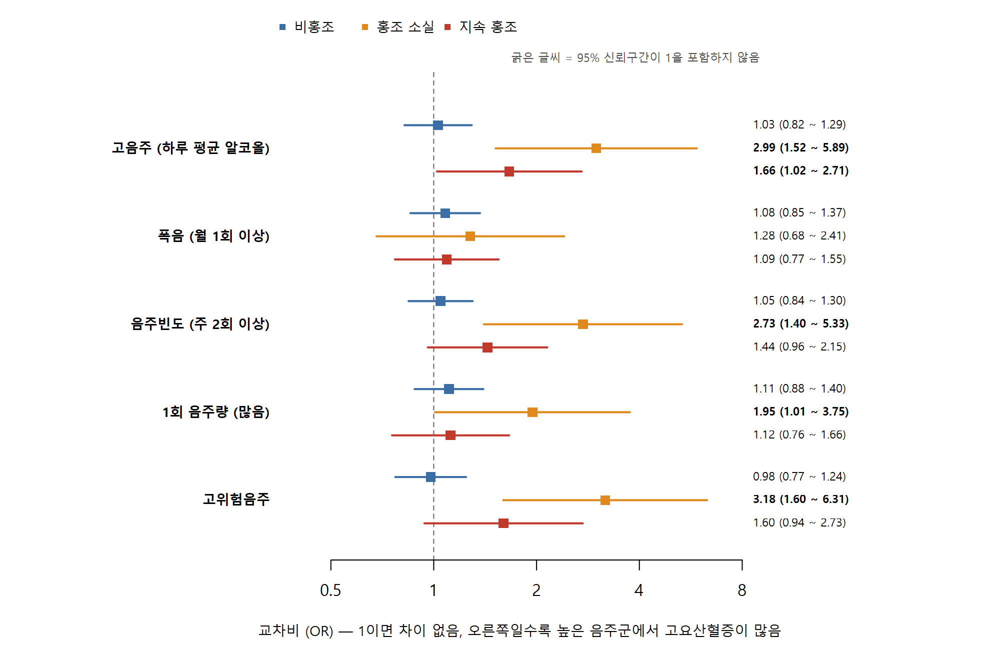
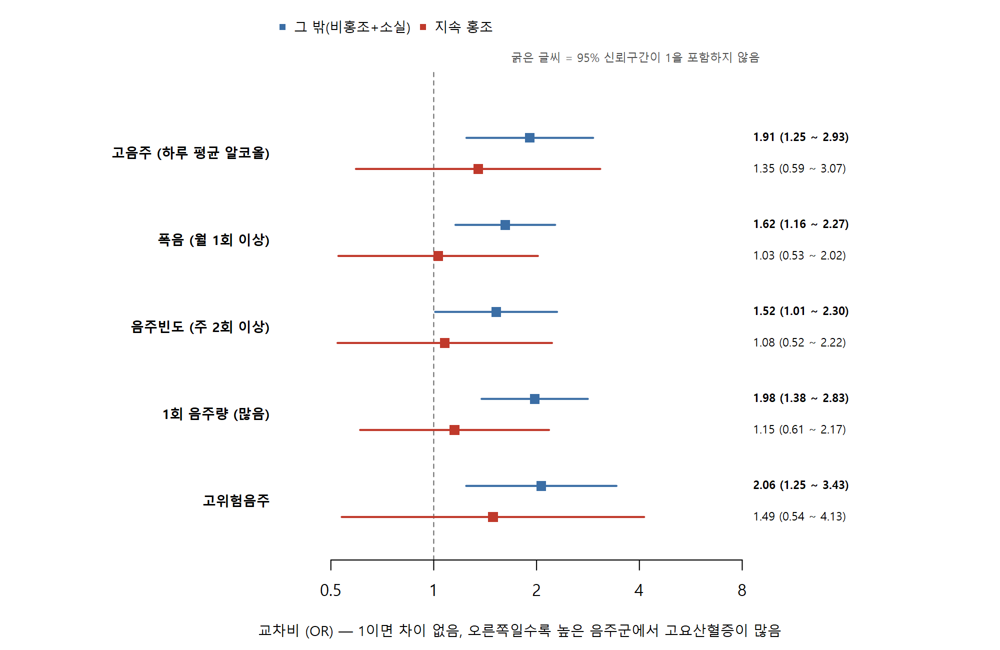

# 음주 지표를 바꿔 본 추가분석: 홍조 이력에 따라 음주와 고요산혈증의 관계가 다른가?

- 작성: arahan90wany-gif (GitHub 계정) · 2026-11-23
- 생성형 AI(Claude)의 도움을 받아 분석하고 정리했다. 조원 검토가 필요하다.
- 출처: 개인 저장소(`arahan90wany-gif/knhanes-analysis`, 비공개)의 `code/03`~`code/06` 실행 결과. 분석 코드는 이 팀 저장소의 `code/`에 올리지 않았다(파일 번호가 겹침). 필요하면 요청해서 받는다.
- 국건영 원시자료는 올리지 않았고, 집계된 결과(n, 비율, 교차비, p값)만 담았다.
- **팀 확정사항과의 관계:** 팀은 보정 모형을 Crude · M2S · M3S 세 가지만 쓰기로 확정했다. 이 보고서의 모형 2는 M2S, 모형 3은 M3S에 해당한다(연령·조사연도·교육·소득·흡연 3범주·유산소 신체활동·폐경 + M3S는 체질량지수·고혈압·당뇨병·eGFR). 모형 1(연령·조사연도만)은 팀이 쓰지 않기로 한 모형이라 **표에 참고로만 남겼고 본문 해석은 모형 3 기준**이다. 음주 기준 16·8 g/일(하루 기준)은 회의 결정이다.

> **상태: 조원 검토 필요 (2026-11-23 초안)**
> 자료: 국민건강영양조사 제8기(2019–2021) 원시자료
> 모든 숫자는 연구 대상자 중 필요한 정보가 모두 있는 **10,078명(남 5,112 / 여 4,966)** 에서 계산했습니다. 표본 수(n)는 가중치를 쓰지 않은 실제 사람 수이고, 비율·교차비 같은 추정치는 복합표본설계(가중치 `wt_itvex`, 층 `kstrata`, 집락 `psu`)를 반영한 값입니다.

---

## 1. 한눈에 보는 결론

1. **남자:** 하루 평균 알코올량(g/일)과 고위험음주로 보면, **홍조 이력에 따라 음주와 고요산혈증의 관계가 다릅니다**(상호작용 p = 0.010, 0.009).
   - 한 번도 홍조가 없었던 남자(비홍조)는 많이 마셔도 고요산혈증이 거의 늘지 않았습니다(교차비 1.03).
   - 과거에 홍조가 있었던 남자는 많이 마시면 고요산혈증이 뚜렷하게 늘었습니다(홍조 소실 2.99, 지속 홍조 1.66).
2. **남자인데 결과가 다른 지표도 있습니다.** 폭음(p = 0.795)과 1회 음주량(p = 0.303)으로 보면 홍조 이력에 따른 차이가 없습니다. 음주빈도는 p = 0.050으로 경계선입니다.
3. **여자:** 5개 지표 모두에서 **지속 홍조군은 음주와 고요산혈증의 관계가 약해 보입니다**(교차비 1.03~1.49, 그 밖의 군은 1.52~2.06). 하지만 "두 군이 다르다"고 말할 만큼 통계적 근거는 부족합니다(모형 3 기준 상호작용 p = 0.22~0.85).
4. **조심할 점:** 검정을 많이 했고, 지표들이 서로 겹치며, 홍조 소실군의 인원이 적습니다. 이 결과는 **확정이 아니라 "가능성을 보여 주는 탐색 결과"** 로 읽어야 합니다.

---

## 2. 이 분석은 무엇을 알아보려는 것인가

**연구 질문:** 남녀 각각에서, 음주 수준과 고요산혈증의 관계는 **지속 홍조군과 비홍조군 사이에서 다른가?**

원래 계획서의 주분석은 "하루 평균 알코올량(g/일)"으로 음주 수준을 나누는 것이었습니다. 이 보고서는 음주를 **다른 방식으로 재도 같은 결론이 나오는지** 확인한 추가분석입니다. 음주를 재는 방법이 달라도 결과가 같으면 결론을 더 믿을 수 있고, 다르면 어떤 음주 습관이 중요한지 단서가 됩니다.

### 누구를 분석했나

- 최근 1년 안에 술을 마신 만 19세 이상 성인
- 통풍 진단을 받았거나 진단 여부를 모르는 사람은 제외 (요산 수치에 영향을 주기 때문)
- 과거에는 홍조가 없었는데 지금 홍조가 생긴 사람(신규 홍조)은 제외

### 홍조 이력은 어떻게 나눴나

| 구분 | 뜻 | 남자 n | 여자 n |
|---|---|---:|---:|
| 비홍조 | 과거에도 현재도 술 마시면 얼굴이 빨개지지 않음 | 3,182 | 3,271 |
| 홍조 소실 | 과거에는 빨개졌지만 지금은 아님 | 341 | 236 |
| 지속 홍조 | 과거에도 빨개졌고 지금도 가끔·자주·늘 빨개짐 | 1,589 | 1,459 |

- 남자는 3군으로 모두 분석했습니다.
- **여자는 홍조 소실군이 236명뿐이라** "지속 홍조"와 "그 밖의 군(비홍조 + 홍조 소실)" 2군으로 나눠 분석했습니다.

### 고요산혈증의 기준

혈청 요산이 남자 7.0 mg/dL 초과, 여자 6.0 mg/dL 초과일 때입니다. 요산 수치 자체(연속값)도 함께 분석했습니다.

---

## 3. 숫자를 읽는 방법 (용어 풀이)

| 용어 | 쉬운 설명 | 읽는 법 |
|---|---|---|
| **교차비 (OR)** | 음주가 "많은 군"이 "적은 군"보다 고요산혈증이 얼마나 더 흔한지 | **1이면 차이 없음.** 1.5면 약 1.5배 더 흔함(정확히는 "오즈"의 비). 1보다 작으면 오히려 덜 흔함 |
| **95% 신뢰구간** | 진짜 값이 이 범위 안에 있을 것이라고 95% 믿을 수 있는 범위 | **범위가 1을 포함하면** "차이가 있다"고 말하기 어렵습니다. 범위가 넓으면 사람이 적어서 추정이 불확실하다는 뜻입니다 |
| **p값** | 실제로는 차이가 없는데 우연히 이 정도 차이가 나올 가능성 | 보통 **0.05보다 작으면** "우연으로 보기 어렵다"고 판단합니다 |
| **상호작용 p값** | "홍조 이력에 따라 음주–고요산혈증 관계가 달라지는가"를 직접 따지는 p값 | **이 보고서의 핵심 숫자입니다.** 작을수록 홍조 이력에 따라 관계가 다르다는 근거가 강합니다 |
| **β (베타)** | 음주가 많은 군의 평균 요산이 적은 군보다 몇 mg/dL 더 높은지 | 0이면 차이 없음. 신뢰구간이 0을 포함하면 차이 있다고 말하기 어렵습니다 |
| **모형 1 / 2 / 3** | 다른 영향을 얼마나 걸러 냈는지 | 모형 1: 나이·조사연도만 보정. 모형 2: + 교육·소득·흡연·유산소 운동(여자는 폐경 상태도). 모형 3: + 체질량지수·고혈압·당뇨병·신장 기능(eGFR). **이 보고서의 본문은 가장 많이 보정한 모형 3** 입니다 |

> **표에서 굵은 글씨**는 "신뢰구간이 1(β는 0)을 포함하지 않음" 또는 "p < 0.05"를 뜻합니다.

---

## 4. 음주 지표 5개

모든 지표는 **"높음 / 낮음" 두 군**으로 나눴습니다. 기준은 남녀가 다르므로 **남자와 여자를 따로** 분석했고 남녀를 직접 비교하지 않았습니다.

| 지표 | "높음"의 기준 | 설문 변수(지침서 쪽) |
|---|---|---|
| ① 고음주 (하루 평균 알코올) | 남자 16 g/일 초과, 여자 8 g/일 초과 | `BD1_11`, `BD2_1`, `BD2_14` (p.153). 1잔 = 7 g으로 가정(연구자 가정) |
| ② 폭음 | 한 번의 술자리에서 남자 7잔·여자 5잔 이상 마시는 일이 월 1회 이상 | 남자 `BD2_31`, 여자 `BD2_32` (p.153, 문항 p.154) |
| ③ 음주빈도 | 주 2회 이상 마심 | `BD1_11` 5·6 (p.153) |
| ④ 1회 음주량 | 한 번에 남자 7잔 이상, 여자 5잔 이상 | `BD2_1` (p.153) |
| ⑤ 고위험음주 | ③과 ④를 모두 만족 (질병관리청 지표 정의) | p.40 |

**지표들은 서로 겹칩니다.** ①은 빈도와 1회 음주량을 곱해 만들고, ⑤는 ③과 ④를 합친 것이라, 각각이 완전히 독립된 확인이 아닙니다.

---

## 5. 대상자 특징

### 음주 "높음"에 해당하는 사람의 수와 비율 (n = 높음 인원 / 전체, 괄호는 가중 %)

| 성별·홍조 | ① 고음주 | ② 폭음 | ③ 음주빈도 | ④ 1회 음주량 | ⑤ 고위험음주 |
|---|---:|---:|---:|---:|---:|
| 남자·비홍조 | 1,000/3,182 (30.6%) | 2,124/3,182 (67.6%) | 1,444/3,182 (42.8%) | 1,672/3,182 (55.1%) | 862/3,182 (26.9%) |
| 남자·홍조 소실 | 124/341 (39.8%) | 225/341 (70.2%) | 183/341 (53.1%) | 161/341 (53.1%) | 101/341 (33.7%) |
| 남자·지속 홍조 | 194/1,589 (11.2%) | 545/1,589 (33.9%) | 340/1,589 (19.3%) | 401/1,589 (26.1%) | 152/1,589 (8.8%) |
| 여자·비홍조 | 529/3,271 (17.7%) | 1,061/3,271 (35.2%) | 601/3,271 (18.7%) | 943/3,271 (31.6%) | 292/3,271 (9.3%) |
| 여자·홍조 소실 | 44/236 (19.1%) | 70/236 (32.7%) | 53/236 (22.8%) | 50/236 (21.8%) | 25/236 (11.2%) |
| 여자·지속 홍조 | 108/1,459 (7.3%) | 260/1,459 (18.6%) | 150/1,459 (10.2%) | 207/1,459 (15.7%) | 60/1,459 (4.0%) |

**눈에 띄는 점:** 지속 홍조군은 어떤 지표로 봐도 "많이 마시는 사람"의 비율이 비홍조군의 절반 이하입니다. 얼굴이 쉽게 빨개지는 체질이라 덜 마시게 되는 것으로 보입니다.

### 고요산혈증 유병률 (가중 %)

| | 비홍조 | 홍조 소실 | 지속 홍조 |
|---|---:|---:|---:|
| 남자 | 22.9% | 21.9% | 18.6% |
| 여자 | 6.9% | 5.5% | 5.9% |

### 분석 칸별 인원 (비가중 n)

여자의 홍조 소실군은 "그 밖의 군"에 합쳤습니다.

| 성별·홍조 | 전체 n | 고요산혈증 사례 수 | ① 고음주 n | ② 폭음 n | ③ 빈도 n | ④ 1회량 n | ⑤ 고위험 n |
|---|---:|---:|---:|---:|---:|---:|---:|
| 남자·비홍조 | 3,182 | 696 | 1,000 | 2,124 | 1,444 | 1,672 | 862 |
| 남자·홍조 소실 | 341 | 73 | 124 | 225 | 183 | 161 | 101 |
| 남자·지속 홍조 | 1,589 | 270 | 194 | 545 | 340 | 401 | 152 |
| 여자·그 밖(비홍조+소실) | 3,507 | 243 | 573 | 1,131 | 654 | 993 | 317 |
| 여자·지속 홍조 | 1,459 | 94 | 108 | 260 | 150 | 207 | 60 |

---

## 6. 결과 ① 남자

### 6-1. 홍조 군별로 따로 본 결과 (모형 3)

"음주 높음 군이 낮음 군보다 고요산혈증이 몇 배 더 흔한가"입니다. 아래 그림에서 점은 교차비, 가로선은 95% 신뢰구간입니다. **가로선이 점선(1)을 넘어서 오른쪽에만 있으면 의미 있는 차이**입니다.

| 음주 지표 | 비홍조 | 홍조 소실 | 지속 홍조 |
|---|---:|---:|---:|
| ① 고음주 (하루 평균 알코올) | 1.03 (0.82 ~ 1.29) | **2.99 (1.52 ~ 5.89)** | **1.66 (1.02 ~ 2.71)** |
| ② 폭음 (월 1회 이상) | 1.08 (0.85 ~ 1.37) | 1.28 (0.68 ~ 2.41) | 1.09 (0.77 ~ 1.55) |
| ③ 음주빈도 (주 2회 이상) | 1.05 (0.84 ~ 1.30) | **2.73 (1.40 ~ 5.33)** | 1.44 (0.96 ~ 2.15) |
| ④ 1회 음주량 (많음) | 1.11 (0.88 ~ 1.40) | **1.95 (1.01 ~ 3.75)** | 1.12 (0.76 ~ 1.66) |
| ⑤ 고위험음주 | 0.98 (0.77 ~ 1.24) | **3.18 (1.60 ~ 6.31)** | 1.60 (0.94 ~ 2.73) |

*값 = 교차비 (95% 신뢰구간)*

**읽는 법 (예: ① 고음주):** 비홍조 남자는 고음주군과 저음주군의 고요산혈증 위험이 비슷합니다(1.03, 구간이 1을 포함). 홍조 소실 남자는 고음주군이 약 3배 더 흔하고(2.99, 구간이 1보다 오른쪽), 지속 홍조 남자는 약 1.7배입니다(1.66).

### 6-2. 홍조 이력에 따라 관계가 다른가? (상호작용 p값)

"세 군의 교차비가 서로 다르다고 볼 수 있는가"를 직접 검정한 p값입니다.

**홍조 3군 비교 (비홍조 / 홍조 소실 / 지속 홍조), 결과 = 고요산혈증**

| 음주 지표 | 모형 1 | 모형 2 | 모형 3 |
|---|---:|---:|---:|
| ① 고음주 (하루 평균 알코올) | **0.032** | **0.029** | **0.010** |
| ② 폭음 (월 1회 이상) | 0.836 | 0.844 | 0.795 |
| ③ 음주빈도 (주 2회 이상) | 0.056 | 0.060 | **0.050** |
| ④ 1회 음주량 (많음) | 0.494 | 0.522 | 0.303 |
| ⑤ 고위험음주 | **0.017** | **0.016** | **0.009** |

**지속 홍조 대 그 밖의 군(비홍조 + 홍조 소실) 2군 비교**

| 음주 지표 | 모형 1 | 모형 2 | 모형 3 |
|---|---:|---:|---:|
| ① 고음주 (하루 평균 알코올) | 0.206 | 0.171 | 0.098 |
| ② 폭음 (월 1회 이상) | 0.563 | 0.575 | 0.608 |
| ③ 음주빈도 (주 2회 이상) | 0.183 | 0.169 | 0.220 |
| ④ 1회 음주량 (많음) | 0.652 | 0.694 | 0.641 |
| ⑤ 고위험음주 | 0.191 | 0.157 | 0.105 |

**해석**

- 3군으로 비교하면 ①과 ⑤에서 p < 0.05입니다. 보정을 더 할수록 p가 오히려 작아져 결과가 보정에 흔들리지 않았습니다.
- 그런데 2군(지속 홍조 대 그 밖)으로 합쳐 보면 p가 0.10 안팎으로 커집니다. 차이를 만든 주된 군이 **홍조 소실군**이고, 소실군을 비홍조군과 합치면 효과가 희석되기 때문입니다.
- 홍조 소실군의 교차비(약 3배)가 지속 홍조군(약 1.7배)보다 더 컸습니다. 하지만 소실군은 341명(사례 73건)뿐이라 **신뢰구간이 매우 넓어서**(예: 1.52 ~ 5.89) 두 군의 크기를 비교할 수는 없습니다.
- ③ 음주빈도의 p = 0.050은 정확히는 0.0496으로 경계선입니다. "유의하다"고 단정하지 않고 "경계선"으로 적습니다.

### 6-3. 요산 수치(연속값)로 보면 (모형 3)

음주 "높음" 군이 "낮음" 군보다 평균 혈청 요산이 몇 mg/dL 더 높은지입니다. 값 = β (95% 신뢰구간).

| 음주 지표 | 비홍조 | 홍조 소실 | 지속 홍조 |
|---|---:|---:|---:|
| ① 고음주 (하루 평균 알코올) | 0.10 (-0.01 ~ 0.20) | 0.18 (-0.15 ~ 0.52) | **0.26 (0.04 ~ 0.47)** |
| ② 폭음 (월 1회 이상) | **0.14 (0.04 ~ 0.24)** | 0.07 (-0.26 ~ 0.40) | **0.17 (0.04 ~ 0.30)** |
| ③ 음주빈도 (주 2회 이상) | 0.08 (-0.02 ~ 0.18) | 0.22 (-0.07 ~ 0.52) | 0.17 (-0.01 ~ 0.34) |
| ④ 1회 음주량 (많음) | **0.14 (0.04 ~ 0.24)** | 0.24 (-0.07 ~ 0.56) | 0.13 (-0.05 ~ 0.32) |
| ⑤ 고위험음주 | 0.07 (-0.03 ~ 0.18) | 0.29 (-0.07 ~ 0.66) | 0.22 (-0.02 ~ 0.46) |

- 요산 수치로 보면 **홍조 군별 차이가 뚜렷하지 않습니다.** 상호작용 p값이 모든 지표에서 0.35 이상입니다(모형 3: ① 0.358, ② 0.787, ③ 0.506, ④ 0.697, ⑤ 0.365).
- 고요산혈증(기준선을 넘는지 여부)에서만 홍조 소실군의 위험이 크게 나타났다는 점을 기억해야 합니다.

---

## 7. 결과 ② 여자

### 7-1. 홍조 군별로 따로 본 결과 (모형 3)

| 음주 지표 | 그 밖(비홍조+소실) | 지속 홍조 |
|---|---:|---:|
| ① 고음주 (하루 평균 알코올) | **1.91 (1.25 ~ 2.93)** | 1.35 (0.59 ~ 3.07) |
| ② 폭음 (월 1회 이상) | **1.62 (1.16 ~ 2.27)** | 1.03 (0.53 ~ 2.02) |
| ③ 음주빈도 (주 2회 이상) | **1.52 (1.01 ~ 2.30)** | 1.08 (0.52 ~ 2.22) |
| ④ 1회 음주량 (많음) | **1.98 (1.38 ~ 2.83)** | 1.15 (0.61 ~ 2.17) |
| ⑤ 고위험음주 | **2.06 (1.25 ~ 3.43)** | 1.49 (0.54 ~ 4.13) |

*값 = 교차비 (95% 신뢰구간)*

- **그 밖의 군(주로 비홍조)** 에서는 5개 지표 모두 음주가 많을수록 고요산혈증이 1.5~2.1배 더 흔했고, 신뢰구간이 모두 1보다 오른쪽입니다.
- **지속 홍조군** 에서는 교차비가 1.03~1.49로 낮고 신뢰구간이 1을 포함합니다. 다만 지속 홍조군에서 음주 "높음"인 여자가 60~260명, 고요산혈증 사례가 94건뿐이어서 **구간이 매우 넓습니다**(예: 0.54 ~ 4.13). "관계가 없다"가 아니라 "있는지 없는지 알기 어렵다"가 정확한 표현입니다.

### 7-2. 홍조 이력에 따라 관계가 다른가? (상호작용 p값)

**결과 = 고요산혈증**

| 음주 지표 | 모형 1 | 모형 2 | 모형 3 |
|---|---:|---:|---:|
| ① 고음주 (하루 평균 알코올) | 0.774 | 0.675 | 0.705 |
| ② 폭음 (월 1회 이상) | 0.238 | 0.203 | 0.301 |
| ③ 음주빈도 (주 2회 이상) | 0.732 | 0.687 | 0.643 |
| ④ 1회 음주량 (많음) | 0.084 | 0.086 | 0.223 |
| ⑤ 고위험음주 | 0.995 | 0.962 | 0.848 |

→ **모든 p값이 0.05보다 큽니다.** 여자에서는 고요산혈증 기준으로 "홍조 이력에 따라 관계가 다르다"는 통계적 근거를 찾지 못했습니다. (④ 1회 음주량은 모형 1·2에서 0.08 수준이지만 모형 3에서 0.223으로 커집니다.)

### 7-3. 요산 수치(연속값)로 보면 (모형 3)

| 음주 지표 | 그 밖(비홍조+소실) | 지속 홍조 |
|---|---:|---:|
| ① 고음주 (하루 평균 알코올) | **0.19 (0.08 ~ 0.31)** | 0.03 (-0.18 ~ 0.25) |
| ② 폭음 (월 1회 이상) | **0.13 (0.05 ~ 0.22)** | -0.02 (-0.16 ~ 0.12) |
| ③ 음주빈도 (주 2회 이상) | **0.14 (0.04 ~ 0.24)** | 0.06 (-0.12 ~ 0.23) |
| ④ 1회 음주량 (많음) | **0.16 (0.07 ~ 0.26)** | 0.05 (-0.10 ~ 0.20) |
| ⑤ 고위험음주 | **0.27 (0.12 ~ 0.42)** | 0.19 (-0.07 ~ 0.46) |

**상호작용 p값 (요산 수치, 지속 홍조 대 그 밖)**

| 음주 지표 | 모형 1 | 모형 2 | 모형 3 |
|---|---:|---:|---:|
| ① 고음주 (하루 평균 알코올) | 0.281 | 0.249 | 0.219 |
| ② 폭음 (월 1회 이상) | **0.034** | **0.024** | 0.056 |
| ③ 음주빈도 (주 2회 이상) | 0.561 | 0.529 | 0.416 |
| ④ 1회 음주량 (많음) | **0.046** | **0.040** | 0.120 |
| ⑤ 고위험음주 | 0.632 | 0.605 | 0.449 |

- 요산 수치로 보면 ②(폭음)과 ④(1회 음주량)에서 **모형 1·2는 p < 0.05**, 모형 3은 p = 0.056, 0.120으로 커집니다. 신체 조건(체질량지수·고혈압·당뇨병·신장 기능)까지 보정하면 차이가 약해진다는 뜻입니다. 방향은 일관되지만(지속 홍조군에서 관계가 약함) **확실하다고 말하기는 어렵습니다.**

---

## 8. 홍조와 음주가 "합쳐서" 위험을 더 키우는가 (덧셈 상호작용, RERI)

지속 홍조이면서 음주도 많은 경우의 위험이, "홍조의 효과 + 음주의 효과"를 단순히 더한 것보다 큰지(0보다 큼) 작은지(0보다 작음)를 보는 지표입니다. **0이면 단순 합**이고, 신뢰구간이 0을 포함하면 차이가 있다고 말하기 어렵습니다. (모형 3)

| 음주 지표 | 남자 RERI (95% 신뢰구간) | 여자 RERI (95% 신뢰구간) |
|---|---:|---:|
| ① 고음주 (하루 평균 알코올) | 0.38 (-0.17 ~ 0.94) | -0.32 (-1.67 ~ 1.02) |
| ② 폭음 (월 1회 이상) | 0.07 (-0.28 ~ 0.43) | -0.52 (-1.40 ~ 0.37) |
| ③ 음주빈도 (주 2회 이상) | 0.22 (-0.20 ~ 0.64) | -0.29 (-1.27 ~ 0.70) |
| ④ 1회 음주량 (많음) | 0.06 (-0.33 ~ 0.45) | -0.67 (-1.68 ~ 0.34) |
| ⑤ 고위험음주 | 0.41 (-0.19 ~ 1.01) | -0.28 (-2.08 ~ 1.52) |

→ **모든 신뢰구간이 0을 포함합니다.** 남자는 대체로 양(+), 여자는 대체로 음(-)의 방향이지만 통계적으로 확인된 것은 없습니다. 이 분석은 참고용입니다.

---

## 9. 결과를 해석할 때 조심할 점

1. **검정을 많이 했습니다.** 지표 5개 × 결과 2개(고요산혈증, 요산 수치) × 모형 3개를 각각 검정했습니다. 검정을 많이 하면 우연히 p < 0.05가 나오는 경우가 생기므로, 이 보고서는 별도의 보정을 하지 않은 **탐색적 분석**입니다. 남자 3군 상호작용(고요산혈증, 모형 3)만 보면 5개 중 3개가 p ≤ 0.05입니다(①, ⑤, 경계선인 ③).
2. **지표가 서로 겹칩니다.** ①(하루 평균 알코올)과 ⑤(고위험음주)는 같은 문항에서 만든 지표라 따로 확인한 결과가 아니라 비슷한 정보의 반복입니다. 남자의 의미 있는 두 결과도 사실상 "하나의 관찰"에 가깝습니다.
3. **지표에 따라 결과가 갈립니다.** 폭음(②)과 1회 음주량(④)에서는 남자의 홍조 이력 차이가 없었습니다. "총량·빈도가 중요한가, 한 번에 많이 마시는 습관이 중요한가"는 이 자료만으로 결론낼 수 없습니다.
4. **홍조 소실군이 작습니다.** 남자 341명(사례 73건), 여자 236명입니다. 남자 소실군의 큰 교차비(약 3배)는 신뢰구간이 매우 넓습니다.
5. **지속 홍조군은 애초에 덜 마십니다.** 어떤 지표로 봐도 "높음"에 해당하는 비율이 비홍조군의 절반 이하입니다(5절). 그래서 지속 홍조군의 추정치는 비교적 불확실합니다.
6. **단면조사입니다.** 같은 시점에 음주와 요산을 측정했으므로 "음주가 요산을 올렸다"는 인과관계를 확인할 수는 없습니다.
7. **기준값은 연구 정의입니다.** 16 g/일과 8 g/일 기준, 1잔 = 7 g 가정, 남녀별 폭음·1회 음주량 기준은 지침서에 있는 정의가 아니라 연구팀의 결정(또는 지침서 지표 정의)입니다. 기준을 바꾸면 결과가 달라질 수 있어 민감도분석이 필요합니다.
8. **여자 홍조 소실군은 따로 보지 못했습니다.** 고음주 칸이 44명(사례 4건)뿐이라 "그 밖의 군"에 합쳤습니다.

---

## 10. 다음 단계 제안

- 주분석(하루 평균 알코올 g/일)을 중심에 두고 이 보고서의 분석을 추가분석으로 보고
- 홍조 소실군이 비홍조군에 가까운지 지속 홍조군에 가까운지 확인하는 결합군 분석의 결과 정리 (결과 파일에는 있음)
- 기준 변경(경계 이상/초과, 14·7 g/일 등), 2020년 제외, 홍조 정의 변경 등 민감도분석
- 소실군 효과의 크기가 안정적인지 보기 위한 별도 검토

---

## 부록

### 분석 방법

- **자료:** 제8기(2019–2021) 원시자료. 3개년 통합가중치는 `wt_itvex / 3` (제8기 이용지침서 p.28).
- **복합표본설계:** 가중치 `wt_itvex`(p.84), 층 `kstrata`(p.84), 집락 `psu`(p.83). 하위집단은 자료를 자르지 않고 설계를 유지한 채 분석했습니다(R `survey` 패키지).
- **회귀:** 고요산혈증은 복합표본 로지스틱 회귀(교차비), 혈청 요산은 복합표본 선형 회귀(β). 95% 신뢰구간은 t 분포 기준입니다.
- **상호작용 검정:** `음주 × 홍조` 항을 모형에 넣고 Wald 검정(`regTermTest`).
- **덧셈 상호작용(RERI):** 지속 홍조(이분형) × 음주 높음 항으로 계산하고 델타법으로 신뢰구간 산출.
- **표본:** 모형 1~3을 같은 표본(공변량이 모두 있는 10,078명)에서 추정했습니다.
- **결측 처리:** 모름·무응답(9)은 결측으로 처리했습니다. 폭음 문항(`BD2_31`)이 모름·무응답인 남자 2명은 분석에서 빠졌습니다.

### 변수와 지침서 쪽수 (제8기 원시자료 이용지침서)

| 변수 | 의미 | 쪽 |
|---|---|---|
| `BD1_11` | 1년간 음주빈도 | p.153 |
| `BD2_1`, `BD2_14` | 한 번에 마시는 음주량(구간·잔 수) | p.153 |
| `BD2_31`, `BD2_32` | 폭음 빈도(남자 7잔·여자 5잔 이상) | p.153 (문항 p.154) |
| `BD9_1`, `BD9_2` | 과거·현재 알코올 홍조 | p.155 |
| `HE_Uacid` | 혈청 요산 (1.0 mg/dL 미만은 0.9로 대체) | p.192 |
| `DM8_dg` | 통풍 의사진단 | p.129 |
| dr_high | 고위험음주 지표 정의 | p.40 |
| `잔 환산` | 소주 1병 = 7잔, 캔맥주 1개 = 1.6잔 | p.154 |

### 산출 파일

| 파일 | 내용 |
|---|---|
아래 파일은 개인 저장소(`arahan90wany-gif/knhanes-analysis`)의 것이고, 이 팀 저장소에는 올리지 않았다.

| 파일 | 내용 |
|---|---|
| `code/03_음주2군_칸별n.R` | 하루 평균 알코올 2군 칸별 인원 |
| `code/04_폭음빈도_분석.R` | 폭음빈도 분석 |
| `code/05_음주지표별_추가분석.R` | 음주 지표 5개 분석 (전체 결과 표 생성) |
| `code/06_추가분석_그림표_생성.R` | 이 보고서의 그림·표 생성 |
| `output/음주지표별_추가분석결과.csv` | 모든 결과(층화·상호작용·결합군·RERI) |
