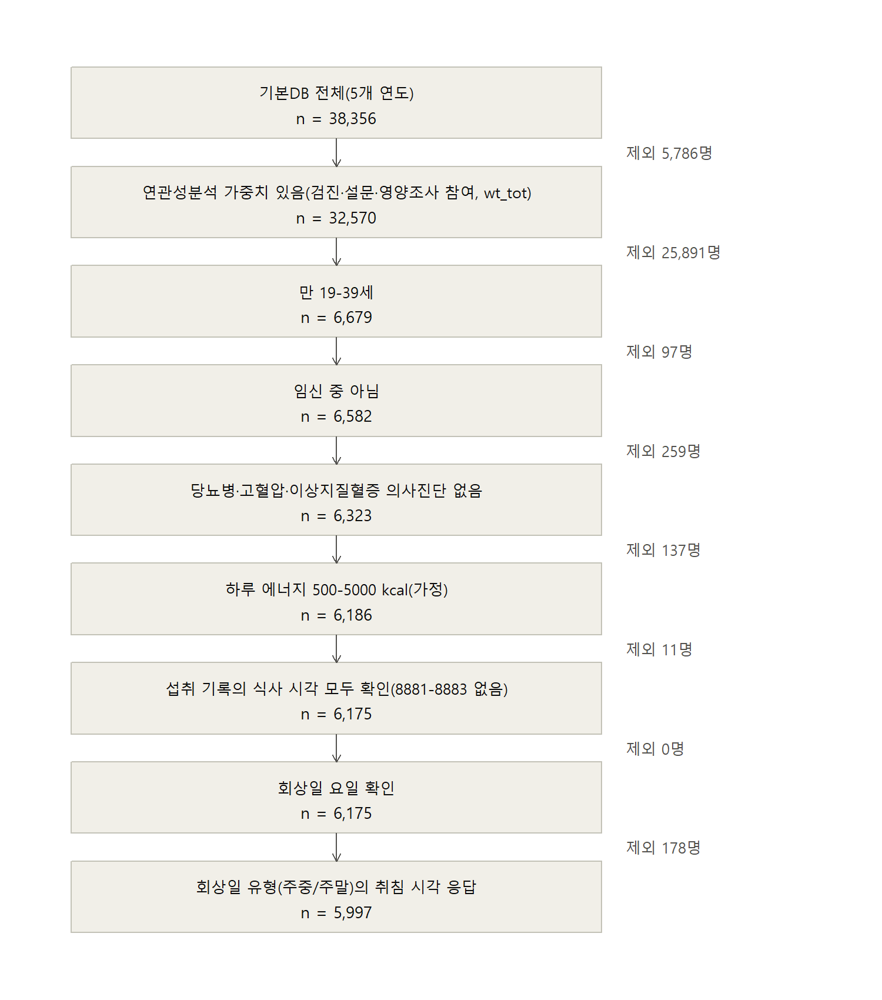
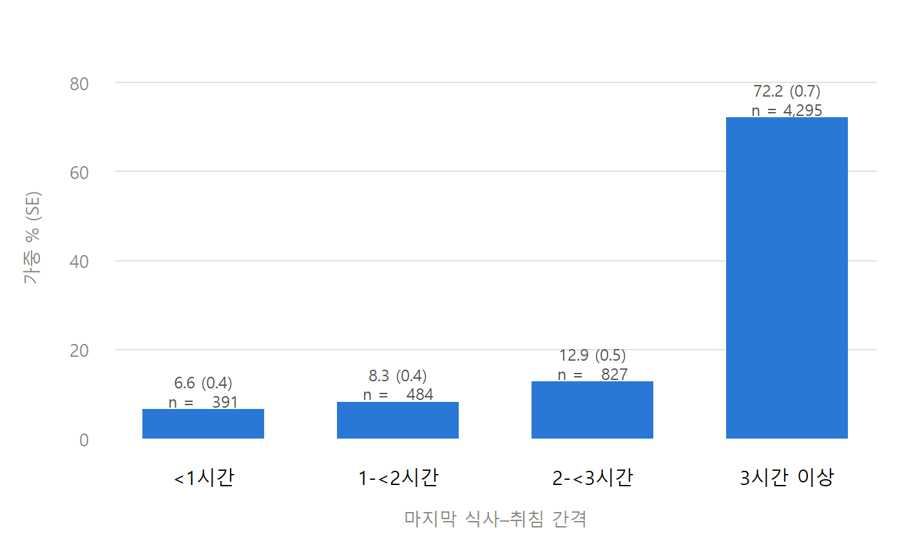
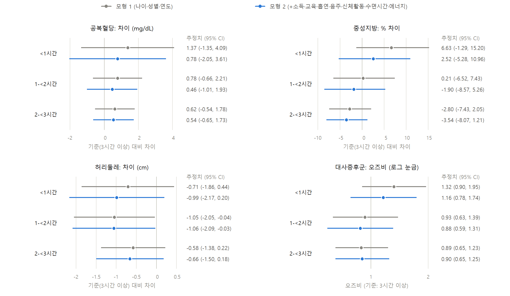
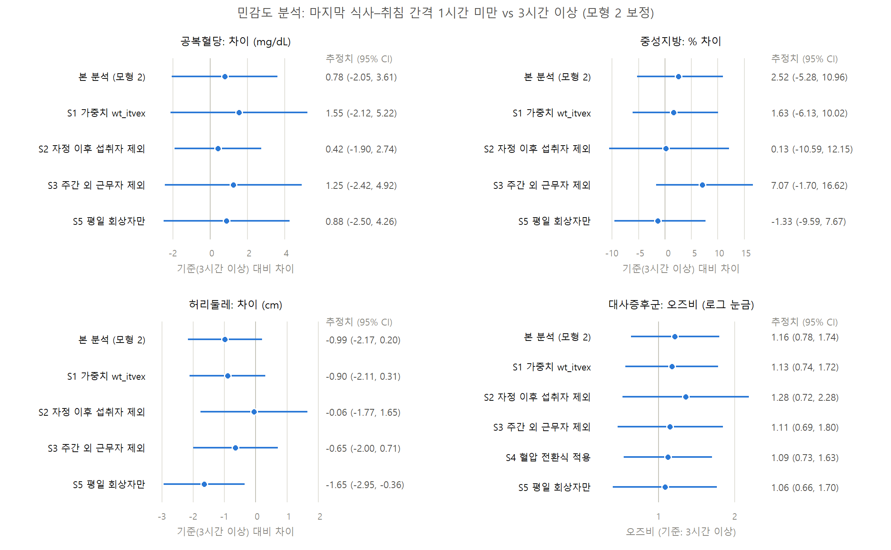

# 청년층(19–39세)의 마지막 식사–취침 간격과 심혈관대사 위험 요인

각자의 평소 취침 시각을 기준으로 잰 '마지막 식사–취침 간격'과 공복혈당·중성지방·허리둘레·대사증후군의 관련성 — 국민건강영양조사 2016–2018, 2021, 2024

- 보고서 생성: 2026-10-31 18:51
- 분석 코드: `code/02_meal_bedtime_cardiometabolic.R` (본 분석), `code/07_meal_bedtime_figures.R` (그림), `code/08_meal_bedtime_report.R` (이 보고서)
- 분석 환경: R version 4.6.0 (2026-04-24 ucrt), survey 패키지(복합표본)
- 재현성 확인: **PASS** (2026-10-19 10:48:45, 새 R 세션에서 2회 실행 후 결과 CSV 비교)

## 요약

- 분석 대상은 2016–2018·2021·2024년 만 19–39세 중 24시간 회상조사와 검진에 참여하고 취침 시각에 응답한 5,997명이다(임신부, 당뇨병·고혈압·이상지질혈증 진단자 제외).
- 마지막 식사–취침 간격은 3시간 이상이 72.2 (0.7)%로 대부분이었고, 1시간 미만 6.6 (0.4)%, 1–2시간 미만 8.3 (0.4)%, 2–3시간 미만 12.9 (0.5)%였다(가중 %, 괄호는 SE).
- 보정 후 1시간 미만 군(vs 3시간 이상)은 공복혈당 차이 0.78 (-2.05, 3.61) mg/dL, 중성지방 2.52 (-5.28, 10.96)%, 대사증후군 OR 1.16 (0.78–1.74)로 **뚜렷한 연관성이 없었다**(경향성 p = 0.428, 0.941, 0.864).
- 허리둘레는 간격이 짧을수록 오히려 약간 작았다(1–2시간 미만 -1.06 (-2.09, -0.03) cm, 경향성 p = 0.017). 그러나 자정 이후 섭취자를 제외하면 -0.06 (-1.77, 1.65) cm로 사라지고, 평일 회상자만 보면 -1.65 (-2.95, -0.36) cm로 커지는 등 **가정에 민감하여** 근거로 삼기 어렵다.
- 1시간 미만 군은 남성·현재흡연자·고에너지 섭취자가 많고, 취침 시각은 오히려 이른 편이어서 '늦게 먹는 것'과 '일찍 자는 것'이 섞인 지표일 수 있다.

## 1. 자료와 복합표본설계

- 자료: 국민건강영양조사 2016·2017·2018년(제7기), 2021년(제8기), 2024년(제9기)의 기본DB(`hnYY_all`)와 식품섭취조사(`hnYY_24rc`). 평일·주말 취침 시각 문항(BP16_11~24)이 있는 연도만 썼다.
- 가중치: 검진(혈액·계측) 변수와 영양조사(24시간 회상) 변수를 함께 쓰므로 연관성분석 가중치 `wt_tot`(제7기 지침서 PDF p.38 / 인쇄 p.30, 제8기 PDF p.40 / 인쇄 p.32, 제9기 PDF p.42 / 인쇄 p.34). 프로젝트 규칙의 `wt_itvex`는 민감도 분석 S1로 함께 보고한다.
- 통합비율: 서로 다른 기수를 합치므로 조사기간 비례(제7기 PDF p.35 / 인쇄 p.27 표 8, 제9기 PDF p.47 / 인쇄 p.39 표 15). 5개 연도 모두 1년 조사로 보아 각 1/5(가정).
- 층 `kstrata`, 집락 `psu`. 층 안에 집락이 1개뿐인 경우와 연도 간 (층, 조사구) 번호가 겹치는 경우는 없었다.
- 모든 추정은 `svydesign` 설계 객체를 만든 뒤 `subset`으로 분석 대상을 지정해 계산했다(행 삭제 없음).

입력 파일 지문:

| 파일 | 크기 | md5 |
|---|---|---|
| hn16_all.sas7bdat | 102,236,160 | 84f1e967352e83596c948a771ed211bf |
| hn17_all.sas7bdat | 138,149,888 | 05acbe9197146ae5759edb42c7ec7b95 |
| hn18_all.sas7bdat | 95,682,560 | f7e1bce007802e4f0bd5357f7cd03f15 |
| hn21_all.sas7bdat | 77,856,768 | 2db62da7587d709942f5b0aec135fb0c |
| hn24_all.sas7bdat | 78,962,688 | acd0b9c2f7342168b5542fb244a8767b |
| hn16_24rc.sas7bdat | 998,277,120 | 61d86a862bd6e1d6bc330e0a2d211332 |
| hn17_24rc.sas7bdat | 1,124,745,216 | 430a4105c98a64dfc7708435d14ef11e |
| hn18_24rc.sas7bdat | 757,129,216 | 03b2b1937109a4df40e1670ae97698d1 |
| hn21_24rc.sas7bdat | 637,800,448 | 8457702933e9b75a7ab39af44f3d51cf |
| hn24_24rc.sas7bdat | 842,231,808 | 37fffb95c7ef6886872bc07551e0aba0 |

## 2. 변수 정의 (이용지침서 쪽수)

변수의 의미와 코드값은 분석 연도가 속한 제7·8·9기 원시자료 이용지침서에서 확인했다. 9·99·999(모름·무응답)는 결측으로, 8·88·888(비해당)은 지침서의 의미를 보고 처리했다.

| 변수 | 파일 | 설명 | 코드 | 결측코드 | 비해당처리 | 근거 |
|---|---|---|---|---|---|---|
| id | all,24rc | 개인 아이디 |  |  |  | 7기 PDF p.93-94 / 인쇄 p.85-86; 9기 PDF p.101-102 / 인쇄 p.93-94 |
| year | all | 조사연도 |  |  |  | 7기 PDF p.93-94 / 인쇄 p.85-86; 9기 PDF p.101-102 / 인쇄 p.93-94 |
| sex | all | 성별 | 1=남자;2=여자 |  |  | 7기 PDF p.93-94 / 인쇄 p.85-86; 9기 PDF p.101-102 / 인쇄 p.93-94 |
| age | all | 만나이 | 1~79=세;80=80세이상(탑코딩) |  |  | 7기 PDF p.93-94 / 인쇄 p.85-86; 9기 PDF p.101-102 / 인쇄 p.93-94 |
| psu | all | 조사구번호(집락) |  |  |  | 7기 PDF p.93-94 / 인쇄 p.85-86; 9기 PDF p.101-102 / 인쇄 p.93-94 |
| kstrata | all | 분산추정 층 |  |  |  | 7기 PDF p.93-94 / 인쇄 p.85-86; 9기 PDF p.101-102 / 인쇄 p.93-94 |
| wt_tot | all | 건강설문-검진조사 & 영양조사 가중치(본 분석) |  |  |  | 7기 PDF p.93-94 / 인쇄 p.85-86; 9기 PDF p.101-102 / 인쇄 p.93-94 |
| wt_itvex | all | 건강설문-검진조사 가중치(민감도 S1) |  |  |  | 7기 PDF p.93-94 / 인쇄 p.85-86; 9기 PDF p.101-102 / 인쇄 p.93-94 |
| incm | all | 소득 4분위수(개인) | 1=하;2=중하;3=중상;4=상 |  |  | 7기 PDF p.93-94 / 인쇄 p.85-86; 9기 PDF p.101-102 / 인쇄 p.93-94 |
| edu | all | 교육수준 재분류 | 1=초졸이하;2=중졸;3=고졸;4=대졸이상 |  |  | 7기 PDF p.93-94 / 인쇄 p.85-86; 9기 PDF p.101-102 / 인쇄 p.93-94 |
| he_prg | all | 임신여부 | 0=아니오;1=예 |  | 8=범주유지(비해당-남자) | 7기 PDF p.192 / 인쇄 p.184; 8기 PDF p.192 / 인쇄 p.184; 9기 PDF p.182 / 인쇄 p.174 |
| de1_dg | all | 당뇨병 의사진단 | 0=없음;1=있음 | 9 | 8=결측(청소년·소아 비해당, 성인엔 해당 없음) | 7기 PDF p.112 / 인쇄 p.104; 8기 PDF p.112 / 인쇄 p.104; 9기 PDF p.112-113 / 인쇄 p.104-105 |
| di1_dg | all | 고혈압 의사진단 | 0=없음;1=있음 | 9 | 8=결측(청소년·소아 비해당) | 7기 PDF p.103 / 인쇄 p.95; 8기 PDF p.100 / 인쇄 p.92; 9기 PDF p.110 / 인쇄 p.102 |
| di2_dg | all | 이상지질혈증 의사진단 | 0=없음;1=있음 | 9 | 8=결측(청소년·소아 비해당) | 7기 PDF p.104 / 인쇄 p.96; 8기 PDF p.101 / 인쇄 p.93; 9기 PDF p.111 / 인쇄 p.103 |
| bp16_11 | all | 주중 잠자리에 든 시각_시 | 시 | 99 | 88=결측(소아) | 7기 PDF p.169 / 인쇄 p.161; 8기 PDF p.169 / 인쇄 p.161; 9기 PDF p.158 / 인쇄 p.150; 시각 변환 규칙 7기 PDF p.46 / 인쇄 p.38, 8기 PDF p.48 / 인쇄 p.40, 9기 PDF p.50 / 인쇄 p.42 |
| bp16_12 | all | 주중 잠자리에 든 시각_분 | 분 | 99 | 88=결측(소아) | 7기 PDF p.169 / 인쇄 p.161; 8기 PDF p.169 / 인쇄 p.161; 9기 PDF p.158 / 인쇄 p.150; 시각 변환 규칙 7기 PDF p.46 / 인쇄 p.38, 8기 PDF p.48 / 인쇄 p.40, 9기 PDF p.50 / 인쇄 p.42 |
| bp16_13 | all | 주중 일어난 시각_시 | 시 | 99 | 88=결측(소아) | 7기 PDF p.169 / 인쇄 p.161; 8기 PDF p.169 / 인쇄 p.161; 9기 PDF p.158 / 인쇄 p.150; 시각 변환 규칙 7기 PDF p.46 / 인쇄 p.38, 8기 PDF p.48 / 인쇄 p.40, 9기 PDF p.50 / 인쇄 p.42 |
| bp16_14 | all | 주중 일어난 시각_분 | 분 | 99 | 88=결측(소아) | 7기 PDF p.169 / 인쇄 p.161; 8기 PDF p.169 / 인쇄 p.161; 9기 PDF p.158 / 인쇄 p.150; 시각 변환 규칙 7기 PDF p.46 / 인쇄 p.38, 8기 PDF p.48 / 인쇄 p.40, 9기 PDF p.50 / 인쇄 p.42 |
| bp16_21 | all | 주말 잠자리에 든 시각_시 | 시 | 99 | 88=결측(소아) | 7기 PDF p.169 / 인쇄 p.161; 8기 PDF p.169 / 인쇄 p.161; 9기 PDF p.158 / 인쇄 p.150; 시각 변환 규칙 7기 PDF p.46 / 인쇄 p.38, 8기 PDF p.48 / 인쇄 p.40, 9기 PDF p.50 / 인쇄 p.42 |
| bp16_22 | all | 주말 잠자리에 든 시각_분 | 분 | 99 | 88=결측(소아) | 7기 PDF p.169 / 인쇄 p.161; 8기 PDF p.169 / 인쇄 p.161; 9기 PDF p.158 / 인쇄 p.150; 시각 변환 규칙 7기 PDF p.46 / 인쇄 p.38, 8기 PDF p.48 / 인쇄 p.40, 9기 PDF p.50 / 인쇄 p.42 |
| bp16_23 | all | 주말 일어난 시각_시 | 시 | 99 | 88=결측(소아) | 7기 PDF p.169 / 인쇄 p.161; 8기 PDF p.169 / 인쇄 p.161; 9기 PDF p.158 / 인쇄 p.150; 시각 변환 규칙 7기 PDF p.46 / 인쇄 p.38, 8기 PDF p.48 / 인쇄 p.40, 9기 PDF p.50 / 인쇄 p.42 |
| bp16_24 | all | 주말 일어난 시각_분 | 분 | 99 | 88=결측(소아) | 7기 PDF p.169 / 인쇄 p.161; 8기 PDF p.169 / 인쇄 p.161; 9기 PDF p.158 / 인쇄 p.150; 시각 변환 규칙 7기 PDF p.46 / 인쇄 p.38, 8기 PDF p.48 / 인쇄 p.40, 9기 PDF p.50 / 인쇄 p.42 |
| he_fst | all | 공복시간 | 시간 |  |  | 7기 PDF p.192 / 인쇄 p.184; 8기 PDF p.192 / 인쇄 p.184; 9기 PDF p.182 / 인쇄 p.174 |
| he_glu | all | 공복혈당(공복 8시간 이상만 사용: 7기 PDF p.49 / 인쇄 p.41) | mg/dL |  |  | 7기 PDF p.198 / 인쇄 p.190; 8기 PDF p.199 / 인쇄 p.191; 9기 PDF p.188 / 인쇄 p.180 |
| he_tg | all | 중성지방(공복 12시간 이상만 사용: 7기 PDF p.50 / 인쇄 p.42, 9기 PDF p.52 / 인쇄 p.44) | mg/dL |  |  | 7기 PDF p.198 / 인쇄 p.190; 8기 PDF p.199 / 인쇄 p.191; 9기 PDF p.188 / 인쇄 p.180 |
| he_hdl_st2 | all | HDL-콜레스테롤(보정값) | mg/dL |  |  | 7기 PDF p.198 / 인쇄 p.190; 8기 PDF p.199 / 인쇄 p.191; 9기 PDF p.188 / 인쇄 p.180 |
| he_wc | all | 허리둘레 | cm |  |  | 7기 PDF p.197 / 인쇄 p.189; 8기 PDF p.198 / 인쇄 p.190; 9기 PDF p.187 / 인쇄 p.179 |
| he_sbp | all | 최종 수축기 혈압(2,3차 평균) | mmHg |  |  | 7기 PDF p.196 / 인쇄 p.188; 8기 PDF p.196 / 인쇄 p.188; 9기 PDF p.185 / 인쇄 p.177; 2021년부터 성인 진동형 혈압계(8기 PDF p.18-19 / 인쇄 p.10-11, 9기 PDF p.20 / 인쇄 p.12) |
| he_dbp | all | 최종 이완기 혈압(2,3차 평균) | mmHg |  |  | 7기 PDF p.196 / 인쇄 p.188; 8기 PDF p.196 / 인쇄 p.188; 9기 PDF p.185 / 인쇄 p.177 |
| bs1_1 | all | 평생 흡연 여부 | 현재흡연 정의에만 사용 |  |  | 주요지표 SAS: 7기 PDF p.46 / 인쇄 p.38; 8기 PDF p.48 / 인쇄 p.40; 9기 PDF p.50 / 인쇄 p.42 |
| bs3_1 | all | 현재 흡연 여부 | 현재흡연 정의에만 사용 |  |  | 주요지표 SAS: 7기 PDF p.46 / 인쇄 p.38; 8기 PDF p.48 / 인쇄 p.40; 9기 PDF p.50 / 인쇄 p.42 |
| bd1 | all | 평생 음주 경험 | 월간음주 정의에만 사용 |  |  | 주요지표 SAS: 7기 PDF p.46 / 인쇄 p.38; 8기 PDF p.48 / 인쇄 p.40; 9기 PDF p.50 / 인쇄 p.42 |
| bd1_11 | all | 1년간 음주 빈도 | 월간음주 정의에만 사용 |  |  | 주요지표 SAS: 7기 PDF p.46 / 인쇄 p.38; 8기 PDF p.48 / 인쇄 p.40; 9기 PDF p.50 / 인쇄 p.42 |
| pa_aerobic | all | 유산소 신체활동 실천 | 0=미실천;1=실천 |  |  | 7기 PDF p.185 / 인쇄 p.177; 8기 PDF p.188 / 인쇄 p.180; 9기 PDF p.177 / 인쇄 p.169 |
| ec_wht_5 | all | 변형근로시간(민감도 S3) | 1=주간;2=저녁;3=밤;4=주야간 규칙적 교대;5=24시간 교대;6=분할;7=불규칙 교대;8=기타 | 99 | 88=범주유지(최근 1년 일하지 않음) | 7기 PDF p.157 / 인쇄 p.149; 8기 PDF p.155 / 인쇄 p.147; 9기 PDF p.144 / 인쇄 p.136 |
| n_day | 24rc | 영양조사를 실시한 요일 | 월요일~일요일(문자) |  |  | 7기 PDF p.299 / 인쇄 p.291; 8기 PDF p.287 / 인쇄 p.279; 9기 PDF p.234 / 인쇄 p.226 |
| n_meal | 24rc | 끼니 구분 | 1=아침;2=점심;3=저녁;4=간식;5=식이보충제(2016-2017만) |  |  | 7기 PDF p.299 / 인쇄 p.291; 8기 PDF p.287 / 인쇄 p.279; 9기 PDF p.234 / 인쇄 p.226 |
| n_meal_t | 24rc | 식사 시간(8881 오전·8882 오후 시각 모름, 8883 모름) | HHMM(24시간제) | 8881;8882;8883 |  | 7기 PDF p.299 / 인쇄 p.291; 8기 PDF p.287 / 인쇄 p.279; 9기 PDF p.234 / 인쇄 p.226 |
| nf_en | 24rc | 식품별 에너지 섭취량 | kcal |  |  | 7기 PDF p.303 / 인쇄 p.295; 8기 PDF p.291 / 인쇄 p.283; 9기 PDF p.238 / 인쇄 p.230 |

### 2-1. 노출 변수(마지막 식사–취침 간격) 만들기

1. **회상한 날의 요일**: `N_DAY`는 영양조사를 실시한 요일이므로(제7기 PDF p.299, 제8기 PDF p.287, 제9기 PDF p.234), 24시간 회상의 준거일인 조사 1일 전(2016–2018·2021, 제7기 PDF p.13, 제8기 PDF p.13) 또는 2일 전(2024, 제9기 PDF p.14·p.23)으로 되돌렸다.
2. **취침 시각**: 회상한 날 밤이 일–목요일이면 주중 취침 시각(BP16_11·12), 금·토요일이면 주말 취침 시각(BP16_21·22)을 썼다. 지침서 규칙대로 1–12시는 24를 더했다(제7기 PDF p.46 / 인쇄 p.38).
3. **마지막 섭취 시각**: 24시간 회상 자료에서 식이보충제(N_MEAL = 5, 2016–2017년만)와 시각을 모르는 기록(N_MEAL_T 8881–8883)을 빼고, 에너지가 0보다 큰 끼니 중 가장 늦은 시각.
4. **가정 A**: 00:00–04:59에 기록된 섭취는 지침서에 하루 경계 정의가 없어 확인할 수 없었다. 자료에서 이 시간대 기록 다수가 '저녁'·'간식'으로 분류되어 있어, 아침(N_MEAL = 1)이 아니면 회상일 밤 자정 이후의 섭취로 보고 24시간을 더했다. 영향은 민감도 분석 S2로 확인했다.
5. **간격** = 취침 시각 − 마지막 섭취 시각. 1시간 미만 / 1–2시간 미만 / 2–3시간 미만 / 3시간 이상(기준)으로 나누고, 경향성 검정에는 0–3점 점수를 썼다.

### 2-2. 결과 변수와 공변량

- 공복혈당 `HE_glu`: 공복 8시간 이상(`HE_fst`)인 사람만(제7기 PDF p.49 / 인쇄 p.41). 중성지방 `HE_TG`: 공복 12시간 이상만(제7기 PDF p.50 / 인쇄 p.42), 로그 변환하여 % 차이로 보고. 허리둘레 `HE_wc`(cm).
- 대사증후군: 지침서에 정의가 없어 문헌 기준(NCEP-ATP III 개정 기준, 허리둘레는 한국인 기준 남 90·여 85 cm)을 적용했다(가정). 진단자를 제외했으므로 약물 기준은 쓰지 않았고, 중성지방 조건 때문에 공복 12시간 이상인 사람만 판정했다.
- 공변량: 나이, 성별, 조사연도(모형 1); 소득 4분위, 교육(중졸 이하/고졸/대졸 이상), 현재흡연·월간음주(지침서 주요지표 정의, 제7기 PDF p.46 / 인쇄 p.38), 유산소 신체활동, 수면시간(회상일 유형 기준), 하루 에너지 섭취량(모형 2).

## 3. 대상자 선정 흐름

| 단계 | 남은 n | 제외 |
|---|---|---|
| 기본DB 전체(5개 연도) | 38,356 |  |
| 연관성분석 가중치 있음(검진·설문·영양조사 참여, wt_tot) | 32,570 | 5,786 |
| 만 19-39세 | 6,679 | 25,891 |
| 임신 중 아님 | 6,582 | 97 |
| 당뇨병·고혈압·이상지질혈증 의사진단 없음 | 6,323 | 259 |
| 하루 에너지 500-5000 kcal(가정) | 6,186 | 137 |
| 섭취 기록의 식사 시각 모두 확인(8881-8883 없음) | 6,175 | 11 |
| 회상일 요일 확인 | 6,175 | 0 |
| 회상일 유형(주중/주말)의 취침 시각 응답 | 5,997 | 178 |

## 4. 노출 분포

| 마지막 식사–취침 간격 | 비가중 n | 가중 % (SE) |
|---|---|---|
| <1시간 | 391 | 6.6 (0.4) |
| 1-<2시간 | 484 | 8.3 (0.4) |
| 2-<3시간 | 827 | 12.9 (0.5) |
| 3시간 이상 | 4,295 | 72.2 (0.7) |

가중 사분위수:

| 변수 | 25% | 50%(중앙값) | 75% |
|---|---|---|---|
| 마지막 식사–취침 간격(시간) | 2.5 | 4.0 | 5.5 |
| 취침 시각(자정 이후는 24+시) | 24.0 | 24.5 | 25.5 |
| 마지막 섭취 시각(자정 이후는 24+시) | 19.0 | 20.5 | 22.0 |

## 5. 대상자 특성 (Table 1): 마지막 식사–취침 간격 범주별

각 칸은 **가중 추정치 (비가중 n)** 이다. 범주형은 가중 % (SE), 연속형은 가중 평균 (SE).

| 항목 | 통계 | 전체 | <1시간 | 1-<2시간 | 2-<3시간 | 3시간 이상(기준) |
|---|---|---|---|---|---|---|
| 성별: 남자 | 가중 % (SE) | 52.0 (0.7) (2,586) | 68.0 (2.5) (230) | 56.5 (2.4) (232) | 51.4 (1.8) (346) | 50.1 (0.8) (1,778) |
| 성별: 여자 | 가중 % (SE) | 48.0 (0.7) (3,411) | 32.0 (2.5) (161) | 43.5 (2.4) (252) | 48.6 (1.8) (481) | 49.9 (0.8) (2,517) |
| 나이 | 가중 평균 (SE) | 29.3 (0.1) (5,997) | 29.4 (0.3) (391) | 30.3 (0.3) (484) | 30.1 (0.3) (827) | 29.0 (0.1) (4,295) |
| 조사연도: 2016 | 가중 % (SE) | 20.2 (1.4) (1,316) | 25.8 (3.0) (104) | 26.8 (2.6) (133) | 20.9 (2.1) (191) | 18.8 (1.4) (888) |
| 조사연도: 2017 | 가중 % (SE) | 20.0 (1.4) (1,202) | 23.1 (2.8) (89) | 17.4 (2.1) (90) | 23.5 (2.2) (190) | 19.3 (1.4) (833) |
| 조사연도: 2018 | 가중 % (SE) | 20.9 (0.9) (1,319) | 21.3 (2.4) (90) | 23.2 (2.1) (119) | 22.5 (1.7) (197) | 20.3 (0.9) (913) |
| 조사연도: 2021 | 가중 % (SE) | 20.1 (0.9) (953) | 14.9 (2.3) (50) | 18.0 (2.2) (70) | 17.6 (1.7) (114) | 21.3 (1.0) (719) |
| 조사연도: 2024 | 가중 % (SE) | 18.8 (0.8) (1,207) | 14.9 (2.1) (58) | 14.6 (1.8) (72) | 15.5 (1.4) (135) | 20.2 (0.9) (942) |
| 소득 4분위(개인): 하 | 가중 % (SE) | 25.4 (0.9) (1,509) | 26.2 (2.5) (107) | 23.4 (2.3) (109) | 27.2 (1.8) (221) | 25.3 (1.0) (1,072) |
| 소득 4분위(개인): 중하 | 가중 % (SE) | 25.4 (0.8) (1,507) | 29.0 (2.6) (108) | 26.7 (2.3) (129) | 25.0 (1.7) (207) | 25.0 (0.8) (1,063) |
| 소득 4분위(개인): 중상 | 가중 % (SE) | 24.4 (0.7) (1,489) | 22.6 (2.3) (92) | 23.3 (2.1) (111) | 23.8 (1.6) (198) | 24.8 (0.9) (1,088) |
| 소득 4분위(개인): 상 | 가중 % (SE) | 24.8 (0.9) (1,481) | 22.2 (2.4) (84) | 26.6 (2.4) (135) | 24.1 (1.8) (199) | 24.9 (1.0) (1,063) |
| 교육수준: 중졸이하 | 가중 % (SE) | 2.0 (0.2) (124) | 1.5 (0.5) (10) | 2.9 (0.8) (14) | 2.3 (0.6) (21) | 1.8 (0.2) (79) |
| 교육수준: 고졸 | 가중 % (SE) | 38.8 (0.9) (2,208) | 48.2 (2.9) (177) | 34.2 (2.5) (163) | 34.1 (2.0) (270) | 39.3 (1.0) (1,598) |
| 교육수준: 대졸이상 | 가중 % (SE) | 59.2 (0.9) (3,665) | 50.3 (2.9) (204) | 62.9 (2.6) (307) | 63.6 (2.0) (536) | 58.9 (1.0) (2,618) |
| 현재흡연: 비흡연 | 가중 % (SE) | 78.9 (0.6) (4,888) | 63.8 (2.6) (259) | 75.4 (2.3) (379) | 77.0 (1.7) (663) | 81.0 (0.7) (3,587) |
| 현재흡연: 현재흡연 | 가중 % (SE) | 21.1 (0.6) (1,108) | 36.2 (2.6) (132) | 24.6 (2.3) (105) | 23.0 (1.7) (163) | 19.0 (0.7) (708) |
| 월간음주: 월1회 미만 | 가중 % (SE) | 32.8 (0.7) (2,065) | 26.2 (2.5) (104) | 29.2 (2.4) (152) | 34.3 (1.9) (300) | 33.5 (0.9) (1,509) |
| 월간음주: 월1회 이상 | 가중 % (SE) | 67.2 (0.7) (3,931) | 73.8 (2.5) (287) | 70.8 (2.4) (332) | 65.7 (1.9) (526) | 66.5 (0.9) (2,786) |
| 유산소 신체활동: 미실천 | 가중 % (SE) | 41.3 (0.8) (2,592) | 41.1 (2.8) (174) | 42.6 (2.6) (215) | 44.0 (2.0) (378) | 40.7 (0.8) (1,825) |
| 유산소 신체활동: 실천 | 가중 % (SE) | 58.7 (0.8) (3,352) | 58.9 (2.8) (213) | 57.4 (2.6) (262) | 56.0 (2.0) (440) | 59.3 (0.8) (2,437) |
| 수면시간(시간, 회상일 유형) | 가중 평균 (SE) | 7.4 (0.0) (5,856) | 7.8 (0.1) (389) | 7.7 (0.1) (481) | 7.7 (0.0) (821) | 7.2 (0.0) (4,165) |
| 하루 에너지(kcal) | 가중 평균 (SE) | 2051.5 (13.6) (5,997) | 2438.4 (53.4) (391) | 2277.4 (42.4) (484) | 2182.2 (35.1) (827) | 1966.6 (15.0) (4,295) |
| 취침 시각(24+시 표기) | 가중 평균 (SE) | 24.7 (0.0) (5,997) | 23.4 (0.1) (391) | 23.9 (0.1) (484) | 24.1 (0.1) (827) | 25.0 (0.0) (4,295) |
| 마지막 섭취 시각(24+시 표기) | 가중 평균 (SE) | 20.6 (0.0) (5,997) | 24.1 (0.1) (391) | 22.7 (0.1) (484) | 21.9 (0.1) (827) | 19.8 (0.0) (4,295) |
| 공복혈당(mg/dL, 공복≥8h) | 가중 평균 (SE) | 92.1 (0.2) (5,748) | 93.8 (1.3) (368) | 93.1 (0.7) (461) | 92.7 (0.6) (791) | 91.7 (0.2) (4,128) |
| 중성지방(mg/dL, 공복≥12h) | 가중 평균 (SE) | 111.7 (1.5) (4,713) | 127.5 (5.2) (287) | 120.8 (6.7) (361) | 108.3 (3.2) (627) | 109.9 (1.8) (3,438) |
| 허리둘레(cm) | 가중 평균 (SE) | 79.9 (0.2) (5,961) | 81.3 (0.6) (389) | 80.0 (0.5) (482) | 79.7 (0.4) (823) | 79.8 (0.2) (4,267) |
| 대사증후군(공복≥12h): 없음 | 가중 % (SE) | 89.1 (0.5) (4,188) | 83.1 (2.4) (242) | 88.3 (1.9) (318) | 89.4 (1.3) (553) | 89.7 (0.6) (3,075) |
| 대사증후군(공복≥12h): 있음 | 가중 % (SE) | 10.9 (0.5) (476) | 16.9 (2.4) (44) | 11.7 (1.9) (41) | 10.6 (1.3) (69) | 10.3 (0.6) (322) |

주: 연도 2016–2018·2021·2024, 가중치 wt_tot × 1/5, 층 kstrata, 집락 psu. n은 비가중 표본 수, %와 평균은 복합표본 가중 추정치. 공복혈당은 공복 8시간 이상, 중성지방·대사증후군은 공복 12시간 이상인 사람만.

## 6. 본 분석 (복합표본 선형·로지스틱 회귀)

모형 1: 나이·성별·조사연도 보정. 모형 2: 모형 1 + 소득·교육·현재흡연·월간음주·유산소 신체활동·수면시간·하루 에너지. 기준은 3시간 이상. 중성지방은 로그 변환 후 % 차이로, 대사증후군은 오즈비로 보고한다.

| 결과 | 척도 | 모형 | 간격 | 추정치 (95% CI) | p | 해당 n | 모형 n | 경향성 p |
|---|---|---|---|---|---|---|---|---|
| 공복혈당(mg/dL) | 차이(mg/dL) | 모형1(나이·성별·연도) | 3시간 이상(기준) | 기준 |  | 4128 | 5748 | 0.163 |
| 공복혈당(mg/dL) | 차이(mg/dL) | 모형1(나이·성별·연도) | <1시간 | 1.37 (-1.35, 4.09) | 0.322 | 368 | 5748 | 0.163 |
| 공복혈당(mg/dL) | 차이(mg/dL) | 모형1(나이·성별·연도) | 1-<2시간 | 0.78 (-0.66, 2.21) | 0.287 | 461 | 5748 | 0.163 |
| 공복혈당(mg/dL) | 차이(mg/dL) | 모형1(나이·성별·연도) | 2-<3시간 | 0.62 (-0.54, 1.78) | 0.293 | 791 | 5748 | 0.163 |
| 공복혈당(mg/dL) | 차이(mg/dL) | 모형2(+소득·교육·흡연·음주·신체활동·수면시간·에너지) | 3시간 이상(기준) | 기준 |  | 3975 | 5565 | 0.428 |
| 공복혈당(mg/dL) | 차이(mg/dL) | 모형2(+소득·교육·흡연·음주·신체활동·수면시간·에너지) | <1시간 | 0.78 (-2.05, 3.61) | 0.589 | 363 | 5565 | 0.428 |
| 공복혈당(mg/dL) | 차이(mg/dL) | 모형2(+소득·교육·흡연·음주·신체활동·수면시간·에너지) | 1-<2시간 | 0.46 (-1.01, 1.93) | 0.538 | 453 | 5565 | 0.428 |
| 공복혈당(mg/dL) | 차이(mg/dL) | 모형2(+소득·교육·흡연·음주·신체활동·수면시간·에너지) | 2-<3시간 | 0.54 (-0.65, 1.73) | 0.378 | 774 | 5565 | 0.428 |
| 중성지방 | % 차이 | 모형1(나이·성별·연도) | 3시간 이상(기준) | 기준 |  | 3438 | 4713 | 0.308 |
| 중성지방 | % 차이 | 모형1(나이·성별·연도) | <1시간 | 6.63 (-1.29, 15.20) | 0.103 | 287 | 4713 | 0.308 |
| 중성지방 | % 차이 | 모형1(나이·성별·연도) | 1-<2시간 | 0.21 (-6.52, 7.43) | 0.953 | 361 | 4713 | 0.308 |
| 중성지방 | % 차이 | 모형1(나이·성별·연도) | 2-<3시간 | -2.80 (-7.43, 2.05) | 0.253 | 627 | 4713 | 0.308 |
| 중성지방 | % 차이 | 모형2(+소득·교육·흡연·음주·신체활동·수면시간·에너지) | 3시간 이상(기준) | 기준 |  | 3323 | 4579 | 0.941 |
| 중성지방 | % 차이 | 모형2(+소득·교육·흡연·음주·신체활동·수면시간·에너지) | <1시간 | 2.52 (-5.28, 10.96) | 0.537 | 285 | 4579 | 0.941 |
| 중성지방 | % 차이 | 모형2(+소득·교육·흡연·음주·신체활동·수면시간·에너지) | 1-<2시간 | -1.90 (-8.57, 5.26) | 0.593 | 356 | 4579 | 0.941 |
| 중성지방 | % 차이 | 모형2(+소득·교육·흡연·음주·신체활동·수면시간·에너지) | 2-<3시간 | -3.54 (-8.07, 1.21) | 0.141 | 615 | 4579 | 0.941 |
| 허리둘레(cm) | 차이(cm) | 모형1(나이·성별·연도) | 3시간 이상(기준) | 기준 |  | 4267 | 5961 | 0.033 |
| 허리둘레(cm) | 차이(cm) | 모형1(나이·성별·연도) | <1시간 | -0.71 (-1.86, 0.44) | 0.227 | 389 | 5961 | 0.033 |
| 허리둘레(cm) | 차이(cm) | 모형1(나이·성별·연도) | 1-<2시간 | -1.05 (-2.05, -0.04) | 0.042 | 482 | 5961 | 0.033 |
| 허리둘레(cm) | 차이(cm) | 모형1(나이·성별·연도) | 2-<3시간 | -0.58 (-1.38, 0.22) | 0.154 | 823 | 5961 | 0.033 |
| 허리둘레(cm) | 차이(cm) | 모형2(+소득·교육·흡연·음주·신체활동·수면시간·에너지) | 3시간 이상(기준) | 기준 |  | 4098 | 5760 | 0.017 |
| 허리둘레(cm) | 차이(cm) | 모형2(+소득·교육·흡연·음주·신체활동·수면시간·에너지) | <1시간 | -0.99 (-2.17, 0.20) | 0.102 | 383 | 5760 | 0.017 |
| 허리둘레(cm) | 차이(cm) | 모형2(+소득·교육·흡연·음주·신체활동·수면시간·에너지) | 1-<2시간 | -1.06 (-2.09, -0.03) | 0.045 | 472 | 5760 | 0.017 |
| 허리둘레(cm) | 차이(cm) | 모형2(+소득·교육·흡연·음주·신체활동·수면시간·에너지) | 2-<3시간 | -0.66 (-1.50, 0.18) | 0.122 | 807 | 5760 | 0.017 |
| 대사증후군 | OR | 모형1(나이·성별·연도) | 3시간 이상(기준) | 기준 |  | 3397 | 4664 | 0.437 |
| 대사증후군 | OR | 모형1(나이·성별·연도) | <1시간 | 1.32 (0.90–1.95) | 0.156 | 286 | 4664 | 0.437 |
| 대사증후군 | OR | 모형1(나이·성별·연도) | 1-<2시간 | 0.93 (0.63–1.39) | 0.738 | 359 | 4664 | 0.437 |
| 대사증후군 | OR | 모형1(나이·성별·연도) | 2-<3시간 | 0.89 (0.65–1.23) | 0.491 | 622 | 4664 | 0.437 |
| 대사증후군 | OR | 모형2(+소득·교육·흡연·음주·신체활동·수면시간·에너지) | 3시간 이상(기준) | 기준 |  | 3285 | 4535 | 0.864 |
| 대사증후군 | OR | 모형2(+소득·교육·흡연·음주·신체활동·수면시간·에너지) | <1시간 | 1.16 (0.78–1.74) | 0.456 | 284 | 4535 | 0.864 |
| 대사증후군 | OR | 모형2(+소득·교육·흡연·음주·신체활동·수면시간·에너지) | 1-<2시간 | 0.88 (0.59–1.31) | 0.523 | 354 | 4535 | 0.864 |
| 대사증후군 | OR | 모형2(+소득·교육·흡연·음주·신체활동·수면시간·에너지) | 2-<3시간 | 0.90 (0.65–1.25) | 0.529 | 612 | 4535 | 0.864 |

## 7. 민감도 분석 (1시간 미만 vs 3시간 이상, 모형 2)

| 분석 | 결과 | 척도 | 추정치 (95% CI) | p | 해당 n | 모형 n | 경향성 p |
|---|---|---|---|---|---|---|---|
| S1 가중치 wt_itvex×1/5 (CLAUDE.md 규칙) | 공복혈당(mg/dL) | 차이(mg/dL) | 1.55 (-2.12, 5.22) | 0.408 | 363 | 5565 | 0.295 |
| S2 자정 이후(00-04시) 섭취자 제외(가정 A 영향) | 공복혈당(mg/dL) | 차이(mg/dL) | 0.42 (-1.90, 2.74) | 0.722 | 181 | 5225 | 0.257 |
| S3 주간 외 근무자(EC_wht_5=2-7) 제외 | 공복혈당(mg/dL) | 차이(mg/dL) | 1.25 (-2.42, 4.92) | 0.504 | 276 | 4654 | 0.324 |
| S5 평일(일-목) 회상자만 | 공복혈당(mg/dL) | 차이(mg/dL) | 0.88 (-2.50, 4.26) | 0.610 | 271 | 4307 | 0.211 |
| S1 가중치 wt_itvex×1/5 (CLAUDE.md 규칙) | 중성지방 | % 차이 | 1.63 (-6.13, 10.02) | 0.690 | 285 | 4579 | 0.915 |
| S2 자정 이후(00-04시) 섭취자 제외(가정 A 영향) | 중성지방 | % 차이 | 0.13 (-10.59, 12.15) | 0.981 | 144 | 4325 | 0.486 |
| S3 주간 외 근무자(EC_wht_5=2-7) 제외 | 중성지방 | % 차이 | 7.07 (-1.70, 16.62) | 0.117 | 219 | 3835 | 0.268 |
| S5 평일(일-목) 회상자만 | 중성지방 | % 차이 | -1.33 (-9.59, 7.67) | 0.763 | 217 | 3582 | 0.415 |
| S1 가중치 wt_itvex×1/5 (CLAUDE.md 규칙) | 허리둘레(cm) | 차이(cm) | -0.90 (-2.11, 0.31) | 0.144 | 383 | 5760 | 0.014 |
| S2 자정 이후(00-04시) 섭취자 제외(가정 A 영향) | 허리둘레(cm) | 차이(cm) | -0.06 (-1.77, 1.65) | 0.944 | 190 | 5400 | 0.123 |
| S3 주간 외 근무자(EC_wht_5=2-7) 제외 | 허리둘레(cm) | 차이(cm) | -0.65 (-2.00, 0.71) | 0.349 | 289 | 4807 | 0.168 |
| S5 평일(일-목) 회상자만 | 허리둘레(cm) | 차이(cm) | -1.65 (-2.95, -0.36) | 0.012 | 288 | 4450 | 0.003 |
| S1 가중치 wt_itvex×1/5 (CLAUDE.md 규칙) | 대사증후군 | OR | 1.13 (0.74–1.72) | 0.580 | 284 | 4535 | 0.784 |
| S2 자정 이후(00-04시) 섭취자 제외(가정 A 영향) | 대사증후군 | OR | 1.28 (0.72–2.28) | 0.391 | 143 | 4282 | 0.769 |
| S3 주간 외 근무자(EC_wht_5=2-7) 제외 | 대사증후군 | OR | 1.11 (0.69–1.80) | 0.655 | 218 | 3797 | 0.904 |
| S5 평일(일-목) 회상자만 | 대사증후군 | OR | 1.06 (0.66–1.70) | 0.807 | 216 | 3547 | 0.915 |
| S4 2021·2024 혈압 전환식 적용 | 대사증후군(혈압 전환식) | OR | 1.09 (0.73–1.63) | 0.658 | 284 | 4535 | 0.815 |

- S1: 가중치를 프로젝트 규칙의 `wt_itvex` × 1/5로 교체. S2: 자정 이후(00–04시) 섭취자 제외(가정 A의 영향). S3: 주간 외 근무자(`EC_wht_5` = 2–7) 제외. S4: 2021·2024년 혈압을 지침서 전환식으로 청진형 기준으로 바꿔 대사증후군 재판정(제9기 PDF p.185 / 인쇄 p.177). S5: 평일(일–목) 회상자만.
- 공복혈당·중성지방·대사증후군은 모든 민감도 분석에서 유의하지 않았다. 허리둘레는 S2에서 사라지고 S5에서 커져 가정 A에 민감하다.

## 8. 공식 통계 대조와 재현성

단년도(2018) `wt_itvex`로 만 19세 이상 현재흡연율(조율)을 재현했다. 공식 조율값은 「2018 국민건강통계」에서 표 번호·쪽과 함께 확인해 `official` 열에 넣어야 한다(아직 비어 있음).

| 지표 | 비가중 n | 추정치(%) | SE | 95% CI | 공식값 | CI 포함 | 출처 |
|---|---|---|---|---|---|---|---|
| 만19세 이상 현재흡연율(%), 2018, 조율(crude) | 6183 | 21.15 | 0.73 | 19.72–22.58 | 미확인 |  | 지표 정의: 7기 PDF p.46 / 인쇄 p.38. 공식값 출처 미확인(국민건강통계 2018 조율값 필요) |

재현성 확인: **PASS** — 새 R 세션에서 분석 스크립트를 2회 실행해 결과 CSV의 md5가 모두 같았다(2026-10-19 10:48:45).

## 9. 해석

1. **청년층에서 마지막 식사–취침 간격이 짧은 것과 공복혈당·중성지방·대사증후군 사이에 뚜렷한 연관성은 없었다.** 보정하지 않은 값에서는 1시간 미만 군의 중성지방과 대사증후군이 높았지만, 성별·흡연·에너지 섭취 차이로 대부분 설명되었다.
2. **허리둘레의 역방향 연관성은 가정 A에 민감하다.** 자정 이후 섭취를 어느 날로 볼지에 따라 결과가 사라지거나 커지므로, 이 결과를 근거로 쓰기는 어렵다.
3. **1시간 미만 군의 취침 시각이 오히려 이르다는 점**(Table 1)은 이 노출이 '늦게 먹는 것'뿐 아니라 '일찍 자는 것'을 함께 담고 있음을 뜻한다. 시계 시각 기준(21시 이후 식사)과의 설명력 비교는 아직 하지 않았다.
4. 19–39세는 대사증후군 유병률이 낮아 이분형 결과의 검정력이 부족할 수 있다. 연속형 지표(혈당·중성지방 수치)에서도 연관성이 없었다는 점이 더 안정적인 근거다.

## 10. 한계와 가정

- 횡단 연구이므로 인과관계를 말할 수 없다.
- 취침 시각은 '평소' 습관(설문)이고 마지막 식사 시각은 특정 하루(24시간 회상)의 기록이라, 간격에 측정 시점 불일치로 인한 오차가 있다. 이 오차는 연관성을 약하게 만드는 쪽으로 작용할 가능성이 크다.
- 가정 A(자정 이후 섭취 처리), 하루 에너지 500–5000 kcal 제외 기준, 수면시간 이상값(0 이하 또는 16시간 초과) 결측 처리, 통합비율(각 연도 1년)은 지침서가 아닌 가정이다.
- 대사증후군 정의는 문헌 기준이며, 공복 12시간 이상인 사람만 판정할 수 있었다.
- 2021·2024년은 성인 혈압계가 바뀌었다(제8기 PDF p.18–19, 제9기 PDF p.20). 본 분석은 연도를 보정 변수로 넣었고 전환식은 S4에서만 적용했다.
- 2021·2024년은 조사가 화–목요일에 몰려 주말 회상이 거의 없어, 사실상 평일 위주의 분석이다.
- 수면 시각과 식사 시각 모두 자기보고이며, 공식 통계 대조의 공식값이 아직 비어 있어 확보되기 전까지는 예비 결과로 본다.

## 11. 결과 파일

| 파일 | 내용 |
|---|---|
| `01_variable_definitions.csv` | 변수 정의와 지침서 쪽수 |
| `02_participant_flow.csv` | 대상자 선정 흐름 |
| `03_exposure_distribution.csv`, `03_exposure_quantiles_weighted.csv` | 노출 분포 |
| `04_table1.csv`, `04_table1_footnote.txt` | Table 1 |
| `05_official_check.csv` | 공식 통계 대조표 |
| `06_main_results.csv` | 본 분석 |
| `07_sensitivity.csv` | 민감도 분석 |
| `fig/fig1~fig4*.png` | 그림 |
| `_inputs.csv`, `_sessionInfo.txt`, `_reproducibility.txt` | 재현성 기록 |

