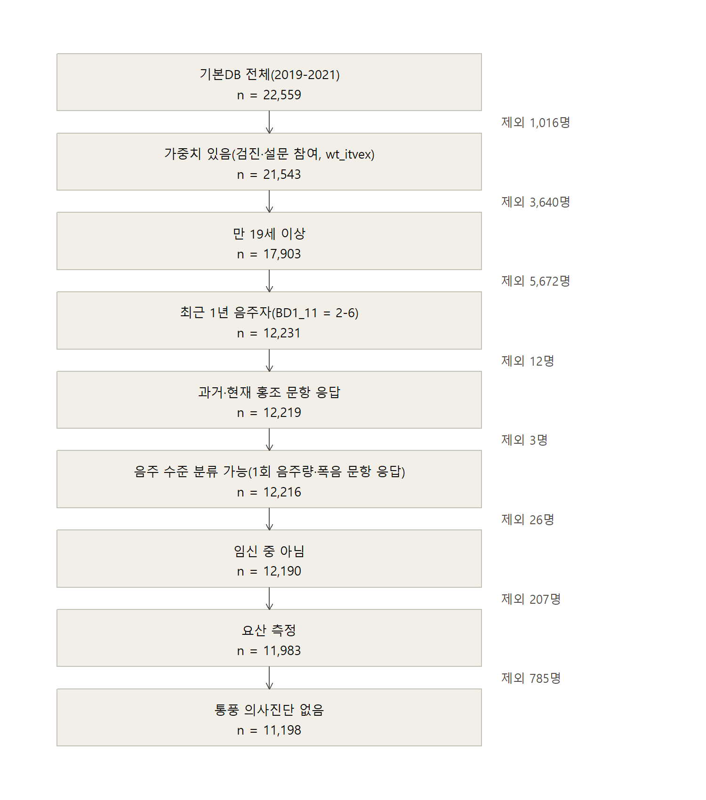
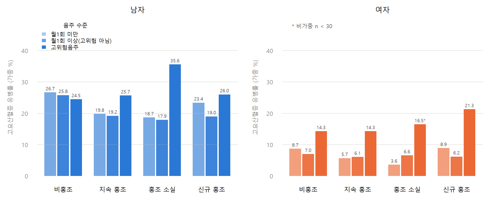
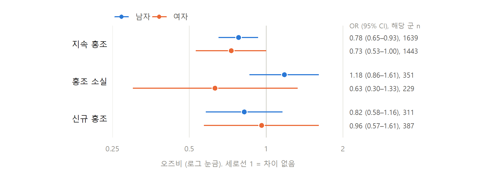
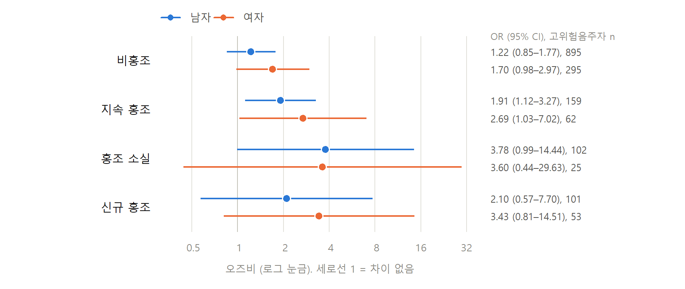
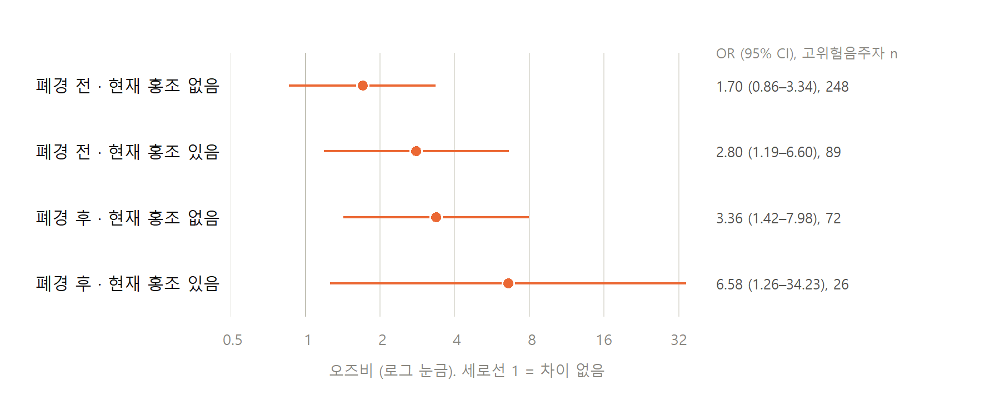

# 한국 성인 음주자에서 음주 관련 안면홍조 패턴이 음주와 고요산혈증의 연관성에 미치는 영향

성별 및 홍조 패턴(비홍조·지속·소실·신규), 여성의 폐경 상태에 따른 분석 — 국민건강영양조사 제8기(2019–2021)

- 보고서 생성: 2026-10-31 19:21
- 분석 코드: `code/03_flushing_hyperuricemia.R` (본 분석), `code/04_flushing_figures.R` (그림), `code/05_flushing_report.R` (이 보고서)
- 분석 환경: R version 4.6.0 (2026-04-24 ucrt), survey 패키지(복합표본)
- 재현성 확인: **PASS** (2026-10-31 18:26:26, 새 R 세션에서 2회 실행 후 결과 CSV 비교)

## 요약

- 분석 대상은 2019–2021년 만 19세 이상 최근 1년 음주자 중 홍조 문항에 응답하고 요산을 측정한 11,198명(통풍 진단자 제외)이다.
- 음주 수준을 보정하면 **지속 홍조군은 비홍조군보다 고요산혈증이 적었다**(남 OR 0.78 (0.65–0.93), 여 OR 0.73 (0.53–1.00)).
- 같은 홍조군 안에서 고위험음주(vs 월1회 미만)의 연관성은 홍조군에서 더 컸다. 남성 비홍조 1.22 (0.85–1.77) → 지속 1.91 (1.12–3.27) → 소실 3.78 (0.99–14.44), 여성 비홍조 1.70 (0.98–2.97) → 지속 2.69 (1.03–7.02) → 소실 3.60 (0.44–29.63).
- 여성은 폐경 후·현재 홍조 있음 군에서 고위험음주의 연관성이 가장 컸다(OR 6.58 (1.26–34.23), 고위험음주자 n = 26).
- 다만 음주 수준 × 홍조 패턴 상호작용은 유의하지 않았고(남 p = 0.118, 여 p = 0.801), 일부 칸의 표본이 작아 신뢰구간이 넓다. 결과는 **경향**으로 해석한다.

## 1. 자료와 복합표본설계

- 자료: 국민건강영양조사 제8기 2019, 2020, 2021년 기본DB(`hn19_all`, `hn20_all`, `hn21_all`). 음주 관련 홍조 문항(BD9_1, BD9_2)은 이 3개 연도에만 있다.
- 가중치: 건강설문·검진 변수만 사용하므로 `wt_itvex`(8기 지침서 PDF p.92 / 인쇄 p.84). 3개 연도를 합치는 통합비율은 각 연도 1/3.
  - 제8기는 예외적으로 조사구 수 비율 대신 **조사기간 비례**로 합친다. 2020년은 코로나19로 192개 중 180개 조사구만 조사했지만 조사기간은 1년으로 같다(8기 지침서 PDF p.36 / 인쇄 p.28, 표 7).
- 층 `kstrata`, 집락 `psu`. 층 안에 집락이 1개뿐인 경우는 없었다.
- 모든 추정은 `svydesign` 설계 객체를 만든 뒤 `subset`으로 분석 대상을 지정해 계산했다(행 삭제 없음).

입력 파일 지문:

| 파일 | 크기 | md5 |
|---|---|---|
| hn19_all.sas7bdat | 101,711,872 | e7ea8b1418ee99e43e7d82a951dd76ea |
| hn20_all.sas7bdat | 83,091,456 | aaf33e81c24721f63987bdfcdfb1c1e7 |
| hn21_all.sas7bdat | 77,856,768 | 2db62da7587d709942f5b0aec135fb0c |

## 2. 변수 정의 (이용지침서 쪽수)

변수의 의미와 코드값은 제8기(2019–2021) 원시자료 이용지침서에서 확인했다. 9·99·999(모름·무응답)는 결측으로, 8·88·888(비해당)은 지침서의 의미를 보고 처리했다.

| 변수 | 설명 | 코드 | 결측코드 | 비해당처리 | 근거 |
|---|---|---|---|---|---|
| id | 개인 아이디 |  |  |  | 8기 PDF p.91 / 인쇄 p.83 |
| year | 조사연도 |  |  |  | 8기 PDF p.91 / 인쇄 p.83 |
| sex | 성별 | 1=남자;2=여자 |  |  | 8기 PDF p.91 / 인쇄 p.83 |
| age | 만나이 | 1~79=세;80=80세이상(탑코딩) |  |  | 8기 PDF p.91 / 인쇄 p.83 |
| psu | 조사구번호(집락) |  |  |  | 8기 PDF p.91 / 인쇄 p.83 |
| kstrata | 분산추정 층 |  |  |  | 8기 PDF p.92 / 인쇄 p.84 |
| wt_itvex | 건강설문-검진조사 가중치 |  |  |  | 8기 PDF p.92 / 인쇄 p.84 |
| incm | 소득 4분위수(개인) | 1=하;2=중하;3=중상;4=상 |  |  | 8기 PDF p.91 / 인쇄 p.83 |
| edu | 교육수준 재분류 | 1=초졸이하;2=중졸;3=고졸;4=대졸이상 |  |  | 8기 PDF p.92 / 인쇄 p.84 |
| bd1 | 평생음주경험 | 1=술을 마셔 본 적 없음;2=있음 | 9 | 8=결측(소아) | 8기 PDF p.161-162 / 인쇄 p.153-154 |
| bd1_11 | 1년간 음주빈도 | 1=최근1년 전혀 안 마심;2=월1회미만;3=월1회정도;4=월2-4회;5=주2-3회;6=주4회이상 | 9 | 8=범주유지(평생 비음주, 문항1-①) | 8기 PDF p.161-162 / 인쇄 p.153-154 |
| bd2_1 | 한 번에 마시는 음주량 | 1=1-2잔;2=3-4잔;3=5-6잔;4=7-9잔;5=10잔 이상 | 9 | 8=범주유지(최근1년 비음주) | 8기 PDF p.161-162 / 인쇄 p.153-154 |
| bd2_14 | 한 번에 마시는 음주량(잔) | 잔(10잔 이상 응답자만) | 999 | 888=결측(문항2-2 ①-④) | 8기 PDF p.161-162 / 인쇄 p.153-154 |
| bd2_31 | 폭음 빈도(7잔 이상) | 1=전혀 없음;2=월1회미만;3=월1회정도;4=주1회정도;5=거의매일 | 9 | 8=범주유지(지침서 고위험음주 정의에 8 포함) | 8기 PDF p.161-162 / 인쇄 p.153-154 |
| bd2_32 | 여자 폭음 빈도(5잔 이상) | 1=전혀 없음;2=월1회미만;3=월1회정도;4=주1회정도;5=거의매일 | 9 | 8=범주유지(지침서 고위험음주 정의에 8 포함) | 8기 PDF p.161-162 / 인쇄 p.153-154 |
| bd9_1 | 과거 알코올 홍조(처음 마시기 시작한 1-2년 사이 소량 음주로 금세 빨개짐) | 1=예;2=아니오 | 9 | 8=결측(평생 비음주·청소년·소아) | 8기 PDF p.163-164 / 인쇄 p.155-156 |
| bd9_2 | 현재 알코올 홍조 | 1=아니오;2=가끔 그렇다;3=자주 그렇다;4=늘 그렇다 | 9 | 8=결측(최근1년 비음주·청소년·소아) | 8기 PDF p.163-164 / 인쇄 p.155-156 |
| he_uacid | 요산 | mg/dL |  |  | 8기 PDF p.200 / 인쇄 p.192 |
| he_uacid_etc | 요산 장비분석범위(2017년부터 1.0 미만 표시) | <1.0=1.0 mg/dL 미만 |  |  | 8기 PDF p.200 / 인쇄 p.192 |
| he_crea | 혈중크레아티닌 | mg/dL |  |  | 8기 PDF p.200 / 인쇄 p.192 |
| dm8_dg | 통풍 의사진단 여부 | 0=없음;1=있음 | 9 | 8=결측(청소년·소아) | 8기 PDF p.137 / 인쇄 p.129 |
| dm8_pt | 통풍 치료 | 0=없음;1=있음 | 9 | 8=범주유지(의사진단 받지 않음 등) | 8기 PDF p.137 / 인쇄 p.129 |
| he_prg | 임신여부 | 0=아니오;1=예 |  | 8=범주유지(비해당-남자) | 8기 PDF p.192 / 인쇄 p.184 |
| lw_ms | 월경여부(여성) | 1=초경하기 전;2=월경중;3=임신중;4=출산후 수유 중;5=자연폐경;6=인공폐경;7=기타 | 9 | 8=결측(만10세미만 여자) | 8기 PDF p.190 / 인쇄 p.182 |
| he_bmi | 체질량지수 | kg/m2 |  |  | 8기 PDF p.198 / 인쇄 p.190 |
| di1_dg | 고혈압 의사진단 | 0=없음;1=있음 | 9 | 8=결측(청소년·소아) | 8기 PDF p.100 / 인쇄 p.92 |
| de1_dg | 당뇨병 의사진단 | 0=없음;1=있음 | 9 | 8=결측(청소년·소아) | 8기 PDF p.112 / 인쇄 p.104 |
| bs1_1 | 평생 흡연 여부 | 현재흡연 정의에만 사용 |  |  | 주요지표 SAS 프로그램: 8기 PDF p.48 / 인쇄 p.40 |
| bs3_1 | 현재 흡연 여부 | 현재흡연 정의에만 사용 |  |  | 주요지표 SAS 프로그램: 8기 PDF p.48 / 인쇄 p.40 |
| pa_aerobic | 유산소 신체활동 실천 | 0=미실천;1=실천 |  |  | 8기 PDF p.188 / 인쇄 p.180 |

분석 변수 만들기:

- **홍조 패턴**: 과거 홍조(BD9_1: 1 예, 2 아니오) × 현재 홍조(BD9_2: 1 아니오, 2 가끔, 3 자주, 4 늘) → 비홍조(과거 아니오·현재 아니오), 지속 홍조(과거 예·현재 가끔 이상), 홍조 소실(과거 예·현재 아니오), 신규 홍조(과거 아니오·현재 가끔 이상). 신규 홍조군은 회상 오류 가능성이 있어 해석에서 제외한다.
- **음주 수준**: 지침서의 고위험음주 정의(주 2회 이상 & 1회 음주량 남 7잔·여 5잔 이상, 8기 PDF p.48 / 인쇄 p.40)에 따라 월1회 미만 / 월1회 이상(고위험 아님) / 고위험음주.
- **고요산혈증**: 혈중 요산(HE_Uacid) 남 ≥ 7.0, 여 ≥ 6.0 mg/dL. *지침서에는 고요산혈증 정의가 없어 문헌 기준을 적용했다(가정).* 요산 1.0 mg/dL 미만(HE_Uacid_etc)은 0.9로 두었다.
- **eGFR**: 혈중 크레아티닌으로 CKD-EPI 2021 식 계산(지침서에 계산식 없음, 가정).
- **폐경**: LW_ms 5(자연폐경)·6(인공폐경) → 폐경 후, 2–4 → 폐경 전.
- **현재흡연**: 지침서 주요지표 SAS 정의(BS1_1, BS3_1) 그대로.

## 3. 대상자 선정 흐름

| 단계 | 남은 n | 제외 |
|---|---|---|
| 기본DB 전체(2019-2021) | 22,559 |  |
| 가중치 있음(검진·설문 참여, wt_itvex) | 21,543 | 1,016 |
| 만 19세 이상 | 17,903 | 3,640 |
| 최근 1년 음주자(BD1_11 = 2-6) | 12,231 | 5,672 |
| 과거·현재 홍조 문항 응답 | 12,219 | 12 |
| 음주 수준 분류 가능(1회 음주량·폭음 문항 응답) | 12,216 | 3 |
| 임신 중 아님 | 12,190 | 26 |
| 요산 측정 | 11,983 | 207 |
| 통풍 의사진단 없음 | 11,198 | 785 |

마지막 단계에서 제외된 사람은 통풍 의사진단자와 통풍 문항 모름·무응답자이다(실행 로그 참조). 모름·무응답자는 교육·신체활동 문항도 결측이라 회귀모형에서는 어차피 빠진다.

## 4. 대상자 특성 (Table 1): 성별 × 홍조 패턴

각 칸은 **가중 추정치 (비가중 n)** 이다. 범주형은 가중 % (SE), 연속형은 가중 평균 (SE).

| 항목 | 통계 | 남자·비홍조 | 남자·지속 홍조 | 남자·홍조 소실 | 남자·신규 홍조 | 여자·비홍조 | 여자·지속 홍조 | 여자·홍조 소실 | 여자·신규 홍조 |
|---|---|---|---|---|---|---|---|---|---|
| 나이 | 가중 평균 (SE) | 44.4 (0.3) (3,306) | 44.9 (0.4) (1,649) | 52.1 (1.0) (361) | 43.7 (1.0) (314) | 43.7 (0.3) (3,392) | 43.6 (0.5) (1,520) | 52.3 (1.3) (241) | 42.6 (0.8) (415) |
| 조사연도: 2019 | 가중 % (SE) | 31.9 (2.3) (1,141) | 37.0 (2.6) (665) | 38.5 (3.8) (140) | 35.1 (3.7) (122) | 31.7 (2.4) (1,176) | 36.8 (2.7) (611) | 39.5 (4.1) (100) | 37.8 (3.5) (162) |
| 조사연도: 2020 | 가중 % (SE) | 34.1 (2.5) (1,133) | 32.2 (2.5) (520) | 32.2 (3.7) (113) | 31.3 (3.9) (96) | 35.6 (2.6) (1,170) | 31.0 (2.6) (468) | 20.5 (3.5) (49) | 27.3 (3.2) (116) |
| 조사연도: 2021 | 가중 % (SE) | 34.1 (2.5) (1,032) | 30.8 (2.5) (464) | 29.4 (3.5) (108) | 33.5 (3.9) (96) | 32.7 (2.5) (1,046) | 32.1 (2.6) (441) | 40.0 (4.2) (92) | 34.9 (3.5) (137) |
| 음주 수준: 월1회 미만 | 가중 % (SE) | 10.7 (0.6) (344) | 32.3 (1.4) (498) | 9.9 (1.7) (35) | 8.6 (1.7) (30) | 31.2 (0.9) (1,114) | 48.3 (1.4) (742) | 33.8 (3.5) (85) | 27.0 (2.4) (119) |
| 음주 수준: 월1회 이상(고위험 아님) | 가중 % (SE) | 62.1 (1.0) (2,061) | 58.7 (1.4) (991) | 57.1 (3.0) (222) | 52.9 (3.5) (183) | 59.4 (1.0) (1,977) | 47.7 (1.5) (716) | 55.1 (3.6) (131) | 59.8 (2.5) (240) |
| 음주 수준: 고위험음주 | 가중 % (SE) | 27.1 (0.9) (901) | 9.0 (0.8) (160) | 33.0 (2.7) (104) | 38.4 (3.5) (101) | 9.3 (0.6) (301) | 4.0 (0.6) (62) | 11.1 (2.3) (25) | 13.2 (1.8) (56) |
| 주당 음주 잔 수(추정) | 가중 평균 (SE) | 14.8 (0.4) (3,306) | 6.2 (0.4) (1,649) | 17.1 (1.1) (361) | 18.7 (1.4) (314) | 4.7 (0.2) (3,392) | 2.3 (0.2) (1,520) | 4.2 (0.5) (241) | 6.0 (0.6) (415) |
| 현재흡연: 비흡연 | 가중 % (SE) | 65.3 (1.0) (2,178) | 66.2 (1.4) (1,115) | 57.3 (2.9) (221) | 58.3 (3.2) (195) | 93.4 (0.5) (3,186) | 92.2 (0.9) (1,414) | 90.5 (2.4) (225) | 88.1 (1.9) (370) |
| 현재흡연: 현재흡연 | 가중 % (SE) | 34.7 (1.0) (1,128) | 33.8 (1.4) (534) | 42.7 (2.9) (140) | 41.7 (3.2) (119) | 6.6 (0.5) (206) | 7.8 (0.9) (106) | 9.5 (2.4) (16) | 11.9 (1.9) (45) |
| 소득 4분위(개인): 하 | 가중 % (SE) | 21.8 (1.0) (736) | 22.9 (1.3) (375) | 22.4 (2.6) (89) | 22.5 (2.8) (72) | 20.8 (1.0) (703) | 24.4 (1.5) (381) | 18.5 (2.8) (51) | 26.6 (2.6) (107) |
| 소득 4분위(개인): 중하 | 가중 % (SE) | 26.1 (1.0) (836) | 24.7 (1.2) (402) | 23.8 (2.8) (89) | 24.5 (2.8) (77) | 23.6 (0.9) (803) | 25.1 (1.4) (382) | 25.4 (3.5) (64) | 23.5 (2.4) (102) |
| 소득 4분위(개인): 중상 | 가중 % (SE) | 25.7 (0.9) (856) | 25.3 (1.2) (414) | 27.8 (3.1) (87) | 31.1 (3.1) (93) | 27.5 (1.0) (903) | 24.8 (1.4) (367) | 26.3 (3.5) (56) | 26.2 (2.5) (110) |
| 소득 4분위(개인): 상 | 가중 % (SE) | 26.3 (1.2) (866) | 27.1 (1.5) (455) | 26.0 (2.8) (95) | 21.9 (2.8) (71) | 28.0 (1.2) (974) | 25.7 (1.5) (386) | 29.8 (3.4) (70) | 23.7 (2.5) (95) |
| 교육수준: 초졸이하 | 가중 % (SE) | 5.3 (0.5) (263) | 6.3 (0.6) (185) | 12.2 (1.6) (71) | 7.8 (1.6) (38) | 8.7 (0.5) (442) | 9.3 (0.8) (205) | 24.1 (3.1) (70) | 7.6 (1.3) (44) |
| 교육수준: 중졸 | 가중 % (SE) | 5.7 (0.4) (249) | 5.5 (0.6) (121) | 11.2 (1.8) (44) | 10.4 (2.0) (34) | 6.5 (0.5) (275) | 5.9 (0.7) (115) | 8.9 (1.8) (28) | 7.7 (1.2) (45) |
| 교육수준: 고졸 | 가중 % (SE) | 39.3 (1.1) (1,265) | 40.4 (1.5) (626) | 37.5 (2.9) (120) | 40.9 (3.3) (124) | 37.6 (1.0) (1,174) | 36.8 (1.4) (538) | 37.1 (3.9) (82) | 42.6 (2.8) (160) |
| 교육수준: 대졸이상 | 가중 % (SE) | 49.7 (1.2) (1,524) | 47.7 (1.7) (714) | 39.1 (3.1) (125) | 40.9 (3.5) (118) | 47.2 (1.1) (1,496) | 48.0 (1.6) (660) | 29.8 (3.8) (60) | 42.1 (2.9) (166) |
| 유산소 신체활동: 미실천 | 가중 % (SE) | 49.7 (1.0) (1,694) | 50.4 (1.4) (858) | 53.9 (3.2) (206) | 49.5 (3.2) (162) | 54.3 (1.1) (1,894) | 57.0 (1.5) (900) | 54.5 (3.8) (139) | 50.2 (2.9) (224) |
| 유산소 신체활동: 실천 | 가중 % (SE) | 50.3 (1.0) (1,604) | 49.6 (1.4) (790) | 46.1 (3.2) (155) | 50.5 (3.2) (152) | 45.7 (1.1) (1,491) | 43.0 (1.5) (618) | 45.5 (3.8) (102) | 49.8 (2.9) (191) |
| 체질량지수 | 가중 평균 (SE) | 25.0 (0.1) (3,297) | 24.7 (0.1) (1,645) | 24.7 (0.2) (353) | 24.9 (0.2) (312) | 23.2 (0.1) (3,376) | 23.1 (0.1) (1,506) | 23.8 (0.3) (238) | 23.5 (0.2) (412) |
| eGFR(CKD-EPI 2021) | 가중 평균 (SE) | 102.1 (0.3) (3,306) | 101.1 (0.4) (1,649) | 97.9 (0.9) (361) | 103.5 (1.0) (314) | 107.7 (0.3) (3,392) | 107.5 (0.4) (1,520) | 100.9 (1.4) (241) | 109.3 (0.7) (415) |
| 고혈압 진단: 없음 | 가중 % (SE) | 80.5 (0.8) (2,494) | 84.5 (1.0) (1,302) | 69.9 (2.7) (236) | 77.9 (2.6) (231) | 86.9 (0.7) (2,827) | 88.8 (0.9) (1,300) | 75.7 (3.0) (174) | 83.1 (2.0) (339) |
| 고혈압 진단: 있음 | 가중 % (SE) | 19.5 (0.8) (812) | 15.5 (1.0) (347) | 30.1 (2.7) (125) | 22.1 (2.6) (83) | 13.1 (0.7) (565) | 11.2 (0.9) (220) | 24.3 (3.0) (67) | 16.9 (2.0) (76) |
| 당뇨병 진단: 없음 | 가중 % (SE) | 92.1 (0.5) (2,976) | 92.0 (0.8) (1,489) | 87.9 (2.0) (311) | 88.4 (1.9) (268) | 95.6 (0.4) (3,211) | 95.2 (0.6) (1,420) | 91.9 (1.9) (219) | 93.9 (1.3) (390) |
| 당뇨병 진단: 있음 | 가중 % (SE) | 7.9 (0.5) (330) | 8.0 (0.8) (160) | 12.1 (2.0) (50) | 11.6 (1.9) (46) | 4.4 (0.4) (181) | 4.8 (0.6) (100) | 8.1 (1.9) (22) | 6.1 (1.3) (25) |
| 폐경(여성): 폐경 전 | 가중 % (SE) | – | – | – | – | 68.6 (1.0) (1,967) | 70.2 (1.4) (915) | 45.1 (4.0) (92) | 71.7 (2.3) (247) |
| 폐경(여성): 폐경 후 | 가중 % (SE) | – | – | – | – | 31.4 (1.0) (1,278) | 29.8 (1.4) (548) | 54.9 (4.0) (141) | 28.3 (2.3) (143) |
| 요산(mg/dL) | 가중 평균 (SE) | 6.2 (0.0) (3,306) | 6.0 (0.0) (1,649) | 6.1 (0.1) (361) | 6.0 (0.1) (314) | 4.5 (0.0) (3,392) | 4.5 (0.0) (1,520) | 4.5 (0.1) (241) | 4.5 (0.1) (415) |
| 고요산혈증: 없음 | 가중 % (SE) | 74.4 (1.0) (2,510) | 80.0 (1.1) (1,343) | 76.2 (2.5) (276) | 77.9 (2.8) (251) | 91.8 (0.6) (3,106) | 93.8 (0.7) (1,413) | 93.3 (2.0) (225) | 91.1 (1.8) (378) |
| 고요산혈증: 있음 | 가중 % (SE) | 25.6 (1.0) (796) | 20.0 (1.1) (306) | 23.8 (2.5) (85) | 22.1 (2.8) (63) | 8.2 (0.6) (286) | 6.2 (0.7) (107) | 6.7 (2.0) (16) | 8.9 (1.8) (37) |

주: 연도 2019–2021, 가중치 wt_itvex × 1/3, 층 kstrata, 집락 psu. n은 비가중 표본 수, %와 평균은 복합표본 가중 추정치. 공복혈당·중성지방 관련 조건은 이 분석에 해당 없음. 남성의 폐경 행은 해당 없음(–).

## 5. 고요산혈증 유병률: 성별 × 홍조 패턴 × 음주 수준

| 성별 | 홍조 패턴 | 음주 수준 | 비가중 n | 고요산혈증 n | 가중 % (SE) |
|---|---|---|---|---|---|
| 남자 | 비홍조 | 월1회 미만 | 344 | 85 | 26.7 (2.8) |
| 남자 | 비홍조 | 월1회 이상(고위험 아님) | 2061 | 497 | 25.8 (1.2) |
| 남자 | 비홍조 | 고위험음주 | 901 | 214 | 24.5 (1.7) |
| 남자 | 지속 홍조 | 월1회 미만 | 498 | 85 | 19.8 (2.2) |
| 남자 | 지속 홍조 | 월1회 이상(고위험 아님) | 991 | 181 | 19.2 (1.5) |
| 남자 | 지속 홍조 | 고위험음주 | 160 | 40 | 25.7 (3.9) |
| 남자 | 홍조 소실 | 월1회 미만 | 35 | 6 | 18.7 (8.1) |
| 남자 | 홍조 소실 | 월1회 이상(고위험 아님) | 222 | 44 | 17.9 (3.0) |
| 남자 | 홍조 소실 | 고위험음주 | 104 | 35 | 35.6 (5.5) |
| 남자 | 신규 홍조 | 월1회 미만 | 30 | 8 | 23.4 (8.1) |
| 남자 | 신규 홍조 | 월1회 이상(고위험 아님) | 183 | 31 | 19.0 (3.7) |
| 남자 | 신규 홍조 | 고위험음주 | 101 | 24 | 26.0 (4.8) |
| 여자 | 비홍조 | 월1회 미만 | 1114 | 95 | 8.7 (1.0) |
| 여자 | 비홍조 | 월1회 이상(고위험 아님) | 1977 | 145 | 7.0 (0.7) |
| 여자 | 비홍조 | 고위험음주 | 301 | 46 | 14.3 (2.2) |
| 여자 | 지속 홍조 | 월1회 미만 | 742 | 48 | 5.7 (0.9) |
| 여자 | 지속 홍조 | 월1회 이상(고위험 아님) | 716 | 49 | 6.1 (1.0) |
| 여자 | 지속 홍조 | 고위험음주 | 62 | 10 | 14.3 (4.5) |
| 여자 | 홍조 소실 | 월1회 미만 | 85 | 2 | 3.6 (2.9) |
| 여자 | 홍조 소실 | 월1회 이상(고위험 아님) | 131 | 11 | 6.6 (2.4) |
| 여자 | 홍조 소실 | 고위험음주 | 25 | 3 | 16.5 (9.3) |
| 여자 | 신규 홍조 | 월1회 미만 | 119 | 10 | 8.9 (3.1) |
| 여자 | 신규 홍조 | 월1회 이상(고위험 아님) | 240 | 18 | 6.2 (1.7) |
| 여자 | 신규 홍조 | 고위험음주 | 56 | 9 | 21.3 (6.5) |

그림의 * 표시는 비가중 n < 30인 칸이다.

## 6. 본 분석 (복합표본 로지스틱·선형 회귀)

보정 변수: 나이, 조사연도, 체질량지수, eGFR, 고혈압·당뇨병 의사진단, 현재흡연, 소득 4분위, 교육수준, 유산소 신체활동. 여성 모형은 폐경 여부를 추가.

### 6-1. 홍조 패턴 자체의 연관성 (음주 수준 보정, 기준 = 비홍조)

| 결과 | 성별 | 홍조 패턴 | OR 또는 차이 (95% CI) | p | 해당 군 n | 기준군 n | 모형 n |
|---|---|---|---|---|---|---|---|
| 고요산혈증(OR) | 남자 | 지속 홍조 | 0.78 (0.65–0.93) | 0.006 | 1639 | 3276 | 5577 |
| 고요산혈증(OR) | 남자 | 홍조 소실 | 1.18 (0.86–1.61) | 0.308 | 351 | 3276 | 5577 |
| 고요산혈증(OR) | 남자 | 신규 홍조 | 0.82 (0.58–1.16) | 0.255 | 311 | 3276 | 5577 |
| 고요산혈증(OR) | 여자 | 지속 홍조 | 0.73 (0.53–1.00) | 0.049 | 1443 | 3219 | 5278 |
| 고요산혈증(OR) | 여자 | 홍조 소실 | 0.63 (0.30–1.33) | 0.225 | 229 | 3219 | 5278 |
| 고요산혈증(OR) | 여자 | 신규 홍조 | 0.96 (0.57–1.61) | 0.877 | 387 | 3219 | 5278 |
| 요산(mg/dL 차이) | 남자 | 지속 홍조 | -0.10 (-0.18, -0.01) | 0.025 | 1639 | 3276 | 5577 |
| 요산(mg/dL 차이) | 남자 | 홍조 소실 | 0.08 (-0.07, 0.24) | 0.301 | 351 | 3276 | 5577 |
| 요산(mg/dL 차이) | 남자 | 신규 홍조 | -0.16 (-0.31, -0.02) | 0.025 | 311 | 3276 | 5577 |
| 요산(mg/dL 차이) | 여자 | 지속 홍조 | -0.05 (-0.11, 0.02) | 0.182 | 1443 | 3219 | 5278 |
| 요산(mg/dL 차이) | 여자 | 홍조 소실 | -0.03 (-0.17, 0.10) | 0.637 | 229 | 3219 | 5278 |
| 요산(mg/dL 차이) | 여자 | 신규 홍조 | -0.08 (-0.21, 0.04) | 0.180 | 387 | 3219 | 5278 |

### 6-2. 홍조군별 음주 수준의 연관성 (기준 = 월1회 미만)

| 결과 | 성별 | 홍조 패턴 | 음주 수준 | OR 또는 차이 (95% CI) | p | 해당 n | 기준군 n | 모형 n |
|---|---|---|---|---|---|---|---|---|
| 고요산혈증(OR) | 남자 | 비홍조 | 월1회 이상(고위험 아님) | 1.14 (0.81–1.62) | 0.453 | 2043 | 338 | 3276 |
| 고요산혈증(OR) | 남자 | 비홍조 | 고위험음주 | 1.22 (0.85–1.77) | 0.283 | 895 | 338 | 3276 |
| 고요산혈증(OR) | 남자 | 지속 홍조 | 월1회 이상(고위험 아님) | 1.04 (0.71–1.51) | 0.842 | 984 | 496 | 1639 |
| 고요산혈증(OR) | 남자 | 지속 홍조 | 고위험음주 | 1.91 (1.12–3.27) | 0.018 | 159 | 496 | 1639 |
| 고요산혈증(OR) | 남자 | 홍조 소실 | 월1회 이상(고위험 아님) | 1.34 (0.36–4.97) | 0.658 | 216 | 33 | 351 |
| 고요산혈증(OR) | 남자 | 홍조 소실 | 고위험음주 | 3.78 (0.99–14.44) | 0.052 | 102 | 33 | 351 |
| 고요산혈증(OR) | 남자 | 신규 홍조 | 월1회 이상(고위험 아님) | 0.99 (0.27–3.62) | 0.993 | 181 | 29 | 311 |
| 고요산혈증(OR) | 남자 | 신규 홍조 | 고위험음주 | 2.10 (0.57–7.70) | 0.260 | 101 | 29 | 311 |
| 고요산혈증(OR) | 여자 | 비홍조 | 월1회 이상(고위험 아님) | 0.98 (0.70–1.38) | 0.920 | 1887 | 1037 | 3219 |
| 고요산혈증(OR) | 여자 | 비홍조 | 고위험음주 | 1.70 (0.98–2.97) | 0.059 | 295 | 1037 | 3219 |
| 고요산혈증(OR) | 여자 | 지속 홍조 | 월1회 이상(고위험 아님) | 1.21 (0.71–2.06) | 0.482 | 678 | 703 | 1443 |
| 고요산혈증(OR) | 여자 | 지속 홍조 | 고위험음주 | 2.69 (1.03–7.02) | 0.044 | 62 | 703 | 1443 |
| 고요산혈증(OR) | 여자 | 홍조 소실 | 월1회 이상(고위험 아님) | 1.16 (0.20–6.67) | 0.864 | 126 | 78 | 229 |
| 고요산혈증(OR) | 여자 | 홍조 소실 | 고위험음주 | 3.60 (0.44–29.63) | 0.232 | 25 | 78 | 229 |
| 고요산혈증(OR) | 여자 | 신규 홍조 | 월1회 이상(고위험 아님) | 0.93 (0.34–2.52) | 0.887 | 228 | 106 | 387 |
| 고요산혈증(OR) | 여자 | 신규 홍조 | 고위험음주 | 3.43 (0.81–14.51) | 0.094 | 53 | 106 | 387 |
| 요산(mg/dL 차이) | 남자 | 비홍조 | 월1회 이상(고위험 아님) | 0.11 (-0.05, 0.27) | 0.169 | 2043 | 338 | 3276 |
| 요산(mg/dL 차이) | 남자 | 비홍조 | 고위험음주 | 0.19 (0.02–0.35) | 0.026 | 895 | 338 | 3276 |
| 요산(mg/dL 차이) | 남자 | 지속 홍조 | 월1회 이상(고위험 아님) | 0.20 (0.03–0.37) | 0.020 | 984 | 496 | 1639 |
| 요산(mg/dL 차이) | 남자 | 지속 홍조 | 고위험음주 | 0.36 (0.08–0.63) | 0.010 | 159 | 496 | 1639 |
| 요산(mg/dL 차이) | 남자 | 홍조 소실 | 월1회 이상(고위험 아님) | 0.14 (-0.44, 0.73) | 0.633 | 216 | 33 | 351 |
| 요산(mg/dL 차이) | 남자 | 홍조 소실 | 고위험음주 | 0.42 (-0.22, 1.06) | 0.196 | 102 | 33 | 351 |
| 요산(mg/dL 차이) | 남자 | 신규 홍조 | 월1회 이상(고위험 아님) | -0.20 (-0.67, 0.27) | 0.394 | 181 | 29 | 311 |
| 요산(mg/dL 차이) | 남자 | 신규 홍조 | 고위험음주 | 0.29 (-0.22, 0.81) | 0.263 | 101 | 29 | 311 |
| 요산(mg/dL 차이) | 여자 | 비홍조 | 월1회 이상(고위험 아님) | 0.04 (-0.04, 0.12) | 0.288 | 1887 | 1037 | 3219 |
| 요산(mg/dL 차이) | 여자 | 비홍조 | 고위험음주 | 0.29 (0.13–0.45) | <0.001 | 295 | 1037 | 3219 |
| 요산(mg/dL 차이) | 여자 | 지속 홍조 | 월1회 이상(고위험 아님) | 0.03 (-0.08, 0.14) | 0.594 | 678 | 703 | 1443 |
| 요산(mg/dL 차이) | 여자 | 지속 홍조 | 고위험음주 | 0.28 (0.02–0.55) | 0.037 | 62 | 703 | 1443 |
| 요산(mg/dL 차이) | 여자 | 홍조 소실 | 월1회 이상(고위험 아님) | 0.06 (-0.23, 0.35) | 0.676 | 126 | 78 | 229 |
| 요산(mg/dL 차이) | 여자 | 홍조 소실 | 고위험음주 | 0.28 (-0.34, 0.91) | 0.373 | 25 | 78 | 229 |
| 요산(mg/dL 차이) | 여자 | 신규 홍조 | 월1회 이상(고위험 아님) | -0.07 (-0.33, 0.19) | 0.585 | 228 | 106 | 387 |
| 요산(mg/dL 차이) | 여자 | 신규 홍조 | 고위험음주 | 0.32 (-0.07, 0.70) | 0.105 | 53 | 106 | 387 |

### 6-3. 상호작용 검정 (Wald)

| 결과 | 검정 | 모형 n | p |
|---|---|---|---|
| 고요산혈증(OR) | 남자: 음주 수준 × 홍조 패턴 | 5577 | 0.118 |
| 고요산혈증(OR) | 여자: 음주 수준 × 홍조 패턴 | 5278 | 0.801 |
| 요산(mg/dL 차이) | 남자: 음주 수준 × 홍조 패턴 | 5577 | 0.446 |
| 요산(mg/dL 차이) | 여자: 음주 수준 × 홍조 패턴 | 5278 | 0.980 |
| 고요산혈증(OR) | 음주 수준 × 성별 (비홍조) | 6636 | 0.043 |
| 고요산혈증(OR) | 음주 수준 × 성별 (지속 홍조) | 3137 | 0.824 |
| 고요산혈증(OR) | 음주 수준 × 성별 (홍조 소실) | 588 | 0.893 |
| 고요산혈증(OR) | 음주 수준 × 성별 (신규 홍조) | 722 | 0.382 |
| 고요산혈증(OR) | 음주 수준 × 홍조 패턴 × 성별 (3원) | 11083 | 0.931 |
| 요산(mg/dL 차이) | 음주 수준 × 성별 (비홍조) | 6636 | 0.076 |
| 요산(mg/dL 차이) | 음주 수준 × 성별 (지속 홍조) | 3137 | 0.317 |
| 요산(mg/dL 차이) | 음주 수준 × 성별 (홍조 소실) | 588 | 0.925 |
| 요산(mg/dL 차이) | 음주 수준 × 성별 (신규 홍조) | 722 | 0.939 |
| 요산(mg/dL 차이) | 음주 수준 × 홍조 패턴 × 성별 (3원) | 11083 | 0.910 |

### 6-4. 여성: 폐경 상태 × 현재 홍조 (기준 = 월1회 미만)

| 결과 | 폐경 | 현재 홍조 | 음주 수준 | OR 또는 차이 (95% CI) | p | 해당 n | 기준군 n | 고요산혈증 사례 수 | 모형 n |
|---|---|---|---|---|---|---|---|---|---|
| 고요산혈증(OR) | 폐경 전 | 현재 홍조 없음 | 월1회 이상(고위험 아님) | 1.29 (0.76–2.18) | 0.340 | 1305 | 494 | 155 | 2047 |
| 고요산혈증(OR) | 폐경 전 | 현재 홍조 없음 | 고위험음주 | 1.70 (0.86–3.34) | 0.124 | 248 | 494 | 155 | 2047 |
| 고요산혈증(OR) | 폐경 전 | 현재 홍조 있음 | 월1회 이상(고위험 아님) | 1.17 (0.66–2.08) | 0.581 | 591 | 470 | 83 | 1150 |
| 고요산혈증(OR) | 폐경 전 | 현재 홍조 있음 | 고위험음주 | 2.80 (1.19–6.60) | 0.019 | 89 | 470 | 83 | 1150 |
| 고요산혈증(OR) | 폐경 후 | 현재 홍조 없음 | 월1회 이상(고위험 아님) | 0.88 (0.54–1.43) | 0.613 | 708 | 621 | 127 | 1401 |
| 고요산혈증(OR) | 폐경 후 | 현재 홍조 없음 | 고위험음주 | 3.36 (1.42–7.98) | 0.006 | 72 | 621 | 127 | 1401 |
| 고요산혈증(OR) | 폐경 후 | 현재 홍조 있음 | 월1회 이상(고위험 아님) | 1.23 (0.61–2.49) | 0.567 | 315 | 339 | 44 | 680 |
| 고요산혈증(OR) | 폐경 후 | 현재 홍조 있음 | 고위험음주 | 6.58 (1.26–34.23) | 0.025 | 26 | 339 | 44 | 680 |
| 요산(mg/dL 차이) | 폐경 전 | 현재 홍조 없음 | 월1회 이상(고위험 아님) | 0.09 (-0.02, 0.19) | 0.095 | 1305 | 494 | 155 | 2047 |
| 요산(mg/dL 차이) | 폐경 전 | 현재 홍조 없음 | 고위험음주 | 0.26 (0.08–0.45) | 0.006 | 248 | 494 | 155 | 2047 |
| 요산(mg/dL 차이) | 폐경 전 | 현재 홍조 있음 | 월1회 이상(고위험 아님) | 0.00 (-0.12, 0.12) | 0.990 | 591 | 470 | 83 | 1150 |
| 요산(mg/dL 차이) | 폐경 전 | 현재 홍조 있음 | 고위험음주 | 0.25 (0.02–0.47) | 0.030 | 89 | 470 | 83 | 1150 |
| 요산(mg/dL 차이) | 폐경 후 | 현재 홍조 없음 | 월1회 이상(고위험 아님) | 0.01 (-0.10, 0.13) | 0.839 | 708 | 621 | 127 | 1401 |
| 요산(mg/dL 차이) | 폐경 후 | 현재 홍조 없음 | 고위험음주 | 0.49 (0.21–0.78) | <0.001 | 72 | 621 | 127 | 1401 |
| 요산(mg/dL 차이) | 폐경 후 | 현재 홍조 있음 | 월1회 이상(고위험 아님) | 0.08 (-0.09, 0.25) | 0.369 | 315 | 339 | 44 | 680 |
| 요산(mg/dL 차이) | 폐경 후 | 현재 홍조 있음 | 고위험음주 | 0.74 (0.15–1.33) | 0.013 | 26 | 339 | 44 | 680 |

### 6-5. 민감도 분석 (고요산혈증, 모형은 6-2와 동일)

| 분석 | 성별 | 홍조 패턴 | 모형 n | OR (95% CI) | p |
|---|---|---|---|---|---|
| S1 통풍 진단자 포함: 고위험음주 vs 월1회 미만 | 남자 | 비홍조 | 3414 | 1.29 (0.91–1.84) | 0.156 |
| S2 주당 7잔 증가당(가정 B) | 남자 | 비홍조 | 3276 | 1.05 (1.01–1.09) | 0.009 |
| S3 통풍 문항 모름·무응답 포함: 고위험음주 vs 월1회 미만 | 남자 | 비홍조 | 3276 | 1.22 (0.85–1.77) | 0.283 |
| S1 통풍 진단자 포함: 고위험음주 vs 월1회 미만 | 남자 | 지속 홍조 | 1680 | 2.21 (1.33–3.68) | 0.002 |
| S2 주당 7잔 증가당(가정 B) | 남자 | 지속 홍조 | 1639 | 1.12 (1.04–1.20) | 0.003 |
| S3 통풍 문항 모름·무응답 포함: 고위험음주 vs 월1회 미만 | 남자 | 지속 홍조 | 1639 | 1.91 (1.12–3.27) | 0.018 |
| S1 통풍 진단자 포함: 고위험음주 vs 월1회 미만 | 남자 | 홍조 소실 | 366 | 4.59 (1.23–17.15) | 0.024 |
| S2 주당 7잔 증가당(가정 B) | 남자 | 홍조 소실 | 351 | 1.23 (1.07–1.41) | 0.003 |
| S3 통풍 문항 모름·무응답 포함: 고위험음주 vs 월1회 미만 | 남자 | 홍조 소실 | 351 | 3.78 (0.99–14.44) | 0.052 |
| S1 통풍 진단자 포함: 고위험음주 vs 월1회 미만 | 남자 | 신규 홍조 | 329 | 1.75 (0.49–6.19) | 0.384 |
| S2 주당 7잔 증가당(가정 B) | 남자 | 신규 홍조 | 311 | 1.11 (0.98–1.25) | 0.114 |
| S3 통풍 문항 모름·무응답 포함: 고위험음주 vs 월1회 미만 | 남자 | 신규 홍조 | 311 | 2.10 (0.57–7.70) | 0.260 |
| S1 통풍 진단자 포함: 고위험음주 vs 월1회 미만 | 여자 | 비홍조 | 3227 | 1.69 (0.97–2.94) | 0.065 |
| S2 주당 7잔 증가당(가정 B) | 여자 | 비홍조 | 3219 | 1.13 (1.02–1.24) | 0.023 |
| S3 통풍 문항 모름·무응답 포함: 고위험음주 vs 월1회 미만 | 여자 | 비홍조 | 3219 | 1.70 (0.98–2.97) | 0.059 |
| S1 통풍 진단자 포함: 고위험음주 vs 월1회 미만 | 여자 | 지속 홍조 | 1452 | 2.26 (0.85–5.99) | 0.101 |
| S2 주당 7잔 증가당(가정 B) | 여자 | 지속 홍조 | 1443 | 1.22 (0.98–1.52) | 0.070 |
| S3 통풍 문항 모름·무응답 포함: 고위험음주 vs 월1회 미만 | 여자 | 지속 홍조 | 1443 | 2.69 (1.03–7.02) | 0.044 |
| S1 통풍 진단자 포함: 고위험음주 vs 월1회 미만 | 여자 | 홍조 소실 | 229 | 3.60 (0.44–29.63) | 0.232 |
| S2 주당 7잔 증가당(가정 B) | 여자 | 홍조 소실 | 229 | 1.25 (0.79–1.97) | 0.344 |
| S3 통풍 문항 모름·무응답 포함: 고위험음주 vs 월1회 미만 | 여자 | 홍조 소실 | 229 | 3.60 (0.44–29.63) | 0.232 |
| S1 통풍 진단자 포함: 고위험음주 vs 월1회 미만 | 여자 | 신규 홍조 | 387 | 3.43 (0.81–14.51) | 0.094 |
| S2 주당 7잔 증가당(가정 B) | 여자 | 신규 홍조 | 387 | 1.28 (0.98–1.66) | 0.070 |
| S3 통풍 문항 모름·무응답 포함: 고위험음주 vs 월1회 미만 | 여자 | 신규 홍조 | 387 | 3.43 (0.81–14.51) | 0.094 |

- S1: 통풍 의사진단자를 포함. S2: 음주 노출을 주당 음주 잔 수(범주 중간값 가정)로 바꾸고 주당 7잔 증가당 OR. S3: 통풍 문항 모름·무응답자를 포함.

## 7. 공식 통계 대조와 재현성

단년도(2019) `wt_itvex`로 만 19세 이상 고위험음주율(조율)을 재현했다. 공식 조율값은 「2019 국민건강통계」에서 표 번호·쪽과 함께 확인해 `official` 열에 넣어야 한다(아직 비어 있음).

| 지표 | 비가중 n | 추정치(%) | SE | 95% CI | 공식값 | CI 포함 | 출처 |
|---|---|---|---|---|---|---|---|
| 만19세 이상 고위험음주율(%), 2019, 조율(crude), 전체 | 6195 | 12.09 | 0.56 | 11.00–13.18 | 미확인 |  | 지표 정의: 8기 PDF p.48 / 인쇄 p.40. 공식값 출처 미확인(국민건강통계 2019 조율값 필요) |
| 만19세 이상 고위험음주율(%), 2019, 조율(crude), 남자 | 2746 | 18.69 | 0.96 | 16.82–20.57 | 미확인 |  | 지표 정의: 8기 PDF p.48 / 인쇄 p.40. 공식값 출처 미확인 |
| 만19세 이상 고위험음주율(%), 2019, 조율(crude), 여자 | 3449 | 5.57 | 0.48 | 4.62–6.51 | 미확인 |  | 지표 정의: 8기 PDF p.48 / 인쇄 p.40. 공식값 출처 미확인 |

주의: 언론에 보도된 '2019년 고위험음주율 14.1%'는 지역사회건강조사(표준화, 시군구 중앙값) 값이고, e-나라지표·주간 건강과 질병의 값은 2005년 추계인구 기준 연령표준화 값이라 조율 추정치와 비교할 수 없다.

재현성 확인: **PASS** — 새 R 세션에서 분석 스크립트를 2회 실행해 결과 CSV의 md5가 모두 같았다(2026-10-31 18:26:26).

## 8. 해석

이 장은 결과를 연구 질문별로 다시 묶어, 숫자가 무엇을 뜻하는지와 어디까지 믿을 수 있는지를 함께 적는다. 표의 수치는 모두 6장 결과와 같다.

### 8-1. 오즈비(OR) 읽는 법

- **OR = 1**이면 두 집단의 고요산혈증 가능성이 같다는 뜻이다. **OR = 1.91**이면 비교군(고위험음주자)의 고요산혈증 오즈가 기준군(월1회 미만 음주자)의 약 1.9배라는 뜻이고, **OR = 0.78**이면 약 22% 낮다는 뜻이다.
- 괄호 안 **95% 신뢰구간(CI)**이 1을 포함하지 않으면 통계적으로 유의하다(p < 0.05). 신뢰구간이 넓을수록 표본이 작아 추정이 불안정하다는 뜻이다.
- 여기서 OR은 고요산혈증의 **상대적인 가능성**을 비교할 뿐, 홍조나 음주가 고요산혈증을 **일으킨다**는 뜻은 아니다(횡단 연구).

### 8-2. 한눈에 보는 결과

| 연구 질문 | 핵심 결과 | 통계적 근거 | 해석의 확실성 |
|---|---|---|---|
| ① 홍조 패턴 자체가 고요산혈증과 관련 있는가? | 지속 홍조군은 비홍조군보다 고요산혈증이 적다. 남 OR 0.78 (0.65–0.93), 여 OR 0.73 (0.53–1.00) | 남 p = 0.006, 여 p = 0.049 | 비교적 확실 |
| ② 홍조군에서 고위험음주의 연관성이 더 큰가? | 고위험음주(vs 월1회 미만) OR: 남 비홍조 1.22 → 지속 1.91 → 소실 3.78, 여 1.70 → 2.69 → 3.60 | 상호작용 p: 남 0.118, 여 0.801 (유의하지 않음) | 경향(통계적으로 확정 못 함) |
| ③ 성별에 따라 다른가? | 비홍조군에서는 음주–고요산혈증 관계가 여성에서 더 강함(남 OR 1.22 vs 여 1.70) | 음주 × 성별 상호작용 p = 0.043(비홍조군); 3원 상호작용 p = 0.931 | 부분적 |
| ④ 여성은 폐경 상태에 따라 다른가? | 폐경 후·현재 홍조 여성에서 고위험음주 OR 6.58 (1.26–34.23) (고위험음주자 n = 26) | p = 0.025, 그러나 신뢰구간이 매우 넓음 | 경향(표본 작음) |
| ⑤ 결과가 분석 방법에 따라 흔들리는가? | 통풍 진단자 포함(S1), 주당 잔 수 척도(S2), 통풍 무응답 포함(S3) 모두 방향 일치 | 7장 참조 | 안정적 |

### 8-3. 발견 1 — 홍조가 있는 사람은 전반적으로 고요산혈증이 적다

| 성별 | 홍조 패턴 | 비가중 n | 고요산혈증 유병률, 가중 % (SE) | 고위험음주 비율, 가중 % (SE) | 고요산혈증 OR (95% CI), 음주 수준 보정 | p |
|---|---|---|---|---|---|---|
| 남자 | 비홍조 | 3,306 | 25.6 (1.0) | 27.1 (0.9) | 1 (기준) |  |
| 남자 | 지속 홍조 | 1,649 | 20.0 (1.1) | 9.0 (0.8) | 0.78 (0.65–0.93) | 0.006 |
| 남자 | 홍조 소실 | 361 | 23.8 (2.5) | 33.0 (2.7) | 1.18 (0.86–1.61) | 0.308 |
| 여자 | 비홍조 | 3,392 | 8.2 (0.6) | 9.3 (0.6) | 1 (기준) |  |
| 여자 | 지속 홍조 | 1,520 | 6.2 (0.7) | 4.0 (0.6) | 0.73 (0.53–1.00) | 0.049 |
| 여자 | 홍조 소실 | 241 | 6.7 (2.0) | 11.1 (2.3) | 0.63 (0.30–1.33) | 0.225 |

- **무엇을 보았나**: 보정하지 않은 유병률부터 지속 홍조군이 낮다(남 20.0% vs 25.6%, 여 6.2% vs 8.2%). 음주 수준과 공변량을 보정해도 지속 홍조군의 OR은 남 0.78 (0.65–0.93), 여 0.73 (0.53–1.00)로 1보다 작았다.
- **왜 그럴까 (가능한 설명)**: 홍조가 있으면 소량의 술에도 불편해 평소 음주량이 적다. 실제로 지속 홍조군의 고위험음주 비율은 남 9.0%(비홍조 27.1%), 여 4.0%(비홍조 9.3%)로 크게 낮다. 다만 음주 수준을 보정한 뒤에도 차이가 남았으므로, 범주형 음주 문항이 잡지 못한 음주량의 차이(잔여 교란)나 홍조와 함께 가는 다른 생활습관이 작용했을 수 있다.
- **홍조 소실군은 다르다**: 과거엔 빨개졌지만 지금은 아닌 사람은 비홍조군과 유병률 차이가 없었다. 이 집단은 나이가 많고(평균 52세) 남성은 고위험음주 비율이 가장 높아, 홍조라는 '경고 신호'가 사라진 뒤 음주가 늘어난 집단일 가능성이 있다.
- **주의**: 이 결과는 '홍조가 요산을 낮춘다'는 뜻이 아니라, 홍조가 있는 사람의 **평균적인 생활 양상**이 고요산혈증과 덜 관련된다는 뜻이다. 홍조 자체의 대사적 효과를 분리하려면 음주량을 더 정밀하게 잰 자료가 필요하다.

### 8-4. 발견 2 — 홍조가 있으면서 많이 마시면, 음주와 고요산혈증의 연관성이 더 크다

| 성별 | 홍조 패턴 | 고위험음주자 n | 기준군(월1회 미만) n | 고위험음주 OR (95% CI) | p | 주당 7잔 증가당 OR (95% CI), S2 |
|---|---|---|---|---|---|---|
| 남자 | 비홍조 | 895 | 338 | 1.22 (0.85–1.77) | 0.283 | 1.05 (1.01–1.09) |
| 남자 | 지속 홍조 | 159 | 496 | 1.91 (1.12–3.27) | 0.018 | 1.12 (1.04–1.20) |
| 남자 | 홍조 소실 | 102 | 33 | 3.78 (0.99–14.44) | 0.052 | 1.23 (1.07–1.41) |
| 여자 | 비홍조 | 295 | 1037 | 1.70 (0.98–2.97) | 0.059 | 1.13 (1.02–1.24) |
| 여자 | 지속 홍조 | 62 | 703 | 2.69 (1.03–7.02) | 0.044 | 1.22 (0.98–1.52) |
| 여자 | 홍조 소실 | 25 | 78 | 3.60 (0.44–29.63) | 0.232 | 1.25 (0.79–1.97) |

- **무엇을 보았나**: 같은 '고위험음주'라도 비홍조군에서는 OR이 1.22(남)·1.70(여)로 뚜렷하지 않은데, 지속 홍조군에서는 1.91(남)·2.69(여)로 유의하게 커지고, 홍조 소실군에서는 3.78(남)·3.60(여)로 더 크다(단, 소실군은 신뢰구간이 매우 넓다).
- **같은 척도로 다시 보아도 같다**: 고위험음주 기준은 남 7잔·여 5잔으로 달라서 남녀 OR을 그대로 비교하면 정의 차이가 섞인다. 그래서 남녀에게 같은 척도(주당 7잔 증가당)를 적용한 S2에서도 비홍조 → 지속 → 소실 순으로 OR이 커지는 방향이 같았다.
- **왜 그럴까 (가능한 설명)**: 홍조는 알코올 대사 효소(ALDH2) 활성이 낮아 아세트알데히드가 쌓이는 체질의 표지로 알려져 있다. 이런 체질에서 같은 양을 마시면 알코올 대사의 부담이 더 크고, 요산 생성이 늘거나 배설이 줄어드는 쪽으로 작용할 가능성이 제안되어 왔다(기전 문헌 인용 필요). 즉 '홍조가 있는데도 많이 마시는 사람'이 가장 취약한 집단일 수 있다.
- **어디까지 믿을 수 있나**: 홍조 패턴에 따라 음주의 효과가 통계적으로 다른지를 보는 상호작용 검정은 유의하지 않았다(남 p = 0.118, 여 p = 0.801). 따라서 '홍조군에서 더 크다'는 것은 **경향**이며, 더 큰 표본에서 확인이 필요하다.

### 8-5. 발견 3 — 여성은 폐경 후 홍조 여성에서 연관성이 가장 크다

| 폐경 상태 | 현재 홍조 | 고위험음주자 n | 기준군 n | 고요산혈증 사례 수 | 고위험음주 OR (95% CI) | p | 요산 차이 mg/dL (95% CI) |
|---|---|---|---|---|---|---|---|
| 폐경 전 | 현재 홍조 없음 | 248 | 494 | 155 | 1.70 (0.86–3.34) | 0.124 | 0.26 (0.08–0.45) |
| 폐경 전 | 현재 홍조 있음 | 89 | 470 | 83 | 2.80 (1.19–6.60) | 0.019 | 0.25 (0.02–0.47) |
| 폐경 후 | 현재 홍조 없음 | 72 | 621 | 127 | 3.36 (1.42–7.98) | 0.006 | 0.49 (0.21–0.78) |
| 폐경 후 | 현재 홍조 있음 | 26 | 339 | 44 | 6.58 (1.26–34.23) | 0.025 | 0.74 (0.15–1.33) |

- **무엇을 보았나**: 고위험음주의 OR은 폐경 전·홍조 없음 1.70 → 폐경 전·홍조 있음 2.80 → 폐경 후·홍조 없음 3.36 → 폐경 후·홍조 있음 6.58로 커졌다. 요산 수치(연속형)도 같은 순서로 차이가 커져, 고요산혈증 기준값 설정과 무관하게 방향이 일관된다.
- **왜 폐경을 나누었나**: 여성호르몬(에스트로겐)은 신장에서 요산이 잘 배설되도록 돕는 것으로 알려져 있어, 폐경 전에는 요산이 낮게 유지되고 폐경 후에 올라간다(기전 문헌 인용 필요). 실제로 홍조 소실군은 폐경 후 비율이 54.9%로 다른 군(약 30%)보다 훨씬 높았다(Table 1). 폐경을 고려하지 않으면 홍조의 효과와 폐경의 효과가 섞인다.
- **성별 차이**: 홍조가 없는 사람들 사이에서는 음주–고요산혈증 관계가 여성에서 더 강했고(음주 × 성별 상호작용 p = 0.043), 같은 척도(S2)로 봐도 주당 7잔 증가당 OR이 여 1.13 (1.02–1.24), 남 1.05 (1.01–1.09)였다. 여성은 기본 요산이 낮아 같은 음주량의 영향이 상대적으로 크게 나타날 수 있다.
- **어디까지 믿을 수 있나**: 폐경 후·홍조 여성 중 고위험음주자는 26명, 고요산혈증 사례는 44건뿐이라 신뢰구간이 1.26–34.23로 매우 넓다. 방향은 일관되지만 크기(OR 6.58)는 과대추정일 수 있다.

### 8-6. 결과는 분석 방법을 바꿔도 유지되는가

| 성별(지속 홍조군) | 본 분석: 고위험음주 OR | S1 통풍 진단자 포함 | S2 주당 7잔 증가당 OR | S3 통풍 무응답 포함 |
|---|---|---|---|---|
| 남자 | 1.91 (1.12–3.27) | 2.21 (1.33–3.68) | 1.12 (1.04–1.20) | 1.91 (1.12–3.27) |
| 여자 | 2.69 (1.03–7.02) | 2.26 (0.85–5.99) | 1.22 (0.98–1.52) | 2.69 (1.03–7.02) |

- 통풍 진단자를 포함하거나(S1), 음주 노출을 연속형 잔 수로 바꾸거나(S2), 통풍 문항 무응답자를 포함해도(S3) 결론의 방향은 같았다. S3은 무응답자가 교육·신체활동 문항도 결측이라 모형 n이 본 분석과 같다.

### 8-7. 선행연구와 비교하면

| 연구 | 대상·자료 | 결과 변수 | 주요 결과 | 본 연구와의 관계 |
|---|---|---|---|---|
| 김어진 등(2015), Korean J Health Promot | 대전 대학병원 건강검진 남성 702명(2013–2014) | 요산–호모시스테인 관계 | 홍조군에서는 요산과 호모시스테인의 연관성이 나타나지 않음 | 같은 주제이나 여성·국가 표본 없음. 본 연구가 여성과 홍조 변화를 추가 |
| Kang & Oh(2023), Nutrients | 국민건강영양조사 2019–2021, 남성 | 대사이상 지방간(MASLD) | 음주–MASLD 연관성이 홍조군에서 더 큼(비홍조 1.90 vs 홍조 2.35), 상호작용 유의 | '홍조군에서 음주의 해가 더 크다'는 방향이 본 연구(발견 2)와 일치 |
| Jeon 등(2022), Sci Rep | 지역사회건강조사 2019, 현재 음주자 약 14만 명 | 우울 | 현재 홍조자만 우울 위험 증가(OR 1.23), 과거 홍조자는 아님 | 현재 홍조 유무로 결과가 갈린다는 점이 본 연구의 '소실군' 구분과 통함 |
| Jee 등(2019), Int J Rheum Dis | 한국인 멘델 무작위 분석(ALDH2 rs671) | 고요산혈증 | 음주→고요산혈증 인과 근거는 남성에서만 시사; rs671 유전형 자체는 고요산혈증과 직접 관련 없음 | 유전형이 아닌 표현형(홍조)에서는 집단별 생활습관이 함께 작용함을 시사 |

- 종합하면, '홍조가 있는 사람에게 음주가 더 해롭다'는 방향은 간 질환(Kang & Oh, 2023)과 요산(본 연구)에서 함께 나타났고, '현재 홍조 유무가 중요하다'는 점은 정신건강 연구(Jeon 등, 2022)와 통한다. 반면 유전형 연구(Jee 등, 2019)에서 ALDH2 변이 자체는 고요산혈증과 직접 관련이 없었으므로, 본 연구의 결과는 체질과 음주 행동이 함께 만든 결과로 보는 것이 타당하다.
- 위 표의 선행연구 수치는 각 논문 초록에서 옮긴 것이며, 인용 전에 원문으로 확인해야 한다.

### 8-8. 실천적 의미

- **간단한 질문으로 위험군을 찾을 수 있다**: "술을 마시면 얼굴이 빨개지나요?"라는 한 문항으로 고요산혈증 위험이 큰 음주자(홍조가 있는데 과음하는 사람)를 가려낼 수 있다. 유전자 검사가 필요 없고 건강검진·상담 현장에서 바로 쓸 수 있다.
- **홍조 기준 절주 권고의 확장**: 국내에는 홍조 여부에 따라 적정 음주량을 절반으로 낮추는 권고가 있다. 본 결과는 그 권고를 통풍·고요산혈증 예방 영역에도 적용할 근거가 될 수 있다.
- **특히 주의할 집단**: ① 과거에 홍조가 있었지만 지금은 사라진 음주자(경고 신호가 사라진 뒤 음주가 늘었을 가능성), ② 폐경 후에도 홍조가 있으면서 고위험음주를 하는 여성.

### 8-9. 해석할 때 주의할 점

1. **경향이지 확정이 아니다.** 홍조 패턴에 따른 음주 효과의 차이는 상호작용 검정에서 유의하지 않았다. 하위 집단의 OR이 크다는 것만으로 '홍조가 음주의 해를 키운다'고 단정할 수 없다.
2. **작은 칸이 있다.** 홍조 소실군의 고위험음주 여성 25명, 폐경 후 홍조 여성의 고위험음주자 26명처럼 수십 명에 기댄 추정치는 신뢰구간이 매우 넓다.
3. **과거 홍조는 기억에 의존한다.** 수십 년 전 체질을 회상한 응답이므로 분류 오류가 있을 수 있다. 특히 '신규 홍조군'은 회상 오류일 가능성이 있어 해석에서 제외했다.
4. **약물 정보가 없다.** 요산저하제·이뇨제 복용 여부를 알 수 없어 통풍 의사진단자를 제외하는 것으로 대신했다.
5. **기준값은 문헌에서 가져왔다.** 고요산혈증 기준(남 7.0·여 6.0 mg/dL)과 eGFR 계산식은 지침서가 아닌 문헌 기준이며, 연속형 요산 분석으로 기준값에 대한 민감성을 보완했다.
6. **횡단 연구다.** 한 시점의 자료이므로 인과관계나 시간적 선후를 말할 수 없다.

### 8-10. 결론

> 음주 관련 안면홍조가 있는 사람은 전반적으로 고요산혈증이 적었지만(지속 홍조군 OR 남 0.78, 여 0.73), 홍조가 있으면서 고위험음주를 하는 경우에는 음주와 고요산혈증의 연관성이 비홍조군보다 커 보였고(남 OR 1.91, 여 2.69), 폐경 후 홍조 여성에서 가장 두드러졌다(OR 6.58). 다만 상호작용 검정이 유의하지 않고 일부 칸의 표본이 작아, 이 차이는 경향으로 해석하며 더 큰 표본에서 확인이 필요하다.

## 9. 한계와 가정

- 횡단 연구이므로 인과관계를 말할 수 없다.
- 음주 수준 × 홍조 패턴 상호작용 검정이 유의하지 않았고, 홍조 소실군·폐경 후 홍조군의 고위험음주자 수가 적다(각 표의 '해당 n' 참고). 결과는 경향으로만 해석한다.
- 과거 홍조는 회상 응답이라 오류가 있을 수 있다. 신규 홍조군은 해석에서 제외했다.
- 고요산혈증 기준(남 7.0·여 6.0 mg/dL), eGFR 계산식, 주당 음주 잔 수의 범주 중간값은 지침서가 아닌 문헌·가정에 근거한다.
- 요산저하제·이뇨제 등 약물 복용 정보가 없어 통풍 의사진단자를 제외하는 것으로 대신했다.
- 고위험음주 기준이 성별로 달라(남 7잔, 여 5잔) 남녀 OR을 그대로 비교하면 정의 차이가 섞인다. 성별 공통 척도 분석(S2)을 함께 보아야 한다.
- 공식 통계 대조의 공식값이 아직 비어 있어, 확보되기 전까지는 예비 결과로 본다.

## 10. 결과 파일

| 파일 | 내용 |
|---|---|
| `01_variable_definitions.csv` | 변수 정의와 지침서 쪽수 |
| `02_participant_flow.csv` | 대상자 선정 흐름 |
| `04_table1.csv`, `04_table1_footnote.txt` | Table 1 |
| `05_official_check.csv` | 공식 통계 대조표 |
| `05b_prevalence_by_sex_flush_drink.csv` | 유병률 표 |
| `06a_drink_by_sex_flush.csv` | 홍조군별 음주 수준의 연관성 |
| `06b_flush_pattern_by_sex.csv` | 홍조 패턴 자체의 연관성 |
| `06c_interaction_tests.csv` | 상호작용 검정 |
| `06d_women_menopause.csv` | 여성 폐경 × 홍조 |
| `07_sensitivity.csv` | 민감도 분석 |
| `fig/fig1~fig5*.png` | 그림 |
| `_inputs.csv`, `_sessionInfo.txt`, `_reproducibility.txt`, `_run_log.txt` | 재현성 기록 |

