# 연구보고서 V3 2부 발표·질의응답 준비 자료

음주 관련 안면홍조 이력에 따른 음주량–고요산혈증 연관성의 차이 (국민건강영양조사 2019–2021) · 과학적 사고와 의학연구 6조

- 작성일: 2026-11-01
- 읽은 자료(드라이브 폴더 5개 파일 전부): 연구보고서_V3.docx, 연구 보고서 수정본 v2 (쉬운 설명).docx, 연구 계획서.docx, 연구계획_발표_v5.pptx(노트 포함), REPORT_안면홍조_고요산혈증.docx
- 추가 근거: 제8기(2019–2021) 원시자료 이용지침서 원문, Jee 외(2019) 초록(PubMed·Wiley·연세대 저장소), 한국 홍조 기반 절주 지침(Lee 외, 2019)
- 예비 집계 재현: `code/09_part2_descriptives.R`로 원시자료에서 다시 계산했고, 발표 v5의 숫자와 **모두 일치**했습니다(6장).
- 그림: `code/10_part2_prep_figures.R` (요산 결과는 쓰지 않음)

## 0. 이 문서를 읽는 법

- **1장**은 시간이 없을 때 읽는 한 장 요약입니다.
- **3장**은 발표 전에 팀이 꼭 정해야 할 불일치 목록입니다. 질문이 들어오기 전에 먼저 정리하세요.
- **5장**은 2부 본문을 문단 단위로 풀어 쓴 해설입니다.
- **7장**이 예상 질문과 답변입니다. 각 질문에 **말할 답변**(그대로 읽어도 되는 1–3문장), **보충 근거**(숫자·쪽수), **꼬리 질문**(이어서 나올 질문)을 붙였습니다.
- 출처 표기: [V3] 연구보고서_V3, [v2] 쉬운 설명본, [계획서] 연구 계획서, [발표] 연구계획_발표_v5, [예비분석] REPORT_안면홍조_고요산혈증, [지침서] 제8기 이용지침서(PDF 쪽 / 인쇄 쪽).
- **확인 필요**라고 적은 내용은 원문을 보지 못했거나 자료끼리 다른 것입니다. 사실처럼 말하지 마세요.

## 1. 한 장 요약: 2부에서 꼭 기억할 15가지

1. **2부 범위**: 선행연구 4(Jee 2019) → 선행연구 종합 → 연구 질문·가설 → 연구 대상 → 연구 설계 → 공변량 → 음주량 정의.
2. **핵심 질문 한 줄**: 같은 양을 마셨을 때, 음주와 고요산혈증의 관계가 홍조 여부(현재)와 홍조 이력(과거·현재)에 따라, 그리고 남녀에 따라 다른가?
3. **Jee 2019**: 관찰 분석에서는 음주와 고요산혈증이 남녀 모두 양의 연관(남 P<0.001, 여 P=0.014). 멘델 무작위(MR)로는 인과가 **남성에서만 시사**되었고 **다중검정 보정 후 유의하지 않음**. **rs671(홍조 유전자) 자체는 고요산혈증과 관련 없음**.
4. **빈틈**: 홍조에 따라 음주의 영향이 달라지는지는 지방간(Kang & Oh 2023)·우울(Jeon 2022)에서만 보였고, 요산에서는 전국 자료로 직접 본 연구가 없습니다.
5. **주질문**: 현재 홍조(가끔·자주·늘) vs 현재 비홍조(아니오). V3 가설은 "홍조군에서 연관성이 더 강하다".
6. **부질문 1**: 홍조 소실군(과거 예·현재 아니오) vs 비홍조군 비교가 중심. 소실 vs 지속은 탐색적. 신규 홍조(과거 아니오·현재 예)는 이력 분석에서 제외.
7. **부질문 2**: 성별 차이. 남녀 공통 결과는 고요산혈증 여부, 여성은 요산 수치(연속형)를 탐색적으로 추가.
8. **대상**: 2019–2021 만 19세 이상 최근 1년 음주자 중 음주량·과거/현재 홍조·요산이 있고 통풍 의사진단이 없는 사람. 통풍 '모름'·무응답도 제외.
9. **최종 인원(예비)**: **10,779명 (남 5,411 · 여 5,368)**. 22,559 → 18,691 → 12,231 → 12,002 → 11,217 → 10,779.
10. **설계**: 단면연구 + 이차자료 분석. 결과는 "조사 당시의 연관성"이며 인과가 아닙니다.
11. **공변량**: 기본(연령·교육·소득·조사연도·흡연·유산소 신체활동) → 확장(+BMI·고혈압·당뇨병·eGFR). 성별 층화 모형에는 성별을 넣지 않습니다.
12. **음주량**: 주당 잔수 = 주당 음주횟수 × 1회 음주량 대표값. '10잔 이상'은 실제 기입값(BD2_14) 사용.
13. **음주 수준**: 저 <3.5 · 중 3.5–14 · 고 ≥14잔/주, 남녀 공통, 저음주가 기준. **3.5·14의 출처는 V3에 없음** → 근거 문장 준비 필요(5-7절).
14. **홍조군은 덜 마십니다**: 주당 잔수 가중평균 남 비홍조 15.5 vs 홍조 8.5, 여 4.8 vs 3.0. 그래서 음주량을 맞춘 비교가 필요합니다.
15. **작은 칸**: 여성 현재 홍조·고음주 **95명**, 여성 홍조 소실·고음주 **17명**. 여성과 이력 분석은 탐색적으로 해석합니다.

## 2. 연구 전체 그림과 2부의 위치

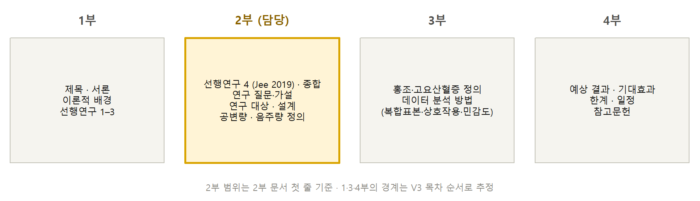

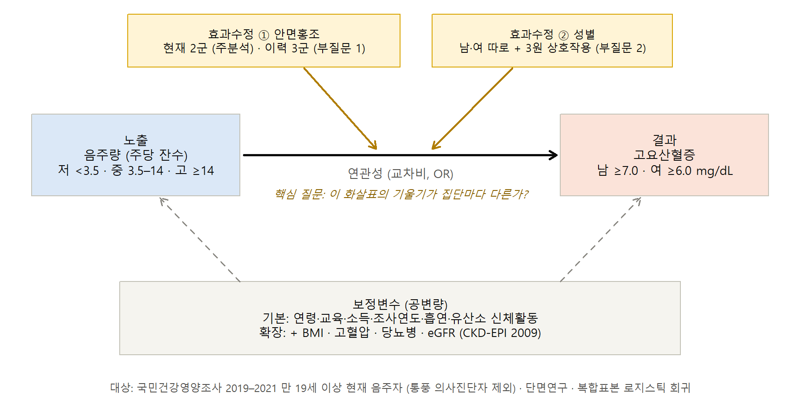

- **제목(국문)**: 한국 성인 현재 음주자에서 음주 관련 안면 홍조 이력에 따른 음주량–고요산혈증 연관성의 차이: 성별 효과수정 분석, 국민건강영양조사 2019–2021
- **제목(영문)**: Sex-Specific Effect Modification of the Association Between Alcohol Consumption and Hyperuricemia by History of Alcohol-Induced Facial Flushing Among Current Drinkers in Korean Adults
- **노출**: 음주량(주당 잔수 → 저·중·고)
- **결과**: 고요산혈증(혈청 요산 남 ≥7.0, 여 ≥6.0 mg/dL)
- **효과수정변수**: 안면홍조(현재 2군, 이력 3군), 성별
- **효과수정**은 "한 요인(홍조)에 따라 다른 요인(음주)의 영향이 달라지는 것"입니다. 그림 2에서 가운데 화살표의 **기울기**가 홍조군과 비홍조군에서 다른지를 보는 연구입니다. 홍조군의 요산이 더 높은지(높이 차이)를 보는 연구가 아닙니다.

## 3. 자료 버전 비교와 발표 전에 정리할 것

드라이브의 문서들은 작성 시점이 달라 내용이 조금씩 다릅니다. 질문자는 발표 슬라이드와 V3를 함께 볼 수 있으므로, 아래 차이를 먼저 맞추거나 답을 준비해야 합니다.

### 3-1. 버전별 차이

| 항목 | 연구 계획서(초기) | v2 · 발표 v5 | V3 (2부 원문) | 예비분석 REPORT |
|---|---|---|---|---|
| 주질문 가설 방향 | 홍조군에서 더 가파름 | **방향 정하지 않음**("다를 것") | **홍조군에서 더 강함** | 해당 없음 |
| 부질문 1 가설 | 소실군도 연관성 큼 | 소실군과 비홍조군은 "차이" | 소실군이 "더 강함" | 해당 없음 |
| 음주 노출 | 성별 삼분위 | 3.5·14잔 공통 기준 | 3.5·14잔 공통 기준 | 국건영 고위험음주 정의 |
| 홍조 분류 | 4군(신규 포함) | 현재 2군 + 이력 3군 | 현재 2군 + 이력 3군 | 4군 |
| 여성 폐경 분석 | 있음(탐색적) | 없음 | 없음 | 있음 |
| eGFR 식 | 언급 없음 | 언급 없음 | CKD-EPI 2009 | CKD-EPI 2021 |
| 고요산혈증 | 남 >7.0, 여 >6.0 (초과) | 이상(≥) | 이상(≥) | 이상(≥) |
| 최종 인원 | 11,768명(음주자) | 10,779명 | 확정 예정 | 11,198명 |

### 3-2. 발표 전에 결정하거나 고칠 것 (우선순위 순)

1. **가설 방향을 하나로 맞추세요.** V3는 "홍조군에서 더 강할 것", 발표 v5 슬라이드 6의 본문은 "위험이 더 클 것"인데 노트는 "방향을 일부러 정하지 않았다"입니다. 두 방향 모두 근거가 있으므로(5-3절), **"차이가 있을 것이다(방향은 양측 검정으로 확인)"**로 통일하고, V3의 기전은 "예상하는 방향과 그 이유"로 소개하는 것을 권합니다. V3 3부도 이미 **양측검정**을 명시하고 있어 이 표현과 맞습니다.
2. **3.5잔·14잔의 근거 문장을 넣으세요.** V3에 출처가 없습니다. 답변은 Q52에 준비했습니다.
3. **예비분석 REPORT의 요산 결과를 발표에서 인용하지 마세요.** 발표 v5는 "음주·홍조별 요산 결과는 분석 전까지 보지 않음"이라고 밝혔습니다. REPORT에는 다른 정의로 계산한 홍조별 요산 결과가 이미 들어 있어서, 인용하면 이 말과 충돌합니다. "다른 정의로 해 본 탐색 분석이 있다"는 질문이 나오면 Q62처럼 답하세요.
4. **eGFR 식을 하나로 정하세요.** V3는 2009식, REPORT는 2021식입니다.
5. **고혈압·당뇨병 정의를 확인하세요.** V3의 "국건영 유병 여부 정의"(HE_HP, HE_DM_HbA1c)를 쓰면 보정변수 결측이 438명이고, 의사진단 변수를 쓰면 119명입니다. 차이(319명)는 대부분 당뇨병 유병 변수의 **8시간 공복 조건** 때문입니다(Q33).
6. **Jee 2019 슬라이드의 "유전자 분석 11,678명" 표현을 고치세요.** 11,678명은 **SNP를 찾은 2017년 음주 GWAS의 인원**입니다. MR 분석 인원은 초록에 없습니다(Q6).
7. **요산 1.0 미만 4명의 처리를 정하세요.** 발표 v5는 결측으로 뺐습니다. REPORT는 0.9로 넣었습니다. 결과에는 거의 영향이 없지만 흐름도 숫자가 달라집니다.
8. **김어진 2015의 '잔'은 14g 기준**이고, 국건영의 '잔'은 소주잔(약 7g)입니다. 같은 "잔"으로 비교하지 마세요(Q10).

## 4. 배경지식: 질문의 바탕이 되는 내용

### 4-1. 요산은 무엇이고 왜 올라가는가

- 요산은 **퓨린의 최종 분해산물**입니다. 퓨린은 DNA·RNA와 에너지 물질 ATP의 재료입니다.
- 경로: 퓨린 → 하이포잔틴 → 잔틴 → 요산 (잔틴 산화효소). 사람은 요산을 더 분해하는 효소(우리카아제)가 없어서 요산이 최종 산물로 남습니다.
- 출처: 몸 안에서 생기는 것이 약 2/3, 음식이 약 1/3입니다. 배설은 신장(소변)이 약 2/3, 장이 약 1/3입니다.
- 고요산혈증은 "많이 만들어지거나"(생성 증가) "덜 나가는"(배설 감소) 경우입니다. 대부분은 배설 감소 쪽입니다.
- 공변량과의 연결: 신장 기능(eGFR), 비만·인슐린 저항성(BMI·당뇨병), 고혈압(이뇨제·신장 손상)은 모두 요산 배설에 영향을 줍니다. 그래서 확장 모형에 들어갑니다.

### 4-2. 알코올 대사, 홍조, 요산

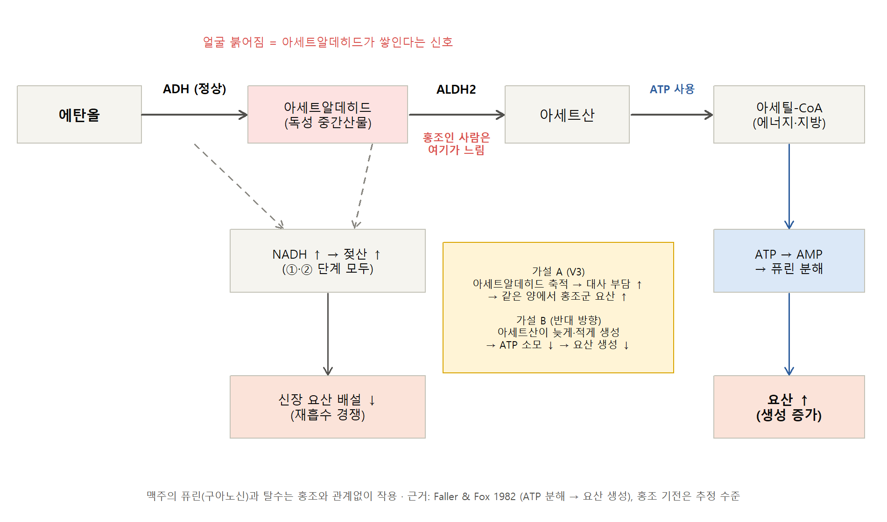

- 에탄올은 ADH에 의해 **아세트알데히드**로, 다시 **ALDH2**에 의해 아세트산으로 바뀝니다. 홍조인 사람은 대부분 ALDH2 활성이 낮아 두 번째 단계가 느리고, 아세트알데히드가 쌓여 얼굴이 붉어집니다.
- 술이 요산을 올리는 경로:
  - **생성 증가**: 아세트산을 아세틸-CoA로 바꿀 때 ATP가 AMP로 분해되고, 그 분해 산물이 요산이 됩니다(Faller & Fox 1982: 통풍 환자 6명에게 8일간 술을 주었더니 요산이 8.4 → 10.1 mg/dL로 올랐고 배설은 오히려 늘어, 원인을 생성 증가로 보았음 [발표 노트]).
  - **배설 감소**: 대사 과정에서 NADH가 늘고 젖산이 늘면, 신장에서 요산 배설이 줄어듭니다.
  - **음식 효과**: 맥주에는 퓨린(구아노신)이 많습니다. 국건영에는 주종 정보가 없습니다(한계).
- **가설 A (V3)**: 아세트알데히드가 쌓여 같은 양에서도 대사 부담이 크다 → 홍조군에서 기울기가 가파르다.
- **가설 B (반대 방향)**: ATP를 쓰는 단계(아세트산 활성화)는 ALDH2 **다음**에 있습니다. 홍조군은 아세트산이 늦게·적게 생겨 ATP 소모가 줄 수 있습니다 → 기울기가 완만하다. 다만 마신 알코올은 결국 대부분 아세트산이 되므로 **총량은 비슷하고 속도만 다를** 수 있고, 젖산 경로는 홍조와 관계없이 남아 있습니다.
- 결론: 기전만으로는 방향을 정할 수 없습니다. 그래서 **양측 검정**으로 확인하는 것이 맞습니다.

### 4-3. 홍조 설문은 믿을 만한가

- 지침서 문항 원문 [지침서 PDF p.164 / 인쇄 p.156]:
  - BD9_1(과거): "과거 술을 처음 마시기 시작했던 1–2년 사이에는 맥주 1잔(소주 1잔) 정도 소량의 음주로 금세 얼굴이 빨개지는 체질이었습니까?" → 예 / 아니오. 평생 음주 경험자만 응답.
  - BD9_2(현재): "현재 맥주 1잔(소주 1잔) 정도 소량의 음주로 금세 얼굴이 빨개지는 체질입니까?" → 아니오 / 가끔 그렇다 / 자주 그렇다 / 늘 그렇다. **최근 1년 음주자만 응답**.
- 타당도: 이 두 문항 구조의 설문은 일본 남성에서 ALDH2 결핍을 민감도 90%, 특이도 88%로 찾았습니다(Brooks 2009 [발표 노트], 대부분 40세 이상). Jeon 2022는 한국인에서 민감도 95.1%, 특이도 76.5%라고 기술했습니다 [계획서].
- 과거 문항은 **홍조에 익숙해진 사람(홍조 소실)**을 찾아내기 위해 들어간 것입니다 [발표 노트].

### 4-4. 효과수정(상호작용)과 오즈비 읽는 법

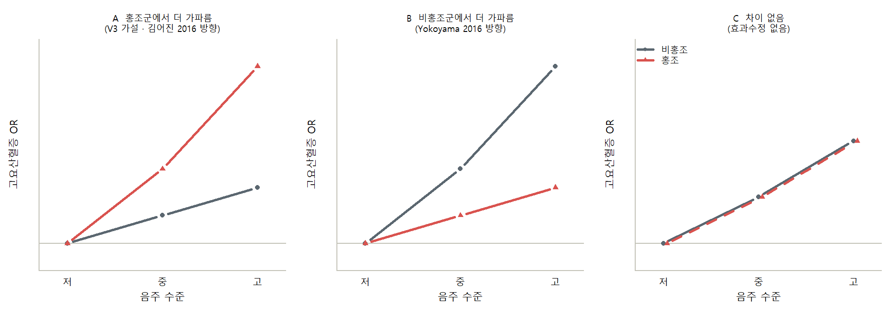

- **효과수정 = 상호작용**: 모형에 '음주 수준 × 홍조' 항을 넣고, 그 항들이 0인지 함께 검정합니다(설계 기반 Wald 검정, V3 3부).
- 로지스틱 회귀의 상호작용은 **곱셈 척도(OR의 비)**입니다. "OR이 몇 배 다른가"를 보는 것이고, 유병률 차이(덧셈 척도)와는 다를 수 있습니다.
- **OR = 1**이면 차이 없음. 신뢰구간이 1을 포함하면 차이가 없을 수도 있다는 뜻입니다.
- 단면자료의 OR은 **유병 오즈비**입니다. 남성처럼 결과가 흔하면(남성 고요산혈증 약 24%) OR이 유병률 비보다 크게 나옵니다. "위험이 몇 배"라고 말하지 말고 "가능성(오즈)이 몇 배"라고 말하세요.
- 상호작용이 유의하지 않을 때: 신뢰구간이 좁으면 "차이가 작다", 넓으면 "판단하기에 자료가 부족하다"로 구분합니다(V3 4부, 발표 슬라이드 14).

### 4-5. 성별과 요산

- 여성은 요산이 낮습니다. 에스트로겐이 신장의 요산 배설을 돕는 것으로 설명합니다. 폐경 후에는 요산이 올라갑니다.
- 예비 집계에서 고요산혈증은 남 23.6%(1,201명), 여 7.7%(427명)입니다(성별 전체, 가중 %).
- 같은 음주 기준을 써도 여성은 고음주자가 적습니다(고음주 남 26.7%, 여 6.8%).

## 5. 2부 본문 해설

### 5-1. 선행연구 4: Jee 외(2019)

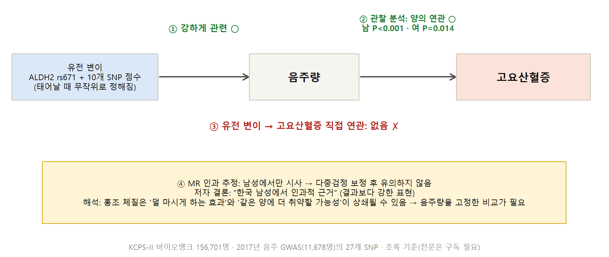

| 항목 | 내용 |
|---|---|
| 서지 | Jee YH, Jung KJ, Park YB, Spiller W, Jee SH. Int J Rheum Dis 2019;22(10):1912–1919. doi:10.1111/1756-185X.13668 |
| 자료 | 한국암예방연구-II(KCPS-II) 바이오뱅크, 만 20세 이상 건강한 한국인 156,701명 |
| 도구변수 | 2017년 KCPS-II 음주 GWAS(11,678명)의 27개 SNP(rs671 포함) → 연관불균형을 고려한 10개 SNP로 가중·비가중 유전위험점수 |
| ① 유전→음주 | rs671과 점수 모두 남녀에서 음주 증가와 관련(강한 도구변수) |
| ② 음주→고요산혈증 | 관찰 분석에서 양의 연관: 남 P<0.001, 여 P=0.014 |
| ③ 유전→고요산혈증 | rs671 G(주) 대립유전자와 점수 모두 관련 없음 |
| ④ MR 인과 추정 | 남성에서만 인과 시사, 다중검정 보정 후 유의하지 않음 |
| 민감도 | 고음주자·고령자를 빼도 결과 같음 |
| 저자 결론 | 한국 남성에서 음주가 고요산혈증의 인과적 위험요인이라는 근거 (결과보다 강한 표현) |
| 확인 못 한 것 | OR·신뢰구간, 고요산혈증 기준값, MR 분석 인원, MR 추정 방법 (전문은 구독 필요) |

- **V3의 요약 평가**: "남녀 모두 양의 연관, 유전자료 분석도 했으나 인과를 확정하지 못함"은 정확합니다. 더 구체적으로 쓰려면 Q2의 문장을 쓰세요.
- **본 연구에 주는 의미**
  - 남녀를 나눠 분석하는 근거입니다.
  - **rs671 자체가 고요산혈증과 무관**하다는 결과는 오히려 본 연구의 필요성을 보여 줍니다. 홍조 체질은 "덜 마시게 하는 효과"와 "같은 양에 더 취약할 가능성"이 함께 있어, 둘이 상쇄되면 순효과가 0처럼 보일 수 있습니다. 그래서 **음주량을 고정한 비교**가 필요합니다.
  - MR은 "유전자는 음주를 통해서만 결과에 영향을 준다"(배제 제약)고 가정합니다. ALDH2가 같은 음주량의 효과 자체를 바꾼다면(본 연구 가설) 이 가정이 깨집니다.
- **여성에서 인과 근거가 없었던 이유(추론)**: 같은 바이오뱅크의 공개 자매연구(PLoS One 2016, 음주와 혈당 MR)에서 rs671 AA 여성의 음주 경험률은 0%, GA 20.8%, GG 55.1%였고, 도구변수 강도(F)는 남 302.6, 여 44.3이었습니다. 여성은 음주가 적어 유전형에 따른 음주 차이가 작고 통계적 힘이 약했을 가능성이 큽니다. Jee 2019가 같은 하위코호트를 썼는지는 **확인 필요**입니다.
- **일관된 다른 연구**: 중국 한족 연구에서 rs671 A 보유자는 **남성에서만** 요산이 낮았고(Wu 2021, 6,461명; Zhang 2018), 그 차이의 상당 부분(약 57–94%)은 유전자 때문에 술을 덜 마셔서로 설명되었습니다(Zhang 2018 [발표 노트]). 여성은 관련이 없었습니다(p=0.409).

### 5-2. 선행연구 종합: 무엇이 비어 있나

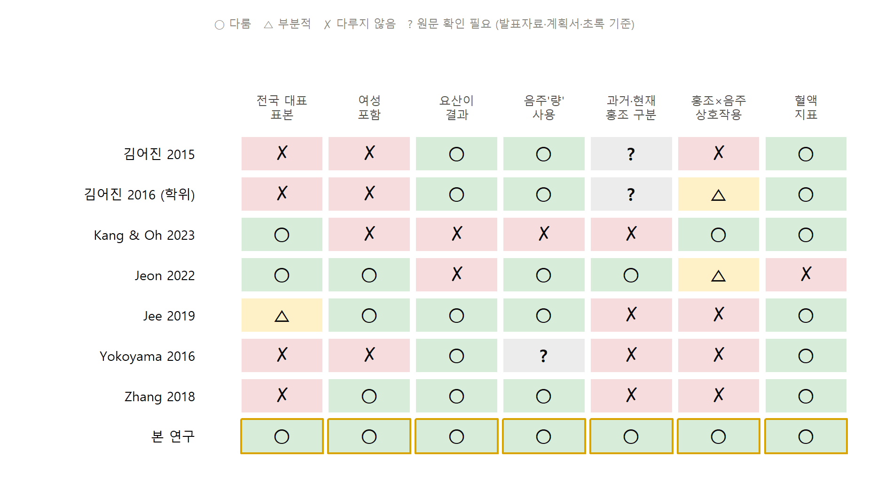

- 논리의 순서:
  1. 음주량과 고요산혈증은 관련이 있다(Jee 2019).
  2. 홍조군은 덜 마셨는데 요산은 비슷했다(김어진 2015) → 홍조에 따른 요산을 보려면 음주량을 함께 봐야 한다.
  3. 홍조에 따라 음주의 영향이 달라지는지는 지방간(Kang & Oh 2023)과 우울(Jeon 2022)에서만 보였다 → 요산에서 같은 양상인지는 설명할 수 없다.
  4. 따라서 음주량과 홍조 이력을 함께 고려해 고요산혈증과의 연관성을 직접 보고, 성별 차이까지 살펴본다.
- 각 선행연구 핵심 숫자:

| 연구 | 대상 | 핵심 결과 | 한계 |
|---|---|---|---|
| 김어진 2015 | 대전 대학병원 검진 남성 702명(홍조 301·비홍조 401) | 주당 음주 중앙값 7.5 vs 12.5잔(1잔=14g), 요산 6.3 vs 6.4 mg/dL | 단일 기관·남성만, 원래 주제는 요산–호모시스테인 |
| 김어진 2016(학위) | 남성 845명(홍조 382·비홍조 463) | 홍조군은 주 2잔 미만에서도 OR 3.33(1.01–10.98), 비홍조군은 8잔 초과부터 OR 2.61 (각 군 비음주자 대비) | 학술지 미게재, 남성만 · 원문 확인 필요 |
| Kang & Oh 2023 | 국건영 2019–2021 남성 5,134명 | 지방간 OR 비홍조 1.90, 홍조 2.35, 상호작용 P<0.001(LAP만) | 빈도로만 구분, 홍조 '자주·늘'만, 과거 홍조 미구분, HSI·NLFS에서는 비유의 |
| Jeon 2022 | 지역사회건강조사 2019 현재 음주자 139,380명 | 현재 홍조 우울 aOR 1.23(1.12–1.34), 과거 홍조는 차이 없음 | 혈액검사 없음, 결과가 우울 |
| Jee 2019 | KCPS-II 156,701명 | 관찰 연관 남녀 모두, MR은 남성에서만 시사 | 홍조 이력 없음 |

- **가장 비슷한 선행연구는 김어진 2016 학위논문**입니다. 차별점은 ① 전국 대표 자료(가중치), ② 여성 포함, ③ 과거·현재 홍조 구분, ④ 상호작용 검정입니다 [발표 노트].

### 5-3. 연구 질문과 가설

| 구분 | 질문 | V3 가설 | 비교 |
|---|---|---|---|
| 주질문 | 남녀 각각에서 음주량–고요산혈증 연관성이 현재 홍조군과 비홍조군 사이에 다른가 | 홍조군에서 더 강함 | 현재 홍조(가끔·자주·늘) vs 아니오 |
| 부질문 1 | 홍조 패턴(비홍조·지속·소실)에 따라 다른가, 특히 소실 vs 비홍조 | 소실군이 비홍조군보다 더 강함 | 중심: 소실 vs 비홍조 · 탐색: 소실 vs 지속 |
| 부질문 2 | 홍조에 따른 차이가 남녀 사이에서도 다른가 | 성별에 따라 다른 양상 | 음주×홍조×성별 3원 상호작용, 여성 연속형 요산 탐색 |

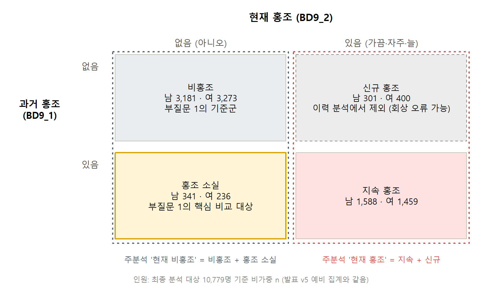

- **주질문의 근거(V3)**: 홍조 = 아세트알데히드를 빨리 분해하지 못한다는 신호 → 같은 양에서도 대사 부담이 큼. 홍조군은 덜 마셨는데도 요산이 비슷했음(김어진 2015).
- **반대 근거**: 일본 알코올의존 남성 1,759명에서 ALDH2가 정상인 유전형은 요산 >7 위험이 1.48배, 알코올을 빨리 분해하는 ADH1B 유전형은 2.04배였습니다(Yokoyama 2016 [발표 노트]). 알코올의존 환자라서 일반 성인에 그대로 적용하기 어렵습니다.
- **부질문 1의 근거**: 과거에 홍조가 있었다면 원래 ALDH2가 약한 체질일 수 있으므로, 지금 홍조가 사라졌어도 반응은 지속 홍조군에 가까울 수 있습니다. **소실의 원인은 특정하지 않습니다**(내성, 음주 습관, 회상 오류 모두 가능).
- **주분석과 이력 분석의 관계**: 주분석의 '현재 비홍조'는 비홍조 + 소실, '현재 홍조'는 지속 + 신규입니다. 이력 분석에서는 신규 홍조(남 301, 여 400)를 뺍니다. 두 분석은 **따로 제시**합니다.
- **부질문 2의 근거**: 에스트로겐의 요산 배설 촉진, 여성의 낮은 요산 수준, Jee 2019·Zhang 2018·Wu 2021에서 남성에서만 관련이 보인 점.
- **여성 연속형 분석**: 여성은 고요산혈증 사례가 적어(전체 427명) 이분형 OR이 불안정할 수 있습니다. 요산 수치는 기준값과 관계없이 정보가 많습니다. **탐색적**으로 제시하고, 실제 n과 사례 수를 함께 봅니다.

### 5-4. 연구 대상

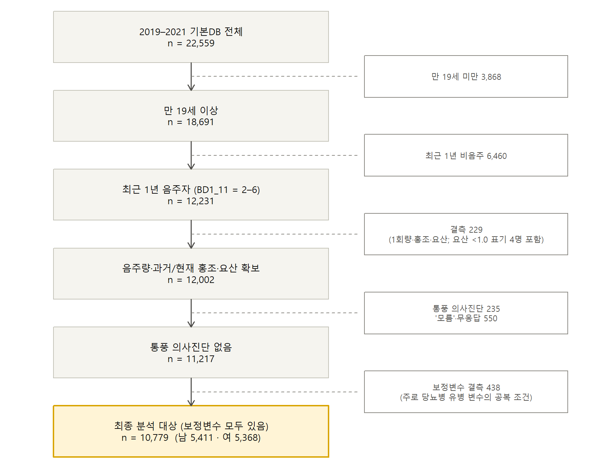

| 단계 | 기준 | 변수와 근거 | 남은 n | 제외 |
|---|---|---|---|---|
| 1 | 2019–2021 기본DB 전체 | hn19·20·21_all | 22,559 |  |
| 2 | 만 19세 이상 | age (80 = 80세 이상 탑코딩) | 18,691 | 3,868 |
| 3 | 최근 1년 음주자 | BD1_11 = 2–6 [지침서 PDF p.161 / 인쇄 p.153] | 12,231 | 6,460 |
| 4 | 음주량·과거/현재 홍조·요산 확보 | BD2_1·BD2_14, BD9_1·BD9_2, HE_Uacid | 12,002 | 229 |
| 5 | 통풍 의사진단 없음 | DM8_dg = 0 [지침서 PDF p.137 / 인쇄 p.129] | 11,217 | 785 (진단 235, 모름·무응답 550) |
| 6 | 보정변수 모두 있음 | 9개 공변량 | **10,779** (남 5,411 · 여 5,368) | 438 |

- 4단계 229명 안에는 요산이 "<1.0"(장비 측정 하한 미만)으로 표기된 4명이 들어 있습니다 [지침서 PDF p.200 / 인쇄 p.192].
- 6단계 438명은 대부분 **당뇨병 유병 변수(HE_DM_HbA1c)가 결측**인 사람입니다. 이 변수는 8시간 이상 공복한 비임신자에서만 정의됩니다 [지침서 PDF p.199 / 인쇄 p.191]. 의사진단 변수로 바꾸면 결측은 119명입니다.
- **임신부**: 음주자 중 임신부 26명은 모두 HE_DM_HbA1c가 결측이라 6단계에서 자동으로 빠집니다. V3에는 따로 적혀 있지 않으므로, 질문이 나오면 이 점을 말하세요.
- **비해당(8) 처리**: 홍조 문항의 8(비음주자·청소년 비해당)은 "홍조 없음"으로 보지 않습니다(V3 3부: 모름·무응답·비해당은 홍조 없음으로 처리하지 않음).
- **해석 대상**: 통풍 의사진단력이 없는 성인 현재 음주자입니다.

### 5-5. 연구 설계와 절차

- **단면연구**: 음주·홍조·요산을 같은 시점에 잰 자료입니다. "관련이 있다"까지만 말할 수 있습니다.
- **이차자료 분석**: 질병관리청이 이미 조사해 공개한 원시자료를 씁니다.
- **해석 범위**: 조사 당시의 연관성. 음주 후 고요산혈증이 새로 생기는 과정이나 인과관계로 해석하지 않습니다.
- **연도별 점검**: 세 해의 조사표와 지침서를 확인합니다. 원시자료에서도 세 해 모두 bd1_11·bd2_1·bd2_14·bd9_1·bd9_2·he_uacid·dm8_dg가 같은 이름으로 있음을 확인했습니다.
- **역인과 예**: 통풍이나 고요산혈증을 알게 된 뒤 술을 줄였다면 연관성이 약하게 보입니다. 통풍 진단자를 빼는 이유 중 하나입니다.

### 5-6. 공변량

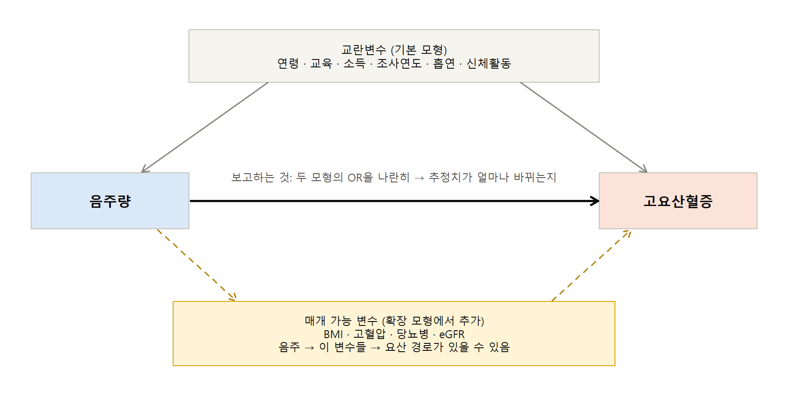

| 변수 | 정의(예비 집계 기준) | 근거 | 넣는 이유 |
|---|---|---|---|
| 연령 | age, 연속형 | 지침서 PDF p.91 / 인쇄 p.83 | 음주와 요산 모두와 관련 |
| 교육수준 | edu 4범주 | 지침서 PDF p.92 / 인쇄 p.84 | 사회경제적 위치 |
| 소득수준 | incm 개인 소득 4분위 | 지침서 PDF p.91 / 인쇄 p.83 | 사회경제적 위치 |
| 조사연도 | 2019·2020·2021 | 지침서 PDF p.91 / 인쇄 p.83 | 2020년 코로나19 등 연도 차이 |
| 흡연상태 | 현재흡연(BS1_1·BS3_1) | 지침서 PDF p.48 / 인쇄 p.40 | 음주와 함께 가는 생활습관 |
| 유산소 신체활동 | pa_aerobic 실천 여부 | 지침서 PDF p.188 / 인쇄 p.180 | 생활습관 |
| BMI | he_bmi, 연속형 | 지침서 PDF p.198 / 인쇄 p.190 | 비만·인슐린 저항성 |
| 고혈압 | HE_HP 유병(3 = 고혈압) | 지침서 PDF p.196 / 인쇄 p.188 | 이뇨제·신장 손상 |
| 당뇨병 | HE_DM_HbA1c 유병(3 = 당뇨병) | 지침서 PDF p.199 / 인쇄 p.191 | 대사질환 |
| eGFR | 혈청 크레아티닌·연령·성별, CKD-EPI 2009 | 계산식은 지침서에 없음(문헌식) | 요산의 주 배설 경로가 신장 |

- **단계적 보정(V3 3부)**: 기본 모형(연령·교육·소득·조사연도·흡연·신체활동) → 확장 모형(+BMI·고혈압·당뇨병·eGFR). 확장 변수는 음주가 요산을 올리는 **중간 경로(매개)**일 수도 있으므로, 두 모형을 나란히 보고 추정치가 얼마나 바뀌는지 봅니다.
- **성별**: 남녀를 나눈 모형에는 넣지 않고, 전체 대상의 성별 비교 모형에만 넣습니다.
- **보정하지 못한 것**: 약물(이뇨제·요산저하제), 식이(퓨린·과당), 주종(맥주). V3 한계에 적혀 있습니다.

### 5-7. 음주량의 정의

- **공식**: 주당 음주잔수 = (BD1_11을 주당 횟수로 바꾼 값) × (BD2_1의 대표값, 10잔 이상은 BD2_14).
- **'잔'의 정의**: 술 종류와 관계없이 각 술의 잔으로 셉니다. 캔맥주 1개(355cc)는 맥주 1.6잔, 소주 1병은 7잔 [지침서 PDF p.162 / 인쇄 p.154].
- **환산표(발표 v5·v2)**:

| 음주 빈도(BD1_11) | 대표값 | 1회 음주량(BD2_1) | 대표값 |
|---|---|---|---|
| 월 1회 미만 | 월 0.5회 | 1–2잔 | 1.5잔 |
| 월 1회 정도 | 월 1회 | 3–4잔 | 3.5잔 |
| 월 2–4회 | 월 3회 | 5–6잔 | 5.5잔 |
| 주 2–3회 정도 | 주 2.5회 | 7–9잔 | 8잔 |
| 주 4회 이상 | 주 5.5회 | 10잔 이상 | BD2_14 기입값 |

- 월 → 주 환산은 ×12/52(약 ÷4.33)로 했습니다(예비 집계 재현 기준).
- **10잔 이상 기입값(BD2_14)**: 최근 1년 음주자 중 응답 범위 10–42잔, 중앙값 14잔, '모름' 1명.

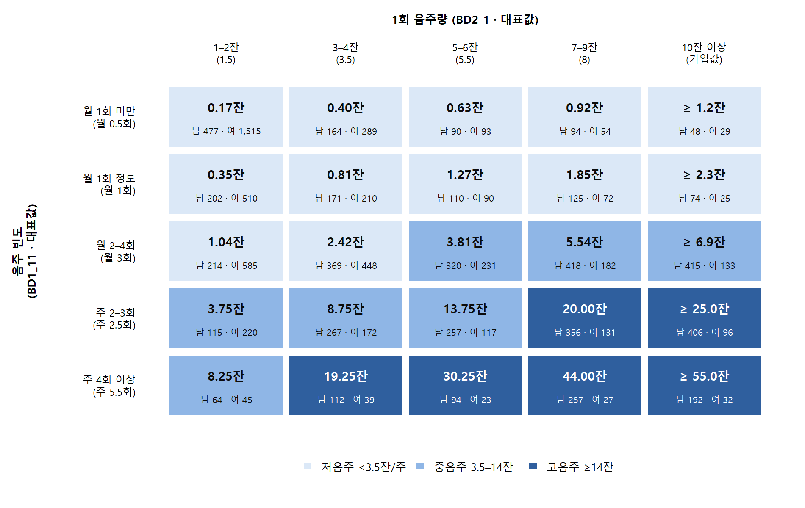

- 격자에서 보이는 **경계의 특징** (질문 대비):
  - "주 2–3회 × 5–6잔" = 13.75잔 → **중음주**입니다(남 257, 여 117명). 그런데 여성은 국건영 고위험음주 정의(주 2회 이상, 1회 5잔 이상)에 해당합니다.
  - "주 2–3회 × 1–2잔" = 3.75잔 → 중음주, "월 2–4회 × 3–4잔" = 2.42잔 → 저음주입니다.
  - "월 1회 정도 × 10잔 이상"은 기입값이 15.2잔 이상이어야 중음주가 됩니다. 한 번에 많이 마셔도 드물게 마시면 저음주로 분류됩니다(폭음 패턴을 놓침).
- **3.5잔·14잔의 의미**: 하루 평균 0.5잔·2잔입니다. 국건영 1잔은 약 7g(소주 1병 360mL = 7잔, 도수 약 17% 가정)이므로 3.5잔 ≈ 25g, 14잔 ≈ 98g/주입니다.

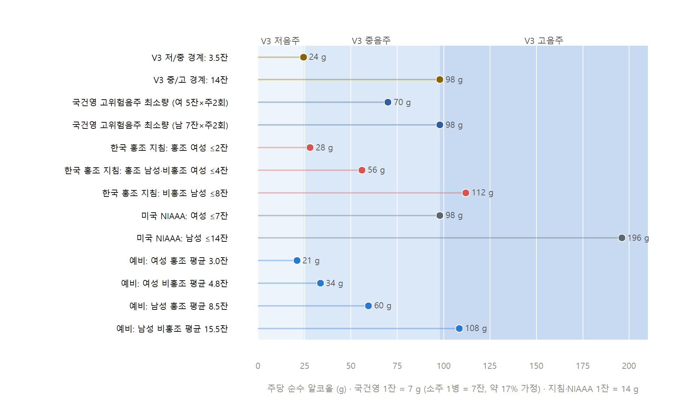

- **기준값 근거로 쓸 수 있는 것**:
  1. **14잔 = 국건영 남성 고위험음주의 최소 주간량**(1회 7잔 × 주 2회)입니다 [고위험음주 정의: 지침서 PDF p.48 / 인쇄 p.40].
  2. g으로는 약 98g으로, 한국 홍조 기반 절주 지침의 비홍조 남성 한도(주 8표준잔 = 112g)에 가깝고, 홍조 남성 한도(56g)의 약 2배입니다(Lee 2019, 1표준잔 = 14g).
  3. 숫자 "14"는 미국 NIAAA의 남성 주 14잔과 같지만, 미국은 1잔 = 14g이라서 **국건영 14잔은 미국 7잔(여성 한도)에 해당**합니다. "미국 기준을 따랐다"고 말하면 틀립니다.
  4. 3.5잔은 직접 근거를 찾지 못했습니다. "하루 평균 반 잔 미만, 거의 마시지 않는 수준을 기준범주로 둔 것"으로 설명하고, 연속형 분석·다른 분류로 민감도를 확인한다고 답하세요.
- **남녀 공통 기준을 쓰는 이유**: 남녀 차이를 비교하려면 노출 척도가 같아야 합니다. 성별로 다른 기준(예: 고위험음주 남 7잔·여 5잔)을 쓰면 정의 차이와 실제 차이가 섞입니다.
- **홍조별 기준을 쓰지 않는 이유**: 홍조가 효과수정변수이므로, 노출 기준을 홍조에 따라 바꾸면 비교가 성립하지 않습니다.

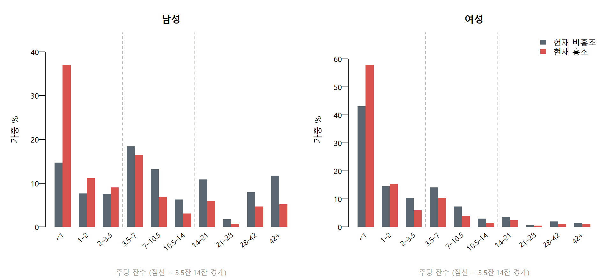

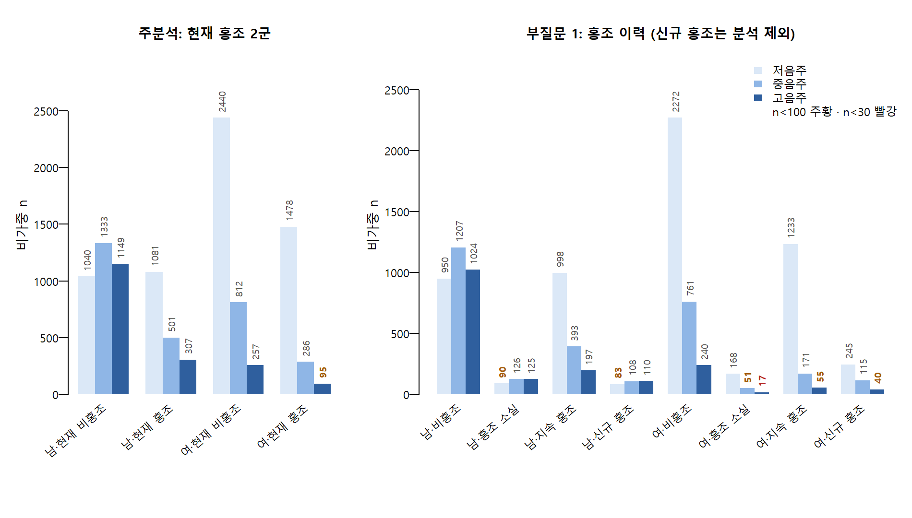

## 6. 예비 집계(발표 v5) 재현 결과

발표 v5의 수치는 생성형 AI를 활용해 R로 계산했다고 밝혔습니다. 이 문서를 만들면서 원시자료에서 독립적으로 다시 계산했고, **모든 수치가 일치**했습니다.

| 항목 | 발표 v5 | 재현 | 일치 |
|---|---|---|---|
| 만 19세 이상 → 음주자 | 18,691 → 12,231 | 18,691 → 12,231 | 일치 |
| 음주량·홍조·요산 확보 | 12,002 | 12,002 | 일치 |
| 통풍 제외 후 | 11,217 (진단 235, 모름 550) | 11,217 (235, 550) | 일치 |
| 최종 | 10,779 (남 5,411 · 여 5,368) | 10,779 (5,411 · 5,368) | 일치 |
| 주당 잔수 가중평균 남 비홍조 / 홍조 | 15.5 / 8.5 | 15.5 (SE 0.38) / 8.5 (SE 0.43) | 일치 |
| 주당 잔수 가중평균 여 비홍조 / 홍조 | 4.8 / 3.0 | 4.8 (SE 0.21) / 3.0 (SE 0.19) | 일치 |
| 현재 홍조 % 남 / 여 | 35.0 / 33.6 | 35.0 / 33.6 | 일치 |
| 고음주 % 남 / 여 | 26.7 / 6.8 | 26.7 / 6.8 | 일치 |
| 고요산혈증 남 / 여 | 23.6% (1,201) / 7.7% (427) | 23.6% (1,201) / 7.7% (427) | 일치 |

- 재현 조건: 요산 "<1.0" 4명은 결측, 고혈압·당뇨병은 국건영 유병 변수(HE_HP·HE_DM_HbA1c), 가중치 wt_itvex × 1/3, 층 kstrata, 집락 psu.
- **현재 홍조 × 음주 수준 (비가중 n)**:

| 집단 | 저음주 | 중음주 | 고음주 |
|---|---|---|---|
| 남 · 현재 비홍조 | 1,040 | 1,333 | 1,149 |
| 남 · 현재 홍조 | 1,081 | 501 | 307 |
| 여 · 현재 비홍조 | 2,440 | 812 | 257 |
| 여 · 현재 홍조 | 1,478 | 286 | 95 |

- **홍조 이력 × 음주 수준 (비가중 n, 발표 v5에 없던 표)**:

| 집단 | 저음주 | 중음주 | 고음주 | 합계 |
|---|---|---|---|---|
| 남 · 비홍조 | 950 | 1,207 | 1,024 | 3,181 |
| 남 · 홍조 소실 | 90 | 126 | 125 | 341 |
| 남 · 지속 홍조 | 998 | 393 | 197 | 1,588 |
| 남 · 신규 홍조 | 83 | 108 | 110 | 301 |
| 여 · 비홍조 | 2,272 | 761 | 240 | 3,273 |
| 여 · 홍조 소실 | 168 | 51 | **17** | 236 |
| 여 · 지속 홍조 | 1,233 | 171 | 55 | 1,459 |
| 여 · 신규 홍조 | 245 | 115 | 40 | 400 |

- **주당 잔수 가중 분위수**: 남 중앙값 5.5잔, 75% 19.3잔, 90% 35.0잔 · 여 중앙값 1.0잔, 75% 3.8잔, 90% 9.7잔.
- **작은 칸의 기대 사례 수**(성별 전체 유병률로 단순 계산한 값이며 실제 결과가 아님): 여성 현재 홍조·고음주 95명 × 약 8% ≈ 8명, 여성 지속 홍조·고음주 55명 ≈ 4명, 여성 소실·고음주 17명 ≈ 1–2명. 이 칸들은 OR을 안정적으로 추정하기 어렵습니다.
- **요산 결과를 보지 않았다는 원칙**: 이 재현에서도 음주 수준·홍조별 요산 결과는 계산하지 않았습니다.

## 7. 예상 질문과 답변 (2부)

### A. 선행연구 4(Jee 2019)와 선행연구 종합

### Q1. Jee 외(2019)는 한 줄로 어떤 연구인가요?

- **말할 답변:** 한국인 바이오뱅크 자료로 음주가 고요산혈증의 원인인지를 유전자를 이용해 확인하려 한 멘델 무작위 연구입니다. 관찰 분석에서는 남녀 모두 음주가 많을수록 고요산혈증이 많았습니다.
- **보충 근거:** 남 P<0.001, 여 P=0.014. KCPS-II 156,701명.
- **꼬리 질문:** "그럼 인과관계는 확인됐나요?" → Q2.

### Q2. 그 연구의 유전자료 분석 결과는 구체적으로 어땠나요?

- **말할 답변:** ALDH2 rs671 등 음주 관련 유전 변이는 남녀 모두에서 음주량과 강하게 관련됐지만, 유전 변이 자체는 고요산혈증과 관련이 없었습니다. 인과 효과는 남성에서만 시사되었고, 여러 번 검정한 것을 보정하면 유의하지 않았습니다.
- **보충 근거:** 2017년 음주 GWAS(11,678명)의 27개 SNP → 10개 SNP 유전위험점수. 저자 결론은 "한국 남성에서 인과적 근거"로 결과보다 강합니다. OR 수치는 본문에 있고 초록에는 P값만 있습니다.
- **꼬리 질문:** "OR이 얼마였나요?" → "초록에는 P값만 있고 OR은 본문 표에 있습니다. 본문을 확보해 보고서에 보완하겠습니다."

### Q3. 멘델 무작위(MR)가 무엇인가요?

- **말할 답변:** 태어날 때 무작위로 정해지는 유전자를 음주의 대리변수로 써서, 생활습관 같은 교란요인을 피해 음주가 정말 원인인지를 보는 방법입니다. 유전자가 음주를 바꾸고, 그 유전자가 고요산혈증과도 관련되면 음주가 원인이라는 근거가 됩니다.
- **보충 근거:** 세 가정 ① 유전자가 음주와 관련 ② 유전자가 교란요인과 무관 ③ 유전자는 음주를 통해서만 결과에 영향(배제 제약).

### Q4. "홍조 유전자는 고요산혈증과 관련이 없었다"면, 홍조로 차이를 보겠다는 연구와 모순 아닌가요?

- **말할 답변:** 모순이 아니라 오히려 본 연구가 필요한 이유입니다. 홍조 체질은 술을 덜 마시게 해서 요산을 낮추는 쪽과, 같은 양에 더 취약하게 해서 높이는 쪽이 함께 있을 수 있습니다. 두 효과가 상쇄되면 유전자의 순효과는 0처럼 보이므로, 음주량을 고정하고 비교해야 합니다.
- **보충 근거:** 예비 집계에서 홍조군은 실제로 덜 마십니다(남 8.5 vs 15.5잔). 중국 연구에서도 rs671과 요산의 관련 대부분이 음주량 차이로 설명되었습니다(Zhang 2018, 약 57–94%).
- **꼬리 질문:** "그럼 MR 결과도 틀렸다는 건가요?" → "ALDH2가 같은 양의 효과를 바꾼다면 MR의 배제 제약 가정이 깨질 수 있다는 뜻입니다. 저희 연구가 그 가정을 간접적으로 점검하는 셈입니다."

### Q5. 여성에서는 왜 인과 근거가 없었을까요?

- **말할 답변:** 여성은 음주량이 적어 유전형에 따른 음주 차이가 작고, 통계적 힘이 약했을 가능성이 큽니다. 에스트로겐의 요산 배설 효과도 함께 작용했을 수 있습니다.
- **보충 근거:** 같은 바이오뱅크의 자매연구에서 rs671 AA 여성의 음주 경험률 0%, 도구변수 강도 F 남 302.6 · 여 44.3(PLoS One 2016). Jee 2019가 같은 하위코호트였는지는 확인 필요입니다.

### Q6. Jee 연구의 유전자 분석 인원은 몇 명인가요?

- **말할 답변:** 초록에 나온 11,678명은 음주 관련 유전 변이를 찾은 2017년 GWAS의 인원입니다. MR 분석에 들어간 인원은 초록에 따로 나와 있지 않아, 본문으로 확인하겠습니다.
- **보충 근거:** 발표 v5 슬라이드 5의 "(유전자 분석 11,678명)"은 오해를 줄 수 있어 수정을 권합니다.

### Q7. Jee 연구를 남녀를 나눠 보는 근거로 쓴 이유는 무엇인가요?

- **말할 답변:** 관찰 분석에서 남녀 모두 연관이 있었지만 강도가 달랐고(남 P<0.001, 여 P=0.014), 인과 근거는 남성에서만 보였습니다. 음주와 요산의 관계가 성별로 다를 수 있다는 근거입니다.

### Q8. 선행연구 종합에서 말하는 "빈틈"을 한 문장으로 말해 보세요.

- **말할 답변:** 홍조에 따라 음주의 영향이 달라지는지는 지방간과 우울에서만 확인됐고, 요산에서 이를 음주량과 과거·현재 홍조 이력을 함께 고려해 전국 자료로 직접 본 연구는 없습니다.

### Q9. 지방간이나 우울 결과로 요산을 설명할 수 없는 이유는 무엇인가요?

- **말할 답변:** 결과마다 기전이 다르기 때문입니다. 요산은 퓨린 대사와 신장 배설로 결정되므로, 간이나 정신건강에서 보인 패턴이 요산에서도 같다고 가정할 수 없습니다.
- **꼬리 질문:** "Kang & Oh도 지표에 따라 결과가 달랐죠?" → "네. LAP에서는 상호작용이 유의했지만(P<0.001) HSI와 NLFS에서는 유의하지 않았습니다(P=0.118, 0.102). 그래서 지방간에서도 결론이 일관되지 않습니다."

### Q10. 김어진 2015의 "덜 마셨는데 요산이 비슷했다"는 강한 근거인가요?

- **말할 답변:** 강한 근거는 아니고, 가설을 세우게 한 단서입니다. 교란요인을 보정하지 않은 단순 비교였고, 원래 주제도 요산과 호모시스테인의 관계였습니다. 그래서 같은 음주 수준에서 직접 비교하는 본 연구가 필요합니다.
- **보충 근거:** 그 연구의 1잔은 알코올 14g입니다. 국건영 잔(약 7g)으로 바꾸면 홍조군 약 15잔, 비홍조군 약 25잔입니다.

### Q11. 본 연구와 가장 비슷한 선행연구는 무엇이고, 무엇이 다른가요?

- **말할 답변:** 김어진 선생님의 2016년 학위논문입니다. 홍조군은 주 2잔 미만에서도, 비홍조군은 8잔 초과부터 고요산혈증 위험이 커졌습니다. 저희는 전국 대표 자료로 여성을 포함하고, 과거·현재 홍조를 구분하고, 상호작용을 직접 검정한다는 점이 다릅니다.
- **보충 근거:** 남성 845명, 홍조군 OR 3.33 (1.01–10.98), 비홍조군 OR 2.61 [발표 노트]. 각 군의 비음주자와 비교한 값이고, 학술지 미게재입니다. 원문 확인 필요.

### B. 연구 질문과 가설

### Q12. 왜 홍조군에서 연관성이 더 강하다고 예상하나요?

- **말할 답변:** 홍조는 아세트알데히드를 빨리 분해하지 못한다는 신호라서, 같은 양을 마셔도 대사적 부담이 더 클 수 있습니다. 실제로 홍조군이 덜 마셨는데도 요산이 비슷했다는 보고가 있습니다.
- **보충 근거:** 식도암(Brooks 2009)과 지방간(Kang & Oh 2023)에서 홍조군의 음주 위험이 더 컸습니다.

### Q13. 오히려 반대일 수도 있지 않나요? (ATP가 덜 분해되어 요산이 덜 생길 수도)

- **말할 답변:** 가능합니다. 술이 ATP를 소모하는 단계는 아세트산을 활성화하는 단계인데, ALDH2가 약하면 아세트산이 늦게 생깁니다. 일본 연구에서는 ALDH2가 정상인 사람의 요산이 더 높았습니다. 그래서 방향을 미리 단정하지 않고 양측 검정으로 확인합니다.
- **보충 근거:** Yokoyama 2016(일본 알코올의존 남성 1,759명: ALDH2 정상형 OR 1.48, ADH1B 빠른형 OR 2.04). 반대 기전에도 한계가 있습니다. 결국 대부분 아세트산이 되어 총량은 비슷할 수 있고, 젖산 경로는 남아 있습니다(4-2절).

### Q14. 가설의 방향을 정한 건가요, 안 정한 건가요? 보고서와 슬라이드가 다른데요.

- **말할 답변:** 예상하는 방향은 홍조군에서 더 강하다는 쪽이지만, 반대 방향의 근거도 있어 검정은 방향을 두지 않는 양측 검정으로 합니다. 결과가 반대로 나와도 그대로 보고하고 해석합니다.
- **보충 근거:** V3 3부 "모든 검정은 양측검정", V3 4부 "예상과 반대 방향의 연관성이 관찰되는 경우에도 해당 결과를 제시". 발표 전에 문서 표현을 통일하세요(3-2절).

### Q15. 왜 현재 홍조를 주분석으로, 이력을 부분석으로 했나요?

- **말할 답변:** 현재 홍조는 지금 상담 현장에서 바로 물을 수 있는 실용적인 정보이고 인원도 충분합니다. 이력 분류는 소실군의 인원이 적고 과거 회상에 의존하므로 부분석으로 둡니다.
- **보충 근거:** 소실군 남 341, 여 236명. 여성 소실·고음주 17명.

### Q16. '가끔 그렇다'까지 홍조로 본 이유는 무엇인가요? Kang & Oh는 '자주·늘'만 봤는데요.

- **말할 답변:** 문항이 "소량에 금세 빨개지는 체질"을 묻고 있어, 가끔이라도 그런 반응이 있으면 대사 능력이 낮은 쪽으로 봤습니다. Jeon 등도 '가끔 이상'을 현재 홍조로 정의했습니다. 기준에 따라 결과가 바뀌는지는 '자주·늘'만 홍조로 본 민감도 분석으로 확인할 수 있습니다.
- **보충 근거:** Jeon 2022 정의 [계획서]. '자주·늘' 민감도 분석은 V3에 없으므로 추가를 검토하세요.

### Q17. 홍조 소실은 무엇이고 왜 생기나요?

- **말할 답변:** 술을 처음 마시던 1–2년에는 빨개졌는데 지금은 빨개지지 않는 경우입니다. 반복 음주에 따른 내성, 음주 습관의 변화, 기억 오류 등이 가능하지만, 저희 연구는 원인을 판단하지 않고 그 집단에서 보이는 연관성만 봅니다.
- **보충 근거:** 문항 원문은 4-3절. V3 4부: 소실군이 지속군과 비슷해도 내성이라 단정하지 않고, 비홍조군과 비슷해도 대사 능력이 회복됐다고 해석하지 않습니다.

### Q18. 소실군이 정말 원래 ALDH2 결핍 체질인가요?

- **말할 답변:** 국민건강영양조사에는 유전형 자료가 없어 직접 확인할 수 없습니다. 과거 홍조는 그 가능성을 보여 주는 간접 지표이고, 후속 연구에서 유전형으로 검증할 과제입니다.

### Q19. 과거엔 없었는데 지금 생긴 '신규 홍조'는 어떻게 처리하나요?

- **말할 답변:** 주분석에서는 현재 홍조가 있으므로 현재 홍조군에 들어갑니다. 이력 분석에서는 세 패턴에 해당하지 않고 회상 오류일 가능성이 있어 제외합니다.
- **보충 근거:** 남 301, 여 400명. 계획서에는 고혈압 연구에서 신규 홍조군의 위험이 가장 높았다는 언급이 있습니다(Park 2022 [계획서], 원문 확인 필요).

### Q20. 소실군과 지속군의 비교는 왜 탐색적인가요?

- **말할 답변:** 소실군 인원이 적고, 두 집단 모두 과거 홍조가 있어 차이가 작을 수 있기 때문입니다. 미리 정한 핵심 비교는 현재 홍조가 없는 사람끼리의 비교, 즉 소실군과 비홍조군입니다.

### Q21. 성별 차이의 근거가 에스트로겐이라면, 폐경 전후로 나눠야 하지 않나요?

- **말할 답변:** 좋은 지적입니다. 초기 계획에는 폐경 분석이 있었지만, 하위집단이 너무 작아져 V3에서는 성별 비교에 집중했습니다. 여성에서 폐경 전후를 나눈 분석은 탐색적으로 추가할 수 있습니다.
- **보충 근거:** 폐경 정의는 LW_ms 5(자연폐경)·6(인공폐경) [지침서 PDF p.190 / 인쇄 p.182]. 계획서 → V3에서 빠진 항목입니다.

### Q22. 성별 차이는 어떻게 검정하나요?

- **말할 답변:** 남녀를 합친 모형에 음주 수준, 현재 홍조, 성별의 주효과와 모든 두 변수 상호작용을 넣고, '음주 수준 × 홍조 × 성별' 세 변수 상호작용을 검정합니다. 남녀에게 같은 음주 기준을 쓰고, 실제 음주량 분포가 겹치는 범위를 고려해 해석합니다.

### Q23. 여성에서만 요산 수치를 연속형으로 추가하는 이유는 무엇인가요?

- **말할 답변:** 여성은 고요산혈증 사례가 적어서 있다·없다로만 보면 추정이 불안정합니다. 요산 수치는 기준값과 관계없이 정보를 더 많이 쓰므로 보완적으로 봅니다. 결과는 탐색적으로 제시합니다.
- **보충 근거:** 여성 고요산혈증 427명(7.7%). 여성 현재 홍조·고음주 95명.

### Q24. 효과수정과 상호작용은 같은 말인가요? 어떤 척도인가요?

- **말할 답변:** 이 연구에서는 같은 뜻으로 씁니다. 로지스틱 회귀의 상호작용항이므로 OR의 곱셈 척도에서의 차이를 봅니다. 유병률 차이(덧셈 척도)와는 결론이 다를 수 있다는 점을 해석에 적겠습니다.

### C. 연구 대상

### Q25. 왜 2019–2021년 자료만 쓰나요?

- **말할 답변:** 음주 관련 안면홍조 문항(과거·현재)이 제8기 2019–2021년에만 있기 때문입니다.
- **보충 근거:** 문항 BD9_1·BD9_2 [지침서 PDF p.163–164 / 인쇄 p.155–156]. 세 해 원시자료에 모두 있음을 확인했습니다. 다른 기수에 없다는 것은 예비분석 기록 기준이며, 9기 지침서로 다시 확인하면 더 확실합니다.

### Q26. 현재 음주자만 대상으로 한 이유는 무엇인가요? 비음주자와 비교하면 안 되나요?

- **말할 답변:** 현재 홍조 문항은 최근 1년 음주자에게만 묻고, 비음주자는 비해당으로 처리됩니다. 그래서 비음주자는 홍조를 분류할 수 없고, 같은 홍조군 안에서 적게 마시는 사람(저음주)을 기준으로 비교합니다.
- **보충 근거:** BD9_2 비해당(8) = 최근 1년 비음주·청소년·소아 [지침서 PDF p.163 / 인쇄 p.155]. 정의: BD1_11 = 2–6(월 1회 미만 이상).

### Q27. 그러면 홍조 때문에 술을 끊은 사람이 빠지는 선택편향이 있지 않나요?

- **말할 답변:** 맞습니다. 본 연구의 홍조군은 "홍조가 있어도 술을 계속 마시는 사람"입니다. 그래서 결과의 해석 범위를 현재 음주자로 한정합니다.
- **보충 근거:** V3 7장 한계 1). 발표 슬라이드 15.

### Q28. 통풍 진단자를 왜 빼나요? 요산이 가장 높은 사람을 빼면 연관성이 과소추정되지 않나요?

- **말할 답변:** 통풍 치료로 요산 수치가 바뀌었을 수 있고, 진단 후 술을 줄였을 수도 있기 때문입니다. 과소추정 가능성은 통풍 진단자를 포함한 민감도 분석으로 확인합니다.
- **보충 근거:** 통풍 진단 235명 제외. DM8_dg [지침서 PDF p.137 / 인쇄 p.129]. V3 3부 민감도 분석에 포함.

### Q29. 통풍 '모름'·무응답이 550명이나 되는데, 왜 이렇게 많고 왜 빼나요?

- **말할 답변:** 진단 여부를 알 수 없으므로 통풍이 없다고 볼 근거가 없어 결측으로 처리했습니다. 이 사람들을 포함한 민감도 분석도 합니다.
- **보충 근거:** 550명은 통풍 진단자(235명)보다 많습니다. 많은 이유는 확인하지 못했습니다. 예비분석에서는 이들이 교육·신체활동 문항도 결측인 경우가 많았다는 기록이 있습니다(이 경우 어차피 모형에서 빠짐). 원인을 단정하지 말고 "결측 패턴을 비교하겠다"고 답하세요.

### Q30. 요산저하제나 이뇨제 복용은 보정하나요?

- **말할 답변:** 국민건강영양조사에는 해당 약물 정보가 없어서 보정하지 못합니다. 통풍 진단자를 빼는 것으로 일부 대신하고, 한계로 밝힙니다.

### Q31. 임신부는 어떻게 처리했나요?

- **말할 답변:** 당뇨병 유병 변수가 비임신자에서만 정의되어, 음주자 중 임신부 26명은 보정변수 결측 단계에서 모두 빠졌습니다. 보고서에 이 점을 명시하겠습니다.
- **보충 근거:** HE_DM_HbA1c 정의: 비임신자이면서 8시간 이상 공복 [지침서 PDF p.199 / 인쇄 p.191].

### Q32. 최종 인원과 단계별 제외 인원을 말해 보세요.

- **말할 답변:** 만 19세 이상 18,691명 중 최근 1년 음주자 12,231명, 음주량·홍조·요산이 있는 12,002명, 통풍 진단과 모름을 뺀 11,217명, 보정변수가 모두 있는 10,779명입니다. 남성 5,411명, 여성 5,368명입니다.

### Q33. 보정변수 결측 438명은 왜 많나요?

- **말할 답변:** 대부분 당뇨병 유병 변수가 8시간 이상 공복한 사람에서만 정의되기 때문입니다. 의사진단 변수로 정의하면 결측은 119명으로 줄어듭니다. 어느 정의를 쓸지와, 제외된 사람과 포함된 사람의 특성 비교를 보고서에 제시하겠습니다.
- **보충 근거:** 재현 결과 정의 B(유병 변수) 10,779명, 정의 A(의사진단) 11,098명.

### Q34. 결측으로 빠진 사람 때문에 생기는 편향은 어떻게 확인하나요?

- **말할 답변:** 완전사례 분석을 하되, 변수별 결측 규모와 제외 인원을 제시하고, 빠진 사람과 남은 사람의 주요 특성을 비교해 선택편향 가능성을 검토합니다.
- **보충 근거:** V3 3부 6).

### Q35. 나이 상한이 있나요?

- **말할 답변:** 상한은 두지 않았습니다. 다만 공개자료에서 80세 이상은 80으로 묶여 있습니다.
- **보충 근거:** age 탑코딩 [지침서 PDF p.91 / 인쇄 p.83]. Kang & Oh는 19–64세로 제한했습니다.

### D. 연구 설계

### Q36. 단면연구라서 말할 수 없는 것은 무엇인가요?

- **말할 답변:** 인과관계와 시간 순서입니다. 예를 들어 고요산혈증을 알게 된 사람이 술을 줄였다면, 연관성이 약하게 보일 수 있습니다. 그래서 결과를 조사 당시의 연관성으로만 해석합니다.

### Q37. 이차자료 분석의 장점과 단점은 무엇인가요?

- **말할 답변:** 장점은 전국을 대표하는 큰 표본과 표준화된 검사입니다. 단점은 필요한 변수(약물, 주종, 유전형)가 없고, 문항을 우리가 고를 수 없다는 점입니다.

### Q38. 세 해의 문항이 같은지 확인했나요?

- **말할 답변:** 지침서로 문항과 응답 범주를 확인했고, 원시자료에서도 세 해 모두 같은 변수 이름으로 들어 있음을 확인했습니다.
- **보충 근거:** bd1_11, bd2_1, bd2_14, bd9_1, bd9_2, he_uacid, dm8_dg 모두 2019·2020·2021 자료에 있음.

### Q39. 2020년 코로나19가 결과에 영향을 주지 않나요?

- **말할 답변:** 2020년에는 일부 조사구만 조사되었고 음주 행태도 달라졌을 수 있어, 조사연도를 보정변수로 넣었습니다. 세 해를 합칠 때는 지침서의 통합가중치 방법을 따릅니다.
- **보충 근거:** 2020년은 192개 중 180개 조사구 조사, 8기는 조사기간 비례 통합(각 1/3) [지침서 PDF p.36 / 인쇄 p.28, 표 7]. 계획서에는 2020년을 뺀 민감도 분석 아이디어가 있었습니다.

### Q40. 가중치는 어떻게 적용하나요? (3부 내용이지만 2부에서 나올 수 있음)

- **말할 답변:** 건강설문·검진 가중치 wt_itvex에 각 연도 1/3을 곱하고, 층 kstrata와 집락 psu로 복합표본설계를 지정한 뒤, 분석 대상을 하위집단으로 지정해 분석합니다.
- **보충 근거:** wt_itvex [지침서 PDF p.92 / 인쇄 p.84]. 영양조사 변수를 쓰지 않으므로 wt_tot가 아닌 wt_itvex입니다.

### E. 공변량

### Q41. 공변량은 어떤 기준으로 골랐나요?

- **말할 답변:** 음주와 요산 모두에 영향을 줄 수 있는 요인을 골랐습니다. 인구사회학적 요인, 생활습관, 그리고 요산 배설과 관련된 임상 지표입니다.
- **보충 근거:** 5-6절 표.

### Q42. BMI, 고혈압, eGFR은 음주가 요산을 올리는 중간 경로일 수 있는데, 보정하면 과잉보정 아닌가요?

- **말할 답변:** 그럴 수 있어서 단계적으로 보정합니다. 기본 모형에는 인구사회학·생활습관 변수만 넣고, 확장 모형에 임상 지표를 추가해 추정치가 얼마나 바뀌는지 함께 보고합니다.
- **보충 근거:** V3 3부 3). 그림 9.

### Q43. eGFR은 왜 CKD-EPI 2009식인가요?

- **말할 답변:** 국내 연구에서 널리 쓰여 비교가 쉽습니다. 한국인에게는 인종 계수가 적용되지 않습니다. 최신 2021식으로 바꿔도 결과가 비슷한지 확인할 수 있습니다.
- **보충 근거:** 지침서에는 eGFR 계산식이 없어 문헌을 인용해야 합니다. 예비분석 REPORT는 2021식을 썼습니다(3-2절, 정리 필요).

### Q44. 고혈압과 당뇨병은 의사진단인가요, 측정 기반인가요?

- **말할 답변:** 국민건강영양조사의 유병 여부 정의를 따릅니다. 고혈압은 혈압 140/90 이상이거나 약을 먹는 사람, 당뇨병은 공복혈당 126 이상·의사진단·약물·당화혈색소 6.5% 이상인 사람입니다.
- **보충 근거:** HE_HP [지침서 PDF p.196 / 인쇄 p.188], HE_DM_HbA1c [PDF p.199 / 인쇄 p.191]. 당뇨병 정의에 공복 조건이 있어 결측이 늘어납니다(Q33).

### Q45. 식이, 약물, 술 종류는 왜 보정하지 않나요?

- **말할 답변:** 약물과 주종 정보는 없고, 식이는 영양조사 참여자만 있어 표본과 가중치가 바뀝니다. 모두 한계로 밝힙니다. 특히 맥주는 퓨린이 많아 같은 잔수라도 요산을 더 올릴 수 있습니다.

### Q46. 흡연과 신체활동은 어떻게 정의했나요?

- **말할 답변:** 지침서의 주요지표 정의를 따릅니다. 현재흡연은 평생 흡연 문항과 현재 흡연 문항으로, 신체활동은 유산소 신체활동 실천율 변수로 정의합니다.
- **보충 근거:** 현재흡연 [지침서 PDF p.48 / 인쇄 p.40], pa_aerobic [PDF p.188 / 인쇄 p.180].

### Q47. 성별을 보정변수로 넣지 않는 이유는 무엇인가요?

- **말할 답변:** 남녀를 나눈 모형은 한 성별만 있어서 넣을 필요가 없습니다. 남녀를 합쳐 차이를 검정하는 모형에는 성별과 그 상호작용을 넣습니다.

### F. 음주량 정의

### Q48. 주당 음주잔수를 예를 들어 계산해 보세요.

- **말할 답변:** 주 2–3회, 한 번에 3–4잔이면 2.5 × 3.5 = 8.75잔으로 중음주입니다. 주 4회 이상, 한 번에 5–6잔이면 5.5 × 5.5 = 30.25잔으로 고음주입니다.

### Q49. 대표값은 어떻게 정했나요? 특히 '주 4회 이상'을 5.5회로 한 이유는?

- **말할 답변:** 구간이 있는 응답은 중간값을 썼습니다. '주 4회 이상'은 4–7회의 중간인 5.5회, '월 1회 미만'은 0–1회의 중간인 0.5회로 정했습니다. 끝이 열린 범주의 대표값은 분석 전에 고정했고, 값을 바꾼 민감도 분석을 합니다.
- **보충 근거:** V3 2) 음주량 정의, V3 3부 6). 예비분석 REPORT는 주 4회 이상을 5회로 둔 적이 있습니다.

### Q50. '10잔 이상'은 어떻게 처리했나요?

- **말할 답변:** 2019–2021년에는 10잔 이상 응답자가 실제 잔수를 적는 후속 문항이 있어서 그 값을 그대로 씁니다.
- **보충 근거:** BD2_14, 888 = 비해당(10잔 미만 응답자), 999 = 모름 [지침서 PDF p.161–162 / 인쇄 p.153–154]. 응답 범위 10–42잔, 중앙값 14잔, 모름 1명.

### Q51. '1잔'은 술 종류와 관계없이 같은 양인가요?

- **말할 답변:** 조사표는 술 종류와 관계없이 각 술의 잔으로 세게 되어 있습니다. 소주 1병은 7잔, 캔맥주 1개는 맥주 1.6잔입니다. 술 종류에 따라 실제 알코올 양이 다르므로 한계로 밝힙니다.
- **보충 근거:** [지침서 PDF p.162 / 인쇄 p.154]. 소주잔 기준으로 1잔은 약 7g(도수 약 17% 가정)입니다.

### Q52. 3.5잔과 14잔 기준은 어디서 나왔나요? (반드시 나올 질문)

- **말할 답변:** 주 14잔은 국민건강영양조사 고위험음주 정의에서 남성이 최소로 마시는 양, 즉 소주 1병씩 주 2회에 해당합니다. g으로는 약 98g으로, 한국 홍조 기반 절주 지침의 비홍조 남성 한도(약 112g)에 가깝습니다. 3.5잔은 하루 평균 반 잔 미만으로, 거의 마시지 않는 수준을 기준범주로 두기 위한 구분입니다.
- **보충 근거:** 그림 11. 고위험음주 정의 [지침서 PDF p.48 / 인쇄 p.40]. Lee 2019(Korean J Fam Med 40(4):204–211): 비홍조 남 ≤8표준잔, 홍조 남·비홍조 여 ≤4, 홍조 여 ≤2 (1표준잔 = 14g).
- **꼬리 질문:** "미국 기준 14잔을 그대로 쓴 것 아닌가요?" → "미국 1잔은 14g이라 국건영 14잔은 미국 7잔, 즉 여성 한도에 해당합니다. 숫자가 같을 뿐 양이 다릅니다."
- **꼬리 질문:** "기준을 바꾸면 결과가 달라지지 않나요?" → "주당 잔수를 연속형으로 넣은 분석과 국건영 고위험음주 정의로 분류한 분석으로 확인하겠습니다."

### Q53. 여성의 적정 음주 기준은 남성보다 낮은데 왜 같은 기준을 쓰나요?

- **말할 답변:** 남녀 차이를 비교하려면 노출의 척도가 같아야 하기 때문입니다. 성별로 다른 기준을 쓰면 정의의 차이와 실제 효과의 차이가 섞입니다. 대신 남녀의 음주량 분포가 겹치는 범위를 고려해 해석합니다.

### Q54. 국민건강영양조사 공식 지표인 고위험음주를 쓰지 않은 이유는 무엇인가요?

- **말할 답변:** 고위험음주는 남성 7잔, 여성 5잔으로 기준이 달라 성별 비교에 맞지 않습니다. 또 빈도가 주 2회 미만이면 양이 많아도 고위험이 아니어서, 음주량의 단계를 나누기에 거칩니다.

### Q55. 처음 계획의 성별 삼분위를 버린 이유는 무엇인가요?

- **말할 답변:** 삼분위는 남녀의 경계값이 달라져 같은 '상위 1/3'이라도 실제 양이 크게 다릅니다. 성별 비교를 하려면 절대량 기준이 필요해서 바꿨습니다.
- **보충 근거:** 예비 집계 주당 잔수 중앙값 남 5.5잔, 여 1.0잔.

### Q56. 주당 평균으로 계산하면 폭음 패턴을 놓치지 않나요?

- **말할 답변:** 일부 놓칩니다. 예를 들어 월 1회 15잔을 마시는 사람은 주당 약 3.5잔으로 저·중 경계에 놓입니다. 폭음 빈도 문항을 이용한 민감도 분석을 검토하겠습니다.
- **보충 근거:** 폭음 빈도 BD2_31(7잔 이상), BD2_32(여성 5잔 이상) [지침서 PDF p.161–162 / 인쇄 p.153–154]. 계획서에 폭음 빈도 노출 분석 아이디어가 있었습니다.

### Q57. 자기보고 음주량은 믿을 만한가요?

- **말할 답변:** 실제보다 적게 응답하는 경향이 있습니다. 홍조 여부와 관계없이 비슷하게 적게 응답했다면, 연관성은 약해지는 방향으로 치우칩니다.

### Q58. 칸별 인원은 충분한가요?

- **말할 답변:** 남성은 모든 칸이 충분합니다. 여성 현재 홍조·고음주는 95명으로, 고요산혈증은 약 8명으로 예상됩니다. 이력 분석에서 여성 소실·고음주는 17명입니다. 그래서 여성과 이력 분석은 신뢰구간 중심으로 탐색적으로 해석합니다.
- **보충 근거:** 6장 표, 그림 13.

### Q59. 홍조군은 덜 마시는데, 음주 수준을 나누면 비교가 공정한가요?

- **말할 답변:** 같은 음주 수준 안에서 비교하므로 단순 평균 비교보다 공정합니다. 다만 고음주 범주 안에서도 비홍조군이 더 많이 마실 수 있어(잔여 교란), 연속형 음주량 분석을 함께 봅니다.
- **보충 근거:** 그림 12: 남성 비홍조군은 42잔 이상 구간 비율이 홍조군보다 높습니다.

### Q60. 음주량을 연속형으로 쓰지 않은 이유는 무엇인가요?

- **말할 답변:** 범주형은 해석이 쉽고, 음주량–요산 관계가 직선이 아닐 수 있어서 주분석은 세 수준으로 했습니다. 연속형은 민감도 분석에 씁니다.

### G. 기타

### Q61. 생성형 AI로 계산한 숫자를 믿을 수 있나요?

- **말할 답변:** AI는 코드 작성에 활용했고, 조원이 코드를 검토했습니다. 또 별도 스크립트로 원시자료에서 다시 계산해 발표 수치가 모두 일치하는 것을 확인했습니다. 분석을 두 번 실행해 같은 결과가 나오는지도 일정에 넣었습니다.
- **보충 근거:** `code/09_part2_descriptives.R`, 6장 대조표. V3 일정 2주차(재현성 확인).

### Q62. 이미 결과를 보고 가설을 정한 것 아닌가요?

- **말할 답변:** 이번 계획의 음주 정의로는 음주·홍조별 요산 결과를 보지 않았습니다. 초기에 다른 정의로 해 본 탐색 분석이 있었지만, 계획의 정의와 가설은 그 결과를 근거로 삼지 않았습니다.
- **보충 근거:** 예비분석 REPORT는 국건영 고위험음주 정의와 홍조 4군을 써서 V3와 정의가 다릅니다. 발표에서 REPORT의 OR을 인용하지 마세요.

### Q63. 고요산혈증 기준(남 7.0, 여 6.0)은 어디서 왔나요?

- **말할 답변:** 지침서에는 고요산혈증 정의가 없어서, 국내외에서 널리 쓰이는 성별 기준을 연구의 조작적 정의로 채택했습니다. 같은 기준을 쓴 국민건강영양조사 연구가 있습니다.
- **보충 근거:** V3 3부. 인용할 문헌을 정해 두세요. 혈청 요산 HE_Uacid [지침서 PDF p.200 / 인쇄 p.192].

### Q64. OR을 "위험이 몇 배"라고 해석해도 되나요?

- **말할 답변:** 단면자료라서 유병 오즈비로 해석합니다. 특히 남성은 고요산혈증이 약 24%로 흔해서, OR이 유병률 비보다 크게 나옵니다. 그래서 "가능성(오즈)이 몇 배"로 표현합니다.

## 8. 다른 부에서 넘어올 수 있는 질문 (짧게)

- **1부(서론·선행연구 1–3)**
  - 연구 동기: "홍조가 있으면 더 해롭다"는 통념과, 주변의 통풍 환자는 오히려 얼굴이 안 빨개지고 많이 마시는 사람이 많았다는 관찰이 어긋난 데서 출발했습니다 [계획서].
  - Kang & Oh는 가중치 적용 언급이 없습니다 [발표 노트]. Jeon 2022의 과거 홍조군(현재 아니오·과거 예)은 본 연구의 소실군과 같은 정의이고, 비율은 4.1%였습니다. 본 연구 예비 대상에서 소실군은 577명(약 5.4%)입니다.
- **3부(정의·분석 방법)**
  - 집단 비교: Rao–Scott 보정 카이제곱(범주형), 복합표본 선형회귀 Wald 검정(연속형).
  - 주분석 상호작용: 성별 모형마다 '음주 수준 × 현재 홍조' 두 항을 함께 검정(설계 기반 Wald).
  - 이력 분석: 비홍조군 기준, 상호작용항 전체 공동 검정 → 소실 vs 비홍조 우선.
  - 민감도: 개방형 범주 대표값 변경, 통풍 진단자·무응답자 포함.
  - 유의수준 0.05, 양측검정, 탐색적 분석은 다중비교를 고려해 해석.
- **4부(예상 결과·한계·일정)**
  - 시나리오 A(홍조군 가파름), B(비홍조군 가파름), C(차이 없음, 신뢰구간 폭으로 구분) — 그림 4.
  - 한계: 단면, 현재 음주자만, 통풍 제외로 고요산 일부 빠짐, 잔 단위·주종 없음, 자기보고 홍조·회상, 소실의 원인 불명, 작은 칸, 약물·식이 미보정.
  - 일정: 11/2 계획 발표 → 2주차 분석 검증(국민건강통계 2019 고위험음주율 대조, 두 번 실행) → 3주차 표·그림 → 4주차 초안 → 12/6 완성.

## 9. 궁금할 수 있는 것 (심화)

### 9-1. 왜 홍조인데 '효과수정변수'이고 '노출'이 아닌가?

- 질문이 "홍조가 요산을 올리는가"가 아니라 "음주의 영향이 홍조에 따라 달라지는가"이기 때문입니다. 노출은 음주량이고, 홍조는 그 영향의 크기를 바꾸는 변수입니다.

### 9-2. 상호작용이 유의하지 않으면 실패한 연구인가?

- 아닙니다. "효과수정이 확인되지 않았다"고 보고하되, 신뢰구간이 좁으면 "차이가 작다", 넓으면 "자료가 부족하다"로 구분합니다(V3 4부 5). 예상과 반대 방향도 그대로 보고합니다.

### 9-3. 층화 OR이 다르게 보이면 상호작용이 있다는 뜻인가?

- 아닙니다. 홍조군의 OR은 유의하고 비홍조군은 유의하지 않아도, 두 OR의 차이는 유의하지 않을 수 있습니다. 그래서 상호작용항을 직접 검정합니다. V3 1부도 Jeon 2022에 대해 "구간별 유의성의 차이만으로 차이가 입증되지 않는다"고 지적했습니다.

### 9-4. 홍조와 ALDH2는 1:1로 대응하는가?

- 아닙니다. 홍조는 ALDH2 결핍(rs671 A 보유)의 대리지표이고 민감도·특이도가 100%가 아닙니다. ADH1B 변이도 반응에 관여합니다. 그래서 "홍조 = 유전형"이라고 말하지 않습니다.

### 9-5. 국건영 '잔'과 표준잔은 무엇이 다른가?

- 국건영은 "각 술의 잔"으로 셉니다. 소주잔 약 50mL(약 7g)가 기준처럼 쓰입니다. 미국·한국 절주 지침의 표준잔은 14g입니다. 그래서 국건영 2잔 ≈ 표준잔 1잔입니다.

### 9-6. 남성 고요산혈증 23.6%는 너무 높지 않은가?

- 이 값은 현재 음주자·통풍 진단 제외·만 19세 이상 남성에서의 가중 비율입니다. 국가 공식 통계와 비교하려면 대상과 기준이 같은지 먼저 확인해야 합니다. 비교 없이 "높다·낮다"를 단정하지 마세요.

### 9-7. 왜 요산 1.0 미만 4명을 결측으로 뺐나?

- 장비 측정 하한 미만이라 정확한 값이 없습니다. 0.9 같은 값으로 넣는 방법도 있습니다(예비분석 REPORT). 4명뿐이라 결과에는 거의 영향이 없지만, 흐름도 숫자가 바뀌므로 하나로 정해야 합니다.

### 9-8. 신규 홍조군은 정말 '오류'인가?

- 반드시 그렇지는 않습니다. 기억 오류일 수도 있고, 나이가 들며 반응이 달라졌을 수도 있습니다. 그래서 "분석에서 제외한다"고만 하고 "오류다"라고 단정하지 않는 것이 좋습니다.

## 10. 용어 풀이

| 용어 | 쉬운 설명 |
|---|---|
| 효과수정 / 상호작용 | 한 요인(홍조)에 따라 다른 요인(음주)의 영향이 달라지는 것 |
| 교란변수 | 노출과 결과 모두에 영향을 주어 둘의 관계를 왜곡하는 변수 |
| 매개변수 | 노출이 결과에 영향을 주는 중간 경로에 있는 변수 |
| 과잉보정 | 매개변수까지 보정해 실제 효과를 작게 만드는 것 |
| 유병 오즈비 | 단면자료에서 구한 OR. 질병이 '있는' 가능성의 비 |
| 신뢰구간 | 추정값이 있을 법한 범위. 1을 포함하면 차이가 없을 수도 있음 |
| 양측 검정 | 어느 방향이든 차이가 있는지를 보는 검정 |
| 탐색적 분석 | 결론보다 가능성을 살펴보는 분석 |
| 민감도 분석 | 기준·정의를 바꿔도 결과가 비슷한지 확인 |
| 완전사례 분석 | 필요한 변수가 모두 있는 사람만 분석 |
| 선택편향 | 분석 대상이 전체를 고르게 대표하지 못해 생기는 치우침 |
| 회상편향 | 과거를 기억에 의존해 답하면서 생기는 오류 |
| 잔여 교란 | 보정했는데도 남아 있는 교란 |
| 역인과 | 결과가 원인에 영향을 준 경우 |
| 복합표본설계 | 층·집락을 나눠 단계적으로 뽑는 표본 설계 |
| 층(kstrata) · 집락(psu) | 표본을 뽑은 단위. 분산 계산에 필요 |
| 통합가중치 | 여러 해를 합칠 때 각 연도 가중치를 나눠 쓰는 것(8기는 1/3씩) |
| Rao–Scott 검정 | 가중치 자료에 맞게 보정한 카이제곱 검정 |
| Wald 검정 | 회귀계수(또는 여러 계수)가 0인지 보는 검정 |
| 멘델 무작위 | 유전자를 도구변수로 써서 인과를 보는 방법 |
| 도구변수 | 노출에만 영향을 주고 결과에는 노출을 통해서만 영향을 주는 변수 |
| ALDH2 · rs671 | 아세트알데히드 분해효소와 그 기능을 낮추는 변이 |
| ADH | 알코올을 아세트알데히드로 바꾸는 효소 |
| eGFR · CKD-EPI | 신장이 피를 거르는 능력과 그 계산식 |
| 표준잔 | 순수 알코올 양으로 정한 1잔(미국·한국 지침 14g) |

## 11. 지침서 근거 쪽수 모음 (제8기 2019–2021)

| 변수 | 내용 | 코드 | 쪽 (PDF / 인쇄) |
|---|---|---|---|
| sex · age · psu · incm | 성별·나이·집락·소득 4분위 | age 80 = 80세 이상 | p.91 / p.83 |
| kstrata · wt_itvex · edu | 층·건강설문검진 가중치·교육 | edu 1–4 | p.92 / p.84 |
| 통합가중치 | 8기 조사기간 비례 통합 | 각 연도 1/3 | p.36 / p.28 |
| 고위험음주·현재흡연 정의 | 주요지표 SAS 프로그램 | 남 7잔·여 5잔, 주 2회 이상 | p.48 / p.40 |
| BD1_11 | 1년간 음주빈도 | 1 안 마심 · 2 월1회미만 … 6 주4회이상 · 8 비해당 · 9 모름 | p.161 / p.153 |
| BD2_1 | 한 번에 마시는 음주량 | 1 1–2잔 … 5 10잔 이상 | p.161 / p.153 |
| BD2_14 | 10잔 이상 응답자의 잔수 | 888 비해당 · 999 모름 | p.161 / p.153 |
| 잔 정의 | 소주·양주 구분 없이 각 술잔, 캔맥주 1개 = 1.6잔, 소주 1병 = 7잔 | 조사표 | p.162 / p.154 |
| BD9_1 | 과거 알코올 홍조 | 1 예 · 2 아니오 · 8 비해당 · 9 모름 | p.163 / p.155 |
| BD9_2 | 현재 알코올 홍조 | 1 아니오 · 2 가끔 · 3 자주 · 4 늘 · 8 비해당 · 9 모름 | p.163 / p.155 |
| 홍조 문항 원문 | 맥주 1잔(소주 1잔) 정도에 금세 빨개지는 체질 | 조사표 | p.164 / p.156 |
| DM8_dg | 통풍 의사진단 | 0 없음 · 1 있음 · 9 모름 | p.137 / p.129 |
| pa_aerobic | 유산소 신체활동 실천 | 0 · 1 | p.188 / p.180 |
| LW_ms | 월경 여부(폐경) | 5 자연폐경 · 6 인공폐경 | p.190 / p.182 |
| HE_HP | 고혈압 유병 | 3 고혈압 | p.196 / p.188 |
| he_bmi | 체질량지수 | kg/m2 | p.198 / p.190 |
| HE_DM_HbA1c | 당뇨병 유병(비임신·8시간 공복) | 3 당뇨병 | p.199 / p.191 |
| HE_Uacid · HE_crea | 요산 · 크레아티닌 | mg/dL, "<1.0" 표기 | p.200 / p.192 |

- 지침서에 **없는** 것: 고요산혈증 기준값, eGFR 계산식, 주당 잔수 환산 대표값, 3.5·14잔 기준. 모두 연구의 조작적 정의이거나 문헌 근거가 필요합니다.

## 12. 참고문헌과 확인 상태

| 문헌 | 확인 상태 |
|---|---|
| Jee YH 외. Int J Rheum Dis 2019;22(10):1912–1919 | 초록 확인(PubMed 31338989). 본문은 구독 필요 |
| 김어진 외. Korean J Health Promot 2015;15(3):91–97 | 발표·계획서 기준. 과거·현재 홍조 구분 여부 원문 확인 필요(V3 일정 1주차) |
| 김어진. 충남대 박사학위논문 2016 | 발표 노트 기준. 원문 확인 필요 |
| Kang DE, Oh SN. Nutrients 2023;15(18):3901 | 본문 방법 확인(음주를 빈도로 구분, 홍조 '자주·늘') |
| Jeon S 외. Sci Rep 2022;12:12569 | 계획서·발표 기준 |
| Faller J, Fox IH. NEJM 1982;307:1598–1602 | 발표 노트 기준 |
| Brooks PJ 외. PLoS Med 2009;6(3):e50 | 리뷰 논문, 발표 노트 기준 |
| Yokoyama A 외. Alcohol Alcohol 2016;51(3):268–274 | 발표 노트 기준 |
| Zhang D 외. Gene 2018;651:62–69 | v2·발표 노트 기준 |
| Wu J 외. Ann Transl Med 2021;9(9):772 | 본문 요약 확인(남성에서만 A 보유자 요산 낮음, 음주 미측정) |
| Lee S 외. Korean J Fam Med 2019;40(4):204–211 | 본문 확인(1표준잔 14g, 홍조군 절반 권고) |
| 질병관리청. 제8기 원시자료 이용지침서 | 원문 확인(11장 쪽수) |

## 13. 발표 직전 체크리스트

1. 가설 방향 표현을 V3·슬라이드·대본에서 하나로 맞췄다.
2. 3.5잔·14잔의 근거 문장(Q52)을 외웠다.
3. Jee 2019의 "11,678명"이 GWAS 인원임을 알고 있다.
4. 최종 인원 10,779명(남 5,411 · 여 5,368)과 단계별 숫자를 말할 수 있다.
5. 홍조군이 덜 마신다는 숫자(남 15.5 vs 8.5, 여 4.8 vs 3.0)를 말할 수 있다.
6. 작은 칸(여성 현재 홍조·고음주 95명, 여성 소실·고음주 17명)을 말할 수 있다.
7. 통풍 '모름' 550명, 보정변수 결측 438명(공복 조건)의 이유를 말할 수 있다.
8. 예비분석 REPORT의 요산 결과를 인용하지 않는다.
9. eGFR 식과 고혈압·당뇨병 정의를 팀에서 하나로 정했다.
10. "모르는 것"은 "원문(또는 지침서)을 확인해 보고서에 보완하겠다"고 답한다.
