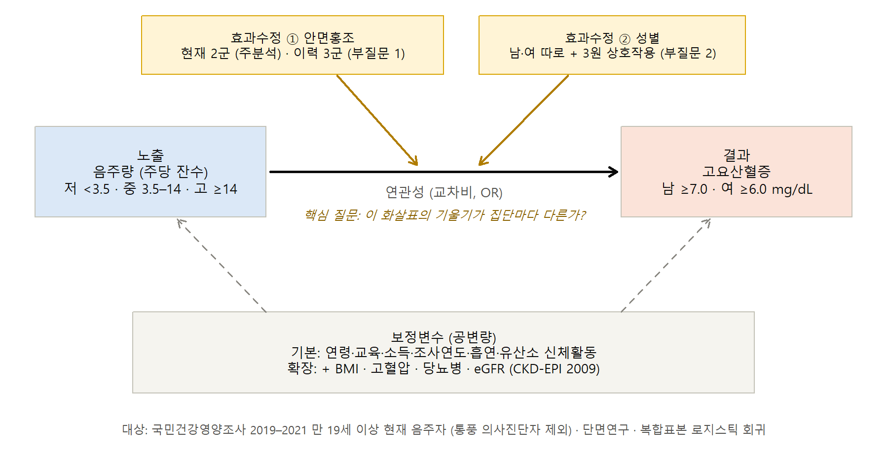
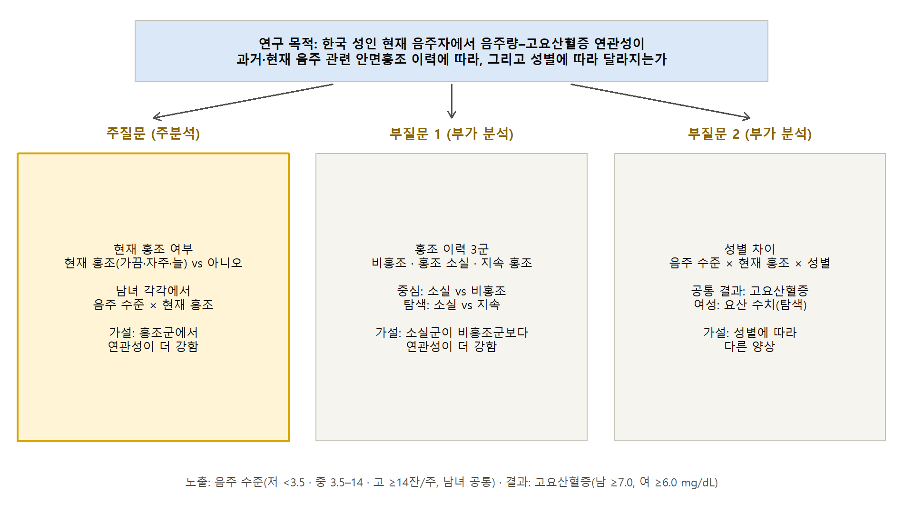
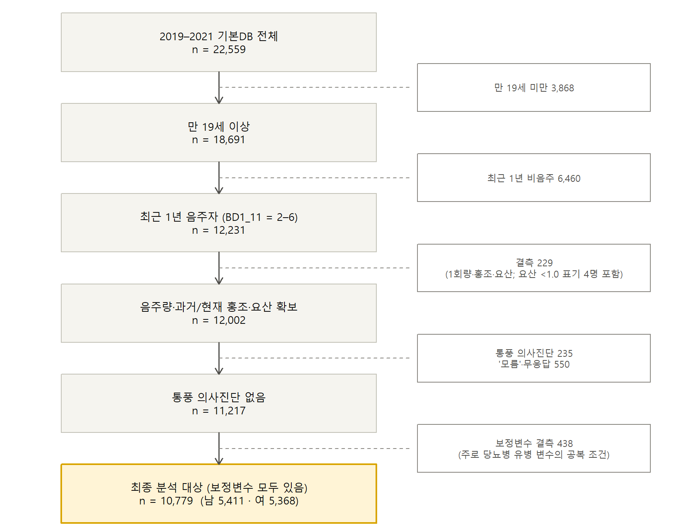
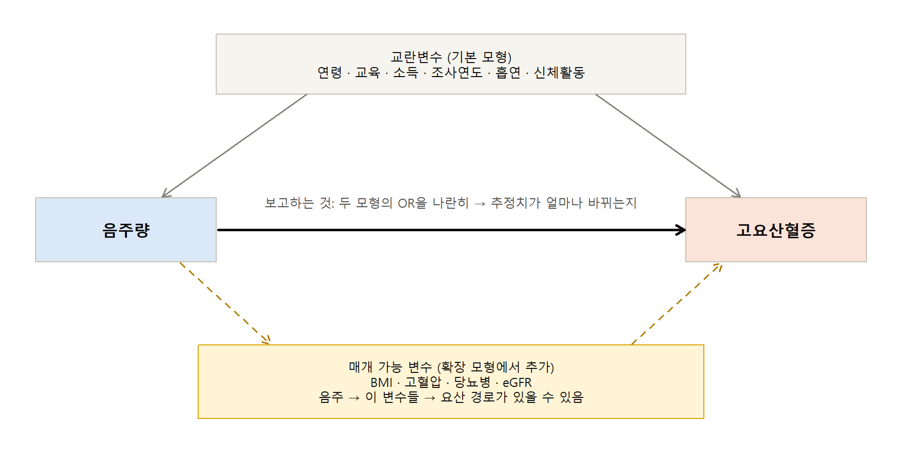
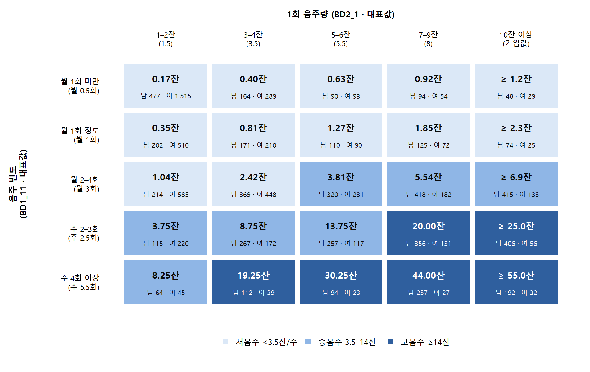
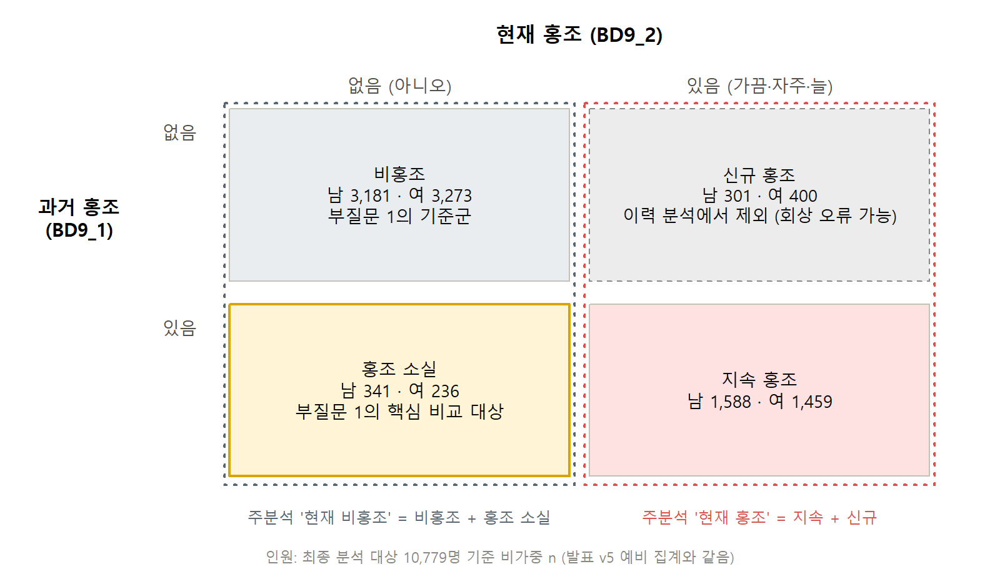
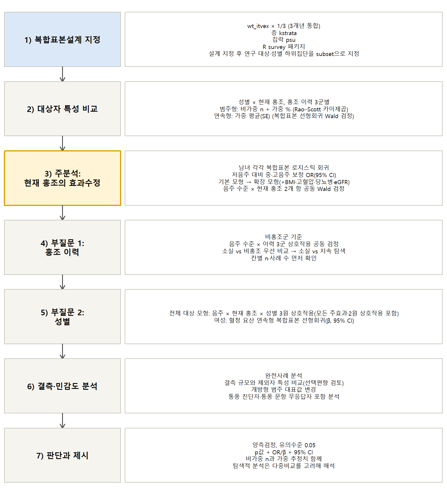
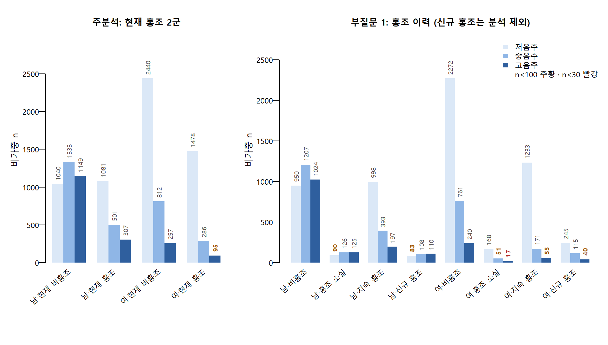
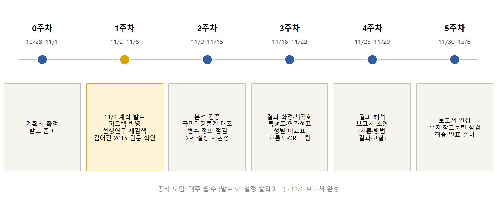
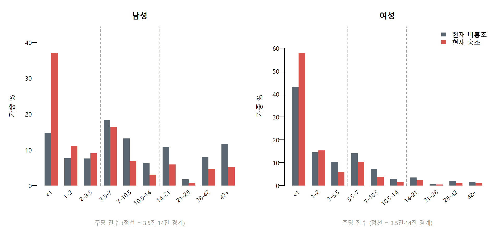

# 연구보고서 V3 한눈에 보기 (정리본)

한국 성인 현재 음주자에서 음주 관련 안면홍조 이력에 따른 음주량–고요산혈증 연관성의 차이: 성별 효과수정 분석, 국민건강영양조사 2019–2021 · 과학적 사고와 의학연구 6조

- 작성일: 2026-11-01
- 원문: 연구보고서_V3.docx (드라이브 폴더). 이 문서는 V3의 내용을 장 순서대로 다시 정리한 것입니다. V3에 없는 내용은 **[보충]**으로 표시했습니다.
- 그림: 개념도는 `code/10_part2_prep_figures.R`, `code/12_v3_summary_figures.R`로 그렸습니다. 인원이 들어간 그림은 원시자료로 다시 계산한 **예비 집계**이며, 발표 v5의 숫자와 같습니다(`code/09_part2_descriptives.R`). 요산 결과는 쓰지 않았습니다.
- 지침서 쪽수 표기: 제8기(2019–2021) 원시자료 이용지침서 "PDF 쪽 / 인쇄 쪽".

## 0. 한 페이지 요약

| 항목 | 내용 |
|---|---|
| 연구 질문 | 같은 양을 마셨을 때, 음주와 고요산혈증의 관계가 안면홍조(현재·과거)와 성별에 따라 달라지는가 |
| 자료 | 국민건강영양조사 제8기 2019–2021 (건강설문 + 검진), 단면연구 · 이차자료 분석 |
| 대상 | 만 19세 이상 최근 1년 음주자, 통풍 의사진단자 제외 (예비 10,779명: 남 5,411 · 여 5,368) |
| 노출 | 주당 음주잔수 → 저 <3.5 · 중 3.5–14 · 고 ≥14잔 (남녀 공통, 저음주 기준) |
| 결과 | 고요산혈증: 혈청 요산 남 ≥7.0, 여 ≥6.0 mg/dL (여성은 요산 수치도 탐색) |
| 효과수정변수 | 현재 홍조(주분석), 홍조 이력 3군(부질문 1), 성별(부질문 2) |
| 보정변수 | 기본: 연령·교육·소득·조사연도·흡연·유산소 신체활동 / 확장: + BMI·고혈압·당뇨병·eGFR |
| 분석 | 복합표본 로지스틱 회귀(남녀 각각), 음주 수준 × 홍조 상호작용 Wald 검정, 3원 상호작용, 여성 선형회귀 |
| 주가설 | 음주량–고요산혈증 연관성은 현재 홍조군에서 더 강하다 |
| 기대효과 | 홍조 이력과 실측 요산을 잇는 전국 근거, 음주 상담에서 과거 홍조 문진의 가치 검토 |
| 주요 한계 | 단면연구, 현재 음주자만, 자기보고 음주·홍조, 작은 하위집단(여성 홍조·고음주 95명) |

## 1. 연구 제목

- **국문**: 한국 성인 현재 음주자에서 음주 관련 안면 홍조 이력에 따른 음주량–고요산혈증 연관성의 차이: 성별 효과수정 분석, 국민건강영양조사 2019–2021
- **영문**: Sex-Specific Effect Modification of the Association Between Alcohol Consumption and Hyperuricemia by History of Alcohol-Induced Facial Flushing Among Current Drinkers in Korean Adults: Korea National Health and Nutrition Examination Survey, 2019–2021
- **제목 풀이**
  - "효과수정"은 한 요인(홍조)에 따라 다른 요인(음주)의 영향이 달라지는 것입니다.
  - "성별 효과수정 분석"은 그 차이가 남녀에서도 다른지를 본다는 뜻입니다.
  - "홍조 이력"은 현재뿐 아니라 술을 처음 마시던 시기의 홍조까지 함께 본다는 뜻입니다.

## 2. 서론 및 연구의 필요성

### 2-1. 연구 배경 (V3의 세 문단 요약)

1. **통념**: 음주는 요산을 높이는 대표적인 생활습관이고, 한국인에서도 많이 마실수록 고요산혈증이 많습니다. 하지만 같은 양에도 영향은 사람마다 다를 수 있습니다. 동아시아인 상당수는 ALDH2 활성이 낮아 소량에도 얼굴이 붉어지고, 이런 사람에게 술이 더 해롭다고 여겨집니다. 실제로 홍조가 있으면 음주에 따른 식도암 위험이 더 커지고, 음주와 지방간의 연관성도 더 강하다는 보고가 있습니다.
2. **요산에서는 근거 부족**: 홍조가 있는 남성이 덜 마셨는데도 요산이 비슷했다는 결과가 있어, 같은 양에 더 민감할 가능성이 있습니다. 다만 이것은 두 집단의 평균을 단순 비교한 결과라서, "홍조가 있으면 더 해롭다"는 통념이 요산에도 맞는지는 확인되지 않았습니다.
3. **출발점**: 두 집단은 음주량부터 다르므로 평균 요산을 단순 비교해서는 답할 수 없습니다. **같은 수준의 음주에서** 고요산혈증과의 연관성이 홍조에 따라 달라지는지를 직접 봐야 합니다.

### 2-2. 연구 목적

- 국민건강영양조사 2019–2021년 자료로, 한국 성인 현재 음주자에서 음주량–고요산혈증 연관성이 **과거·현재의 안면홍조 이력에 따라** 달라지는지 분석합니다.
- 홍조 이력에 따른 이 차이를 **성별로 비교**합니다.

## 3. 이론적 배경

V3는 정의를 『국민건강영양조사 제8기(2019–2021) 원시자료 이용지침서』를 바탕으로 정했습니다.

| 개념 | V3의 정의 | 비고 |
|---|---|---|
| 현재 음주자 | 최근 1년 동안 술을 한 번 이상 마신 만 19세 이상 성인 | BD1_11 = 2–6 [지침서 PDF p.161 / 인쇄 p.153] |
| 음주량 | 주당 음주잔수 = 음주 빈도 × 1회 음주 잔수. 소주·양주 구분 없이 각 술의 잔 하나를 1잔 | 저 <3.5 · 중 3.5–14 · 고 ≥14잔, 남녀 공통 |
| 음주 관련 안면홍조 | ALDH2 활성이 낮아 아세트알데히드가 쌓여 얼굴이 붉어지는 반응. 아세트알데히드 대사 능력의 개인차를 간접적으로 보여 주는 지표 | 본인 응답, 유전자 검사 아님 |
| 홍조 이력·패턴 | 과거(술을 처음 마시기 시작한 시기)와 현재의 반응을 비교한 유형 | 비홍조 · 지속 홍조 · 홍조 소실 |
| 고요산혈증 | 혈청 요산 남 ≥7.0, 여 ≥6.0 mg/dL | 지침서에 정의 없음 → 조작적 정의 |
| 성별과 요산 | 여성은 일반적으로 요산이 낮음. 에스트로겐이 신장의 요산 배설을 촉진 | 부질문 2의 근거 |
| 음주와 요산 | 에탄올이 에너지 물질(ATP)의 분해를 늘려 요산 생성을 증가시킴(Faller & Fox 1982) | 홍조군은 덜 마시므로 단순 비교 시 차이가 가려질 수 있음 |

![그림 3. 알코올 대사, 홍조, 요산의 관계 [보충: 가설 B는 V3에 없는 반대 방향 가능성]](../09_part2_prep/fig/f03_alcohol_urate_pathway.png)

- **알코올 대사의 두 단계**: 알코올은 ADH에 의해 아세트알데히드로, 다시 ALDH2에 의해 아세트산으로 바뀝니다. ALDH2 활성이 낮으면 아세트알데히드가 쌓여 얼굴이 붉어집니다.
- **V3의 이론적 근거 한 줄**: 홍조군은 같은 양에서 대사 부담이 더 클 수 있지만, 덜 마시는 경향 때문에 단순 비교에서는 그 차이가 가려질 수 있습니다. 그래서 **같은 음주 수준에서** 비교합니다.

## 4. 선행연구 검토

### 4-1. 선행연구 4편

| 연구 | 대상 | 주요 결과 | 본 연구에 주는 시사점 | 한계 |
|---|---|---|---|---|
| 김어진 외 2015 | 대전 대학병원 검진 남성 702명 | 주당 음주 중앙값 홍조 7.5 vs 비홍조 12.5잔(1잔 = 14g, P<0.001). 요산 6.3 vs 6.4 mg/dL로 차이 없음. 요산–호모시스테인 상관은 비홍조군에서만(r = 0.166) | 홍조에 따른 건강지표를 비교할 때 음주량을 함께 고려해야 함 | 단일 기관·남성만, 자기보고 홍조, 효과수정을 직접 검증하지 않음 |
| Kang & Oh 2023 | 국건영 2019–2021 남성 5,134명 | 월 1회 초과 음주군의 LAP 기준 지방간 OR: 비홍조 1.90, 홍조 2.35. 상호작용은 LAP에서만 유의(P<0.001), HSI·NLFS에서는 비유의 | 같은 자료로 음주 × 홍조 상호작용을 본 선례 | 남성만, 음주를 빈도로만 구분, 과거·현재 홍조 미구분, 지표마다 결과 다름 |
| Jeon 외 2022 | 2019 지역사회건강조사 현재 음주자 139,380명 | 현재 홍조군 우울(PHQ-9 ≥10) aOR 1.23. 과거 홍조군은 차이 없음. 하루 5g 미만·5–14.9g에서 유의, 15g 이상 비유의 | 현재·과거 홍조를 함께 쓰고 음주량별로 본 방법론 선례 | 단면연구, 자기보고, 결과가 우울, 구간별 유의성 차이만으로 차이가 입증되지 않음 |
| Jee 외 2019 | 한국 성인(유전자료 포함) | 음주량과 고요산혈증의 양의 연관이 남녀 모두에서(남 P<0.001, 여 P=0.014). 유전자료 분석은 인과를 확정하지 못함 | 한국인에서의 배경 근거, 남녀를 나눠 보는 근거 | 홍조를 고려하지 않음 |

- **용어 주의 (Jeon 2022)**: 이 연구의 "현재 홍조군"은 과거 홍조와 관계없이 지금 홍조가 있는 사람입니다. 본 연구의 "지속 홍조군"(과거·현재 모두 홍조)과는 다릅니다.
- **[보충] Jee 2019의 유전자료 분석**: 멘델 무작위 분석에서 인과는 남성에서만 시사되었고, 다중검정 보정 후 유의하지 않았습니다. 홍조 유전자(rs671) 자체는 고요산혈증과 관련이 없었습니다(PubMed 초록).

### 4-2. 선행연구 종합 ("따라서")

![그림 4. 선행연구가 다룬 것과 빈 곳 [보충: 발표자료·계획서·초록 기준]](../09_part2_prep/fig/f05_literature_gap.png)

1. 음주량과 고요산혈증의 관련성은 보고되어 있습니다.
2. 홍조군은 덜 마셨는데도 요산에 차이가 없었습니다 → 홍조에 따른 요산을 이해하려면 **실제 음주량을 함께** 봐야 합니다.
3. 홍조 이력에 따라 음주와 건강지표의 연관성을 본 연구는 **지방간·우울**뿐입니다 → 고요산혈증에서도 같은지 설명할 수 없습니다.
4. 그래서 음주량과 홍조 이력을 함께 고려해 고요산혈증과의 연관성을 직접 보고, **성별 차이**까지 살펴보는 연구가 필요합니다.

## 5. 연구 질문과 가설

| 구분 | 연구 질문 | 연구 가설 | 근거 |
|---|---|---|---|
| 주질문 | 남녀 각각에서 음주량–고요산혈증 연관성이 현재 홍조군과 비홍조군 사이에 다른가 | 현재 홍조군에서 더 강하다. 음주 수준이 높아질 때 고요산혈증이 늘어나는 정도가 홍조군에서 더 크다 | 홍조 = 아세트알데히드 분해가 느리다는 신호 → 같은 양에서 대사 부담 큼. 홍조군은 덜 마셨는데도 요산이 비슷(김어진 2015) |
| 부질문 1 | 과거·현재 홍조를 조합한 홍조 패턴에 따라 다른가, 특히 현재 홍조가 없는 사람 중 소실군과 비홍조군이 다른가 | 소실군은 비홍조군보다 연관성이 더 강하다 | 과거 홍조는 원래 분해가 느린 체질이었을 가능성 → 지금 홍조가 없어도 반응은 지속 홍조군에 가까울 수 있음 |
| 부질문 2 | 홍조에 따른 연관성 차이가 남녀 사이에서도 다른가 | 성별에 따라 다른 양상을 보인다 | 에스트로겐과 요산 배설, 여성의 낮은 요산 수준 |

- **부질문 1의 비교 순서**: 소실 vs 비홍조를 중심으로 보고, 소실 vs 지속은 탐색적으로 비교합니다.
- **홍조 소실의 정의**: 과거에 나타났던 홍조가 현재 나타나지 않는 상태입니다. 소실의 원인을 특정하지 않고, 그 집단에서 보이는 연관성에 초점을 둡니다.
- **부질문 2의 결과변수**: 남녀 모두 고요산혈증 여부를 공통 결과로 쓰고, 남녀 각각의 연관성과 남녀 차이를 구분해 평가합니다. 여성은 혈청 요산 수치를 추가 결과로 써서 탐색합니다. 하위집단의 n과 사례 수를 확인해 불확실성을 함께 봅니다.

## 6. 연구 방법론

### 6-1. 연구 대상

- **포함**: 제8기(2019–2021) 참여자 중 만 19세 이상, 최근 1년 음주 경험이 있는 현재 음주자. 음주빈도·1회 음주량, 과거·현재 홍조, 혈청 요산을 확인할 수 있는 사람.
- **제외**:
  - 음주량을 계산할 수 없는 사람
  - 과거·현재 홍조 또는 혈청 요산이 누락된 사람
  - 통풍 의사진단자 (치료에 따른 요산 변화 가능성)
  - 통풍 진단 여부에 '모름'·무응답 (결측으로 보아 제외)
- **해석 대상**: 통풍 의사진단력이 없는 성인 현재 음주자
- **보고 방식**: 최종 인원은 선정·제외 기준과 공변량 결측 처리 후 확정합니다. 흐름도로 각 단계의 제외 사유·인원과 최종 남녀 인원을 보고합니다.

### 6-2. 연구 설계 및 절차

- 국민건강영양조사 건강설문·검진 원시자료를 이용한 **단면연구이자 이차자료 분석**입니다.
- 조사 시점의 음주량·홍조 이력·혈청 요산으로 연관성을 분석합니다. 결과는 **조사 당시의 연관성**으로 해석하며, 음주 후 고요산혈증이 새로 생기는 과정이나 인과관계로 해석하지 않습니다.
- 자료 처리 전에 **연도별 조사표와 지침서**로 문항·응답 범주·변수 정의가 같은지 검토하고, 세 연도에 공통으로 적용할 수 있는 기준으로 변수를 정리합니다.

### 6-3. 대상자 특성 및 공변량

| 영역 | 변수 | 처리 |
|---|---|---|
| 인구사회학적 | 연령, 성별, 교육수준, 소득수준, 조사연도 | 교육·소득은 응답과 생성변수로 분류 |
| 건강행태 | 흡연상태, 유산소 신체활동 실천 여부 | 응답과 생성변수로 분류 |
| 임상 지표 | 체질량지수(BMI) | 연속형 |
|  | 고혈압, 당뇨병 | 국민건강영양조사 유병 여부 정의 |
|  | 추정사구체여과율(eGFR) | 혈청 크레아티닌·연령·성별, CKD-EPI 2009식 |

- 성별로 나눈 모형에는 성별을 보정변수로 넣지 않고, 전체 대상의 성별 비교 모형에만 넣습니다.

### 6-4. 음주량의 정의

- **계산**: 최근 1년 음주빈도를 주당 음주횟수로 바꾸고, 1회 음주량을 응답 범주의 대표값으로 수치화해 곱합니다.
- **대표값 원칙**: 구간 응답은 중간값을 쓰고, 상한·하한이 열린 범주의 대표값은 분석 전에 정해 환산표에 적습니다.
- **10잔 이상**: 2019–2021년 조사에는 실제 잔수를 기입하는 후속 문항(BD2_14)이 있으므로 기입값을 씁니다.
- **음주 수준**: 주당 3.5잔 미만 저음주, 3.5잔 이상 14잔 미만 중음주, 14잔 이상 고음주. 남녀 공통이며 **저음주가 기준범주**입니다. 남녀 비교도 이 공통 기준으로 합니다.

| 음주 빈도(BD1_11) | 대표값 [보충: 발표 v5] | 1회 음주량(BD2_1) | 대표값 [보충: 발표 v5] |
|---|---|---|---|
| 월 1회 미만 | 월 0.5회 | 1–2잔 | 1.5잔 |
| 월 1회 정도 | 월 1회 | 3–4잔 | 3.5잔 |
| 월 2–4회 | 월 3회 | 5–6잔 | 5.5잔 |
| 주 2–3회 정도 | 주 2.5회 | 7–9잔 | 8잔 |
| 주 4회 이상 | 주 5.5회 | 10잔 이상 | BD2_14 기입값 |

- **[보충] 3.5잔·14잔의 근거 (V3에 출처가 없어 찾아 둔 것)**
  - 하루 0.5잔(주 3.5잔)과 2잔(주 14잔)은 각각 "매우 가벼운 음주"와 "적정 음주 상한"으로 쓰이는 구분입니다(Choi YJ 외, Cancer Res Treat 2018).
  - 국건영 1잔은 약 7g입니다(소주 1병 = 7잔, 지침서 PDF p.162 / 인쇄 p.154). 그래서 3.5잔 ≈ 25g, 14잔 ≈ 98g/주입니다.
  - 3.5잔 미만은 한국 홍조 기반 절주 지침의 가장 엄격한 권고량(주 2표준잔 = 28g)보다 적습니다. 14잔 이상은 65세 이하 비홍조 남성을 뺀 모든 집단의 권고량을 넘습니다(Lee 외, 2019).
  - 14잔은 국건영 남성 고위험음주(1회 7잔 이상, 주 2회 이상)의 최소 주간 음주량입니다(지침서 PDF p.48 / 인쇄 p.40).

![그림 8. 기준값 비교 (주당 순수 알코올 g) [보충]](../09_part2_prep/fig/f10_cutoff_comparison.png)

### 6-5. 현재 안면홍조와 홍조 이력의 정의

- 안면홍조는 음주량–고요산혈증 연관성이 달라지는지 평가하는 **효과수정변수**입니다.
- **주분석: 현재 홍조 여부**
  - 소량 음주 후 얼굴이 빨개지는지에 '가끔·자주·늘 그렇다' → 현재 홍조군
  - '아니오' → 현재 비홍조군
- **과거 홍조**: 술을 처음 마시기 시작한 1–2년 동안 소량 음주 후 얼굴이 빨개졌는지에 대한 응답입니다.
- **[보충] 문항 원문** [지침서 PDF p.164 / 인쇄 p.156]: "맥주 1잔(소주 1잔) 정도 소량의 음주로 금세 얼굴이 빨개지는 체질"인지를 과거(예/아니오)와 현재(아니오/가끔/자주/늘)로 묻습니다. 현재 문항은 최근 1년 음주자만 응답합니다.

| 홍조 이력 집단 | 과거 홍조 | 현재 홍조 | 정의 |
|---|---|---|---|
| 비홍조군 | 없음 | 없음 | 처음 마시던 시기와 현재 모두 홍조 없음 |
| 홍조소실군 | 있음 | 없음 | 처음에는 홍조가 있었으나 현재는 없음 |
| 지속홍조군 | 있음 | 있음 | 처음과 현재 모두 홍조 있음 |

- **주분석과 이력 분석의 관계**: 주분석의 현재 홍조군 = 지속홍조군 + "과거 없음·현재 있음" 응답자, 현재 비홍조군 = 비홍조군 + 홍조소실군.
- "과거 없음·현재 있음" 응답자는 세 패턴에 해당하지 않아 **이력 분석에서 제외**합니다. 두 분석은 구분해서 제시합니다.
- 이 분류는 조사 당시 보고한 과거 경험과 현재 반응을 조합한 것이며, 시간에 따른 변화를 직접 추적한 것이 아닙니다.
- '모름'·무응답·비해당은 **홍조가 없는 것으로 처리하지 않습니다**.

### 6-6. 고요산혈증과 혈청 요산의 정의

- **주결과변수(남녀 모두)**: 고요산혈증 여부. 혈청 요산이 남성 7.0 mg/dL 이상, 여성 6.0 mg/dL 이상. 본 연구의 조작적 정의이며, 같은 기준을 쓴 국민건강영양조사 연구가 있습니다.
- **여성 추가 분석**: 혈청 요산 수치를 연속형 결과로 써서, 기준 초과 여부와 함께 음주량에 따른 요산 수치 차이도 탐색합니다.

## 7. 데이터 분석 방법

### 7-1. 복합표본설계와 통합가중치

- 건강설문·검진 가중치 **wt_itvex**, 층 **kstrata**, 집락 **psu**를 씁니다.
- 2019–2021년을 통합하므로 질병관리청 지침에 따라 각 연도 가중치에 **1/3**을 곱합니다. [보충] 8기는 조사기간 비례로 통합하며, 2020년은 코로나19로 192개 중 180개 조사구만 조사했습니다(지침서 PDF p.36 / 인쇄 p.28).
- R의 survey 패키지를 씁니다. 통합자료에서 설계를 정의한 뒤 연구 대상과 성별 하위집단을 지정해, 하위집단 분석에서도 원래의 층·집락 정보를 유지합니다.

### 7-2. 대상자 특성 비교

- 성별 × 현재 홍조로 제시하고, 홍조 이력 3군의 특성도 비교합니다.
- 범주형: 비가중 n + 가중 %, 차이는 **Rao–Scott 보정 카이제곱검정**.
- 연속형(연령·BMI·혈청 요산 등): 가중 평균(표준오차), 차이는 **복합표본 선형회귀 기반 Wald 검정**.

### 7-3. 주분석: 음주량–고요산혈증 연관성과 현재 홍조의 효과수정

- 남녀를 나눠 **복합표본 로지스틱 회귀**를 합니다. 저음주 대비 중·고음주의 보정 OR과 95% 신뢰구간을 제시합니다.
- OR은 조사 당시의 **유병 오즈비**로 해석하고, 발생 위험이나 확률의 배수로 해석하지 않습니다.
- **단계적 보정**
  - 기본 모형: 연령, 교육수준, 소득수준, 조사연도, 흡연상태, 유산소 신체활동
  - 확장 모형: + BMI, 고혈압, 당뇨병, eGFR (임상 지표 보정에 따른 추정치 변화 확인)
- **효과수정**: 각 성별 모형에 음주 수준, 현재 홍조, '음주 수준 × 현재 홍조' 상호작용항을 넣습니다. 홍조군과 비홍조군 각각의 중·고음주 OR을 제시하고, **두 상호작용항을 함께 검정하는 설계 기반 Wald 검정**으로 차이를 평가합니다.

### 7-4. 홍조 이력에 따른 차이 (부질문 1)

- 비홍조군을 기준집단으로 두고, 음주 수준과 세 이력 집단의 상호작용을 평가합니다. 먼저 상호작용항 전체를 공동 검정합니다.
- 이후 현재 홍조가 없는 두 집단인 **소실군과 비홍조군을 우선 비교**하고, 소실군과 지속군의 비교는 탐색적으로 합니다.
- 해석은 유병률 차이뿐 아니라 **음주 수준에 따른 연관성의 크기**가 다른지를 중심으로 합니다.
- 분석 전에 성별·이력별 n과 고요산혈증 사례 수를 확인하고, 적으면 기술통계와 불확실성 중심으로 제시합니다.

### 7-5. 성별에 따른 차이 (부질문 2)

- 전체 대상 모형에서 '음주 수준 × 현재 홍조 × 성별' **3원 상호작용**을 검정합니다. 세 변수의 주효과와 모든 2원 상호작용을 함께 넣습니다.
- 남녀에게 같은 음주 기준을 쓰고, 실제 음주량 분포가 겹치는 범위를 고려해 해석합니다.
- 여성은 혈청 요산을 연속형 결과로 한 **복합표본 선형회귀**를 추가하고, 저음주 대비 중·고음주의 요산 차이(β, 95% CI)를 제시합니다.

### 7-6. 결측값 처리와 민감도 분석

- 주분석은 노출·결과·공변량에 결측이 없는 대상자의 **완전사례 분석**입니다.
- 변수별 결측 규모와 제외 인원을 제시하고, 제외자와 포함자의 주요 특성을 비교해 선택편향 가능성을 검토합니다.
- **민감도 분석**
  - 대표값을 부여한 개방형 응답 범주의 값을 바꾼 분석
  - 통풍 의사진단자와 통풍 문항 무응답자를 포함한 분석

### 7-7. 통계적 판단과 결과 제시

- 모든 검정은 **양측검정**, 유의수준 0.05.
- p값과 함께 보정 OR 또는 회귀계수, 95% 신뢰구간을 제시해 연관성의 크기와 불확실성을 함께 평가합니다.
- 현재 홍조 분석을 주분석으로, 홍조 이력·성별 분석은 부가 분석으로 구분해 보고합니다. 탐색적 분석은 여러 비교가 이루어졌다는 점을 고려해 해석합니다.
- 각 분석에 **비가중 실제 대상자 수와 복합표본 추정값**을 함께 제시합니다.

## 8. 예상 결과

![그림 11. 결과 시나리오 (개념도, 실제 결과 아님) [보충: 발표 v5의 세 시나리오]](../09_part2_prep/fig/f06_scenarios.png)

| 질문 | 예상 결과 | 해석 방법 |
|---|---|---|
| 주질문 | 음주 수준이 높을수록 고요산혈증 유병 오즈가 높고, 그 연관성은 현재 홍조군에서 더 강할 것 | 같은 음주 수준에서 홍조군 OR이 더 크면 "같은 양에 더 민감" 가설을 지지. 우연 여부는 상호작용 분석과 신뢰구간으로 판단 |
| 여성 | 고요산혈증을 주결과로, 연속형 요산을 보완적으로 | 연속형에서 더 뚜렷할 것이라고 미리 단정하지 않음 |
| 부질문 1 | 소실군이 비홍조군보다 연관성이 더 강할 것 | 차이가 있으면 과거 홍조 문진이 추가 정보를 줄 가능성. 소실 vs 지속은 탐색적 |
| 부질문 2 | 홍조에 따른 차이가 남녀 간에도 다를 수 있음 | 공통 기준의 상호작용 분석, 각 성별의 방향·크기 비교. 호르몬을 직접 측정하지 않으므로 탐색적 근거 |
| 기술통계 | 홍조 여부·이력에 따라 음주량과 특성 분포가 다를 것 | 단순 유병률 비교와 보정 연관성 분석을 구분해서 해석 |
| 민감도 | 대표값 변경, 통풍 진단자·무응답자 포함에도 비슷하면 결과가 일관됨 | 달라지면 그 차이를 보고하고 어떤 기준에 영향을 받는지 검토 |

- **홍조 소실 결과의 해석 원칙**: 지속군과 비슷해도 내성이라 단정하지 않고, 비홍조군과 비슷해도 대사 능력이 회복되거나 위험이 줄었다고 해석하지 않습니다. 소실의 원인은 후속 연구 과제로 남깁니다.
- **예상과 다른 결과**
  - 상호작용이 유의하지 않으면 "효과수정이 확인되지 않았다"고 보고합니다. 차이가 작고 신뢰구간이 좁은 경우와, 신뢰구간이 넓어 판단하기 어려운 경우를 구분합니다.
  - 반대 방향이 나와도 결과를 제시하고, 집단별 음주량 분포, 자기보고 측정오차, 잔여 교란, 대상자 선정의 영향을 검토합니다.

## 9. 기대효과

| 영역 | 내용 |
|---|---|
| 학술적 | 전국 자료로 현재 홍조와 과거 홍조 경험에 따른 음주량–고요산혈증 연관성을 검토. 현재 홍조만으로는 드러나지 않는 집단 차이를 보고, 자기보고 홍조 이력과 실측 요산을 잇는 근거 축적. 여성 연속형 분석으로 성별 차이 탐색에 기여 |
| 임상적 | 음주 문진에서 현재 반응과 과거 홍조 경험을 함께 묻는 것이 유용한지 검토할 기초자료. 단, 홍조 문항으로 요산 검사 대상을 고르려면 별도의 선별 성능·임상 유용성 검증 필요 |
| 공중보건·정책 | 성별과 홍조 이력을 고려한 음주 건강정보 개발의 참고자료. 국가 조사에서 홍조 문항을 계속 수집할 가치 평가. 음주 기준·정책 적용은 다른 건강결과와 후속 연구를 함께 고려 |
| 교육적 | 음주량·홍조 반응·요산의 관계를 설명하는 건강교육 자료. 대학생·청년 절주 교육에서 과거 음주 반응도 이해하도록. 특정 집단을 위험하다고 단정하거나 홍조 없는 집단을 안전하다고 제시하지 않음 |
| 후속 연구 | ALDH2 유전형·반복 측정 자료로 홍조 이력의 의미를 검증하는 출발점. 지방간·고혈압 등 다른 결과와 비교해 홍조에 따른 차이가 공통적인지 확인 |

## 10. 연구의 한계

| 영역 | 한계 |
|---|---|
| 설계·대상자 선정 | 단면연구라 음주와 요산 상승의 선후를 알 수 없고 인과로 해석할 수 없음. 현재 음주자만 분석해 홍조 때문에 술을 끊은 사람이 빠짐(홍조군 = 홍조가 있어도 계속 마시는 사람). 통풍 진단자 제외로 요산이 매우 높은 사람 일부가 빠질 수 있음 |
| 음주량 측정 | 잔 수로 응답하고 소주·양주를 구분하지 않아 같은 1잔이라도 실제 알코올 양이 다름. 범주 응답을 대표값으로 환산했고 기억에 의존해 과소응답 가능. 주종 정보가 없어 퓨린이 많은 맥주의 차이를 반영하지 못함 |
| 안면홍조 측정 | 본인 응답이며 유전자 검사가 아니어서 실제 대사 능력과 다를 수 있음. 과거 홍조는 회상이라 부정확할 수 있음. 홍조 소실이 반복 음주에 따른 내성일 수 있어 해석에 주의 |
| 분석 | 홍조군은 덜 마셔서 고음주 홍조군 인원이 적음. 특히 여성은 고음주자와 고요산혈증 사례가 적어 결과가 불안정할 수 있음. 이뇨제 등 약물과 퓨린·과당 섭취를 반영하지 못함 |

## 11. 연구 일정

| 주차 | 기간 | 할 일 |
|---|---|---|
| 0주차 | 10/28–11/1 | 계획서 확정, 제목·배경·목적·가설·선행연구 정리, 예비 분석을 포함한 발표 자료 제작 |
| 1주차 | 11/2–11/8 | 11/2 계획서 발표, 피드백 반영, RISS·KCI 선행연구 재검색으로 차별점 확인, 김어진 2015 원문에서 과거·현재 홍조 구분 여부 확인 |
| 2주차 | 11/9–11/15 | 분석 검증: 국민건강통계 2019 고위험음주율 공식값과 비교, 홍조 패턴·음주 수준·고요산혈증 변수가 지침서 정의대로인지 점검, 2회 실행 재현성 확인 |
| 3주차 | 11/16–11/22 | 결과 확정·시각화: 성별·홍조 패턴 특성표, 음주 수준–고요산혈증 연관성표, 성별 비교표, 흐름도, 홍조 패턴별 보정 OR 그림 |
| 4주차 | 11/23–11/29 | 결과 해석, 주요 결과·한계 정리, 서론·방법·결과·고찰 초안 |
| 5주차 | 11/30–12/6 | 보고서 완성, 수치·표 대조, 참고문헌 정리, 선행연구 최종 재검색, 발표 자료 제작·연습 |

## 12. 참고문헌 (V3)

1. 김어진, 김종성, 어원철, 최수영, 이선경, 정복선. 음주연관 안면홍조에 따른 혈중 요산과 호모시스테인 농도관계의 변화. Korean Journal of Health Promotion. 2015;15(3):91–97.
2. Kang DE, Oh SN. Association between Alcohol Consumption and Metabolic Dysfunction-Associated Steatotic Liver Disease Based on Alcohol Flushing Response in Men: The Korea National Health and Nutrition Examination Survey 2019–2021. Nutrients. 2023;15(18). doi:10.3390/nu15183901
3. Jeon S, Kang H, Cho I, Cho SI. The alcohol flushing response is associated with the risk of depression. Scientific Reports. 2022;12(1):12569. doi:10.1038/s41598-022-16276-2
4. Jee YH, Jung KJ, Park YB, Spiller W, Jee SH. Causal effect of alcohol consumption on hyperuricemia using a Mendelian randomization design. International Journal of Rheumatic Diseases. 2019;22(10):1912–1919. doi:10.1111/1756-185X.13668
5. Faller J, Fox IH. Ethanol-induced hyperuricemia: evidence for increased urate production by activation of adenine nucleotide turnover. The New England Journal of Medicine. 1982;307(26):1598–1602. doi:10.1056/NEJM198212233072602
6. Brooks PJ, Enoch MA, Goldman D, Li TK, Yokoyama A. The alcohol flushing response: an unrecognized risk factor for esophageal cancer from alcohol consumption. PLoS Medicine. 2009;6(3):e50. doi:10.1371/journal.pmed.1000050

- **[보충] 근거로 추가를 검토할 문헌**
  - Lee S 외. Korean Alcohol Guidelines for Moderate Drinking Based on Facial Flushing. Korean J Fam Med. 2019;40(4):204–211. (3.5·14잔 근거, 홍조군 절반 권고)
  - Choi YJ, Myung SK, Lee JH. Light Alcohol Drinking and Risk of Cancer: A Meta-Analysis of Cohort Studies. Cancer Res Treat. 2018;50(2):474–487. (하루 0.5·2잔 구분)
  - 질병관리청. 국민건강영양조사 제8기(2019–2021) 원시자료 이용지침서. (변수 정의·쪽수)
  - 고요산혈증 기준(남 7.0·여 6.0)과 CKD-EPI 2009식의 원문헌.

## 부록 A. 예비 집계 (발표 v5와 일치, 원시자료로 재현)

- 조건: 요산 "<1.0" 표기 4명 결측, 고혈압·당뇨병은 유병 변수(HE_HP·HE_DM_HbA1c), 가중치 wt_itvex × 1/3.

| 단계 | 남은 n | 제외 |
|---|---|---|
| 2019–2021 기본DB 전체 | 22,559 |  |
| 만 19세 이상 | 18,691 | 3,868 |
| 최근 1년 음주자 | 12,231 | 6,460 |
| 음주량·과거/현재 홍조·요산 확보 | 12,002 | 229 |
| 통풍 의사진단 없음 | 11,217 | 785 (진단 235, 모름·무응답 550) |
| 보정변수 모두 있음 (최종) | 10,779 (남 5,411 · 여 5,368) | 438 |

| 집단 | 저음주 | 중음주 | 고음주 |
|---|---|---|---|
| 남 · 현재 비홍조 | 1,040 | 1,333 | 1,149 |
| 남 · 현재 홍조 | 1,081 | 501 | 307 |
| 여 · 현재 비홍조 | 2,440 | 812 | 257 |
| 여 · 현재 홍조 | 1,478 | 286 | 95 |

| 지표 (가중) | 남 | 여 |
|---|---|---|
| 주당 잔수 평균: 현재 비홍조 | 15.5 | 4.8 |
| 주당 잔수 평균: 현재 홍조 | 8.5 | 3.0 |
| 현재 홍조 % | 35.0 | 33.6 |
| 고음주(≥14잔) % | 26.7 | 6.8 |
| 고요산혈증 % (비가중 n) | 23.6 (1,201) | 7.7 (427) |

- 홍조군은 남녀 모두 덜 마십니다. 그래서 같은 음주 수준 안에서 비교하는 설계가 필요합니다.
- 음주·홍조별 요산 결과는 분석 전까지 보지 않는다는 원칙에 따라 계산하지 않았습니다.

## 부록 B. 용어 풀이

| 용어 | 쉬운 설명 |
|---|---|
| 효과수정 / 상호작용 | 한 요인(홍조)에 따라 다른 요인(음주)의 영향이 달라지는 것 |
| 단면연구 | 한 시점에 여러 정보를 함께 잰 연구. 관련성은 볼 수 있지만 선후는 알 수 없음 |
| 이차자료 분석 | 국가가 이미 모아 둔 자료를 분석하는 것 |
| 복합표본설계 · 가중치 | 층·집락으로 뽑은 표본이 전 국민을 대표하도록 사람마다 다른 무게를 주는 것 |
| 통합가중치 | 여러 해를 합칠 때 각 연도 가중치를 나눠 쓰는 것(8기는 1/3씩) |
| 보정 | 연령·흡연처럼 결과에 영향을 주는 다른 요인의 영향을 통계적으로 빼는 것 |
| 교란변수 · 매개변수 | 노출과 결과 모두에 영향을 주는 변수 · 노출이 결과로 가는 중간 경로의 변수 |
| 교차비(OR) · 유병 오즈비 | 기준 집단에 비해 고요산혈증일 가능성(오즈)이 몇 배인지. 단면자료에서는 유병 오즈비 |
| 95% 신뢰구간 | 추정값이 있을 법한 범위. 1을 포함하면 차이가 없을 수도 있음 |
| Rao–Scott 검정 · Wald 검정 | 가중치 자료용 카이제곱 검정 · 회귀계수가 0인지 보는 검정 |
| 완전사례 분석 · 선택편향 | 필요한 정보가 다 있는 사람만 분석 · 그로 인해 생길 수 있는 치우침 |
| 탐색적 분석 · 민감도 분석 | 가능성을 살펴보는 분석 · 기준을 바꿔도 결과가 비슷한지 확인 |
| ADH · ALDH2 | 알코올 → 아세트알데히드 효소 · 아세트알데히드 → 아세트산 효소 |
| 멘델 무작위화 | 유전자를 이용해 어떤 요인이 원인인지 확인하는 방법 |
| eGFR | 신장이 피를 걸러 내는 능력. 혈청 크레아티닌으로 계산 |

## 부록 C. V3에서 확인·보완하면 좋은 점 [보충]

1. **가설 방향 표현**: V3는 "홍조군에서 더 강할 것"이고, 발표 v5 노트와 v2는 "방향을 정하지 않음"입니다. V3도 양측검정을 쓰므로, "예상 방향은 홍조군에서 더 강함, 검정은 양측"으로 맞추면 일관됩니다.
2. **3.5·14잔 근거 문장**: 6-4절 [보충]의 근거를 본문에 추가하세요.
3. **고혈압·당뇨병 정의와 결측**: 유병 변수를 쓰면 당뇨병 변수의 공복 조건 때문에 보정변수 결측이 438명입니다(의사진단 변수를 쓰면 119명). 음주자 중 임신부 26명도 이 단계에서 자동으로 빠집니다. 보고서에 적어 두면 좋습니다.
4. **eGFR 식**: V3는 CKD-EPI 2009식입니다. 지침서에 계산식이 없으므로 문헌을 인용하세요.
5. **Jee 2019 요약**: "유전자료 분석에서 인과는 남성에서만 시사, 다중검정 보정 후 비유의, rs671 자체는 고요산혈증과 무관"으로 더 구체적으로 쓸 수 있습니다.
6. **요산 1.0 미만 표기 4명**: 결측으로 둘지 0.9로 넣을지 정하고 적어 두세요.
7. **'가끔' 포함 여부 민감도 분석**: Kang & Oh는 '자주·늘'만 홍조로 봤습니다. '자주·늘' 기준의 민감도 분석 추가를 검토할 수 있습니다.
