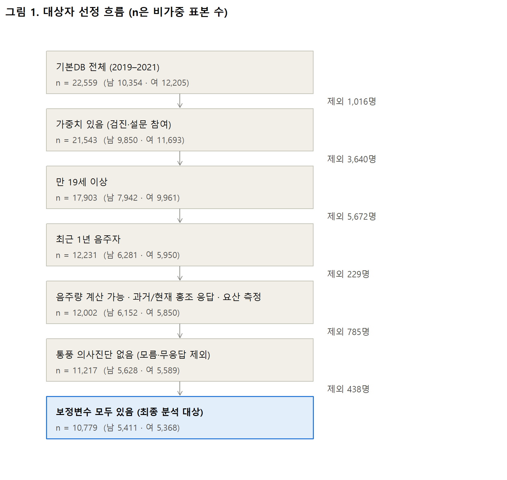
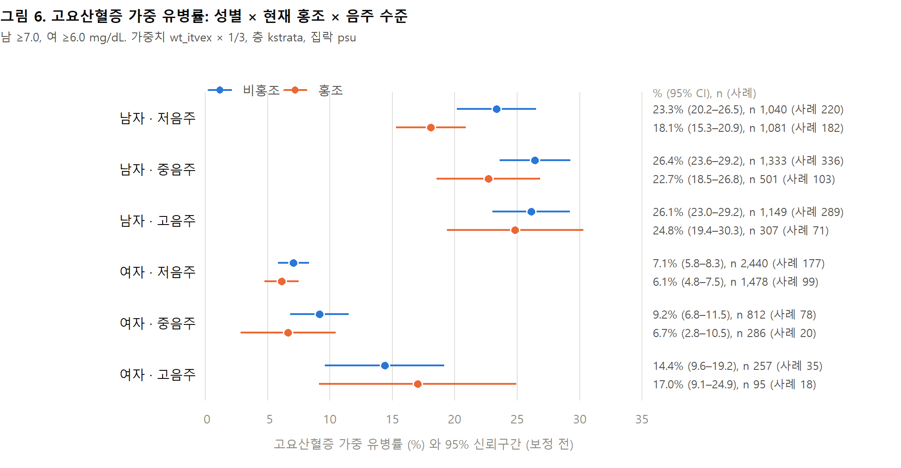
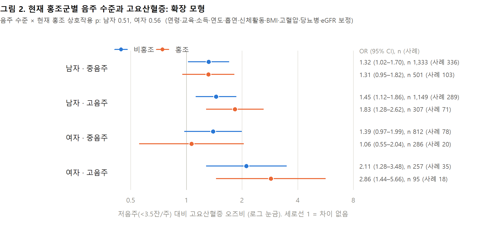
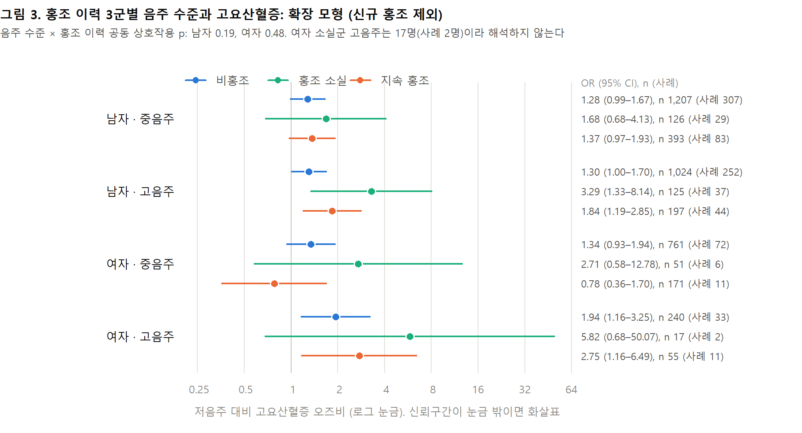
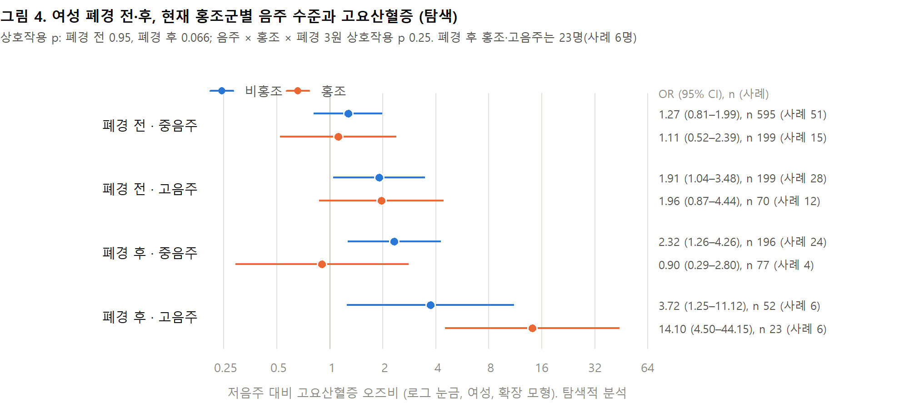
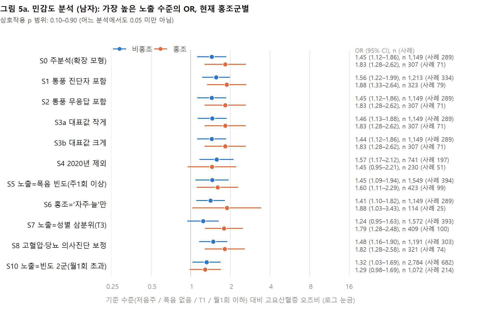
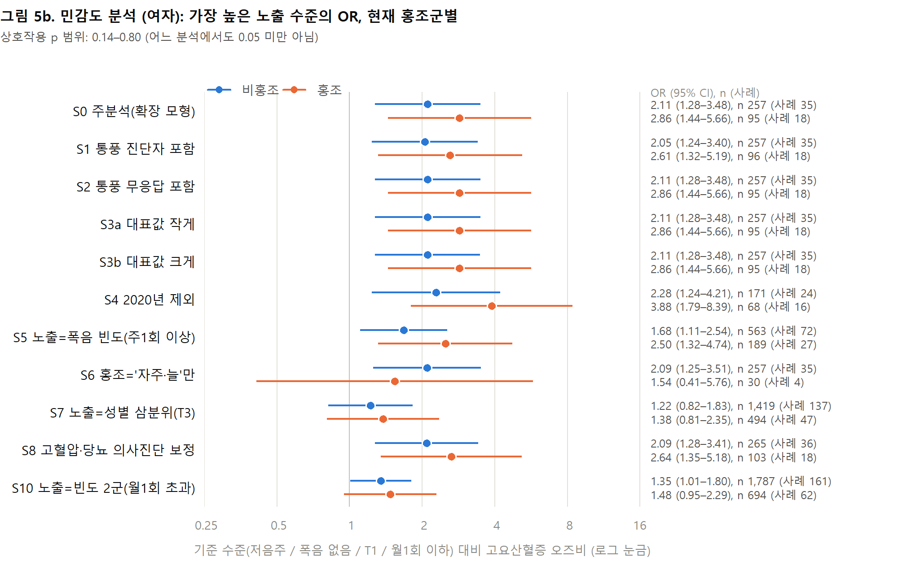

# 한국 성인 현재 음주자에서 음주 관련 안면홍조 이력에 따른 음주량–고요산혈증 연관성의 차이: 성별 효과수정 분석

분석 결과 보고서 · 국민건강영양조사 제8기(2019–2021) · 과학적 사고와 의학연구 6조

- 보고서 생성: 2026-11-04 11:19
- 분석 코드: `code/13_v3_main_analysis.R`(본 분석), `code/14_v3_results_figures.R`(그림), `code/15_v3_results_report.R`(이 보고서). 숫자는 모두 결과 CSV에서 자동으로 옮겼다.
- 분석 환경: R version 4.6.0 (2026-04-24 ucrt), survey 패키지(복합표본). 재현성 확인: **PASS** (2026-11-04 11:08:09, 새 R 세션에서 2회 실행 후 결과 CSV의 md5 비교)
- 분석 설계의 근거: 연구 계획서, 연구계획 발표 v5, 연구보고서 V3. 참고 논문의 방법 정리와 반영 내용은 `00_reference_methods.md`.
- 표기: n은 가중치를 적용하지 않은 표본 수, %·평균·OR·β는 복합표본 가중 추정치. OR은 단면자료의 유병 오즈비. 괄호는 95% 신뢰구간. p는 양측 검정.

## 요약

- 분석 대상은 2019–2021년 만 19세 이상 최근 1년 음주자 중 음주량·과거/현재 홍조·요산이 있고 통풍 의사진단이 없으며 보정변수가 모두 있는 **10,779명(남 5,411, 여 5,368)** 이다. 발표 v5의 대상자 흐름과 단계마다 일치한다.
- **주질문(현재 홍조의 효과수정)**: 음주량이 많을수록 고요산혈증이 느는 연관성은 두 홍조군 모두에 있었다. 저음주 대비 고음주의 OR(확장 모형)은 남자 비홍조 1.45 (1.12–1.86), 홍조 1.83 (1.28–2.62), 여자 비홍조 2.11 (1.28–3.48), 홍조 2.86 (1.44–5.66)였다. 그러나 음주 수준 × 현재 홍조 상호작용은 유의하지 않았고(남 p = 0.510, 여 p = 0.559), 덧셈 척도의 RERI도 0을 포함했다(남 고음주 0.19 (-0.34, 0.73), 여 0.52 (-1.36, 2.40)). **홍조가 연관성을 바꾼다는 근거는 확인되지 않았다.**
- 같은 저음주 안에서 홍조군의 고요산혈증 오즈는 비홍조군보다 낮은 쪽이었다(남 OR 0.77 (0.59–1.01), 여 OR 0.88 (0.63–1.22)).
- **여성 혈청 요산(연속형)**: 고음주의 요산 차이는 비홍조 0.32 (0.15–0.49) mg/dL, 홍조 0.30 (0.06–0.54) mg/dL로 같았다(상호작용 p = 0.383).
- **부질문 1(홍조 이력)**: 남자 홍조 소실군의 고음주 OR은 3.29 (1.33–8.14)로 비홍조군 1.30 (1.00–1.70), 지속 홍조군 1.84 (1.19–2.85)보다 컸지만, 공동 상호작용 p = 0.188, 소실 대 비홍조 p = 0.097로 통계적으로 확인되지 않았다(소실군 고음주 n = 125, 사례 37). 다만 소실군 고음주의 RERI는 1.35 (0.06–2.63)로 덧셈 척도에서는 0을 넘었다(탐색적).
- **부질문 2(성별·폐경)**: 음주 × 홍조 × 성별 3원 상호작용 p = 0.867로 남녀 차이는 없었다. 폐경 후 여성에서 홍조군 고음주 OR 14.10 (4.50–44.15)가 비홍조군 3.72 (1.25–11.12)보다 컸지만(상호작용 p = 0.066), 해당 칸은 23명(사례 6)이라 불안정하고 폐경 3원 상호작용 p = 0.253였다.
- **민감도 분석** 10가지(통풍 진단자·무응답자 포함, 대표값 변경, 2020년 제외, 폭음 빈도, 홍조 정의 변경, 성별 삼분위, 의사진단 보정, 빈도 2군)에서 결론이 바뀌지 않았다(상호작용 p 0.10–0.90).
- 공식 통계 대조는 2019년 고위험음주율·월간음주율의 **조율(crude) 공식값을 구하지 못해** 비어 있다(국민건강통계 2019 표 확인 필요).

## 1. 자료와 방법

### 1.1 자료와 복합표본설계

- 자료: 국민건강영양조사 제8기 2019, 2020, 2021년 기본DB(`hn19_all`, `hn20_all`, `hn21_all`). 음주 관련 홍조 문항(BD9_1, BD9_2)은 이 3개 연도에만 있다.
- 가중치: 건강설문·검진 변수만 사용하므로 `wt_itvex`(8기 지침서 PDF p.92 / 인쇄 p.84). 3개 연도 통합비율은 각 연도 1/3. 제8기는 조사구 수 비율이 아니라 **조사기간 비례**로 합친다(8기 지침서 PDF p.36 / 인쇄 p.28, 표 7). 2020년은 코로나19로 192개 중 180개 조사구만 조사했지만 조사기간은 1년으로 같다.
- 층 `kstrata`, 집락 `psu`. 층 안에 집락이 1개뿐인 경우는 없었다.
- 모든 추정은 `svydesign` 설계 객체를 만든 뒤 `subset`으로 분석 대상과 하위집단을 지정해 계산했다(행 삭제 없음, 도메인 분석). 이는 Kang B 외(2024)가 KNHANES 2019–2020 통합자료에서 쓴 방식과 같다.

입력 파일 지문:

| 파일 | 크기 | md5 |
|---|---|---|
| hn19_all.sas7bdat | 101,711,872 | e7ea8b1418ee99e43e7d82a951dd76ea |
| hn20_all.sas7bdat | 83,091,456 | aaf33e81c24721f63987bdfcdfb1c1e7 |
| hn21_all.sas7bdat | 77,856,768 | 2db62da7587d709942f5b0aec135fb0c |

### 1.2 변수 정의 (이용지침서 쪽수)

변수의 의미와 코드값은 제8기(2019–2021) 원시자료 이용지침서에서 확인했다. 9·99·999(모름·무응답)는 결측으로, 8·88·888(비해당)은 지침서의 의미를 보고 변수마다 처리했다.

| 변수 | 설명 | 코드 | 결측코드 | 비해당처리 | 근거 |
|---|---|---|---|---|---|
| id | 개인 아이디 |  |  |  | 8기 PDF p.91 / 인쇄 p.83 |
| year | 조사연도 |  |  |  | 8기 PDF p.91 / 인쇄 p.83 |
| sex | 성별 | 1=남자;2=여자 |  |  | 8기 PDF p.91 / 인쇄 p.83 |
| age | 만나이 | 1~79=세;80=80세이상(탑코딩) |  |  | 8기 PDF p.91 / 인쇄 p.83 |
| psu | 조사구번호(집락) |  |  |  | 8기 PDF p.91 / 인쇄 p.83 |
| incm | 소득 4분위수(개인) | 1=하;2=중하;3=중상;4=상 |  |  | 8기 PDF p.91 / 인쇄 p.83 |
| kstrata | 분산추정 층 |  |  |  | 8기 PDF p.92 / 인쇄 p.84 |
| wt_itvex | 건강설문-검진조사 가중치 |  |  |  | 8기 PDF p.92 / 인쇄 p.84 |
| edu | 교육수준 재분류 | 1=초졸이하;2=중졸;3=고졸;4=대졸이상 |  |  | 8기 PDF p.92 / 인쇄 p.84 |
| bd1 | 평생음주경험 | 1=술을 마셔 본 적 없음;2=있음 | 9 | 8=결측(소아) | 8기 PDF p.161-162 / 인쇄 p.153-154 |
| bd1_11 | 1년간 음주빈도 | 1=최근1년 전혀 안 마심;2=월1회미만;3=월1회정도;4=월2-4회;5=주2-3회;6=주4회이상 | 9 | 8=범주유지(평생 비음주, 문항1-①⑧) | 8기 PDF p.161-162 / 인쇄 p.153-154 |
| bd2_1 | 한 번에 마시는 음주량 | 1=1-2잔;2=3-4잔;3=5-6잔;4=7-9잔;5=10잔 이상 | 9 | 8=범주유지(최근1년 비음주, 문항2-1-①⑧) | 8기 PDF p.161-162 / 인쇄 p.153-154 |
| bd2_14 | 한 번에 마시는 음주량(잔) | 잔(10잔 이상 응답자만) | 999 | 888=결측(문항2-2-①②③④⑧: 10잔 미만) | 8기 PDF p.161-162 / 인쇄 p.153-154 |
| bd2_31 | 폭음 빈도(7잔 이상) | 1=전혀 없음;2=월1회미만;3=월1회정도;4=주1회정도;5=거의매일 | 9 | 8=범주유지(지침서 고위험음주 정의에 8 포함) | 8기 PDF p.161-162 / 인쇄 p.153-154 |
| bd2_32 | 여자 폭음 빈도(5잔 이상) | 1=전혀 없음;2=월1회미만;3=월1회정도;4=주1회정도;5=거의매일 | 9 | 8=범주유지(지침서 고위험음주 정의에 8 포함) | 8기 PDF p.161-162 / 인쇄 p.153-154 |
| bd9_1 | 과거 알코올 홍조(처음 마시기 시작한 1-2년 사이, 맥주 1잔 정도 소량 음주로 금세 빨개짐) | 1=예;2=아니오 | 9 | 8=결측(문항1-① 평생 비음주, 청소년, 소아) | 8기 PDF p.163-164 / 인쇄 p.155-156 |
| bd9_2 | 현재 알코올 홍조 | 1=아니오;2=가끔 그렇다;3=자주 그렇다;4=늘 그렇다 | 9 | 8=결측(문항2-1-①⑧ 최근1년 비음주, 청소년, 소아) | 8기 PDF p.163-164 / 인쇄 p.155-156 |
| dm8_dg | 통풍 의사진단 여부 | 0=없음;1=있음 | 9 | 8=결측(청소년, 소아) | 8기 PDF p.137 / 인쇄 p.129 |
| di1_dg | 고혈압 의사진단 여부(민감도) | 0=없음;1=있음 | 9 | 8=결측(청소년, 소아) | 8기 PDF p.100 / 인쇄 p.92 |
| de1_dg | 당뇨병 의사진단 여부(민감도) | 0=없음;1=있음 | 9 | 8=결측(청소년, 소아) | 8기 PDF p.112 / 인쇄 p.104 |
| lw_ms | 월경여부(여성) | 1=초경하기 전;2=월경중;3=임신중;4=출산후 수유 중;5=자연폐경;6=인공폐경;7=기타 | 9 | 8=결측(만10세미만 여자) | 8기 PDF p.190 / 인쇄 p.182 |
| lw_mp_a | 폐경연령(자연·인공 통합) | 세(80=80세이상 탑코딩) | 999 | 888=결측(만19세미만 여자, 문항1-①②③④⑦⑧) | 8기 PDF p.190 / 인쇄 p.182 |
| he_prg | 임신여부 | 0=아니오;1=예 |  | 8=범주유지(비해당-남자) | 8기 PDF p.192 / 인쇄 p.184 |
| he_hp | 고혈압 유병여부(19세이상 생성변수) | 1=정상;2=고혈압전단계;3=고혈압 |  |  | 8기 PDF p.196 / 인쇄 p.188 |
| he_bmi | 체질량지수 | kg/m2 |  |  | 8기 PDF p.198 / 인쇄 p.190 |
| he_dm_hba1c | 당뇨병 유병여부(19세이상, 비임신·8시간 이상 공복자만 생성) | 1=정상;2=당뇨병 전단계;3=당뇨병 |  |  | 8기 PDF p.199 / 인쇄 p.191 |
| he_uacid | 요산 | mg/dL |  |  | 8기 PDF p.200 / 인쇄 p.192 |
| he_uacid_etc | 요산 장비분석범위(2017년부터 1.0 미만 표시) | <1.0=1.0 mg/dL 미만 |  |  | 8기 PDF p.200 / 인쇄 p.192 |
| he_crea | 혈중크레아티닌 | mg/dL |  |  | 8기 PDF p.200 / 인쇄 p.192 |
| bs1_1 | 평생 흡연 여부 | 현재흡연 정의에만 사용 |  |  | 주요지표 SAS 프로그램: 8기 PDF p.48 / 인쇄 p.40 |
| bs3_1 | 현재 흡연 여부 | 현재흡연 정의에만 사용 |  |  | 주요지표 SAS 프로그램: 8기 PDF p.48 / 인쇄 p.40 |
| pa_aerobic | 유산소 신체활동 실천율(생성변수) | 0=미실천;1=실천 |  |  | 8기 PDF p.188 / 인쇄 p.180 |

### 1.3 분석 변수

- **노출(주당 음주잔수)**: 1년간 음주빈도(BD1_11)를 주당 횟수 대표값으로, 한 번에 마시는 음주량(BD2_1)을 잔 수 대표값으로 바꿔 곱했다. 10잔 이상은 기입값(BD2_14)을 썼고, 기입값이 없으면 음주량을 계산할 수 없는 것으로 보았다. 1회량 범주의 중앙값 사용은 Lee 외(2023, KJFM)와 같다.
- **음주 수준**: 주당 3.5잔 미만 저음주(기준), 3.5잔 이상 14잔 미만 중음주, 14잔 이상 고음주. 남녀 공통(V3). 추세 검정에는 저·중·고를 0·1·2의 순서형으로 넣었다.

| 항목 | 코드 | 응답 | 주분석 대표값 | 민감도 S3a | 민감도 S3b | 비고 |
|---|---|---|---|---|---|---|
| 빈도(BD1_11) | 2 | 월1회미만 | 0.1154 | 0.0577 | 0.1731 | 회/주 |
| 빈도(BD1_11) | 3 | 월1회정도 | 0.2308 | 0.2308 | 0.2308 | 회/주 |
| 빈도(BD1_11) | 4 | 월2-4회 | 0.6923 | 0.6923 | 0.6923 | 회/주 |
| 빈도(BD1_11) | 5 | 주2-3회정도 | 2.5 | 2.5 | 2.5 | 회/주 |
| 빈도(BD1_11) | 6 | 주4회이상 | 5.5 | 4 | 7 | 회/주 |
| 1회량(BD2_1) | 1 | 1-2잔 | 1.5 | 1.5 | 1.5 | 잔 |
| 1회량(BD2_1) | 2 | 3-4잔 | 3.5 | 3.5 | 3.5 | 잔 |
| 1회량(BD2_1) | 3 | 5-6잔 | 5.5 | 5.5 | 5.5 | 잔 |
| 1회량(BD2_1) | 4 | 7-9잔 | 8 | 8 | 8 | 잔 |
| 1회량(BD2_1) | 5 | 10잔 이상 |  |  |  | BD2_14 기입값(잔) |

- **효과수정변수**: 주분석은 현재 홍조(BD9_2: '가끔·자주·늘' = 홍조, '아니오' = 비홍조). 부가 분석은 홍조 이력 3군(과거 BD9_1 × 현재 BD9_2: 비홍조 = 과거 아니오·현재 아니오, 홍조 소실 = 과거 예·현재 아니오, 지속 홍조 = 과거 예·현재 가끔 이상). 과거 아니오·현재 가끔 이상(신규 홍조)은 이력 분석에서 제외하고 4군 보조 분석에만 넣었다(Yook 외 2024의 분류와 같다). '모름'·무응답·비해당은 홍조 없음으로 보지 않았다.
- **결과**: 고요산혈증 = 혈청 요산(HE_Uacid) 남 7.0 mg/dL 이상, 여 6.0 mg/dL 이상(V3 조작적 정의; Bae 외 2023 등 국건영 논문과 같음). 지침서에는 고요산혈증 정의가 없다. 요산 1.0 mg/dL 미만 표기(HE_Uacid_etc)는 발표 v5와 같이 결측으로 두었다. 여성은 혈청 요산(연속형)을 추가 결과로 썼고, 남성 연속형은 보조로만 제시한다.
- **보정변수**: 기본 모형 = 연령(연속), 교육수준(4군), 소득 4분위(개인), 조사연도, 현재흡연(지침서 주요지표 정의), 유산소 신체활동 실천. 확장 모형 = 기본 + 체질량지수(연속), 고혈압 유병(HE_HP = 3), 당뇨병 유병(HE_DM_HbA1c = 3), eGFR(CKD-EPI 2009식, 10 mL/min/1.73m² 단위; 지침서에 계산식이 없어 문헌식 사용). 연령만 보정한 모형(M0)은 Kang & Oh(2023)의 연령보정 단계에 해당한다.
- **폐경 상태(여성, 탐색)**: 월경여부(LW_ms) 5·6(자연·인공폐경) = 폐경 후, 2·3·4 = 폐경 전. 1(초경 전)·7(기타)은 결측. 폐경연령(LW_mp_a)은 기술통계에만 썼다.

- 민감도 S7의 성별 가중 삼분위 절단점(잔/주): 남자 2.42·9.69, 여자 0.35·2.42.

### 1.4 연구 대상

만 19세 이상 최근 1년 음주자(BD1_11 = 2–6) 가운데 (1) 음주량을 계산할 수 있고, (2) 과거·현재 홍조 문항에 모두 응답했으며, (3) 혈청 요산을 측정했고, (4) 통풍 의사진단이 없고(진단 '모름'·무응답은 결측으로 보아 제외), (5) 보정변수가 모두 있는 사람. 검진·설문 가중치(wt_itvex)가 없는 사람은 첫 단계에서 제외했다. 임신부는 당뇨병 유병 변수가 생성되지 않아 보정변수 단계에서 자동으로 빠진다.

### 1.5 통계 분석

- 기술통계: 비가중 n과 가중 %(표준오차) 또는 가중 평균(표준오차). 집단 차이는 범주형은 Rao-Scott 보정 카이제곱(F) 검정, 연속형은 복합표본 선형회귀의 Wald 검정.
- 주분석: 남녀를 나눠 복합표본 로지스틱 회귀(svyglm, quasibinomial)로 저음주 대비 중·고음주의 OR을 구했다. 모형에 음주 수준, 현재 홍조, '음주 수준 × 현재 홍조' 상호작용항을 넣고, 두 상호작용항을 함께 검정하는 설계 기반 Wald(F) 검정으로 효과수정을 평가했다(V3). 홍조군별 OR(층화 OR)은 상호작용 모형의 계수 조합으로 구했고(단순효과), 공변량 효과까지 홍조군마다 다르게 둔 완전 층화 모형은 보조로 제시한다(Kang & Oh 2023 방식).
- 결과 제시 형식: Knol & VanderWeele(2012) 권고에 따라 결합효과 OR(기준 비홍조·저음주), 층화 OR, 음주 수준 안에서의 홍조 효과 OR, 상호작용항 p를 한 표에 적고, 덧셈 척도의 상호작용 지표 RERI(= OR11 − OR10 − OR01 + 1)와 델타법 95% 신뢰구간을 더했다(Moore 외 2016 참고; 논문의 MOVER법 대신 델타법).
- P for trend: 음주 수준을 순서형으로 넣은 모형에서 홍조군별 한 단계당 OR과 p, 그리고 추세의 홍조군 간 차이 p(Lee 외 2022 참고).
- 부질문 1: 비홍조군을 기준으로 음주 수준 × 홍조 이력(3군) 상호작용을 공동 검정(4 자유도)한 뒤, 소실 대 비홍조, 지속 대 비홍조, 소실 대 지속(탐색)의 음주 연관성 차이를 각각 2 자유도 Wald 검정했다.
- 부질문 2: 전체 대상 모형에서 '음주 수준 × 현재 홍조 × 성별' 3원 상호작용을 검정했다(주효과와 모든 2원 상호작용 포함). 여성은 혈청 요산을 결과로 한 복합표본 선형회귀를 추가했고, 폐경 전·후로 나눈 분석과 폐경 3원 상호작용은 탐색적으로 제시한다.
- 민감도 분석: 통풍 의사진단자 포함(S1), 통풍 문항 모름·무응답 포함(S2), 열린 범주 대표값 변경(S3a·S3b), 2020년 제외(S4), 노출을 폭음 빈도로 교체(S5), 현재 홍조를 '자주·늘'로 좁힘(S6, Kang & Oh 방식), 노출을 성별 가중 삼분위로 교체(S7, 계획서 방법론 문구), 고혈압·당뇨병을 의사진단으로 보정(S8), 노출을 음주 빈도 2군으로 교체(S10, Kang & Oh 방식). 모두 확장 모형·현재 홍조 기준.
- 유의수준 0.05, 양측 검정. R 4.6.0, survey 패키지. 결측은 완전사례 분석이며, 제외자와 포함자의 특성을 비교했다.

## 2. 결과

### 2.1 대상자 선정 흐름

| 단계 | 남은 n | 남자 | 여자 | 제외 |
|---|---|---|---|---|
| 기본DB 전체(2019-2021) | 22,559 | 10,354 | 12,205 |  |
| 가중치 있음(검진·설문 참여, wt_itvex) | 21,543 | 9,850 | 11,693 | 1,016 |
| 만 19세 이상 | 17,903 | 7,942 | 9,961 | 3,640 |
| 최근 1년 음주자(BD1_11 = 2-6) | 12,231 | 6,281 | 5,950 | 5,672 |
| 음주량 계산 가능·과거/현재 홍조 응답·요산 측정 | 12,002 | 6,152 | 5,850 | 229 |
| 통풍 의사진단 없음(진단·모름·무응답 제외) | 11,217 | 5,628 | 5,589 | 785 |
| 보정변수 모두 있음(교육·소득·흡연·신체활동·BMI·고혈압·당뇨병 유병·eGFR) | 10,779 | 5,411 | 5,368 | 438 |

발표 v5의 흐름(가중치 단계 없음)과 대조한 결과, 모든 단계의 인원이 같았다.

| 단계 | 본 분석 n | 발표 v5 n | 일치 |
|---|---|---|---|
| 2019-2021 기본DB 전체 | 22,559 | 22,559 | 예 |
| 만 19세 이상 | 18,691 | 18,691 | 예 |
| 최근 1년 음주자 | 12,231 | 12,231 | 예 |
| 음주량·과거/현재 홍조·요산 확보 | 12,002 | 12,002 | 예 |
| 통풍 의사진단 없음 | 11,217 | 11,217 | 예 |
| 보정변수 모두 있음 | 10,779 | 10,779 | 예 |

**포함자와 제외자 비교.** 통풍 단계까지 통과했지만 보정변수 결측으로 빠진 사람과 최종 포함자의 특성을 비교했다. 차이는 없었다.

| 항목 | 통계 | 포함 (n) | 제외 (n) | p |
|---|---|---|---|---|
| 나이(세) | 가중 평균 (SE) | 44.42 (0.23) (10,779) | 44.51 (0.89) (438) | 0.913 |
| 성별: 남자 | 가중 % (SE) | 54.9 (0.5) (5,411) | 53.2 (2.7) (217) | 0.543 |
| 성별: 여자 | 가중 % (SE) | 45.1 (0.5) (5,368) | 46.8 (2.7) (221) | 0.543 |
| 조사연도: 2019 | 가중 % (SE) | 33.9 (2.3) (3,978) | 34.8 (3.6) (149) | 0.939 |
| 조사연도: 2020 | 가중 % (SE) | 33.2 (2.3) (3,522) | 32.5 (3.4) (147) | 0.939 |
| 조사연도: 2021 | 가중 % (SE) | 32.9 (2.3) (3,279) | 32.7 (3.9) (142) | 0.939 |
| 음주 수준: 저음주 | 가중 % (SE) | 54.0 (0.6) (6,039) | 54.0 (2.8) (252) | 0.516 |
| 음주 수준: 중음주 | 가중 % (SE) | 28.3 (0.5) (2,932) | 26.1 (2.5) (104) | 0.516 |
| 음주 수준: 고음주 | 가중 % (SE) | 17.7 (0.4) (1,808) | 19.9 (2.3) (82) | 0.516 |
| 현재 홍조: 비홍조 | 가중 % (SE) | 65.6 (0.6) (7,031) | 63.0 (2.9) (283) | 0.376 |
| 현재 홍조: 홍조 | 가중 % (SE) | 34.4 (0.6) (3,748) | 37.0 (2.9) (155) | 0.376 |
| 홍조 패턴(4군): 비홍조 | 가중 % (SE) | 60.8 (0.6) (6,454) | 59.4 (2.8) (258) | 0.593 |
| 홍조 패턴(4군): 홍조 소실 | 가중 % (SE) | 4.8 (0.2) (577) | 3.6 (0.8) (25) | 0.593 |
| 홍조 패턴(4군): 지속 홍조 | 가중 % (SE) | 28.0 (0.5) (3,047) | 29.8 (2.8) (126) | 0.593 |
| 홍조 패턴(4군): 신규 홍조 | 가중 % (SE) | 6.4 (0.3) (701) | 7.2 (1.5) (29) | 0.593 |
| 혈청 요산(mg/dL) | 가중 평균 (SE) | 5.39 (0.02) (10,779) | 5.26 (0.08) (438) | 0.124 |
| 고요산혈증: 없음 | 가중 % (SE) | 83.6 (0.5) (9,151) | 84.4 (2.0) (370) | 0.694 |
| 고요산혈증: 있음 | 가중 % (SE) | 16.4 (0.5) (1,628) | 15.6 (2.0) (68) | 0.694 |

### 2.2 대상자 특성 (Table 1)

값은 '가중 추정치 (비가중 n)'. 범주형은 가중 %(SE), 연속형은 가중 평균(SE). p는 성별 안에서 홍조군 간 비교(범주형 Rao-Scott χ², 연속형 Wald).

**Table 1a. 남자: 현재 홍조군별**

| 항목 | 통계 | 비홍조 | 홍조 | p |
|---|---|---|---|---|
| 나이(세) | 가중 평균 (SE) | 45.10 (0.34) (3,522) | 44.58 (0.40) (1,889) | 0.251 |
| 조사연도: 2019 | 가중 % (SE) | 32.2 (2.3) (1,226) | 36.7 (2.6) (757) | 0.016 |
| 조사연도: 2020 | 가중 % (SE) | 34.0 (2.5) (1,195) | 32.0 (2.5) (595) | 0.016 |
| 조사연도: 2021 | 가중 % (SE) | 33.9 (2.5) (1,101) | 31.3 (2.5) (537) | 0.016 |
| 교육수준: 초졸이하 | 가중 % (SE) | 5.8 (0.5) (316) | 6.3 (0.5) (206) | 0.471 |
| 교육수준: 중졸 | 가중 % (SE) | 6.1 (0.4) (281) | 6.3 (0.6) (150) | 0.471 |
| 교육수준: 고졸 | 가중 % (SE) | 38.6 (1.1) (1,318) | 40.3 (1.5) (719) | 0.471 |
| 교육수준: 대졸이상 | 가중 % (SE) | 49.5 (1.2) (1,607) | 47.1 (1.6) (814) | 0.471 |
| 소득 4분위(개인): 하 | 가중 % (SE) | 21.7 (1.0) (787) | 22.7 (1.2) (428) | 0.729 |
| 소득 4분위(개인): 중하 | 가중 % (SE) | 25.7 (1.0) (880) | 24.3 (1.2) (454) | 0.729 |
| 소득 4분위(개인): 중상 | 가중 % (SE) | 26.0 (0.9) (915) | 26.5 (1.2) (493) | 0.729 |
| 소득 4분위(개인): 상 | 가중 % (SE) | 26.6 (1.1) (940) | 26.5 (1.4) (514) | 0.729 |
| 현재흡연: 비흡연 | 가중 % (SE) | 65.1 (0.9) (2,323) | 65.3 (1.3) (1,269) | 0.904 |
| 현재흡연: 현재흡연 | 가중 % (SE) | 34.9 (0.9) (1,199) | 34.7 (1.3) (620) | 0.904 |
| 유산소 신체활동 실천: 미실천 | 가중 % (SE) | 49.8 (1.0) (1,823) | 50.1 (1.3) (980) | 0.877 |
| 유산소 신체활동 실천: 실천 | 가중 % (SE) | 50.2 (1.0) (1,699) | 49.9 (1.3) (909) | 0.877 |
| 체질량지수(kg/m2) | 가중 평균 (SE) | 24.94 (0.07) (3,522) | 24.72 (0.09) (1,889) | 0.053 |
| 고혈압 유병(HE_HP=3): 없음 | 가중 % (SE) | 70.0 (0.9) (2,296) | 76.3 (1.2) (1,349) | <0.001 |
| 고혈압 유병(HE_HP=3): 있음 | 가중 % (SE) | 30.0 (0.9) (1,226) | 23.7 (1.2) (540) | <0.001 |
| 당뇨병 유병(HE_DM_HbA1c=3): 없음 | 가중 % (SE) | 85.9 (0.7) (2,934) | 87.8 (0.9) (1,599) | 0.091 |
| 당뇨병 유병(HE_DM_HbA1c=3): 있음 | 가중 % (SE) | 14.1 (0.7) (588) | 12.2 (0.9) (290) | 0.091 |
| eGFR(CKD-EPI 2009, mL/min/1.73m2) | 가중 평균 (SE) | 97.97 (0.33) (3,522) | 97.85 (0.44) (1,889) | 0.818 |
| 주당 음주잔수(잔) | 가중 평균 (SE) | 15.48 (0.38) (3,522) | 8.46 (0.43) (1,889) | <0.001 |
| 음주 수준: 저음주 | 가중 % (SE) | 29.9 (0.9) (1,040) | 57.1 (1.3) (1,081) | <0.001 |
| 음주 수준: 중음주 | 가중 % (SE) | 37.9 (1.0) (1,333) | 26.4 (1.2) (501) | <0.001 |
| 음주 수준: 고음주 | 가중 % (SE) | 32.2 (0.9) (1,149) | 16.5 (1.0) (307) | <0.001 |
| 폭음 빈도: 없음 | 가중 % (SE) | 13.4 (0.7) (537) | 34.8 (1.3) (698) | <0.001 |
| 폭음 빈도: 월1회 이하 | 가중 % (SE) | 42.6 (1.0) (1,434) | 42.8 (1.4) (768) | <0.001 |
| 폭음 빈도: 주1회 이상 | 가중 % (SE) | 44.0 (0.9) (1,549) | 22.3 (1.2) (423) | <0.001 |
| 혈청 요산(mg/dL) | 가중 평균 (SE) | 6.15 (0.03) (3,522) | 6.00 (0.04) (1,889) | <0.001 |
| 고요산혈증: 없음 | 가중 % (SE) | 74.6 (0.9) (2,677) | 79.6 (1.1) (1,533) | <0.001 |
| 고요산혈증: 있음 | 가중 % (SE) | 25.4 (0.9) (845) | 20.4 (1.1) (356) | <0.001 |
| 폐경 상태(여성, LW_ms): 폐경 전 | 가중 % (SE) | – | – |  |
| 폐경 상태(여성, LW_ms): 폐경 후 | 가중 % (SE) | – | – |  |
| 폐경 연령(세, 여성 폐경 후, LW_mp_a) | 가중 평균 (SE) | – | – |  |

**Table 1b. 여자: 현재 홍조군별**

| 항목 | 통계 | 비홍조 | 홍조 | p |
|---|---|---|---|---|
| 나이(세) | 가중 평균 (SE) | 44.10 (0.29) (3,509) | 43.24 (0.40) (1,859) | 0.062 |
| 조사연도: 2019 | 가중 % (SE) | 32.5 (2.4) (1,248) | 37.1 (2.6) (747) | 0.005 |
| 조사연도: 2020 | 가중 % (SE) | 34.7 (2.5) (1,173) | 30.1 (2.5) (559) | 0.005 |
| 조사연도: 2021 | 가중 % (SE) | 32.8 (2.5) (1,088) | 32.8 (2.6) (553) | 0.005 |
| 교육수준: 초졸이하 | 가중 % (SE) | 9.2 (0.6) (476) | 8.7 (0.7) (234) | 0.797 |
| 교육수준: 중졸 | 가중 % (SE) | 6.6 (0.5) (294) | 6.2 (0.6) (153) | 0.797 |
| 교육수준: 고졸 | 가중 % (SE) | 37.5 (1.0) (1,216) | 38.5 (1.3) (677) | 0.797 |
| 교육수준: 대졸이상 | 가중 % (SE) | 46.6 (1.1) (1,523) | 46.7 (1.4) (795) | 0.797 |
| 소득 4분위(개인): 하 | 가중 % (SE) | 20.3 (0.9) (716) | 24.7 (1.3) (466) | 0.009 |
| 소득 4분위(개인): 중하 | 가중 % (SE) | 24.0 (0.9) (848) | 24.6 (1.2) (467) | 0.009 |
| 소득 4분위(개인): 중상 | 가중 % (SE) | 27.6 (1.0) (934) | 25.1 (1.3) (459) | 0.009 |
| 소득 4분위(개인): 상 | 가중 % (SE) | 28.1 (1.1) (1,011) | 25.6 (1.4) (467) | 0.009 |
| 현재흡연: 비흡연 | 가중 % (SE) | 93.4 (0.5) (3,300) | 91.9 (0.8) (1,721) | 0.102 |
| 현재흡연: 현재흡연 | 가중 % (SE) | 6.6 (0.5) (209) | 8.1 (0.8) (138) | 0.102 |
| 유산소 신체활동 실천: 미실천 | 가중 % (SE) | 54.0 (1.1) (1,956) | 56.0 (1.4) (1,088) | 0.260 |
| 유산소 신체활동 실천: 실천 | 가중 % (SE) | 46.0 (1.1) (1,553) | 44.0 (1.4) (771) | 0.260 |
| 체질량지수(kg/m2) | 가중 평균 (SE) | 23.29 (0.09) (3,509) | 23.19 (0.11) (1,859) | 0.429 |
| 고혈압 유병(HE_HP=3): 없음 | 가중 % (SE) | 81.0 (0.8) (2,705) | 83.8 (1.0) (1,484) | 0.020 |
| 고혈압 유병(HE_HP=3): 있음 | 가중 % (SE) | 19.0 (0.8) (804) | 16.2 (1.0) (375) | 0.020 |
| 당뇨병 유병(HE_DM_HbA1c=3): 없음 | 가중 % (SE) | 92.5 (0.5) (3,191) | 91.9 (0.7) (1,668) | 0.518 |
| 당뇨병 유병(HE_DM_HbA1c=3): 있음 | 가중 % (SE) | 7.5 (0.5) (318) | 8.1 (0.7) (191) | 0.518 |
| eGFR(CKD-EPI 2009, mL/min/1.73m2) | 가중 평균 (SE) | 104.45 (0.32) (3,509) | 105.16 (0.40) (1,859) | 0.147 |
| 주당 음주잔수(잔) | 가중 평균 (SE) | 4.77 (0.21) (3,509) | 3.03 (0.19) (1,859) | <0.001 |
| 음주 수준: 저음주 | 가중 % (SE) | 67.9 (0.9) (2,440) | 79.2 (1.1) (1,478) | <0.001 |
| 음주 수준: 중음주 | 가중 % (SE) | 24.4 (0.8) (812) | 15.8 (0.9) (286) | <0.001 |
| 음주 수준: 고음주 | 가중 % (SE) | 7.6 (0.5) (257) | 5.1 (0.6) (95) | <0.001 |
| 폭음 빈도: 없음 | 가중 % (SE) | 40.3 (1.0) (1,543) | 54.7 (1.4) (1,052) | <0.001 |
| 폭음 빈도: 월1회 이하 | 가중 % (SE) | 42.6 (1.0) (1,403) | 35.3 (1.3) (618) | <0.001 |
| 폭음 빈도: 주1회 이상 | 가중 % (SE) | 17.1 (0.8) (563) | 10.0 (0.8) (189) | <0.001 |
| 혈청 요산(mg/dL) | 가중 평균 (SE) | 4.54 (0.02) (3,509) | 4.49 (0.03) (1,859) | 0.103 |
| 고요산혈증: 없음 | 가중 % (SE) | 91.9 (0.6) (3,219) | 93.2 (0.7) (1,722) | 0.140 |
| 고요산혈증: 있음 | 가중 % (SE) | 8.1 (0.6) (290) | 6.8 (0.7) (137) | 0.140 |
| 폐경 상태(여성, LW_ms): 폐경 전 | 가중 % (SE) | 67.4 (0.9) (2,002) | 70.9 (1.3) (1,122) | 0.018 |
| 폐경 상태(여성, LW_ms): 폐경 후 | 가중 % (SE) | 32.6 (0.9) (1,359) | 29.1 (1.3) (659) | 0.018 |
| 폐경 연령(세, 여성 폐경 후, LW_mp_a) | 가중 평균 (SE) | 50.08 (0.12) (1,352) | 50.13 (0.17) (655) | 0.820 |

**Table 1c. 남자: 홍조 이력 3군별 (신규 홍조 제외)**

| 항목 | 통계 | 비홍조 | 홍조 소실 | 지속 홍조 | p |
|---|---|---|---|---|---|
| 나이(세) | 가중 평균 (SE) | 44.47 (0.34) (3,181) | 51.74 (0.98) (341) | 44.75 (0.43) (1,588) | <0.001 |
| 조사연도: 2019 | 가중 % (SE) | 31.5 (2.3) (1,092) | 38.9 (3.9) (134) | 37.0 (2.7) (640) | 0.007 |
| 조사연도: 2020 | 가중 % (SE) | 34.2 (2.5) (1,091) | 31.5 (3.8) (104) | 32.3 (2.6) (503) | 0.007 |
| 조사연도: 2021 | 가중 % (SE) | 34.3 (2.5) (998) | 29.6 (3.6) (103) | 30.7 (2.5) (445) | 0.007 |
| 교육수준: 초졸이하 | 가중 % (SE) | 5.2 (0.5) (251) | 11.7 (1.6) (65) | 6.0 (0.6) (171) | <0.001 |
| 교육수준: 중졸 | 가중 % (SE) | 5.7 (0.5) (241) | 10.8 (1.9) (40) | 5.7 (0.6) (119) | <0.001 |
| 교육수준: 고졸 | 가중 % (SE) | 38.6 (1.1) (1,203) | 38.2 (3.0) (115) | 40.1 (1.6) (599) | <0.001 |
| 교육수준: 대졸이상 | 가중 % (SE) | 50.5 (1.2) (1,486) | 39.2 (3.2) (121) | 48.2 (1.7) (699) | <0.001 |
| 소득 4분위(개인): 하 | 가중 % (SE) | 21.7 (1.0) (703) | 22.3 (2.7) (84) | 22.6 (1.3) (357) | 0.901 |
| 소득 4분위(개인): 중하 | 가중 % (SE) | 25.9 (1.0) (798) | 23.1 (2.9) (82) | 24.5 (1.3) (384) | 0.901 |
| 소득 4분위(개인): 중상 | 가중 % (SE) | 25.8 (0.9) (832) | 28.3 (3.2) (83) | 25.6 (1.3) (404) | 0.901 |
| 소득 4분위(개인): 상 | 가중 % (SE) | 26.6 (1.2) (848) | 26.3 (2.8) (92) | 27.3 (1.5) (443) | 0.901 |
| 현재흡연: 비흡연 | 가중 % (SE) | 65.9 (1.0) (2,115) | 57.4 (2.9) (208) | 66.6 (1.4) (1,081) | 0.020 |
| 현재흡연: 현재흡연 | 가중 % (SE) | 34.1 (1.0) (1,066) | 42.6 (2.9) (133) | 33.4 (1.4) (507) | 0.020 |
| 유산소 신체활동 실천: 미실천 | 가중 % (SE) | 49.5 (1.1) (1,633) | 52.8 (3.3) (190) | 50.2 (1.4) (825) | 0.620 |
| 유산소 신체활동 실천: 실천 | 가중 % (SE) | 50.5 (1.1) (1,548) | 47.2 (3.3) (151) | 49.8 (1.4) (763) | 0.620 |
| 체질량지수(kg/m2) | 가중 평균 (SE) | 24.97 (0.08) (3,181) | 24.65 (0.22) (341) | 24.69 (0.10) (1,588) | 0.051 |
| 고혈압 유병(HE_HP=3): 없음 | 가중 % (SE) | 71.5 (1.0) (2,115) | 54.6 (3.1) (181) | 78.0 (1.2) (1,154) | <0.001 |
| 고혈압 유병(HE_HP=3): 있음 | 가중 % (SE) | 28.5 (1.0) (1,066) | 45.4 (3.1) (160) | 22.0 (1.2) (434) | <0.001 |
| 당뇨병 유병(HE_DM_HbA1c=3): 없음 | 가중 % (SE) | 86.4 (0.7) (2,661) | 80.6 (2.5) (273) | 88.5 (0.9) (1,361) | 0.004 |
| 당뇨병 유병(HE_DM_HbA1c=3): 있음 | 가중 % (SE) | 13.6 (0.7) (520) | 19.4 (2.5) (68) | 11.5 (0.9) (227) | 0.004 |
| eGFR(CKD-EPI 2009, mL/min/1.73m2) | 가중 평균 (SE) | 98.31 (0.34) (3,181) | 94.38 (1.03) (341) | 97.49 (0.47) (1,588) | <0.001 |
| 주당 음주잔수(잔) | 가중 평균 (SE) | 15.24 (0.39) (3,181) | 18.05 (1.19) (341) | 6.43 (0.39) (1,588) | <0.001 |
| 음주 수준: 저음주 | 가중 % (SE) | 30.2 (0.9) (950) | 26.9 (2.7) (90) | 63.7 (1.4) (998) | <0.001 |
| 음주 수준: 중음주 | 가중 % (SE) | 38.3 (1.0) (1,207) | 32.8 (2.8) (126) | 24.8 (1.2) (393) | <0.001 |
| 음주 수준: 고음주 | 가중 % (SE) | 31.5 (0.9) (1,024) | 40.3 (2.9) (125) | 11.5 (0.9) (197) | <0.001 |
| 폭음 빈도: 없음 | 가중 % (SE) | 13.2 (0.7) (473) | 15.4 (2.1) (64) | 39.7 (1.4) (662) | <0.001 |
| 폭음 빈도: 월1회 이하 | 가중 % (SE) | 43.2 (1.1) (1,312) | 36.3 (2.9) (122) | 44.0 (1.5) (648) | <0.001 |
| 폭음 빈도: 주1회 이상 | 가중 % (SE) | 43.6 (1.0) (1,395) | 48.3 (2.8) (154) | 16.3 (1.0) (278) | <0.001 |
| 혈청 요산(mg/dL) | 가중 평균 (SE) | 6.16 (0.03) (3,181) | 6.06 (0.08) (341) | 6.00 (0.04) (1,588) | 0.002 |
| 고요산혈증: 없음 | 가중 % (SE) | 74.5 (1.0) (2,416) | 76.2 (2.6) (261) | 80.1 (1.2) (1,294) | <0.001 |
| 고요산혈증: 있음 | 가중 % (SE) | 25.5 (1.0) (765) | 23.8 (2.6) (80) | 19.9 (1.2) (294) | <0.001 |
| 폐경 상태(여성, LW_ms): 폐경 전 | 가중 % (SE) | – | – | – |  |
| 폐경 상태(여성, LW_ms): 폐경 후 | 가중 % (SE) | – | – | – |  |
| 폐경 연령(세, 여성 폐경 후, LW_mp_a) | 가중 평균 (SE) | – | – | – |  |

**Table 1d. 여자: 홍조 이력 3군별 (신규 홍조 제외)**

| 항목 | 통계 | 비홍조 | 홍조 소실 | 지속 홍조 | p |
|---|---|---|---|---|---|
| 나이(세) | 가중 평균 (SE) | 43.61 (0.30) (3,273) | 52.11 (1.30) (236) | 43.43 (0.46) (1,459) | <0.001 |
| 조사연도: 2019 | 가중 % (SE) | 32.0 (2.4) (1,149) | 39.8 (4.1) (99) | 37.0 (2.7) (593) | <0.001 |
| 조사연도: 2020 | 가중 % (SE) | 35.5 (2.6) (1,125) | 20.6 (3.5) (48) | 30.9 (2.6) (446) | <0.001 |
| 조사연도: 2021 | 가중 % (SE) | 32.4 (2.5) (999) | 39.6 (4.2) (89) | 32.1 (2.7) (420) | <0.001 |
| 교육수준: 초졸이하 | 가중 % (SE) | 8.3 (0.5) (408) | 23.8 (3.1) (68) | 9.0 (0.8) (192) | <0.001 |
| 교육수준: 중졸 | 가중 % (SE) | 6.5 (0.5) (266) | 9.0 (1.8) (28) | 5.9 (0.7) (111) | <0.001 |
| 교육수준: 고졸 | 가중 % (SE) | 37.5 (1.0) (1,135) | 37.2 (3.9) (81) | 37.3 (1.4) (523) | <0.001 |
| 교육수준: 대졸이상 | 가중 % (SE) | 47.7 (1.2) (1,464) | 29.9 (3.8) (59) | 47.8 (1.6) (633) | <0.001 |
| 소득 4분위(개인): 하 | 가중 % (SE) | 20.4 (1.0) (666) | 18.6 (2.8) (50) | 24.5 (1.5) (365) | 0.108 |
| 소득 4분위(개인): 중하 | 가중 % (SE) | 23.9 (1.0) (784) | 25.8 (3.5) (64) | 24.8 (1.5) (368) | 0.108 |
| 소득 4분위(개인): 중상 | 가중 % (SE) | 27.7 (1.0) (880) | 26.1 (3.6) (54) | 24.8 (1.5) (352) | 0.108 |
| 소득 4분위(개인): 상 | 가중 % (SE) | 28.0 (1.2) (943) | 29.5 (3.4) (68) | 26.0 (1.5) (374) | 0.108 |
| 현재흡연: 비흡연 | 가중 % (SE) | 93.6 (0.5) (3,080) | 90.4 (2.5) (220) | 92.6 (0.9) (1,361) | 0.252 |
| 현재흡연: 현재흡연 | 가중 % (SE) | 6.4 (0.5) (193) | 9.6 (2.5) (16) | 7.4 (0.9) (98) | 0.252 |
| 유산소 신체활동 실천: 미실천 | 가중 % (SE) | 54.0 (1.1) (1,820) | 54.3 (3.8) (136) | 57.7 (1.5) (873) | 0.120 |
| 유산소 신체활동 실천: 실천 | 가중 % (SE) | 46.0 (1.1) (1,453) | 45.7 (3.8) (100) | 42.3 (1.5) (586) | 0.120 |
| 체질량지수(kg/m2) | 가중 평균 (SE) | 23.26 (0.09) (3,273) | 23.77 (0.29) (236) | 23.10 (0.12) (1,459) | 0.110 |
| 고혈압 유병(HE_HP=3): 없음 | 가중 % (SE) | 81.8 (0.8) (2,557) | 67.3 (3.5) (148) | 84.6 (1.0) (1,173) | <0.001 |
| 고혈압 유병(HE_HP=3): 있음 | 가중 % (SE) | 18.2 (0.8) (716) | 32.7 (3.5) (88) | 15.4 (1.0) (286) | <0.001 |
| 당뇨병 유병(HE_DM_HbA1c=3): 없음 | 가중 % (SE) | 92.9 (0.5) (2,994) | 85.2 (2.6) (197) | 92.3 (0.7) (1,308) | <0.001 |
| 당뇨병 유병(HE_DM_HbA1c=3): 있음 | 가중 % (SE) | 7.1 (0.5) (279) | 14.8 (2.6) (39) | 7.7 (0.7) (151) | <0.001 |
| eGFR(CKD-EPI 2009, mL/min/1.73m2) | 가중 평균 (SE) | 104.87 (0.32) (3,273) | 97.64 (1.51) (236) | 104.81 (0.46) (1,459) | <0.001 |
| 주당 음주잔수(잔) | 가중 평균 (SE) | 4.80 (0.22) (3,273) | 4.36 (0.54) (236) | 2.31 (0.19) (1,459) | <0.001 |
| 음주 수준: 저음주 | 가중 % (SE) | 67.7 (0.9) (2,272) | 71.7 (3.2) (168) | 84.3 (1.1) (1,233) | <0.001 |
| 음주 수준: 중음주 | 가중 % (SE) | 24.7 (0.9) (761) | 20.6 (2.8) (51) | 11.8 (0.9) (171) | <0.001 |
| 음주 수준: 고음주 | 가중 % (SE) | 7.6 (0.6) (240) | 7.7 (2.0) (17) | 3.9 (0.6) (55) | <0.001 |
| 폭음 빈도: 없음 | 가중 % (SE) | 39.7 (1.0) (1,415) | 49.8 (3.7) (128) | 60.4 (1.5) (913) | <0.001 |
| 폭음 빈도: 월1회 이하 | 가중 % (SE) | 43.1 (1.0) (1,332) | 34.4 (3.7) (71) | 32.7 (1.5) (443) | <0.001 |
| 폭음 빈도: 주1회 이상 | 가중 % (SE) | 17.2 (0.8) (526) | 15.9 (2.6) (37) | 6.9 (0.8) (103) | <0.001 |
| 혈청 요산(mg/dL) | 가중 평균 (SE) | 4.54 (0.02) (3,273) | 4.56 (0.07) (236) | 4.48 (0.03) (1,459) | 0.258 |
| 고요산혈증: 없음 | 가중 % (SE) | 91.8 (0.6) (2,999) | 93.2 (2.0) (220) | 93.8 (0.7) (1,357) | 0.113 |
| 고요산혈증: 있음 | 가중 % (SE) | 8.2 (0.6) (274) | 6.8 (2.0) (16) | 6.2 (0.7) (102) | 0.113 |
| 폐경 상태(여성, LW_ms): 폐경 전 | 가중 % (SE) | 68.8 (1.0) (1,911) | 45.4 (4.0) (91) | 70.7 (1.4) (884) | <0.001 |
| 폐경 상태(여성, LW_ms): 폐경 후 | 가중 % (SE) | 31.2 (1.0) (1,222) | 54.6 (4.0) (137) | 29.3 (1.4) (521) | <0.001 |
| 폐경 연령(세, 여성 폐경 후, LW_mp_a) | 가중 평균 (SE) | 49.99 (0.13) (1,215) | 50.93 (0.45) (137) | 50.08 (0.20) (518) | 0.130 |

- 주당 음주잔수 가중 평균(SE)은 남자 비홍조 15.48 (0.38), 홍조 8.46 (0.43)(p <0.001), 여자 비홍조 4.77 (0.21), 홍조 3.03 (0.19)(p <0.001)로 홍조군이 덜 마셨다.
- 고요산혈증 가중 %(SE)는 남자 비홍조 25.4 (0.9), 홍조 20.4 (1.1)(p <0.001), 여자 비홍조 8.1 (0.6), 홍조 6.8 (0.7)(p 0.140)였다. 보정 전 단순 비교에서는 홍조군의 고요산혈증이 적거나 비슷하다.
- 고혈압 유병은 남자 비홍조 30.0 (0.9), 홍조 23.7 (1.2)(p <0.001), 여자 비홍조 19.0 (0.8), 홍조 16.2 (1.0)(p 0.020)로 홍조군이 적었다.

### 2.3 칸별 고요산혈증 사례 수와 가중 유병률

**표 2a. 성별 × 현재 홍조 × 음주 수준**

| 성별 | 현재 홍조 | 음주 수준 | n | 고요산혈증 사례 | 가중 유병률 % | SE |
|---|---|---|---|---|---|---|
| 남자 | 비홍조 | 저음주 | 1,040 | 220 | 23.3 | 1.6 |
| 남자 | 비홍조 | 중음주 | 1,333 | 336 | 26.4 | 1.4 |
| 남자 | 비홍조 | 고음주 | 1,149 | 289 | 26.1 | 1.6 |
| 남자 | 홍조 | 저음주 | 1,081 | 182 | 18.1 | 1.4 |
| 남자 | 홍조 | 중음주 | 501 | 103 | 22.7 | 2.1 |
| 남자 | 홍조 | 고음주 | 307 | 71 | 24.8 | 2.8 |
| 여자 | 비홍조 | 저음주 | 2,440 | 177 | 7.1 | 0.6 |
| 여자 | 비홍조 | 중음주 | 812 | 78 | 9.2 | 1.2 |
| 여자 | 비홍조 | 고음주 | 257 | 35 | 14.4 | 2.4 |
| 여자 | 홍조 | 저음주 | 1,478 | 99 | 6.1 | 0.7 |
| 여자 | 홍조 | 중음주 | 286 | 20 | 6.7 | 1.9 |
| 여자 | 홍조 | 고음주 | 95 | 18 | 17.0 | 4.0 |

**표 2b. 성별 × 홍조 패턴(4군) × 음주 수준**

| 성별 | 홍조 패턴 | 음주 수준 | n | 고요산혈증 사례 | 가중 유병률 % | SE |
|---|---|---|---|---|---|---|
| 남자 | 비홍조 | 저음주 | 950 | 206 | 24.0 | 1.7 |
| 남자 | 비홍조 | 중음주 | 1,207 | 307 | 26.9 | 1.5 |
| 남자 | 비홍조 | 고음주 | 1,024 | 252 | 25.4 | 1.7 |
| 남자 | 홍조 소실 | 저음주 | 90 | 14 | 16.0 | 4.8 |
| 남자 | 홍조 소실 | 중음주 | 126 | 29 | 20.5 | 4.0 |
| 남자 | 홍조 소실 | 고음주 | 125 | 37 | 31.7 | 4.9 |
| 남자 | 지속 홍조 | 저음주 | 998 | 167 | 18.1 | 1.5 |
| 남자 | 지속 홍조 | 중음주 | 393 | 83 | 23.0 | 2.4 |
| 남자 | 지속 홍조 | 고음주 | 197 | 44 | 23.6 | 3.4 |
| 남자 | 신규 홍조 | 저음주 | 83 | 15 | 18.4 | 5.0 |
| 남자 | 신규 홍조 | 중음주 | 108 | 20 | 21.4 | 5.0 |
| 남자 | 신규 홍조 | 고음주 | 110 | 27 | 26.5 | 4.8 |
| 여자 | 비홍조 | 저음주 | 2,272 | 169 | 7.2 | 0.7 |
| 여자 | 비홍조 | 중음주 | 761 | 72 | 9.2 | 1.2 |
| 여자 | 비홍조 | 고음주 | 240 | 33 | 14.1 | 2.5 |
| 여자 | 홍조 소실 | 저음주 | 168 | 8 | 4.9 | 2.2 |
| 여자 | 홍조 소실 | 중음주 | 51 | 6 | 8.9 | 3.7 |
| 여자 | 홍조 소실 | 고음주 | 17 | 2 | 18.7 | 12.3 |
| 여자 | 지속 홍조 | 저음주 | 1,233 | 80 | 6.0 | 0.8 |
| 여자 | 지속 홍조 | 중음주 | 171 | 11 | 4.7 | 1.6 |
| 여자 | 지속 홍조 | 고음주 | 55 | 11 | 16.1 | 5.0 |
| 여자 | 신규 홍조 | 저음주 | 245 | 19 | 6.9 | 1.8 |
| 여자 | 신규 홍조 | 중음주 | 115 | 9 | 9.5 | 4.1 |
| 여자 | 신규 홍조 | 고음주 | 40 | 7 | 18.4 | 6.7 |

### 2.4 주분석: 음주 수준 × 현재 홍조 (고요산혈증)

표의 열: 결합효과 OR = 비홍조·저음주를 기준으로 한 각 칸의 OR, 층화 OR = 같은 홍조군 안에서 저음주 대비 OR(단순효과), 홍조 효과 OR = 같은 음주 수준 안에서 비홍조 대비 홍조의 OR, RERI = 덧셈 척도의 상호작용 지표(0 = 덧셈 상호작용 없음).

**표 3-남1. 남자 · M0 연령보정 (모형 n = 5,411)**

| 홍조군 | 음주 수준 | n | 사례 | 가중 유병률(%) | 결합효과 OR (95% CI) | 층화 OR (95% CI) | 홍조 효과 OR (95% CI) | RERI (95% CI) |
|---|---|---|---|---|---|---|---|---|
| 비홍조 | 저음주 | 1,040 | 220 | 23.3 | 1 (기준) | 1 (기준) | 1 (기준) |  |
| 비홍조 | 중음주 | 1,333 | 336 | 26.4 | 1.21 (0.95–1.53) | 1.21 (0.95–1.53) | 1 (기준) |  |
| 비홍조 | 고음주 | 1,149 | 289 | 26.1 | 1.28 (1.01–1.62) | 1.28 (1.01–1.62) | 1 (기준) |  |
| 홍조 | 저음주 | 1,081 | 182 | 18.1 | 0.73 (0.56–0.94) | 1 (기준) | 0.73 (0.56–0.94) |  |
| 홍조 | 중음주 | 501 | 103 | 22.7 | 1.00 (0.74–1.33) | 1.37 (1.00–1.89) | 0.82 (0.62–1.09) | 0.06 (-0.33, 0.45) |
| 홍조 | 고음주 | 307 | 71 | 24.8 | 1.16 (0.81–1.65) | 1.59 (1.12–2.27) | 0.90 (0.64–1.28) | 0.15 (-0.29, 0.60) |

- 음주 수준 × 현재 홍조 상호작용(공동 Wald, 2 자유도): p = 0.568. 상호작용항별 p: 중음주 0.539, 고음주 0.299.
- P for trend(한 단계당 OR): 비홍조 1.13 (1.01–1.27) (p 0.040) / 홍조 1.28 (1.08–1.51) (p 0.004). 추세의 홍조군 간 차이 p = 0.222.

**표 3-남2. 남자 · M1 기본 (모형 n = 5,411)**

| 홍조군 | 음주 수준 | n | 사례 | 가중 유병률(%) | 결합효과 OR (95% CI) | 층화 OR (95% CI) | 홍조 효과 OR (95% CI) | RERI (95% CI) |
|---|---|---|---|---|---|---|---|---|
| 비홍조 | 저음주 | 1,040 | 220 | 23.3 | 1 (기준) | 1 (기준) | 1 (기준) |  |
| 비홍조 | 중음주 | 1,333 | 336 | 26.4 | 1.26 (0.99–1.61) | 1.26 (0.99–1.61) | 1 (기준) |  |
| 비홍조 | 고음주 | 1,149 | 289 | 26.1 | 1.37 (1.07–1.74) | 1.37 (1.07–1.74) | 1 (기준) |  |
| 홍조 | 저음주 | 1,081 | 182 | 18.1 | 0.75 (0.57–0.97) | 1 (기준) | 0.75 (0.57–0.97) |  |
| 홍조 | 중음주 | 501 | 103 | 22.7 | 1.03 (0.77–1.39) | 1.38 (1.00–1.90) | 0.82 (0.61–1.09) | 0.02 (-0.39, 0.43) |
| 홍조 | 고음주 | 307 | 71 | 24.8 | 1.24 (0.87–1.77) | 1.66 (1.17–2.36) | 0.91 (0.64–1.28) | 0.13 (-0.35, 0.60) |

- 음주 수준 × 현재 홍조 상호작용(공동 Wald, 2 자유도): p = 0.662. 상호작용항별 p: 중음주 0.678, 고음주 0.365.
- P for trend(한 단계당 OR): 비홍조 1.17 (1.04–1.31) (p 0.010) / 홍조 1.30 (1.10–1.54) (p 0.002). 추세의 홍조군 간 차이 p = 0.291.

**표 3-남3. 남자 · M2 확장 (모형 n = 5,411)**

| 홍조군 | 음주 수준 | n | 사례 | 가중 유병률(%) | 결합효과 OR (95% CI) | 층화 OR (95% CI) | 홍조 효과 OR (95% CI) | RERI (95% CI) |
|---|---|---|---|---|---|---|---|---|
| 비홍조 | 저음주 | 1,040 | 220 | 23.3 | 1 (기준) | 1 (기준) | 1 (기준) |  |
| 비홍조 | 중음주 | 1,333 | 336 | 26.4 | 1.32 (1.02–1.70) | 1.32 (1.02–1.70) | 1 (기준) |  |
| 비홍조 | 고음주 | 1,149 | 289 | 26.1 | 1.45 (1.12–1.86) | 1.45 (1.12–1.86) | 1 (기준) |  |
| 홍조 | 저음주 | 1,081 | 182 | 18.1 | 0.77 (0.59–1.01) | 1 (기준) | 0.77 (0.59–1.01) |  |
| 홍조 | 중음주 | 501 | 103 | 22.7 | 1.01 (0.74–1.38) | 1.31 (0.95–1.82) | 0.77 (0.57–1.03) | -0.08 (-0.50, 0.35) |
| 홍조 | 고음주 | 307 | 71 | 24.8 | 1.41 (0.98–2.03) | 1.83 (1.28–2.62) | 0.97 (0.68–1.39) | 0.19 (-0.34, 0.73) |

- 음주 수준 × 현재 홍조 상호작용(공동 Wald, 2 자유도): p = 0.510. 상호작용항별 p: 중음주 0.988, 고음주 0.292.
- P for trend(한 단계당 OR): 비홍조 1.20 (1.06–1.36) (p 0.004) / 홍조 1.35 (1.13–1.60) (p <0.001). 추세의 홍조군 간 차이 p = 0.289.

**표 3-여1. 여자 · M0 연령보정 (모형 n = 5,368)**

| 홍조군 | 음주 수준 | n | 사례 | 가중 유병률(%) | 결합효과 OR (95% CI) | 층화 OR (95% CI) | 홍조 효과 OR (95% CI) | RERI (95% CI) |
|---|---|---|---|---|---|---|---|---|
| 비홍조 | 저음주 | 2,440 | 177 | 7.1 | 1 (기준) | 1 (기준) | 1 (기준) |  |
| 비홍조 | 중음주 | 812 | 78 | 9.2 | 1.38 (0.99–1.91) | 1.38 (0.99–1.91) | 1 (기준) |  |
| 비홍조 | 고음주 | 257 | 35 | 14.4 | 2.32 (1.49–3.62) | 2.32 (1.49–3.62) | 1 (기준) |  |
| 홍조 | 저음주 | 1,478 | 99 | 6.1 | 0.87 (0.64–1.19) | 1 (기준) | 0.87 (0.64–1.19) |  |
| 홍조 | 중음주 | 286 | 20 | 6.7 | 0.97 (0.51–1.84) | 1.12 (0.58–2.13) | 0.70 (0.36–1.39) | -0.28 (-1.05, 0.49) |
| 홍조 | 고음주 | 95 | 18 | 17.0 | 2.80 (1.53–5.11) | 3.21 (1.76–5.89) | 1.21 (0.59–2.45) | 0.61 (-1.27, 2.49) |

- 음주 수준 × 현재 홍조 상호작용(공동 Wald, 2 자유도): p = 0.561. 상호작용항별 p: 중음주 0.574, 고음주 0.405.
- P for trend(한 단계당 OR): 비홍조 1.48 (1.21–1.82) (p <0.001) / 홍조 1.60 (1.17–2.19) (p 0.004). 추세의 홍조군 간 차이 p = 0.707.

**표 3-여2. 여자 · M1 기본 (모형 n = 5,368)**

| 홍조군 | 음주 수준 | n | 사례 | 가중 유병률(%) | 결합효과 OR (95% CI) | 층화 OR (95% CI) | 홍조 효과 OR (95% CI) | RERI (95% CI) |
|---|---|---|---|---|---|---|---|---|
| 비홍조 | 저음주 | 2,440 | 177 | 7.1 | 1 (기준) | 1 (기준) | 1 (기준) |  |
| 비홍조 | 중음주 | 812 | 78 | 9.2 | 1.32 (0.95–1.85) | 1.32 (0.95–1.85) | 1 (기준) |  |
| 비홍조 | 고음주 | 257 | 35 | 14.4 | 1.92 (1.20–3.08) | 1.92 (1.20–3.08) | 1 (기준) |  |
| 홍조 | 저음주 | 1,478 | 99 | 6.1 | 0.85 (0.61–1.16) | 1 (기준) | 0.85 (0.61–1.16) |  |
| 홍조 | 중음주 | 286 | 20 | 6.7 | 0.85 (0.45–1.60) | 1.00 (0.53–1.91) | 0.64 (0.32–1.26) | -0.32 (-1.04, 0.39) |
| 홍조 | 고음주 | 95 | 18 | 17.0 | 2.35 (1.24–4.45) | 2.78 (1.47–5.27) | 1.23 (0.59–2.54) | 0.59 (-1.04, 2.22) |

- 음주 수준 × 현재 홍조 상호작용(공동 Wald, 2 자유도): p = 0.452. 상호작용항별 p: 중음주 0.459, 고음주 0.358.
- P for trend(한 단계당 OR): 비홍조 1.37 (1.10–1.69) (p 0.004) / 홍조 1.46 (1.06–2.03) (p 0.022). 추세의 홍조군 간 차이 p = 0.728.

**표 3-여3. 여자 · M2 확장 (모형 n = 5,368)**

| 홍조군 | 음주 수준 | n | 사례 | 가중 유병률(%) | 결합효과 OR (95% CI) | 층화 OR (95% CI) | 홍조 효과 OR (95% CI) | RERI (95% CI) |
|---|---|---|---|---|---|---|---|---|
| 비홍조 | 저음주 | 2,440 | 177 | 7.1 | 1 (기준) | 1 (기준) | 1 (기준) |  |
| 비홍조 | 중음주 | 812 | 78 | 9.2 | 1.39 (0.97–1.99) | 1.39 (0.97–1.99) | 1 (기준) |  |
| 비홍조 | 고음주 | 257 | 35 | 14.4 | 2.11 (1.28–3.48) | 2.11 (1.28–3.48) | 1 (기준) |  |
| 홍조 | 저음주 | 1,478 | 99 | 6.1 | 0.88 (0.63–1.22) | 1 (기준) | 0.88 (0.63–1.22) |  |
| 홍조 | 중음주 | 286 | 20 | 6.7 | 0.93 (0.49–1.77) | 1.06 (0.55–2.04) | 0.67 (0.34–1.33) | -0.34 (-1.12, 0.45) |
| 홍조 | 고음주 | 95 | 18 | 17.0 | 2.50 (1.27–4.94) | 2.86 (1.44–5.66) | 1.19 (0.54–2.60) | 0.52 (-1.36, 2.40) |

- 음주 수준 × 현재 홍조 상호작용(공동 Wald, 2 자유도): p = 0.559. 상호작용항별 p: 중음주 0.486, 고음주 0.482.
- P for trend(한 단계당 OR): 비홍조 1.44 (1.14–1.80) (p 0.002) / 홍조 1.50 (1.07–2.11) (p 0.019). 추세의 홍조군 간 차이 p = 0.830.

- 보정변수를 늘릴수록 음주의 OR은 조금 커졌다(남자 비홍조 고음주 M0 1.28 (1.01–1.62) → M2 1.45 (1.12–1.86); 여자 비홍조 고음주 M0 2.32 (1.49–3.62) → M2 2.11 (1.28–3.48)). 홍조군의 점 추정치가 비홍조군보다 조금 크지만, 신뢰구간이 크게 겹치고 곱셈·덧셈 척도 모두에서 차이를 지지하지 않는다.

### 2.5 혈청 요산(연속형): 여성(계획), 남성(보조)

β는 혈청 요산의 차이(mg/dL). 결합효과 β는 비홍조·저음주 기준, 층화 β는 같은 홍조군 안에서 저음주 대비, 홍조 효과 β는 같은 음주 수준 안에서 비홍조 대비.

**표 4-1. 여자 · M0 연령보정 (모형 n = 5,368)**

| 홍조군 | 음주 수준 | n | 가중 평균 요산(mg/dL) | 결합효과 β (95% CI) | 층화 β (95% CI) | 홍조 효과 β (95% CI) |
|---|---|---|---|---|---|---|
| 비홍조 | 저음주 | 2,440 | 4.49 | 0 (기준) | 0 (기준) | 0 (기준) |
| 비홍조 | 중음주 | 812 | 4.59 | 0.09 (-0.01, 0.19) | 0.09 (-0.01, 0.19) | 0 (기준) |
| 비홍조 | 고음주 | 257 | 4.86 | 0.37 (0.19–0.54) | 0.37 (0.19–0.54) | 0 (기준) |
| 홍조 | 저음주 | 1,478 | 4.47 | -0.03 (-0.10, 0.05) | 0 (기준) | -0.03 (-0.10, 0.05) |
| 홍조 | 중음주 | 286 | 4.47 | -0.02 (-0.17, 0.13) | 0.01 (-0.14, 0.16) | -0.11 (-0.28, 0.05) |
| 홍조 | 고음주 | 95 | 4.83 | 0.34 (0.08–0.60) | 0.37 (0.10–0.63) | -0.03 (-0.34, 0.28) |

- 상호작용(공동 Wald) p = 0.643. 한 단계당 β: 비홍조 0.15 (0.08–0.22) (p <0.001) / 홍조 0.11 (0.01–0.22) (p 0.029). 추세 차이 p = 0.555.

**표 4-2. 여자 · M1 기본 (모형 n = 5,368)**

| 홍조군 | 음주 수준 | n | 가중 평균 요산(mg/dL) | 결합효과 β (95% CI) | 층화 β (95% CI) | 홍조 효과 β (95% CI) |
|---|---|---|---|---|---|---|
| 비홍조 | 저음주 | 2,440 | 4.49 | 0 (기준) | 0 (기준) | 0 (기준) |
| 비홍조 | 중음주 | 812 | 4.59 | 0.09 (-0.01, 0.19) | 0.09 (-0.01, 0.19) | 0 (기준) |
| 비홍조 | 고음주 | 257 | 4.86 | 0.33 (0.15–0.50) | 0.33 (0.15–0.50) | 0 (기준) |
| 홍조 | 저음주 | 1,478 | 4.47 | -0.03 (-0.11, 0.05) | 0 (기준) | -0.03 (-0.11, 0.05) |
| 홍조 | 중음주 | 286 | 4.47 | -0.04 (-0.19, 0.10) | -0.01 (-0.16, 0.13) | -0.13 (-0.29, 0.03) |
| 홍조 | 고음주 | 95 | 4.83 | 0.31 (0.05–0.57) | 0.34 (0.08–0.61) | -0.02 (-0.33, 0.29) |

- 상호작용(공동 Wald) p = 0.528. 한 단계당 β: 비홍조 0.14 (0.07–0.20) (p <0.001) / 홍조 0.10 (-0.01, 0.20) (p 0.064). 추세 차이 p = 0.537.

**표 4-3. 여자 · M2 확장 (모형 n = 5,368)**

| 홍조군 | 음주 수준 | n | 가중 평균 요산(mg/dL) | 결합효과 β (95% CI) | 층화 β (95% CI) | 홍조 효과 β (95% CI) |
|---|---|---|---|---|---|---|
| 비홍조 | 저음주 | 2,440 | 4.49 | 0 (기준) | 0 (기준) | 0 (기준) |
| 비홍조 | 중음주 | 812 | 4.59 | 0.08 (-0.02, 0.17) | 0.08 (-0.02, 0.17) | 0 (기준) |
| 비홍조 | 고음주 | 257 | 4.86 | 0.32 (0.15–0.49) | 0.32 (0.15–0.49) | 0 (기준) |
| 홍조 | 저음주 | 1,478 | 4.47 | -0.02 (-0.09, 0.05) | 0 (기준) | -0.02 (-0.09, 0.05) |
| 홍조 | 중음주 | 286 | 4.47 | -0.06 (-0.19, 0.07) | -0.04 (-0.17, 0.09) | -0.13 (-0.28, 0.01) |
| 홍조 | 고음주 | 95 | 4.83 | 0.28 (0.04–0.52) | 0.30 (0.06–0.54) | -0.04 (-0.32, 0.25) |

- 상호작용(공동 Wald) p = 0.383. 한 단계당 β: 비홍조 0.13 (0.06–0.19) (p <0.001) / 홍조 0.07 (-0.02, 0.17) (p 0.130). 추세 차이 p = 0.352.

**표 4-4. 남자 · M2 확장 (보조, 모형 n = 5,411)**

| 홍조군 | 음주 수준 | n | 가중 평균 요산(mg/dL) | 결합효과 β (95% CI) | 층화 β (95% CI) | 홍조 효과 β (95% CI) |
|---|---|---|---|---|---|---|
| 비홍조 | 저음주 | 1,040 | 6.08 | 0 (기준) | 0 (기준) | 0 (기준) |
| 비홍조 | 중음주 | 1,333 | 6.18 | 0.14 (0.03–0.25) | 0.14 (0.03–0.25) | 0 (기준) |
| 비홍조 | 고음주 | 1,149 | 6.17 | 0.22 (0.11–0.33) | 0.22 (0.11–0.33) | 0 (기준) |
| 홍조 | 저음주 | 1,081 | 5.91 | -0.13 (-0.25, -0.02) | 0 (기준) | -0.13 (-0.25, -0.02) |
| 홍조 | 중음주 | 501 | 6.11 | 0.05 (-0.10, 0.20) | 0.18 (0.03–0.34) | -0.09 (-0.23, 0.06) |
| 홍조 | 고음주 | 307 | 6.11 | 0.17 (-0.01, 0.35) | 0.30 (0.12–0.47) | -0.05 (-0.22, 0.12) |

- 상호작용(공동 Wald) p = 0.716. 한 단계당 β: 비홍조 0.11 (0.05–0.16) (p <0.001) / 홍조 0.16 (0.07–0.24) (p <0.001). 추세 차이 p = 0.340.

### 2.6 부질문 1: 홍조 이력 3군 (비홍조 · 홍조 소실 · 지속 홍조)

신규 홍조(과거 아니오·현재 있음)는 제외했다. 기준은 비홍조·저음주.

**표 5-남1. 남자 · M1 기본 (모형 n = 5,110)**

| 홍조군 | 음주 수준 | n | 사례 | 가중 유병률(%) | 결합효과 OR (95% CI) | 층화 OR (95% CI) | 홍조 효과 OR (95% CI) | RERI (95% CI) |
|---|---|---|---|---|---|---|---|---|
| 비홍조 | 저음주 | 950 | 206 | 23.9 | 1 (기준) | 1 (기준) | 1 (기준) |  |
| 비홍조 | 중음주 | 1,207 | 307 | 26.9 | 1.26 (0.98–1.61) | 1.26 (0.98–1.61) | 1 (기준) |  |
| 비홍조 | 고음주 | 1,024 | 252 | 25.4 | 1.28 (0.99–1.65) | 1.28 (0.99–1.65) | 1 (기준) |  |
| 홍조 소실 | 저음주 | 90 | 14 | 16.0 | 0.81 (0.38–1.71) | 1 (기준) | 0.81 (0.38–1.71) |  |
| 홍조 소실 | 중음주 | 126 | 29 | 20.5 | 1.06 (0.62–1.81) | 1.31 (0.55–3.15) | 0.84 (0.50–1.43) | -0.00 (-0.83, 0.82) |
| 홍조 소실 | 고음주 | 125 | 37 | 31.7 | 2.00 (1.25–3.17) | 2.46 (1.04–5.81) | 1.56 (0.98–2.49) | 0.91 (-0.17, 1.99) |
| 지속 홍조 | 저음주 | 998 | 167 | 18.1 | 0.73 (0.55–0.96) | 1 (기준) | 0.73 (0.55–0.96) |  |
| 지속 홍조 | 중음주 | 393 | 83 | 23.0 | 1.05 (0.76–1.45) | 1.44 (1.02–2.05) | 0.84 (0.61–1.15) | 0.07 (-0.37, 0.50) |
| 지속 홍조 | 고음주 | 197 | 44 | 23.6 | 1.22 (0.80–1.85) | 1.67 (1.10–2.54) | 0.96 (0.63–1.44) | 0.21 (-0.33, 0.75) |

| 검정 | 모형 n | 자유도 | F | p |
|---|---|---|---|---|
| 음주 수준 × 홍조 이력 (공동, 4 df) | 5,110 | 4 | 1.13 | 0.339 |
| 소실 vs 비홍조: 음주 연관성 차이 (2 df) | 5,110 | 2 | 1.77 | 0.171 |
| 지속 vs 비홍조: 음주 연관성 차이 (2 df) | 5,110 | 2 | 0.61 | 0.546 |
| 소실 vs 지속: 음주 연관성 차이 (2 df, 탐색) | 5,110 | 2 | 0.76 | 0.470 |

- P for trend(한 단계당 OR): 비홍조 1.13 (1.00–1.28) (p 0.059) / 홍조 소실 1.61 (1.05–2.47) (p 0.028) / 지속 홍조 1.33 (1.09–1.61) (p 0.005).

**표 5-남2. 남자 · M2 확장 (모형 n = 5,110)**

| 홍조군 | 음주 수준 | n | 사례 | 가중 유병률(%) | 결합효과 OR (95% CI) | 층화 OR (95% CI) | 홍조 효과 OR (95% CI) | RERI (95% CI) |
|---|---|---|---|---|---|---|---|---|
| 비홍조 | 저음주 | 950 | 206 | 23.9 | 1 (기준) | 1 (기준) | 1 (기준) |  |
| 비홍조 | 중음주 | 1,207 | 307 | 26.9 | 1.28 (0.99–1.67) | 1.28 (0.99–1.67) | 1 (기준) |  |
| 비홍조 | 고음주 | 1,024 | 252 | 25.4 | 1.30 (1.00–1.70) | 1.30 (1.00–1.70) | 1 (기준) |  |
| 홍조 소실 | 저음주 | 90 | 14 | 16.0 | 0.72 (0.34–1.55) | 1 (기준) | 0.72 (0.34–1.55) |  |
| 홍조 소실 | 중음주 | 126 | 29 | 20.5 | 1.21 (0.70–2.09) | 1.68 (0.68–4.13) | 0.94 (0.55–1.62) | 0.21 (-0.63, 1.05) |
| 홍조 소실 | 고음주 | 125 | 37 | 31.7 | 2.37 (1.43–3.92) | 3.29 (1.33–8.14) | 1.82 (1.10–3.01) | 1.35 (0.06–2.63) |
| 지속 홍조 | 저음주 | 998 | 167 | 18.1 | 0.74 (0.56–0.99) | 1 (기준) | 0.74 (0.56–0.99) |  |
| 지속 홍조 | 중음주 | 393 | 83 | 23.0 | 1.02 (0.73–1.41) | 1.37 (0.97–1.93) | 0.79 (0.58–1.09) | -0.01 (-0.45, 0.43) |
| 지속 홍조 | 고음주 | 197 | 44 | 23.6 | 1.37 (0.88–2.13) | 1.84 (1.19–2.85) | 1.05 (0.68–1.63) | 0.32 (-0.30, 0.95) |

| 검정 | 모형 n | 자유도 | F | p |
|---|---|---|---|---|
| 음주 수준 × 홍조 이력 (공동, 4 df) | 5,110 | 4 | 1.54 | 0.188 |
| 소실 vs 비홍조: 음주 연관성 차이 (2 df) | 5,110 | 2 | 2.35 | 0.097 |
| 지속 vs 비홍조: 음주 연관성 차이 (2 df) | 5,110 | 2 | 0.90 | 0.406 |
| 소실 vs 지속: 음주 연관성 차이 (2 df, 탐색) | 5,110 | 2 | 0.65 | 0.523 |

- P for trend(한 단계당 OR): 비홍조 1.14 (1.00–1.30) (p 0.049) / 홍조 소실 1.84 (1.18–2.86) (p 0.007) / 지속 홍조 1.36 (1.11–1.67) (p 0.003).

**표 5-여1. 여자 · M1 기본 (모형 n = 4,968)**

| 홍조군 | 음주 수준 | n | 사례 | 가중 유병률(%) | 결합효과 OR (95% CI) | 층화 OR (95% CI) | 홍조 효과 OR (95% CI) | RERI (95% CI) |
|---|---|---|---|---|---|---|---|---|
| 비홍조 | 저음주 | 2,272 | 169 | 7.2 | 1 (기준) | 1 (기준) | 1 (기준) |  |
| 비홍조 | 중음주 | 761 | 72 | 9.2 | 1.30 (0.92–1.84) | 1.30 (0.92–1.84) | 1 (기준) |  |
| 비홍조 | 고음주 | 240 | 33 | 14.1 | 1.80 (1.10–2.92) | 1.80 (1.10–2.92) | 1 (기준) |  |
| 홍조 소실 | 저음주 | 168 | 8 | 4.9 | 0.53 (0.20–1.39) | 1 (기준) | 0.53 (0.20–1.39) |  |
| 홍조 소실 | 중음주 | 51 | 6 | 8.9 | 1.02 (0.42–2.49) | 1.94 (0.50–7.50) | 0.79 (0.31–1.98) | 0.19 (-0.94, 1.33) |
| 홍조 소실 | 고음주 | 17 | 2 | 18.7 | 2.38 (0.45–12.64) | 4.52 (0.66–31.07) | 1.33 (0.24–7.41) | 1.06 (-3.01, 5.12) |
| 지속 홍조 | 저음주 | 1,233 | 80 | 6.0 | 0.79 (0.56–1.12) | 1 (기준) | 0.79 (0.56–1.12) |  |
| 지속 홍조 | 중음주 | 171 | 11 | 4.7 | 0.56 (0.27–1.14) | 0.71 (0.34–1.47) | 0.43 (0.20–0.92) | -0.54 (-1.20, 0.13) |
| 지속 홍조 | 고음주 | 55 | 11 | 16.1 | 2.16 (1.01–4.59) | 2.72 (1.25–5.91) | 1.20 (0.51–2.81) | 0.57 (-1.21, 2.34) |

| 검정 | 모형 n | 자유도 | F | p |
|---|---|---|---|---|
| 음주 수준 × 홍조 이력 (공동, 4 df) | 4,968 | 4 | 1.01 | 0.401 |
| 소실 vs 비홍조: 음주 연관성 차이 (2 df) | 4,968 | 2 | 0.45 | 0.635 |
| 지속 vs 비홍조: 음주 연관성 차이 (2 df) | 4,968 | 2 | 1.65 | 0.193 |
| 소실 vs 지속: 음주 연관성 차이 (2 df, 탐색) | 4,968 | 2 | 0.86 | 0.423 |

- P for trend(한 단계당 OR): 비홍조 1.33 (1.07–1.65) (p 0.010) / 홍조 소실 2.09 (0.82–5.34) (p 0.121) / 지속 홍조 1.33 (0.88–2.02) (p 0.171).

**표 5-여2. 여자 · M2 확장 (모형 n = 4,968)**

| 홍조군 | 음주 수준 | n | 사례 | 가중 유병률(%) | 결합효과 OR (95% CI) | 층화 OR (95% CI) | 홍조 효과 OR (95% CI) | RERI (95% CI) |
|---|---|---|---|---|---|---|---|---|
| 비홍조 | 저음주 | 2,272 | 169 | 7.2 | 1 (기준) | 1 (기준) | 1 (기준) |  |
| 비홍조 | 중음주 | 761 | 72 | 9.2 | 1.34 (0.93–1.94) | 1.34 (0.93–1.94) | 1 (기준) |  |
| 비홍조 | 고음주 | 240 | 33 | 14.1 | 1.94 (1.16–3.25) | 1.94 (1.16–3.25) | 1 (기준) |  |
| 홍조 소실 | 저음주 | 168 | 8 | 4.9 | 0.42 (0.14–1.28) | 1 (기준) | 0.42 (0.14–1.28) |  |
| 홍조 소실 | 중음주 | 51 | 6 | 8.9 | 1.14 (0.41–3.17) | 2.71 (0.58–12.78) | 0.85 (0.29–2.44) | 0.37 (-0.96, 1.70) |
| 홍조 소실 | 고음주 | 17 | 2 | 18.7 | 2.44 (0.38–15.58) | 5.82 (0.68–50.07) | 1.26 (0.19–8.40) | 1.08 (-3.51, 5.68) |
| 지속 홍조 | 저음주 | 1,233 | 80 | 6.0 | 0.81 (0.57–1.15) | 1 (기준) | 0.81 (0.57–1.15) |  |
| 지속 홍조 | 중음주 | 171 | 11 | 4.7 | 0.63 (0.29–1.35) | 0.78 (0.36–1.70) | 0.47 (0.21–1.06) | -0.52 (-1.26, 0.22) |
| 지속 홍조 | 고음주 | 55 | 11 | 16.1 | 2.22 (0.95–5.15) | 2.75 (1.16–6.49) | 1.14 (0.45–2.91) | 0.47 (-1.55, 2.49) |

| 검정 | 모형 n | 자유도 | F | p |
|---|---|---|---|---|
| 음주 수준 × 홍조 이력 (공동, 4 df) | 4,968 | 4 | 0.88 | 0.476 |
| 소실 vs 비홍조: 음주 연관성 차이 (2 df) | 4,968 | 2 | 0.63 | 0.531 |
| 지속 vs 비홍조: 음주 연관성 차이 (2 df) | 4,968 | 2 | 1.13 | 0.325 |
| 소실 vs 지속: 음주 연관성 차이 (2 df, 탐색) | 4,968 | 2 | 1.05 | 0.352 |

- P for trend(한 단계당 OR): 비홍조 1.38 (1.09–1.74) (p 0.007) / 홍조 소실 2.46 (0.90–6.76) (p 0.080) / 지속 홍조 1.38 (0.89–2.14) (p 0.150).

**표 5-5. 여자 · 혈청 요산(β) · M2 확장 (모형 n = 4,968)**

| 홍조군 | 음주 수준 | n | 가중 평균 요산(mg/dL) | 결합효과 β (95% CI) | 층화 β (95% CI) | 홍조 효과 β (95% CI) |
|---|---|---|---|---|---|---|
| 비홍조 | 저음주 | 2,272 | 4.49 | 0 (기준) | 0 (기준) | 0 (기준) |
| 비홍조 | 중음주 | 761 | 4.59 | 0.07 (-0.02, 0.17) | 0.07 (-0.02, 0.17) | 0 (기준) |
| 비홍조 | 고음주 | 240 | 4.86 | 0.32 (0.15–0.48) | 0.32 (0.15–0.48) | 0 (기준) |
| 홍조 소실 | 저음주 | 168 | 4.53 | -0.02 (-0.18, 0.13) | 0 (기준) | -0.02 (-0.18, 0.13) |
| 홍조 소실 | 중음주 | 51 | 4.51 | 0.05 (-0.27, 0.37) | 0.07 (-0.30, 0.45) | -0.02 (-0.34, 0.29) |
| 홍조 소실 | 고음주 | 17 | 4.88 | 0.23 (-0.49, 0.96) | 0.26 (-0.48, 1.00) | -0.08 (-0.81, 0.65) |
| 지속 홍조 | 저음주 | 1,233 | 4.48 | -0.01 (-0.09, 0.06) | 0 (기준) | -0.01 (-0.09, 0.06) |
| 지속 홍조 | 중음주 | 171 | 4.43 | -0.08 (-0.23, 0.07) | -0.06 (-0.22, 0.09) | -0.15 (-0.32, 0.01) |
| 지속 홍조 | 고음주 | 55 | 4.86 | 0.29 (-0.02, 0.60) | 0.30 (-0.01, 0.62) | -0.02 (-0.36, 0.31) |

| 검정 | 모형 n | 자유도 | F | p |
|---|---|---|---|---|
| 음주 수준 × 홍조 이력 (공동, 4 df) | 4,968 | 4 | 0.59 | 0.667 |
| 소실 vs 비홍조: 음주 연관성 차이 (2 df) | 4,968 | 2 | 0.01 | 0.989 |
| 지속 vs 비홍조: 음주 연관성 차이 (2 df) | 4,968 | 2 | 1.19 | 0.306 |
| 소실 vs 지속: 음주 연관성 차이 (2 df, 탐색) | 4,968 | 2 | 0.23 | 0.792 |

**표 5-6. 보조: 신규 홍조를 포함한 4군 (확장 모형, 저음주 대비 층화 OR)**

| 성별 | 홍조패턴 | 음주 수준 | n | 사례 | 층화 OR (95% CI) | RERI (95% CI) | 상호작용 p (6 자유도) |
|---|---|---|---|---|---|---|---|
| 남자 | 비홍조 | 저음주 | 950 | 206 | 1 (기준) |  | 0.363 |
| 남자 | 비홍조 | 중음주 | 1,207 | 307 | 1.30 (1.00–1.69) |  | 0.363 |
| 남자 | 비홍조 | 고음주 | 1,024 | 252 | 1.33 (1.02–1.73) |  | 0.363 |
| 남자 | 홍조 소실 | 저음주 | 90 | 14 | 1 (기준) |  | 0.363 |
| 남자 | 홍조 소실 | 중음주 | 126 | 29 | 1.68 (0.68–4.11) | 0.20 (-0.65, 1.05) | 0.363 |
| 남자 | 홍조 소실 | 고음주 | 125 | 37 | 3.34 (1.35–8.24) | 1.38 (0.05–2.70) | 0.363 |
| 남자 | 지속 홍조 | 저음주 | 998 | 167 | 1 (기준) |  | 0.363 |
| 남자 | 지속 홍조 | 중음주 | 393 | 83 | 1.37 (0.97–1.94) | -0.02 (-0.46, 0.43) | 0.363 |
| 남자 | 지속 홍조 | 고음주 | 197 | 44 | 1.87 (1.21–2.90) | 0.33 (-0.31, 0.96) | 0.363 |
| 남자 | 신규 홍조 | 저음주 | 83 | 15 | 1 (기준) |  | 0.363 |
| 남자 | 신규 홍조 | 중음주 | 108 | 20 | 1.01 (0.41–2.49) | -0.29 (-1.13, 0.55) | 0.363 |
| 남자 | 신규 홍조 | 고음주 | 110 | 27 | 1.59 (0.70–3.61) | 0.18 (-0.75, 1.11) | 0.363 |
| 여자 | 비홍조 | 저음주 | 2,272 | 169 | 1 (기준) |  | 0.752 |
| 여자 | 비홍조 | 중음주 | 761 | 72 | 1.34 (0.93–1.94) |  | 0.752 |
| 여자 | 비홍조 | 고음주 | 240 | 33 | 1.98 (1.18–3.32) |  | 0.752 |
| 여자 | 홍조 소실 | 저음주 | 168 | 8 | 1 (기준) |  | 0.752 |
| 여자 | 홍조 소실 | 중음주 | 51 | 6 | 2.70 (0.58–12.54) | 0.38 (-0.96, 1.72) | 0.752 |
| 여자 | 홍조 소실 | 고음주 | 17 | 2 | 5.90 (0.73–47.92) | 1.11 (-3.48, 5.71) | 0.752 |
| 여자 | 지속 홍조 | 저음주 | 1,233 | 80 | 1 (기준) |  | 0.752 |
| 여자 | 지속 홍조 | 중음주 | 171 | 11 | 0.79 (0.36–1.72) | -0.52 (-1.26, 0.23) | 0.752 |
| 여자 | 지속 홍조 | 고음주 | 55 | 11 | 2.77 (1.17–6.55) | 0.46 (-1.59, 2.50) | 0.752 |
| 여자 | 신규 홍조 | 저음주 | 245 | 19 | 1 (기준) |  | 0.752 |
| 여자 | 신규 홍조 | 중음주 | 115 | 9 | 1.30 (0.48–3.51) | -0.06 (-1.33, 1.20) | 0.752 |
| 여자 | 신규 홍조 | 고음주 | 40 | 7 | 2.71 (0.88–8.37) | 0.65 (-2.14, 3.44) | 0.752 |

- 남자 홍조 소실군은 고음주 OR 3.29 (1.33–8.14)(비홍조 1.30 (1.00–1.70), 지속 1.84 (1.19–2.85))로 점 추정치가 컸고 RERI 1.35 (0.06–2.63)였지만, 소실 대 비홍조 p = 0.097로 확정적이지 않다. 여자 소실군은 고음주 17명(사례 2)뿐이라 해석하지 않는다.

### 2.7 부질문 2: 성별 차이

| 결과 | 모형 | 검정 | 모형 n | 자유도 | F | p |
|---|---|---|---|---|---|---|
| 고요산혈증(OR) | M1 기본 | 음주 수준 × 현재 홍조 × 성별 (3원, 2 df) | 10,779 | 2 | 0.45 | 0.639 |
| 고요산혈증(OR) | M1 기본 | 음주 수준 × 성별 (비홍조 안에서, 2 df) | 7,031 | 2 | 1.30 | 0.274 |
| 고요산혈증(OR) | M1 기본 | 음주 수준 × 성별 (홍조 안에서, 2 df) | 3,748 | 2 | 1.97 | 0.140 |
| 혈청 요산(β, mg/dL) | M1 기본 | 음주 수준 × 현재 홍조 × 성별 (3원, 2 df) | 10,779 | 2 | 0.65 | 0.524 |
| 혈청 요산(β, mg/dL) | M1 기본 | 음주 수준 × 성별 (비홍조 안에서, 2 df) | 7,031 | 2 | 2.03 | 0.133 |
| 혈청 요산(β, mg/dL) | M1 기본 | 음주 수준 × 성별 (홍조 안에서, 2 df) | 3,748 | 2 | 2.78 | 0.063 |
| 고요산혈증(OR) | M2 확장 | 음주 수준 × 현재 홍조 × 성별 (3원, 2 df) | 10,779 | 2 | 0.14 | 0.867 |
| 고요산혈증(OR) | M2 확장 | 음주 수준 × 성별 (비홍조 안에서, 2 df) | 7,031 | 2 | 1.27 | 0.280 |
| 고요산혈증(OR) | M2 확장 | 음주 수준 × 성별 (홍조 안에서, 2 df) | 3,748 | 2 | 0.87 | 0.422 |
| 혈청 요산(β, mg/dL) | M2 확장 | 음주 수준 × 현재 홍조 × 성별 (3원, 2 df) | 10,779 | 2 | 0.63 | 0.531 |
| 혈청 요산(β, mg/dL) | M2 확장 | 음주 수준 × 성별 (비홍조 안에서, 2 df) | 7,031 | 2 | 1.77 | 0.171 |
| 혈청 요산(β, mg/dL) | M2 확장 | 음주 수준 × 성별 (홍조 안에서, 2 df) | 3,748 | 2 | 2.39 | 0.093 |

- 3원 상호작용은 고요산혈증 p = 0.867(확장), 요산 p = 0.531(확장)로, 홍조에 따른 음주 연관성의 차이가 남녀 간에 다르다는 근거는 없었다. 여성의 OR 점 추정치가 남성보다 크지만 음주 × 성별 검정도 유의하지 않았다.

### 2.8 여성 폐경 전·후 (탐색, 확장 모형)

**표 6. 폐경 전 · 고요산혈증(OR) (모형 n = 3,124)**

| 홍조군 | 음주 수준 | n | 사례 | 가중 유병률(%) | 결합효과 OR (95% CI) | 층화 OR (95% CI) | 홍조 효과 OR (95% CI) | RERI (95% CI) |
|---|---|---|---|---|---|---|---|---|
| 비홍조 | 저음주 | 1,208 | 73 | 6.6 | 1 (기준) | 1 (기준) | 1 (기준) |  |
| 비홍조 | 중음주 | 595 | 51 | 8.4 | 1.27 (0.81–1.99) | 1.27 (0.81–1.99) | 1 (기준) |  |
| 비홍조 | 고음주 | 199 | 28 | 13.9 | 1.91 (1.04–3.48) | 1.91 (1.04–3.48) | 1 (기준) |  |
| 홍조 | 저음주 | 853 | 56 | 6.0 | 0.94 (0.61–1.45) | 1 (기준) | 0.94 (0.61–1.45) |  |
| 홍조 | 중음주 | 199 | 15 | 7.3 | 1.05 (0.49–2.26) | 1.11 (0.52–2.39) | 0.83 (0.36–1.87) | -0.16 (-1.14, 0.82) |
| 홍조 | 고음주 | 70 | 12 | 14.5 | 1.85 (0.82–4.18) | 1.96 (0.87–4.44) | 0.97 (0.40–2.35) | -0.00 (-1.71, 1.70) |

- 음주 수준 × 현재 홍조 상호작용 p = 0.954.

**표 6. 폐경 후 · 고요산혈증(OR) (모형 n = 2,018)**

| 홍조군 | 음주 수준 | n | 사례 | 가중 유병률(%) | 결합효과 OR (95% CI) | 층화 OR (95% CI) | 홍조 효과 OR (95% CI) | RERI (95% CI) |
|---|---|---|---|---|---|---|---|---|
| 비홍조 | 저음주 | 1,111 | 92 | 7.6 | 1 (기준) | 1 (기준) | 1 (기준) |  |
| 비홍조 | 중음주 | 196 | 24 | 12.1 | 2.32 (1.26–4.26) | 2.32 (1.26–4.26) | 1 (기준) |  |
| 비홍조 | 고음주 | 52 | 6 | 17.3 | 3.72 (1.25–11.12) | 3.72 (1.25–11.12) | 1 (기준) |  |
| 홍조 | 저음주 | 559 | 33 | 5.6 | 0.76 (0.47–1.23) | 1 (기준) | 0.76 (0.47–1.23) |  |
| 홍조 | 중음주 | 77 | 4 | 3.9 | 0.68 (0.23–2.03) | 0.90 (0.29–2.80) | 0.30 (0.09–0.94) | -1.39 (-2.99, 0.20) |
| 홍조 | 고음주 | 23 | 6 | 29.2 | 10.70 (3.47–32.97) | 14.10 (4.50–44.15) | 2.87 (0.62–13.34) | 7.22 (-5.28, 19.71) |

- 음주 수준 × 현재 홍조 상호작용 p = 0.066.

**표 6. 폐경 전 · 혈청 요산(β, mg/dL) (모형 n = 3,124)**

| 홍조군 | 음주 수준 | n | 가중 평균 요산(mg/dL) | 결합효과 β (95% CI) | 층화 β (95% CI) | 홍조 효과 β (95% CI) |
|---|---|---|---|---|---|---|
| 비홍조 | 저음주 | 1,208 | 4.45 | 0 (기준) | 0 (기준) | 0 (기준) |
| 비홍조 | 중음주 | 595 | 4.56 | 0.06 (-0.05, 0.17) | 0.06 (-0.05, 0.17) | 0 (기준) |
| 비홍조 | 고음주 | 199 | 4.85 | 0.32 (0.13–0.51) | 0.32 (0.13–0.51) | 0 (기준) |
| 홍조 | 저음주 | 853 | 4.45 | 0.00 (-0.08, 0.09) | 0 (기준) | 0.00 (-0.08, 0.09) |
| 홍조 | 중음주 | 199 | 4.49 | -0.04 (-0.19, 0.12) | -0.04 (-0.20, 0.12) | -0.10 (-0.28, 0.08) |
| 홍조 | 고음주 | 70 | 4.72 | 0.16 (-0.07, 0.39) | 0.16 (-0.08, 0.39) | -0.16 (-0.44, 0.13) |

- 음주 수준 × 현재 홍조 상호작용 p = 0.379.

**표 6. 폐경 후 · 혈청 요산(β, mg/dL) (모형 n = 2,018)**

| 홍조군 | 음주 수준 | n | 가중 평균 요산(mg/dL) | 결합효과 β (95% CI) | 층화 β (95% CI) | 홍조 효과 β (95% CI) |
|---|---|---|---|---|---|---|
| 비홍조 | 저음주 | 1,111 | 4.55 | 0 (기준) | 0 (기준) | 0 (기준) |
| 비홍조 | 중음주 | 196 | 4.70 | 0.19 (-0.01, 0.39) | 0.19 (-0.01, 0.39) | 0 (기준) |
| 비홍조 | 고음주 | 52 | 4.96 | 0.46 (0.12–0.79) | 0.46 (0.12–0.79) | 0 (기준) |
| 홍조 | 저음주 | 559 | 4.45 | -0.08 (-0.19, 0.03) | 0 (기준) | -0.08 (-0.19, 0.03) |
| 홍조 | 중음주 | 77 | 4.39 | -0.05 (-0.31, 0.22) | 0.03 (-0.24, 0.31) | -0.24 (-0.52, 0.05) |
| 홍조 | 고음주 | 23 | 5.24 | 0.85 (0.05–1.64) | 0.92 (0.12–1.73) | 0.39 (-0.43, 1.21) |

- 음주 수준 × 현재 홍조 상호작용 p = 0.292.

| 검정 | 모형 n | 자유도 | F | p |
|---|---|---|---|---|
| 고요산혈증(OR): 음주 수준 × 현재 홍조 × 폐경 (3원, 2 df) | 5,142 | 2 | 1.38 | 0.253 |
| 혈청 요산(β, mg/dL): 음주 수준 × 현재 홍조 × 폐경 (3원, 2 df) | 5,142 | 2 | 0.91 | 0.403 |

- 폐경 전 여성은 고음주 OR이 비홍조 1.91 (1.04–3.48), 홍조 1.96 (0.87–4.44)로 같았다. 폐경 후는 홍조군 14.10 (4.50–44.15)가 비홍조군 3.72 (1.25–11.12)보다 컸지만, 폐경 후 홍조·고음주 칸은 23명(사례 6)이라 신뢰구간이 매우 넓고 3원 상호작용 p = 0.253였다. 가설(폐경 후에서 차이가 뚜렷)과 방향은 같지만 확인된 것은 아니다.

### 2.9 민감도 분석 (확장 모형, 현재 홍조)

값은 기준 수준(저음주 / 폭음 없음 / T1 / 월1회 이하) 대비 층화 OR. 상호작용 p는 노출 × 현재 홍조 공동 검정.

| ID | 분석 | 성별 | 홍조군 | 노출 수준 | n (사례) | 층화 OR (95% CI) | p | RERI (95% CI) | 상호작용 p |
|---|---|---|---|---|---|---|---|---|---|
| S0 | 주분석(M2 확장) — 비교 기준 | 남자 | 비홍조 | 중음주 | 1,333 (336) | 1.32 (1.02–1.70) | 0.036 |  | 0.510 |
| S0 | 주분석(M2 확장) — 비교 기준 | 남자 | 비홍조 | 고음주 | 1,149 (289) | 1.45 (1.12–1.86) | 0.004 |  | 0.510 |
| S0 | 주분석(M2 확장) — 비교 기준 | 남자 | 홍조 | 중음주 | 501 (103) | 1.31 (0.95–1.82) | 0.101 | -0.08 (-0.50, 0.35) | 0.510 |
| S0 | 주분석(M2 확장) — 비교 기준 | 남자 | 홍조 | 고음주 | 307 (71) | 1.83 (1.28–2.62) | <0.001 | 0.19 (-0.34, 0.73) | 0.510 |
| S0 | 주분석(M2 확장) — 비교 기준 | 여자 | 비홍조 | 중음주 | 812 (78) | 1.39 (0.97–1.99) | 0.070 |  | 0.559 |
| S0 | 주분석(M2 확장) — 비교 기준 | 여자 | 비홍조 | 고음주 | 257 (35) | 2.11 (1.28–3.48) | 0.004 |  | 0.559 |
| S0 | 주분석(M2 확장) — 비교 기준 | 여자 | 홍조 | 중음주 | 286 (20) | 1.06 (0.55–2.04) | 0.851 | -0.34 (-1.12, 0.45) | 0.559 |
| S0 | 주분석(M2 확장) — 비교 기준 | 여자 | 홍조 | 고음주 | 95 (18) | 2.86 (1.44–5.66) | 0.003 | 0.52 (-1.36, 2.40) | 0.559 |
| S1 | 통풍 의사진단자 포함(모름·무응답은 제외) | 남자 | 비홍조 | 중음주 | 1,383 (364) | 1.36 (1.06–1.75) | 0.014 |  | 0.539 |
| S1 | 통풍 의사진단자 포함(모름·무응답은 제외) | 남자 | 비홍조 | 고음주 | 1,213 (334) | 1.56 (1.22–1.99) | <0.001 |  | 0.539 |
| S1 | 통풍 의사진단자 포함(모름·무응답은 제외) | 남자 | 홍조 | 중음주 | 515 (110) | 1.30 (0.95–1.78) | 0.102 | -0.13 (-0.55, 0.28) | 0.539 |
| S1 | 통풍 의사진단자 포함(모름·무응답은 제외) | 남자 | 홍조 | 고음주 | 323 (79) | 1.88 (1.33–2.64) | <0.001 | 0.12 (-0.41, 0.65) | 0.539 |
| S1 | 통풍 의사진단자 포함(모름·무응답은 제외) | 여자 | 비홍조 | 중음주 | 816 (79) | 1.36 (0.95–1.95) | 0.092 |  | 0.586 |
| S1 | 통풍 의사진단자 포함(모름·무응답은 제외) | 여자 | 비홍조 | 고음주 | 257 (35) | 2.05 (1.24–3.40) | 0.005 |  | 0.586 |
| S1 | 통풍 의사진단자 포함(모름·무응답은 제외) | 여자 | 홍조 | 중음주 | 287 (20) | 1.01 (0.53–1.95) | 0.970 | -0.35 (-1.13, 0.43) | 0.586 |
| S1 | 통풍 의사진단자 포함(모름·무응답은 제외) | 여자 | 홍조 | 고음주 | 96 (18) | 2.61 (1.32–5.19) | 0.006 | 0.40 (-1.39, 2.19) | 0.586 |
| S2 | 통풍 문항 모름·무응답 포함(진단자는 제외) | 남자 | 비홍조 | 중음주 | 1,333 (336) | 1.32 (1.02–1.70) | 0.036 |  | 0.510 |
| S2 | 통풍 문항 모름·무응답 포함(진단자는 제외) | 남자 | 비홍조 | 고음주 | 1,149 (289) | 1.45 (1.12–1.86) | 0.004 |  | 0.510 |
| S2 | 통풍 문항 모름·무응답 포함(진단자는 제외) | 남자 | 홍조 | 중음주 | 501 (103) | 1.31 (0.95–1.82) | 0.101 | -0.08 (-0.50, 0.35) | 0.510 |
| S2 | 통풍 문항 모름·무응답 포함(진단자는 제외) | 남자 | 홍조 | 고음주 | 307 (71) | 1.83 (1.28–2.62) | <0.001 | 0.19 (-0.34, 0.73) | 0.510 |
| S2 | 통풍 문항 모름·무응답 포함(진단자는 제외) | 여자 | 비홍조 | 중음주 | 812 (78) | 1.39 (0.97–1.99) | 0.070 |  | 0.559 |
| S2 | 통풍 문항 모름·무응답 포함(진단자는 제외) | 여자 | 비홍조 | 고음주 | 257 (35) | 2.11 (1.28–3.48) | 0.004 |  | 0.559 |
| S2 | 통풍 문항 모름·무응답 포함(진단자는 제외) | 여자 | 홍조 | 중음주 | 286 (20) | 1.06 (0.55–2.04) | 0.851 | -0.34 (-1.12, 0.45) | 0.559 |
| S2 | 통풍 문항 모름·무응답 포함(진단자는 제외) | 여자 | 홍조 | 고음주 | 95 (18) | 2.86 (1.44–5.66) | 0.003 | 0.52 (-1.36, 2.40) | 0.559 |
| S3a | 대표값 변경: 월1회미만=월0.25회, 주4회이상=주4회 | 남자 | 비홍조 | 중음주 | 1,332 (336) | 1.33 (1.03–1.72) | 0.028 |  | 0.513 |
| S3a | 대표값 변경: 월1회미만=월0.25회, 주4회이상=주4회 | 남자 | 비홍조 | 고음주 | 1,149 (289) | 1.46 (1.13–1.88) | 0.004 |  | 0.513 |
| S3a | 대표값 변경: 월1회미만=월0.25회, 주4회이상=주4회 | 남자 | 홍조 | 중음주 | 501 (103) | 1.31 (0.95–1.82) | 0.100 | -0.09 (-0.52, 0.34) | 0.513 |
| S3a | 대표값 변경: 월1회미만=월0.25회, 주4회이상=주4회 | 남자 | 홍조 | 고음주 | 307 (71) | 1.83 (1.28–2.62) | <0.001 | 0.19 (-0.35, 0.73) | 0.513 |
| S3a | 대표값 변경: 월1회미만=월0.25회, 주4회이상=주4회 | 여자 | 비홍조 | 중음주 | 812 (78) | 1.39 (0.97–1.99) | 0.070 |  | 0.559 |
| S3a | 대표값 변경: 월1회미만=월0.25회, 주4회이상=주4회 | 여자 | 비홍조 | 고음주 | 257 (35) | 2.11 (1.28–3.48) | 0.004 |  | 0.559 |
| S3a | 대표값 변경: 월1회미만=월0.25회, 주4회이상=주4회 | 여자 | 홍조 | 중음주 | 286 (20) | 1.06 (0.55–2.04) | 0.851 | -0.34 (-1.12, 0.45) | 0.559 |
| S3a | 대표값 변경: 월1회미만=월0.25회, 주4회이상=주4회 | 여자 | 홍조 | 고음주 | 95 (18) | 2.86 (1.44–5.66) | 0.003 | 0.52 (-1.36, 2.40) | 0.559 |
| S3b | 대표값 변경: 월1회미만=월0.75회, 주4회이상=주7회 | 남자 | 비홍조 | 중음주 | 1,337 (337) | 1.31 (1.01–1.69) | 0.040 |  | 0.509 |
| S3b | 대표값 변경: 월1회미만=월0.75회, 주4회이상=주7회 | 남자 | 비홍조 | 고음주 | 1,149 (289) | 1.44 (1.12–1.86) | 0.005 |  | 0.509 |
| S3b | 대표값 변경: 월1회미만=월0.75회, 주4회이상=주7회 | 남자 | 홍조 | 중음주 | 503 (104) | 1.31 (0.95–1.82) | 0.097 | -0.07 (-0.49, 0.36) | 0.509 |
| S3b | 대표값 변경: 월1회미만=월0.75회, 주4회이상=주7회 | 남자 | 홍조 | 고음주 | 307 (71) | 1.83 (1.28–2.62) | <0.001 | 0.19 (-0.34, 0.73) | 0.509 |
| S3b | 대표값 변경: 월1회미만=월0.75회, 주4회이상=주7회 | 여자 | 비홍조 | 중음주 | 813 (78) | 1.39 (0.97–1.99) | 0.071 |  | 0.560 |
| S3b | 대표값 변경: 월1회미만=월0.75회, 주4회이상=주7회 | 여자 | 비홍조 | 고음주 | 257 (35) | 2.11 (1.28–3.48) | 0.004 |  | 0.560 |
| S3b | 대표값 변경: 월1회미만=월0.75회, 주4회이상=주7회 | 여자 | 홍조 | 중음주 | 286 (20) | 1.06 (0.55–2.04) | 0.851 | -0.33 (-1.12, 0.46) | 0.560 |
| S3b | 대표값 변경: 월1회미만=월0.75회, 주4회이상=주7회 | 여자 | 홍조 | 고음주 | 95 (18) | 2.86 (1.44–5.66) | 0.003 | 0.52 (-1.36, 2.40) | 0.560 |
| S4 | 2020년 제외 | 남자 | 비홍조 | 중음주 | 896 (242) | 1.49 (1.11–2.01) | 0.008 |  | 0.877 |
| S4 | 2020년 제외 | 남자 | 비홍조 | 고음주 | 741 (197) | 1.57 (1.17–2.12) | 0.003 |  | 0.877 |
| S4 | 2020년 제외 | 남자 | 홍조 | 중음주 | 335 (73) | 1.33 (0.91–1.95) | 0.143 | -0.21 (-0.75, 0.34) | 0.877 |
| S4 | 2020년 제외 | 남자 | 홍조 | 고음주 | 230 (51) | 1.45 (0.95–2.21) | 0.087 | -0.18 (-0.79, 0.43) | 0.877 |
| S4 | 2020년 제외 | 여자 | 비홍조 | 중음주 | 537 (61) | 1.45 (0.97–2.16) | 0.067 |  | 0.416 |
| S4 | 2020년 제외 | 여자 | 비홍조 | 고음주 | 171 (24) | 2.28 (1.24–4.21) | 0.008 |  | 0.416 |
| S4 | 2020년 제외 | 여자 | 홍조 | 중음주 | 190 (13) | 1.07 (0.48–2.39) | 0.874 | -0.39 (-1.39, 0.62) | 0.416 |
| S4 | 2020년 제외 | 여자 | 홍조 | 고음주 | 68 (16) | 3.88 (1.79–8.39) | <0.001 | 1.34 (-1.57, 4.26) | 0.416 |
| S5 | 노출 = 폭음 빈도(남 7잔·여 5잔 이상; 없음/월1회 이하/주1회 이상) | 남자 | 비홍조 | 주1회 이상 | 1,549 (394) | 1.45 (1.09–1.94) | 0.012 |  | 0.359 |
| S5 | 노출 = 폭음 빈도(남 7잔·여 5잔 이상; 없음/월1회 이하/주1회 이상) | 남자 | 홍조 | 주1회 이상 | 423 (99) | 1.60 (1.11–2.29) | 0.011 | 0.05 (-0.47, 0.57) | 0.359 |
| S5 | 노출 = 폭음 빈도(남 7잔·여 5잔 이상; 없음/월1회 이하/주1회 이상) | 여자 | 비홍조 | 주1회 이상 | 563 (72) | 1.68 (1.11–2.54) | 0.015 |  | 0.555 |
| S5 | 노출 = 폭음 빈도(남 7잔·여 5잔 이상; 없음/월1회 이하/주1회 이상) | 여자 | 홍조 | 주1회 이상 | 189 (27) | 2.50 (1.32–4.74) | 0.005 | 0.52 (-0.74, 1.77) | 0.555 |
| S6 | 현재 홍조 = '자주·늘'만, '가끔'은 제외 (Kang & Oh 2023 방식) | 남자 | 비홍조 | 중음주 | 1,333 (336) | 1.30 (1.01–1.68) | 0.041 |  | 0.558 |
| S6 | 현재 홍조 = '자주·늘'만, '가끔'은 제외 (Kang & Oh 2023 방식) | 남자 | 비홍조 | 고음주 | 1,149 (289) | 1.41 (1.10–1.82) | 0.007 |  | 0.558 |
| S6 | 현재 홍조 = '자주·늘'만, '가끔'은 제외 (Kang & Oh 2023 방식) | 남자 | 홍조 | 중음주 | 252 (49) | 1.20 (0.79–1.83) | 0.396 | -0.15 (-0.63, 0.34) | 0.558 |
| S6 | 현재 홍조 = '자주·늘'만, '가끔'은 제외 (Kang & Oh 2023 방식) | 남자 | 홍조 | 고음주 | 114 (25) | 1.88 (1.03–3.43) | 0.040 | 0.26 (-0.60, 1.11) | 0.558 |
| S6 | 현재 홍조 = '자주·늘'만, '가끔'은 제외 (Kang & Oh 2023 방식) | 여자 | 비홍조 | 중음주 | 812 (78) | 1.40 (0.98–2.00) | 0.067 |  | 0.138 |
| S6 | 현재 홍조 = '자주·늘'만, '가끔'은 제외 (Kang & Oh 2023 방식) | 여자 | 비홍조 | 고음주 | 257 (35) | 2.09 (1.25–3.51) | 0.005 |  | 0.138 |
| S6 | 현재 홍조 = '자주·늘'만, '가끔'은 제외 (Kang & Oh 2023 방식) | 여자 | 홍조 | 중음주 | 111 (6) | 0.52 (0.21–1.29) | 0.158 | -0.80 (-1.49, -0.10) | 0.138 |
| S6 | 현재 홍조 = '자주·늘'만, '가끔'은 제외 (Kang & Oh 2023 방식) | 여자 | 홍조 | 고음주 | 30 (4) | 1.54 (0.41–5.76) | 0.522 | -0.65 (-2.53, 1.23) | 0.138 |
| S7 | 노출 = 성별 가중 삼분위(T1 기준; 계획서 방법론 문구) | 남자 | 비홍조 | T2 | 1,160 (276) | 1.16 (0.87–1.54) | 0.305 |  | 0.096 |
| S7 | 노출 = 성별 가중 삼분위(T1 기준; 계획서 방법론 문구) | 남자 | 비홍조 | T3 | 1,572 (393) | 1.24 (0.95–1.63) | 0.119 |  | 0.096 |
| S7 | 노출 = 성별 가중 삼분위(T1 기준; 계획서 방법론 문구) | 남자 | 홍조 | T2 | 571 (104) | 1.06 (0.77–1.47) | 0.717 | -0.12 (-0.54, 0.31) | 0.096 |
| S7 | 노출 = 성별 가중 삼분위(T1 기준; 계획서 방법론 문구) | 남자 | 홍조 | T3 | 409 (100) | 1.79 (1.28–2.48) | <0.001 | 0.33 (-0.12, 0.78) | 0.096 |
| S7 | 노출 = 성별 가중 삼분위(T1 기준; 계획서 방법론 문구) | 여자 | 비홍조 | T2 | 1,245 (86) | 0.85 (0.57–1.26) | 0.415 |  | 0.801 |
| S7 | 노출 = 성별 가중 삼분위(T1 기준; 계획서 방법론 문구) | 여자 | 비홍조 | T3 | 1,419 (137) | 1.22 (0.82–1.83) | 0.331 |  | 0.801 |
| S7 | 노출 = 성별 가중 삼분위(T1 기준; 계획서 방법론 문구) | 여자 | 홍조 | T2 | 695 (43) | 1.06 (0.63–1.78) | 0.833 | 0.20 (-0.32, 0.71) | 0.801 |
| S7 | 노출 = 성별 가중 삼분위(T1 기준; 계획서 방법론 문구) | 여자 | 홍조 | T3 | 494 (47) | 1.38 (0.81–2.35) | 0.242 | 0.06 (-0.58, 0.70) | 0.801 |
| S8 | 고혈압·당뇨병을 의사진단(DI1_dg·DE1_dg)으로 보정 | 남자 | 비홍조 | 중음주 | 1,372 (344) | 1.32 (1.03–1.70) | 0.028 |  | 0.579 |
| S8 | 고혈압·당뇨병을 의사진단(DI1_dg·DE1_dg)으로 보정 | 남자 | 비홍조 | 고음주 | 1,191 (303) | 1.48 (1.16–1.90) | 0.002 |  | 0.579 |
| S8 | 고혈압·당뇨병을 의사진단(DI1_dg·DE1_dg)으로 보정 | 남자 | 홍조 | 중음주 | 513 (104) | 1.30 (0.94–1.79) | 0.111 | -0.09 (-0.52, 0.33) | 0.579 |
| S8 | 고혈압·당뇨병을 의사진단(DI1_dg·DE1_dg)으로 보정 | 남자 | 홍조 | 고음주 | 321 (74) | 1.82 (1.28–2.58) | <0.001 | 0.15 (-0.38, 0.69) | 0.579 |
| S8 | 고혈압·당뇨병을 의사진단(DI1_dg·DE1_dg)으로 보정 | 여자 | 비홍조 | 중음주 | 833 (80) | 1.33 (0.93–1.91) | 0.118 |  | 0.707 |
| S8 | 고혈압·당뇨병을 의사진단(DI1_dg·DE1_dg)으로 보정 | 여자 | 비홍조 | 고음주 | 265 (36) | 2.09 (1.28–3.41) | 0.003 |  | 0.707 |
| S8 | 고혈압·당뇨병을 의사진단(DI1_dg·DE1_dg)으로 보정 | 여자 | 홍조 | 중음주 | 289 (20) | 1.08 (0.56–2.09) | 0.807 | -0.26 (-1.03, 0.50) | 0.707 |
| S8 | 고혈압·당뇨병을 의사진단(DI1_dg·DE1_dg)으로 보정 | 여자 | 홍조 | 고음주 | 103 (18) | 2.64 (1.35–5.18) | 0.005 | 0.29 (-1.41, 1.98) | 0.707 |
| S10 | 노출 = 음주 빈도 2군(월1회 이하 vs 초과; Kang & Oh 2023 방식) | 남자 | 비홍조 | 월1회 초과 | 2,784 (682) | 1.32 (1.03–1.69) | 0.027 |  | 0.900 |
| S10 | 노출 = 음주 빈도 2군(월1회 이하 vs 초과; Kang & Oh 2023 방식) | 남자 | 홍조 | 월1회 초과 | 1,072 (214) | 1.29 (0.98–1.69) | 0.069 | -0.09 (-0.48, 0.29) | 0.900 |
| S10 | 노출 = 음주 빈도 2군(월1회 이하 vs 초과; Kang & Oh 2023 방식) | 여자 | 비홍조 | 월1회 초과 | 1,787 (161) | 1.35 (1.01–1.80) | 0.044 |  | 0.741 |
| S10 | 노출 = 음주 빈도 2군(월1회 이하 vs 초과; Kang & Oh 2023 방식) | 여자 | 홍조 | 월1회 초과 | 694 (62) | 1.48 (0.95–2.29) | 0.084 | 0.04 (-0.54, 0.62) | 0.741 |

- 어느 분석에서도 상호작용이 유의하지 않았다(p 0.10–0.90). 2020년을 빼면(S4) 남자 홍조군의 고음주 OR이 1.45 (0.95–2.21)로 약해지고 여자는 3.88 (1.79–8.39)로 강해졌다. 홍조를 '자주·늘'로 좁히면(S6) 여자 홍조 중음주는 사례 6명뿐이라 OR 0.52 (0.21–1.29), RERI -0.80 (-1.49, -0.10)가 나오지만 표본이 작아 신뢰하기 어렵다.

**보조: 홍조군별 완전 층화 모형(공변량 효과도 홍조군마다 다르게, Kang & Oh 2023 방식)**

| 성별 | 홍조군 | 모형 n | 저음주 n | 음주 수준 | n | OR (95% CI) | p |
|---|---|---|---|---|---|---|---|
| 남자 | 비홍조 | 3,522 | 1,040 | 중음주 | 1,333 | 1.32 (1.03–1.70) | 0.031 |
| 남자 | 비홍조 | 3,522 | 1,040 | 고음주 | 1,149 | 1.46 (1.14–1.88) | 0.003 |
| 남자 | 홍조 | 1,889 | 1,081 | 중음주 | 501 | 1.32 (0.93–1.86) | 0.116 |
| 남자 | 홍조 | 1,889 | 1,081 | 고음주 | 307 | 1.89 (1.28–2.77) | 0.001 |
| 여자 | 비홍조 | 3,509 | 2,440 | 중음주 | 812 | 1.40 (0.98–2.01) | 0.068 |
| 여자 | 비홍조 | 3,509 | 2,440 | 고음주 | 257 | 2.02 (1.17–3.46) | 0.011 |
| 여자 | 홍조 | 1,859 | 1,478 | 중음주 | 286 | 1.05 (0.56–2.00) | 0.871 |
| 여자 | 홍조 | 1,859 | 1,478 | 고음주 | 95 | 2.70 (1.30–5.65) | 0.008 |

상호작용 모형에서 구한 층화 OR과 거의 같다.

### 2.10 공식 통계 대조

2019년 단년도 자료와 wt_itvex로 지침서 정의(8기 PDF p.48 / 인쇄 p.40)의 고위험음주율·월간음주율을 재현했다. 공식 조율값은 출처를 찾지 못해 비어 있다. 웹에 있는 값(PHWR 등)은 2005년 추계인구 연령표준화율이라 조율 추정치와 비교할 수 없다.

| 지표 | 비가중 n | 추정치 | SE | 95% CI | 공식값 | CI 포함 |
|---|---|---|---|---|---|---|
| 만19세 이상 고위험음주율(%), 2019, 조율(crude), 전체 | 6,195 | 12.09 | 0.56 | 11.00–13.18 | 미확인 |  |
| 만19세 이상 고위험음주율(%), 2019, 조율(crude), 남자 | 2,746 | 18.69 | 0.96 | 16.82–20.57 | 미확인 |  |
| 만19세 이상 고위험음주율(%), 2019, 조율(crude), 여자 | 3,449 | 5.57 | 0.48 | 4.62–6.51 | 미확인 |  |
| 만19세 이상 월간음주율(%), 2019, 조율(crude), 전체 | 6,195 | 57.72 | 0.82 | 56.11–59.32 | 미확인 |  |
| 만19세 이상 월간음주율(%), 2019, 조율(crude), 남자 | 2,746 | 72.43 | 1.08 | 70.31–74.54 | 미확인 |  |
| 만19세 이상 월간음주율(%), 2019, 조율(crude), 여자 | 3,449 | 43.20 | 1.05 | 41.15–45.25 | 미확인 |  |

## 3. 해석과 한계

### 3.1 연구 질문별 결론

- **주질문**: 음주량–고요산혈증 연관성은 남녀와 홍조군 모두에서 확인되었지만(고음주 OR 남 1.45 (1.12–1.86)·1.83 (1.28–2.62), 여 2.11 (1.28–3.48)·2.86 (1.44–5.66)), 현재 홍조에 따른 연관성의 차이는 곱셈 척도(p 0.510, 0.559)와 덧셈 척도(RERI 0 포함) 모두에서 확인되지 않았다. 발표 v5의 세 시나리오 중 **C(차이 없음)** 에 해당한다. 남자는 신뢰구간이 좁아 '차이가 있더라도 작다'로, 여자는 넓어 '자료가 부족하다'로 읽는 것이 맞다.
- 홍조군은 음주량이 적고, 같은 저음주에서도 고요산혈증이 적거나 비슷했다. '얼굴이 빨개지는 사람이 같은 양에 더 민감하다'는 통념은 요산에서는 지지되지 않았다. 김어진(2016)의 홍조군 저용량 위험 상승과는 다른 방향이고, Yokoyama(2016)의 '비홍조형에서 요산이 더 높다'는 결과와도 뚜렷이 일치하지는 않는다.
- **부질문 1**: 남자 홍조 소실군의 고음주 OR 3.29 (1.33–8.14)와 RERI 1.35 (0.06–2.63)는 '소실군이 비홍조군보다 음주의 영향이 클 수 있다'는 가설과 방향이 같지만, 상호작용 검정(p 0.097)으로는 확인되지 않았고 칸이 작다. 가설 생성 수준의 결과다.
- **부질문 2**: 성별 3원 상호작용 p 0.867. 폐경 후 여성의 홍조군 고음주 OR이 크지만 사례 6명으로 불안정하다.

### 3.2 한계와 가정

- 단면연구라 선후 관계와 인과를 말할 수 없다. 현재 음주자만 분석해 홍조 때문에 술을 끊은 사람이 빠졌다(홍조군 = 홍조가 있어도 계속 마시는 사람).
- 음주량과 홍조는 자기보고이며, 범주 응답을 대표값으로 환산했다(민감도 S3a·S3b에서 결과 불변). 주종과 퓨린 섭취, 이뇨제 등 약물은 반영하지 못했다.
- 고요산혈증 기준(남 ≥7.0, 여 ≥6.0)과 eGFR 식(CKD-EPI 2009)은 지침서에 없는 문헌 기준이다. 요산 1.0 미만 표기는 결측 처리했다.
- 여성 홍조·고음주(95명), 남자 홍조 소실·고음주(125명), 폐경 후 홍조·고음주(23명) 등 작은 칸의 추정치는 신뢰구간이 넓다. 여러 비교를 했으므로 탐색적 결과는 가설 생성으로만 본다.
- 공식 통계 대조가 완료되지 않았다(조율 공식값 필요).

## 4. 부록: 결과 파일

| 파일 | 내용 |
|---|---|
| 00_reference_methods.md | 참고 논문 방법 정리와 설계 반영 |
| 01_variable_definitions.csv | 변수 정의(지침서 쪽수) |
| 02_participant_flow.csv | 대상자 선정 흐름 |
| 02b_flow_vs_presentation_v5.csv | 발표 v5 흐름 대조 |
| 03_cell_counts.csv | 칸별 n·사례·가중 유병률 |
| 03b_included_vs_excluded.csv | 포함자 vs 제외자 비교 |
| 03c_conversion_table.csv | 음주 대표값 환산표 |
| 03d_tertile_cutpoints.csv | 성별 삼분위 절단점(S7) |
| 04_table1_by_sex_flushnow.csv | Table 1 (현재 홍조) |
| 04b_table1_by_sex_flushhist.csv | Table 1 (홍조 이력 3군) |
| 05a_main_joint_effects.csv | 주분석 결합·층화 OR·RERI (M0·M1·M2, 남녀, 요산 연속형 포함) |
| 05b_main_interaction_tests.csv | 주분석 상호작용 검정 |
| 05c_main_trend.csv | 주분석 P for trend |
| 06a_history_joint_effects.csv | 홍조 이력 결합·층화 OR |
| 06b_history_tests.csv | 홍조 이력 검정 |
| 06c_history_trend.csv | 홍조 이력 P for trend |
| 06d_history_4groups_supp.csv | 4군 보조 분석 |
| 07_sex_difference_tests.csv | 성별 차이 검정 |
| 08a_women_menopause_cells.csv | 폐경 전·후 결과 |
| 08b_women_menopause_tests.csv | 폐경 검정 |
| 09_sensitivity.csv | 민감도 분석 10가지 |
| 10_supp_stratified_models.csv | 홍조군별 완전 층화 모형 |
| 11_official_check.csv | 공식 통계 대조 |
| RESULTS_summary.md | 자동 생성 요약 |
| fig/ | 그림 PNG |
| _inputs.csv, _sessionInfo.txt, _reproducibility.txt, _run_log.txt | 입력 파일 지문, 세션 정보, 재현성, 실행 로그 |

