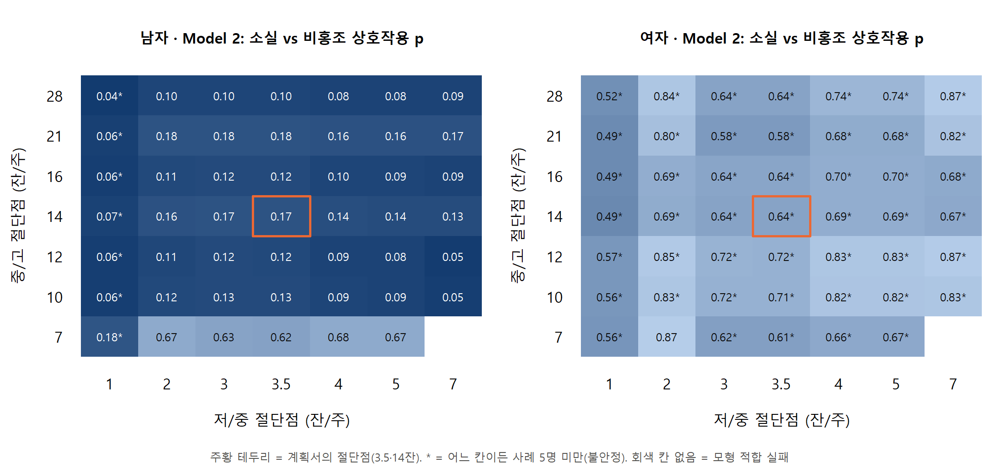
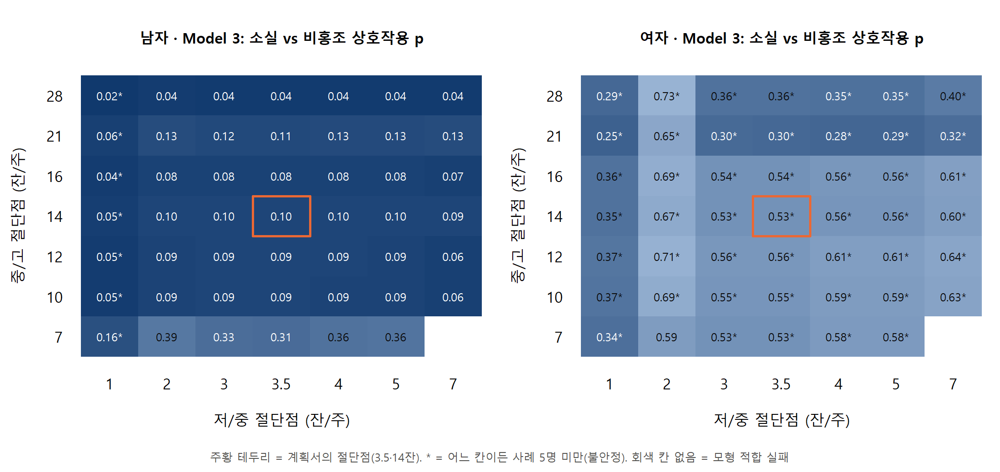

# 부질문 1 절단점 격자 탐색 (사후 탐색, 주 결과 아님)

- 격자: 저/중 절단점 1·2·3·3.5·4·5·7, 중/고 절단점 7·10·12·14·16·21·28 → 절단점 조합 48개 × 남녀 × 모형 2개.
- 검정: 음주 수준 × 홍조 이력 공동 검정(4 df), 소실 vs 비홍조(2 df), 지속 vs 비홍조(2 df). 모두 설계 기반 Wald F.
- 주의: 사전 지정 분석(3.5·14잔)이 아니라 절단점을 바꿔 본 사후 탐색이다. p < 0.05인 절단점만 골라 보고하면 p-해킹이다. 보고한다면 격자 전체를 보고한다.
- 사례 수가 적은 칸(어느 칸이든 사례 5명 미만)이 있는 조합은 '불안정'으로 표시했다. 조합당 검정 3개를 48개 조합에 적용했으므로, 차이가 전혀 없어도 우연히 p < 0.05가 몇 개 나오는 것이 정상이다.

## 요약

| 성별 | 모형 | 검정 | 조합 수 | p<0.05 조합 | 그중 안정 | 불안정 조합 | 최소 p | 최소 p 절단점 | 최소 p 불안정? | 계획서 절단점 p |
|---|---|---|---|---|---|---|---|---|---|---|
| 남자 | Model 2 | p_joint_4df | 48 | 2 | 2 | 7 | 0.010 | 7·10 | 아니오 | 0.339 |
| 남자 | Model 3 | p_joint_4df | 48 | 8 | 6 | 7 | 0.010 | 7·10 | 아니오 | 0.188 |
| 여자 | Model 2 | p_joint_4df | 48 | 0 | 0 | 47 | 0.378 | 5·14 | 예 | 0.401 |
| 여자 | Model 3 | p_joint_4df | 48 | 0 | 0 | 47 | 0.438 | 5·14 | 예 | 0.476 |
| 남자 | Model 2 | p_lost_vs_non | 48 | 2 | 1 | 7 | 0.038 | 1·28 | 예 | 0.171 |
| 남자 | Model 3 | p_lost_vs_non | 48 | 10 | 6 | 7 | 0.022 | 1·28 | 예 | 0.097 |
| 여자 | Model 2 | p_lost_vs_non | 48 | 0 | 0 | 47 | 0.488 | 1·14 | 예 | 0.635 |
| 여자 | Model 3 | p_lost_vs_non | 48 | 0 | 0 | 47 | 0.253 | 1·21 | 예 | 0.531 |
| 남자 | Model 2 | p_persist_vs_non | 48 | 0 | 0 | 7 | 0.073 | 7·10 | 아니오 | 0.546 |
| 남자 | Model 3 | p_persist_vs_non | 48 | 5 | 4 | 7 | 0.033 | 7·10 | 아니오 | 0.406 |
| 여자 | Model 2 | p_persist_vs_non | 48 | 0 | 0 | 47 | 0.161 | 5·14 | 예 | 0.193 |
| 여자 | Model 3 | p_persist_vs_non | 48 | 0 | 0 | 47 | 0.287 | 5·14 | 예 | 0.325 |

## p < 0.05가 나온 조합 (검정별)

| 성별 | 모형 | 저/중 | 중/고 | 소실·고 n(사례) | 소실 고 OR | 비홍조 고 OR | 공동 p | 소실 vs 비홍조 p | 지속 vs 비홍조 p | 불안정 |
|---|---|---|---|---|---|---|---|---|---|---|
| 남자 | Model 2 | 1.00 | 28 | 76 (25) | 6.59 (1.74–25.02) | 1.24 | 0.097 | 0.038 | 0.363 | 예 |
| 남자 | Model 2 | 7.00 | 10 | 155 (42) | 1.92 (1.00–3.72) | 1.15 | 0.010 | 0.054 | 0.073 |  |
| 남자 | Model 2 | 7.00 | 12 | 155 (42) | 1.92 (1.00–3.72) | 1.14 | 0.013 | 0.050 | 0.092 |  |
| 남자 | Model 3 | 1.00 | 7 | 198 (50) | 4.77 (1.23–18.44) | 1.24 | 0.046 | 0.156 | 0.035 | 예 |
| 남자 | Model 3 | 1.00 | 10 | 155 (42) | 5.58 (1.43–21.87) | 1.22 | 0.118 | 0.047 | 0.354 | 예 |
| 남자 | Model 3 | 1.00 | 12 | 155 (42) | 5.58 (1.43–21.86) | 1.21 | 0.115 | 0.047 | 0.339 | 예 |
| 남자 | Model 3 | 1.00 | 16 | 123 (37) | 6.26 (1.55–25.36) | 1.26 | 0.070 | 0.043 | 0.180 | 예 |
| 남자 | Model 3 | 1.00 | 28 | 76 (25) | 8.06 (1.87–34.72) | 1.26 | 0.040 | 0.022 | 0.186 | 예 |
| 남자 | Model 3 | 2.00 | 28 | 76 (25) | 3.67 (1.23–10.88) | 1.21 | 0.065 | 0.040 | 0.212 |  |
| 남자 | Model 3 | 3.00 | 28 | 76 (25) | 4.29 (1.60–11.55) | 1.30 | 0.068 | 0.039 | 0.254 |  |
| 남자 | Model 3 | 3.50 | 28 | 76 (25) | 4.40 (1.64–11.80) | 1.32 | 0.067 | 0.038 | 0.259 |  |
| 남자 | Model 3 | 4.00 | 28 | 76 (25) | 3.78 (1.55–9.19) | 1.28 | 0.057 | 0.039 | 0.197 |  |
| 남자 | Model 3 | 5.00 | 28 | 76 (25) | 3.78 (1.55–9.20) | 1.29 | 0.060 | 0.039 | 0.209 |  |
| 남자 | Model 3 | 7.00 | 10 | 155 (42) | 2.25 (1.12–4.52) | 1.14 | 0.010 | 0.064 | 0.033 |  |
| 남자 | Model 3 | 7.00 | 12 | 155 (42) | 2.25 (1.12–4.52) | 1.14 | 0.012 | 0.065 | 0.038 |  |
| 남자 | Model 3 | 7.00 | 14 | 125 (37) | 2.44 (1.18–5.06) | 1.17 | 0.025 | 0.093 | 0.053 |  |
| 남자 | Model 3 | 7.00 | 16 | 123 (37) | 2.52 (1.22–5.22) | 1.18 | 0.024 | 0.069 | 0.056 |  |
| 남자 | Model 3 | 7.00 | 21 | 84 (26) | 2.65 (1.17–5.99) | 1.14 | 0.047 | 0.131 | 0.049 |  |
| 남자 | Model 3 | 7.00 | 28 | 76 (25) | 3.27 (1.44–7.42) | 1.19 | 0.018 | 0.040 | 0.047 |  |

