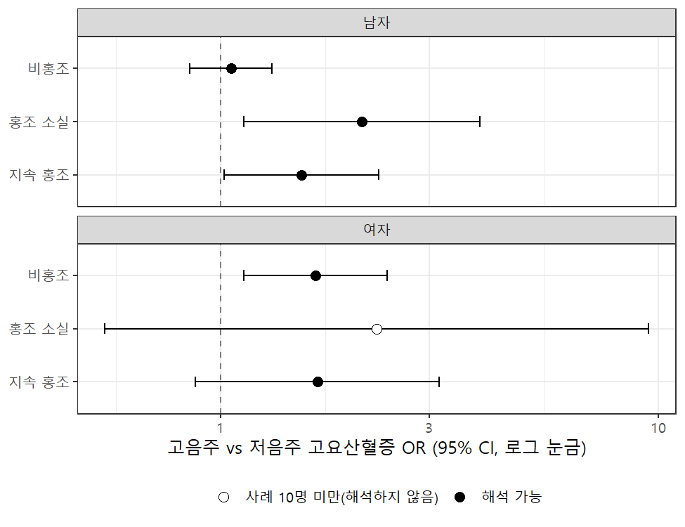
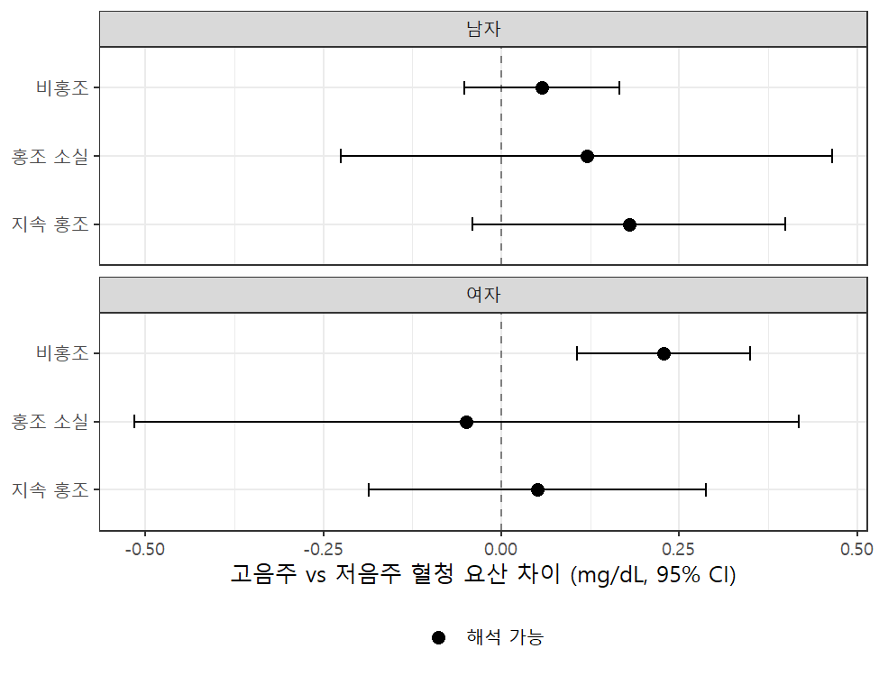
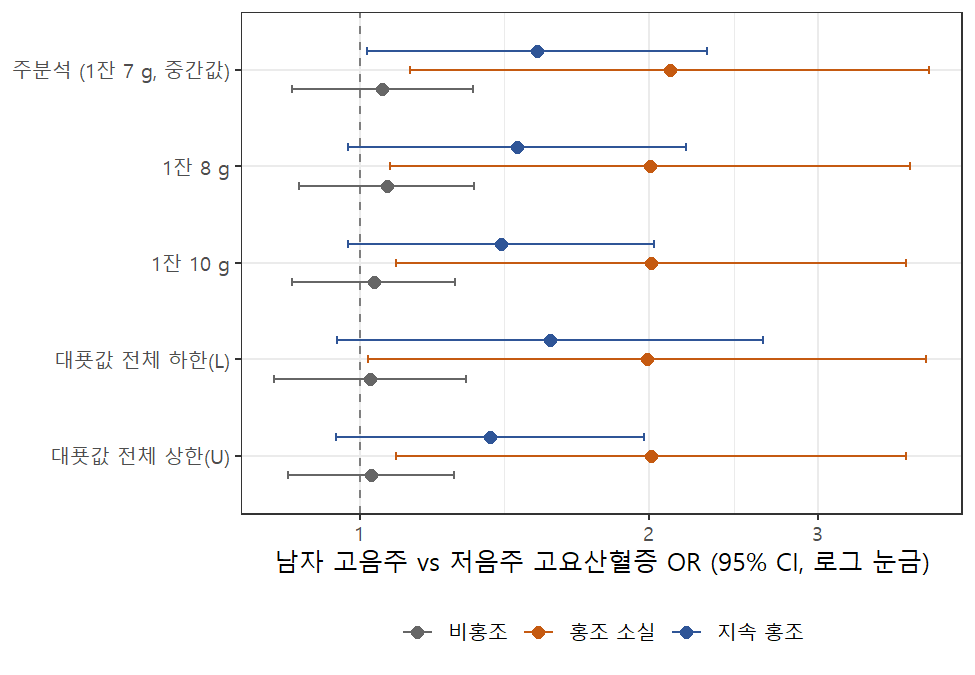

# 최종 발표자료 반영 내용

**음주 관련 안면홍조 이력에 따른 음주량–고요산혈증 연관성의 차이: 국민건강영양조사 2019–2021**

이 파일은 최종 보고서와 발표자료를 만들 때 바탕이 되는 문서다. 반영하기로 한 내용을 해당 절에 바로 적고, 아래 반영 기록에 한 줄을 남긴다. 아직 비어 있는 절은 정해진 내용이 없다는 뜻이다.

### 조원이 최종 발표에 필요한 파일을 올릴 때

커밋 메시지(PR이면 PR 제목) 앞에 `[최종발표]`를 붙이고, 그 파일이 어느 절에 왜 필요한지 한 줄 적는다.

- 예: `[최종발표] 표 2 주분석 결과 — 6. 결과에 사용`

이렇게 올라온 파일은 확인한 뒤 아래 "반영할 파일" 표와 해당 절에 반영한다.

### 반영할 파일

| 파일 경로 | 올린 사람 | 쓰일 절 | 반영 여부 |
|---|---|---|---|
| `Result/2026-11-23_최종발표_반영내용.md` | 김정윤 | 4.2 보정변수 | 반영(흡연 3범주 확정, 보정 모형은 Crude·M2S·M3S) |
| `Result/2026-11-23_주분석_결과_S2.md` | 김준현 | 5, 6 | 반영 |
| `Result/2026-11-23_주분석_그림/` (그림 1–3) | 김준현 | 6 | 반영 |
| `output/final_analysis/` (10–13번 결과 파일) | 김준현 | 6 | 반영 |
| `Result/2026-11-23_최종분석_정리.pdf` | 김준현 | 3, 4, 5, 6, 7 | 반영. 내용 정리 부분(변수 목록과 쪽수, 만든 변수, 대상자 특성 요약, 가정, 해석할 때 주의할 점)과 분석 결과(PDF 6–9절)를 모두 옮김 |

---

## 1. 연구 배경과 목적

## 2. 연구 질문 (확정)

| 구분 | 질문 | 분석 |
|---|---|---|
| **주질문** | 남녀 각각에서, 음주 수준과 고요산혈증의 관계는 **지속 홍조군과 비홍조군** 사이에 다른가? | 음주 수준 × 홍조 이력 교호작용 검정 |
| **부질문** | 같은 관계가 현재 홍조가 없는 사람 가운데 **홍조 소실군과 비홍조군** 사이에 다른가? | 같은 모형의 교호작용 검정 |

- **결과 변수:** 고요산혈증(남 ≥ 7.0, 여 ≥ 6.0 mg/dL)을 절단점으로 쓴 것이 주결과다. 혈청 요산(연속형)은 보조적으로 다중 선형회귀로 본다.
- **경향성 분석은 하지 않는다.** 이전에 넣었던 보조 ①·②(경향성)는 2026-11-23에 뺐다. 음주 기준이 2단계라 경향성 검정이 위 검정과 같은 값이 되고, 주결과를 고요산혈증 절단점으로 두기로 했기 때문이다.

## 3. 자료와 연구 대상

### 3.1 자료 (확정)

기존 내용을 그대로 쓴다.

| 항목 | 내용 | 근거 |
|---|---|---|
| 자료 | 국민건강영양조사 제8기 2019·2020·2021년 기본DB(`hn19_all`, `hn20_all`, `hn21_all`)를 합쳐서 쓴다 | 지침서 |
| 가중치 | `wt_itvex`(건강설문-검진조사 가중치) × 1/3 | PDF p.92 / 인쇄 p.84 |
| 통합 비율 | 제8기는 각 연도의 조사기간에 비례해 통합한다. 세 해 모두 조사기간이 1년이므로 각 연도에 1/3을 곱한다 | PDF p.36 / 인쇄 p.28, 표 7 |
| 층 · 집락 | `kstrata`(분산추정 층) · `psu`(조사구번호) | PDF p.92 / 인쇄 p.84, PDF p.91 / 인쇄 p.83 |
| 대상자 지정 | 대상자가 아닌 사람도 행을 지우지 않는다. 대상자를 `inc`로 표시하고, 전체 자료로 복합표본설계를 만든 뒤 `subset(des, inc == 1)`로 대상자만 부분집단으로 지정한다 | CLAUDE.md, knhanes-analysis 스킬 |
| 분석 도구 | R 4.6.0, `survey` 패키지(`svyglm`: 로지스틱은 quasibinomial, 선형은 gaussian) | README |

근거의 쪽수는 『국민건강영양조사 제8기(2019-2021) 원시자료 이용지침서』 기준이다. 2020년에는 코로나19 유행으로 192개 조사구 중 180개에서만 조사했지만, 조사기간이 1년으로 같으므로 조사구 수 비율은 반영하지 않는다(같은 쪽).

### 3.2 연구 대상 (확정)

기존에 쓰던 선정 기준을 그대로 쓴다. 다만 흐름표에는 실제 분석 과정대로 **가중치가 있는 사람만 남기는 단계를 맨 앞에 넣는다**(결정 7-6, 3.3절). 아래 순서대로 적용하며, n은 가중치를 적용하지 않은 표본 수다.

| 단계 | 기준 | 전체 n | 남 | 여 | 제외 |
|---|---|---:|---:|---:|---:|
| 0 | 2019–2021 기본DB 전체 | 22,559 | 10,354 | 12,205 | |
| 1 | 건강설문·검진조사 가중치 있음(`wt_itvex`) | 21,543 | 9,850 | 11,693 | 1,016 |
| 2 | 만 19세 이상 | 17,903 | 7,942 | 9,961 | 3,640 |
| 3 | 최근 1년 음주자(`BD1_11` = 2–6) | 12,231 | 6,281 | 5,950 | 5,672 |
| 4 | 음주량 계산 가능, 과거·현재 홍조 응답, 혈청 요산 측정 | 12,002 | 6,152 | 5,850 | 229 |
| 5 | 통풍 의사진단 없음(`DM8_dg` = 0, 진단자와 모름·무응답 제외) | 11,217 | 5,628 | 5,589 | 785 |
| 6 | 보정변수 모두 응답 | **10,779** | **5,411** | **5,368** | 438 |

가중치 단계를 빼고 세면 만 19세 이상은 18,691명(남 8,343 · 여 10,348)이다. 음주자 중에는 가중치가 없는 사람이 없어서, 12,231명부터는 두 흐름이 같다.

통풍 진단자는 치료 때문에 요산 수치가 달라질 수 있는데 국건영에는 요산강하제 복용 정보가 없어서 뺀다. 6단계의 보정변수는 연령, 교육수준, 소득, 흡연, 유산소 신체활동, 체질량지수, 고혈압, 당뇨병, eGFR이다. 흡연을 3범주로 바꿔도 결측이 되는 조건은 2범주와 같아서 인원은 그대로다.

최종 대상자 10,779명의 홍조 이력 분포는 다음과 같다.

| | 현재 홍조 없음 | 현재 홍조 있음 |
|---|---|---|
| 과거 홍조 없음 | **비홍조**(기준) 남 3,181 · 여 3,273 | 신규 홍조 남 301 · 여 400 |
| 과거 홍조 있음 | **홍조 소실** 남 341 · 여 236 | **지속 홍조** 남 1,588 · 여 1,459 |

- 홍조 이력 분석(주질문, 부질문)에서는 신규 홍조를 뺀다. 이들은 비홍조·소실·지속 어느 군에도 속하지 않는다. 그래서 홍조 이력 분석 대상은 남 5,110명, 여 4,968명이다.
- 여성 보정 모형에서는 폐경 상태가 결측인 2명이 더 빠진다. 모형끼리 비교할 때는 Crude 모형도 같은 인원으로 맞추고, 모형마다 실제로 들어간 n을 따로 보고한다.
- 혈청 요산이 '1.0 mg/dL 미만'으로 표기된 사람은 기존 규칙대로 측정값이 없는 것으로 보아 4단계에서 빠진다.
- 임신·수유 중인 여성(4명)은 기존 규칙대로 포함하고 폐경 전으로 분류한다.

근거: 『국민건강영양조사 제8기(2019-2021) 원시자료 이용지침서』 `wt_itvex` PDF p.92 / 인쇄 p.84, `BD1_11` PDF p.161 / 인쇄 p.153, `BD2_1`·`BD2_14` PDF p.161–162 / 인쇄 p.153–154, `BD9_1`·`BD9_2` PDF p.163–164 / 인쇄 p.155–156, `HE_Uacid` PDF p.200 / 인쇄 p.192(1.0 미만 표기는 같은 쪽 각주 1), `DM8_dg` PDF p.137 / 인쇄 p.129. 인원은 `code/final_analysis.R` 결과(`output/final_analysis/02a_participant_flow.csv` 가중치 단계 포함, `02b_flow_vs_README.csv` 가중치 단계 없음)이며, 가중치 단계의 남녀 인원은 `code/C12_detail_definitions_check.R`과 같은 방식으로 원자료에서 다시 셌다.

### 3.3 세부 정의 (확정, 결정 7)

다음 회의 자료의 결정 7(세부 정의 6가지)을 추천대로 확정했다. 수치는 원자료로 다시 확인했다(`Result/2026-11-23_결정7_세부정의_처리.md`, `code/C12_detail_definitions_check.R`).

| # | 항목 | 확정 내용 | 이전과 비교 |
|---|---|---|---|
| 7-1 | 혈청 요산 '1.0 미만' 표기 | 측정값이 없는 것으로 보아 제외한다. 포함했다면 최종 대상에 3명(모두 남자, 모두 고요산혈증 아님)이 더해진다 | 같음 |
| 7-2 | eGFR 계산식 | CKD-EPI 2009식(Levey 2009). M3S에만 10 단위 연속형으로 쓴다. 2021식과의 상관은 0.998이다 | 같음 |
| 7-3 | 임신·수유 여성 | 주분석에 포함하고 폐경 전으로 분류한다(4명: 임신 1, 수유 3). 각주에 적는다 | 같음 |
| 7-4 | S1(성별 삼분위) 절단점 | 반올림값 대신 실제 가중 삼분위로 다시 계산한다: 남 2.42 · 9.69 g/일, 여 0.35 · 2.42 g/일. S1은 민감도 분석에만 쓴다 | **바뀜** |
| 7-5 | 폐경 전후 탐색 분석 | 하지 않는다. 폐경 상태는 여성 모형의 보정변수로만 넣는다 | **바뀜**(분석계획서 6.4에서 삭제) |
| 7-6 | 대상자 흐름표 | 가중치 단계를 넣은 흐름(3.2절 표)을 쓴다 | **바뀜**(표 형식만, 최종 대상은 같음) |

**결론:** 7-1·7-2·7-3은 기존 규칙을 그대로 쓴다. 바뀐 것은 7-4(S1 값), 7-5(폐경 탐색 분석 삭제), 7-6(흐름표에 가중치 단계 추가) 세 가지이고, 최종 대상자(10,779명)와 주분석 모형은 달라지지 않는다.

> 같은 날 후속 결정(5.1절): 민감도는 1잔 8·10 g과 대푯값 전체 하한·상한만 한다. 그래서 7-4의 S1은 최종 분석에서 쓰지 않는다. Model 3은 민감도가 아니라 보정 모형 M3S로 쓴다(5절).

### 3.4 대상자 특성 (Table 1 요약)

홍조 이력 분석에 들어간 사람(신규 홍조 제외)의 홍조 이력별 특성이다.

| 성별 | 홍조 이력 | n | 나이(세) | 현재흡연 % | 음주 g/일 | 고음주 n (%) | 고요산혈증 n (%) | 혈청 요산 mg/dL |
|---|---|---:|---|---|---|---|---|---|
| 남자 | 비홍조 | 3,181 | 44.47 (0.34) | 34.1 (1.0) | 15.2 (0.4) | 1,000 (30.6) | 765 (25.5) | 6.16 (0.03) |
| 남자 | 홍조 소실 | 341 | 51.74 (0.98) | 42.6 (2.9) | 18.0 (1.2) | 123 (39.6) | 80 (23.8) | 6.06 (0.08) |
| 남자 | 지속 홍조 | 1,588 | 44.75 (0.43) | 33.4 (1.4) | 6.4 (0.4) | 194 (11.2) | 294 (19.9) | 6.00 (0.04) |
| 여자 | 비홍조 | 3,271 | 43.61 (0.30) | 6.4 (0.5) | 4.8 (0.2) | 529 (17.7) | 273 (8.2) | 4.54 (0.02) |
| 여자 | 홍조 소실 | 236 | 52.11 (1.30) | 9.6 (2.5) | 4.4 (0.5) | 44 (19.1) | 16 (6.8) | 4.56 (0.07) |
| 여자 | 지속 홍조 | 1,459 | 43.43 (0.46) | 7.4 (0.9) | 2.3 (0.2) | 108 (7.3) | 102 (6.2) | 4.48 (0.03) |

n은 비가중 표본 수이고, 괄호는 가중 % 또는 가중 평균(SE)이다(가중치 `wt_itvex` × 1/3). 여자 n은 폐경 상태 결측 2명을 뺀 수다. 교육, 소득, 신체활동, 체질량지수, 고혈압, 당뇨병, eGFR, 폐경 상태까지 담은 전체 특성표는 `output/final_analysis/03_table1.csv`에 있다.

## 4. 변수 정의

### 4.1 음주량 (확정)

**1잔의 알코올은 7 g으로 한다.** 지침서에는 1잔의 알코올 양이 없어서 Jeon 등(2022)이 쓴 값을 가정으로 쓴다. 1잔이 7 g이면 하루 알코올 g(g/일)과 주당 잔 수가 같은 값이 된다.

**주분석 음주 기준은 S2(절주 지침)로 확정한다.** 남녀 각각 다른 절단점으로 나눈 2단계이며, 기준범주는 저음주다.

| 성별 | 저음주(기준) | 고음주 |
|---|---|---|
| 남자 | 16 g/일 미만 | 16 g/일 이상 |
| 여자 | 8 g/일 미만 | 8 g/일 이상 |

절단점은 Lee 등(2019)이 제안한 65세 이하 비홍조군의 적정 음주 상한(남자 주 8잔, 여자 주 4잔, 1잔 14 g)을 하루 양으로 바꾼 값이다. 남자는 주 112 g, 즉 하루 16 g이고, 여자는 주 56 g, 즉 하루 8 g이다. 이 연구에서 홍조군 상한은 비홍조군의 절반이지만, 여기서는 모든 홍조군에 같은 절단점을 쓴다.

**하루 음주량(g/일) 계산:** 음주빈도(`BD1_11`)의 대푯값 × 한 번에 마시는 잔 수(`BD2_1`)의 대푯값 × 7 g ÷ 7일.

- 빈도 대푯값: 월 1회 미만 0.5회/월, 월 1회 1회/월, 월 2–4회 3회/월, 주 2–3회 2.5회/주, 주 4회 이상 5.5회/주. 월 단위는 × 12/52로 주 단위로 바꾼다.
- 잔 수 대푯값: 1–2잔 1.5잔, 3–4잔 3.5잔, 5–6잔 5.5잔, 7–9잔 8잔. 10잔 이상은 `BD2_14`에 적은 잔 수를 쓴다.
- 근거: `BD1_11`, `BD2_1`, `BD2_14` 『국민건강영양조사 제8기(2019-2021) 원시자료 이용지침서』 PDF p.161–162 / 인쇄 p.153–154. 대푯값은 연구팀이 정한 값이다(코드 `code/final_analysis.R`).

### 4.2 보정변수: 흡연 (확정)

흡연은 비흡연, 과거흡연, 현재흡연의 3범주로 보정한다.

| 범주 | 정의 |
|---|---|
| 비흡연 | 평생 일반담배를 5갑 미만 피웠거나(`BS1_1` = 1) 피운 적 없음(`BS1_1` = 3) |
| 과거흡연 | 평생 5갑 이상 피웠고(`BS1_1` = 2), 과거엔 피웠으나 현재 피우지 않음(`BS3_1` = 3) |
| 현재흡연 | 평생 5갑 이상 피웠고(`BS1_1` = 2), 현재 매일 또는 가끔 피움(`BS3_1` = 1, 2) |

`BS1_1`이나 `BS3_1`이 9(모름·무응답)이면 결측으로 둔다. 평생 5갑 미만인 사람은 지침서의 현재흡연율 정의(5갑 이상 피웠고 현재 피움)에 맞춰 비흡연으로 분류한다.

근거: 『국민건강영양조사 제8기(2019-2021) 원시자료 이용지침서』 PDF p.175 / 인쇄 p.167(`BS1_1`, `BS3_1` 문항과 코드), PDF p.48 / 인쇄 p.40(표 18, 현재흡연율 정의).

### 4.3 결과 변수 (확정)

| 구분 | 변수 | 정의 | 분석 |
|---|---|---|---|
| **주결과** | 고요산혈증 | 혈청 요산 남 7.0 mg/dL 이상, 여 6.0 mg/dL 이상 | 복합표본 로지스틱 회귀 |
| 보조 결과 | 혈청 요산 | mg/dL, 연속형 | 복합표본 다중 선형회귀 |

혈청 요산은 `HE_Uacid`(『국민건강영양조사 제8기(2019-2021) 원시자료 이용지침서』 PDF p.200 / 인쇄 p.192)다. 고요산혈증 기준값은 지침서에 없어 문헌 기준을 쓴다(분석계획서 4.3). 여성은 고요산혈증 사례가 427명으로 적어 혈청 요산 결과를 함께 해석한다.

### 4.4 쓰는 변수와 지침서 쪽수

출처는 모두 『국민건강영양조사 제8기(2019-2021) 원시자료 이용지침서』다. 9·99·999(모름·무응답)는 결측으로 두고, 8·88·888(비해당)은 변수마다 지침서에서 뜻을 확인해 처리했다.

| 변수 | 뜻(코드) | 모름·무응답 | 비해당 처리 | 쪽수(PDF / 인쇄) |
|---|---|---|---|---|
| `sex` | 성별(1 남, 2 여) | - | - | p.91 / p.83 |
| `age` | 만 나이(80 = 80세 이상) | - | - | p.91 / p.83 |
| `psu` | 조사구번호(집락) | - | - | p.91 / p.83 |
| `incm` | 소득 4분위수, 개인(1 하 ~ 4 상) | - | - | p.91 / p.83 |
| `kstrata` | 분산추정 층 | - | - | p.92 / p.84 |
| `wt_itvex` | 건강설문-검진조사 가중치 | - | - | p.92 / p.84 |
| `edu` | 교육수준 재분류(1 초졸 이하 ~ 4 대졸 이상) | - | - | p.92 / p.84 |
| `BD1_11` | 1년간 음주빈도(1 최근 1년간 전혀 안 마심 ~ 6 주 4회 이상) | 9 결측 | 8(평생 비음주·소아)은 범주로 둔다. 음주자 선정(2–6)에서 빠진다 | p.161–162 / p.153–154 |
| `BD2_1` | 한 번에 마시는 음주량(1 1–2잔 ~ 5 10잔 이상) | 9 결측 | 8(최근 1년 비음주)은 범주로 둔다 | p.161–162 / p.153–154 |
| `BD2_14` | 한 번에 마시는 잔 수(10잔 이상만 기입) | 999 결측 | 888은 10잔 미만이라는 뜻이라 값만 비우고 `BD2_1` 대푯값을 쓴다 | p.161–162 / p.153–154 |
| `BD9_1` | 과거 알코올 홍조(1 예, 2 아니오) | 9 결측 | 8 결측 | p.163–164 / p.155–156 |
| `BD9_2` | 현재 알코올 홍조(1 아니오, 2 가끔, 3 자주, 4 늘) | 9 결측 | 8 결측 | p.163–164 / p.155–156 |
| `DM8_dg` | 통풍 의사진단(0 없음, 1 있음) | 9 결측(대상에서 뺌) | 8 결측 | p.137 / p.129 |
| `LW_ms` | 월경 여부(1 초경 전, 2 월경 중, 3 임신 중, 4 수유 중, 5 자연폐경, 6 인공폐경, 7 기타) | 9 결측 | 8 결측 | p.190 / p.182 |
| `HE_HP` | 고혈압 유병(3 = 고혈압) | - | - | p.196 / p.188 |
| `HE_BMI` | 체질량지수(kg/m²) | - | - | p.198 / p.190 |
| `HE_DM_HbA1c` | 당뇨병 유병(3 = 당뇨병) | - | - | p.199 / p.191 |
| `HE_Uacid` | 혈청 요산(mg/dL) | - | - | p.200 / p.192 |
| `HE_Uacid_etc` | 요산 장비분석범위 표기(<1.0 = 1.0 mg/dL 미만). 측정값이 없는 것으로 본다(결정 7-1) | - | - | p.200 / p.192 |
| `HE_crea` | 혈중 크레아티닌(mg/dL), eGFR 계산에 씀 | - | - | p.200 / p.192 |
| `BS1_1` | 평생 일반담배 흡연(1 5갑 미만, 2 5갑 이상, 3 피운 적 없음) | 4.2절 | 4.2절 | p.175 / p.167, 현재흡연 정의 p.48 / p.40 |
| `BS3_1` | 현재 일반담배 흡연(1 매일, 2 가끔, 3 과거엔 피웠으나 현재 안 피움) | 4.2절 | 4.2절 | p.175 / p.167, 현재흡연 정의 p.48 / p.40 |
| `pa_aerobic` | 유산소 신체활동 실천(0 미실천, 1 실천, 생성변수) | - | - | p.188 / p.180 |

### 4.5 만든 변수

| 변수 | 정의 |
|---|---|
| 하루 음주량(g/일) | 4.1절의 계산식 |
| 홍조 이력 | 비홍조(과거·현재 없음) · 홍조 소실(과거 있음, 현재 없음) · 지속 홍조(과거·현재 있음) · 신규 홍조(과거 없음, 현재 있음 → 홍조 이력 분석에서 뺌). 현재 홍조 있음은 `BD9_2`가 가끔·자주·늘(2–4)인 경우다 |
| 흡연 3범주 | 4.2절 |
| 폐경 상태(여자) | 폐경 전(월경 중·임신 중·수유 중) · 폐경 후(자연폐경·인공폐경) · 기타 |
| eGFR | CKD-EPI 2009식(Levey 2009). 지침서에 식이 없어 문헌의 식을 쓴다. M3S에만 10 단위 연속형으로 넣는다 |
| 고요산혈증 | 4.3절 |

## 5. 분석 방법 (확정)

| 항목 | 내용 |
|---|---|
| 주분석 | 남녀 각각 복합표본 로지스틱 회귀(`svyglm`, quasibinomial). 고요산혈증 ~ 음주 수준(2단계) + 홍조 이력(비홍조 기준·소실·지속) + 음주 수준 × 홍조 이력 + 보정변수 |
| 보정 모형 | **Crude**(보정 없음) · **M2S**(주 모형: 연령, 교육, 소득, 조사연도, 흡연 3범주, 유산소 신체활동, 폐경 상태(여)) · **M3S**(M2S + 체질량지수, 고혈압, 당뇨병, eGFR. 매개변수일 수 있어 참고로 해석). 이 세 가지만 쓴다 |
| 효과 크기 | 홍조군마다 저음주 대비 고음주의 OR과 95% 신뢰구간 |
| 효과수정 검정 | 교호작용 항의 Wald 검정(곱셈 척도, 1 자유도). 주질문 = 음주 × 지속 홍조, 부질문 = 음주 × 홍조 소실 |
| 보조 분석 | 같은 구조의 혈청 요산 다중 선형회귀. 효과 크기는 저음주 대비 평균 차이(mg/dL) |
| 보고 규칙 | 비가중 n과 가중 추정치를 함께 적는다. 고요산혈증 사례가 10명 미만인 칸이 있으면 그 OR은 해석하지 않는다(†) |
| 분석 도구 | R 4.6.0, `survey`. 코드 `code/final_analysis.R`, 보고서 `code/39_main_report.R` |

모형은 남녀 따로 다음과 같다.

```
고요산혈증 ~ 음주(저/고) + 홍조 이력 + 음주 × 홍조 이력 + 보정변수
  주질문 = 음주 × 지속 홍조 항,  부질문 = 음주 × 홍조 소실 항
```

### 5.1 민감도 분석 (확정)

아래 4개만 한다. 주결과(고요산혈증)를 주 모형(M2S)으로 계산하고, p < 0.05 유지 여부가 아니라 OR의 방향과 크기가 주분석과 같은지로 판단한다.

| 민감도 | 바꾸는 가정 |
|---|---|
| 1잔 8 g | 1잔의 알코올 7 g → 8 g(Lee 2023의 국건영 환산) |
| 1잔 10 g | 7 g → 10 g |
| 대푯값 전체 하한 | 빈도·1회 음주량을 모두 범주 하한으로(예: 주 2–3회 → 주 2회, 1–2잔 → 1잔) |
| 대푯값 전체 상한 | 빈도·1회 음주량을 모두 범주 상한으로(예: 주 4회 이상 → 주 7회, 1–2잔 → 2잔) |

10잔 이상은 직접 적은 잔 수라 바꾸지 않는다. 대푯값의 하한·상한 정의는 `Result/2026-11-18_음주대표값_민감도분석_계획.md` 4–5절이다.

**하지 않는 분석:** 경향성 분석, 폐경 전후 탐색, 현재 홍조 2군 분석, Model 1·M2A 등 다른 보정 모형, 다른 음주 기준, 통풍 제외 기준 바꾸기 등. 분석 조건은 여러 기준의 결과를 본 뒤 정했으므로, 시도한 기준 전체(`output/21_ptest/ptest_log.csv`)를 부록에 밝힌다.

- 폐경 상태는 여성 모형의 보정변수로만 넣고, 폐경 전후 탐색 분석(음주 × 홍조 이력 × 폐경 3원 교호작용)은 하지 않는다(결정 7-5). 주분석 기준에서 폐경 후 홍조 소실 여성의 고음주 칸은 18명(고요산혈증 3명)뿐이라 해석할 수 없다.
- (기록) S1을 쓸 경우에는 실제 가중 삼분위 값(3.3절)으로 나눈다(결정 7-4). 다만 같은 날 민감도를 1잔 g·대푯값 4개로 확정해 S1은 최종 분석에서 쓰지 않는다(5.1). 음주량 응답값에 같은 값이 많아 정확히 1/3씩 나뉘지는 않는다(여자 26.4 / 36.7 / 36.9%).

### 5.2 분석에서 가정한 것

- 1잔 = 7 g과 고요산혈증 기준값(남 7.0, 여 6.0 mg/dL)은 지침서에 없어 문헌 값을 썼다.
- 음주량은 설문 범주의 대푯값으로 계산했다. 대푯값 전체 하한·상한 민감도(5.1)로 영향을 확인한다.
- 혈청 요산 '<1.0' 표기는 측정값이 없는 것으로 보았고(결정 7-1), 임신·수유 여성 4명은 폐경 전으로 포함했다(결정 7-3).

## 6. 결과

자세한 표와 그림은 `Result/2026-11-23_주분석_결과_S2.md`와 `Result/2026-11-23_최종분석_정리.pdf`에 있다. 숫자는 모두 `output/final_analysis/`의 결과 파일(10–13번)에서 옮겼다. n은 비가중 표본 수이고, %·OR·β는 복합표본 가중 추정치다. M2S가 주 모형이다. \* p < 0.05, † 비교하는 칸의 고요산혈증 사례가 10명 미만이라 해석하지 않음.

분석 인원은 남 5,110명, 여 4,966명이다(신규 홍조와 폐경 상태 결측 여자 2명 제외, 세 모형 모두 같은 인원).

### 6.1 칸별 인원과 가중 유병률 (고요산혈증)

| 성별 | 홍조 이력 | 저음주 n (사례, 가중 %) | 고음주 n (사례, 가중 %) |
|---|---|---|---|
| 남자 | 비홍조 | 2,181 (523, 25.8) | 1,000 (242, 25.1) |
| 남자 | 홍조 소실 | 218 (43, 18.3) | 123 (37, 32.3) |
| 남자 | 지속 홍조 | 1,394 (250, 19.4) | 194 (44, 24.2) |
| 여자 | 비홍조 | 2,742 (204, 7.2) | 529 (69, 12.8) |
| 여자 | 홍조 소실 | 192 (11, 5.5) | 44 (5, 12.0) † |
| 여자 | 지속 홍조 | 1,351 (87, 5.9) | 108 (15, 11.0) |

저음주는 남 16 g/일 미만, 여 8 g/일 미만이고, 고음주는 그 이상이다.

### 6.2 홍조 이력별 고음주의 고요산혈증 OR (저음주 대비, 95% CI)



| 성별 | 홍조 이력 | Crude | **M2S (주 모형)** | M3S |
|---|---|---|---|---|
| 남자 | 비홍조 | 0.96 (0.78–1.19) | 1.06 (0.85–1.31) | 1.09 (0.87–1.36) |
| 남자 | 홍조 소실 | 2.13 (1.15–3.93) | **2.10 (1.13–3.91)** | 2.46 (1.26–4.80) |
| 남자 | 지속 홍조 | 1.33 (0.89–1.98) | 1.53 (1.02–2.30) | 1.75 (1.14–2.68) |
| 여자 | 비홍조 | 1.88 (1.33–2.67) | 1.65 (1.13–2.40) | 1.72 (1.17–2.53) |
| 여자 | 홍조 소실 | 2.32 (0.58–9.32) † | 2.27 (0.54–9.52) † | 3.71 (0.77–17.82) † |
| 여자 | 지속 홍조 | 1.99 (1.06–3.74) | 1.66 (0.88–3.16) | 1.79 (0.88–3.62) |

### 6.3 효과수정 검정 p (Wald, 1 자유도)

| 질문 | 성별 | Crude | **M2S (주 모형)** | M3S |
|---|---|---|---|---|
| 주질문 (지속 vs 비홍조) | 남자 | 0.157 | 0.100 | 0.046\* |
| 주질문 (지속 vs 비홍조) | 여자 | 0.884 | 0.979 | 0.928 |
| 부질문 (소실 vs 비홍조) | 남자 | 0.019\* | **0.043\*** | 0.025\* |
| 부질문 (소실 vs 비홍조) | 여자 | 0.774 † | 0.660 † | 0.340 † |
| 탐색 (소실 vs 지속) | 남자 | 0.210 | 0.403 | 0.406 |
| 탐색 (소실 vs 지속) | 여자 | 0.844 † | 0.691 † | 0.392 † |

주질문은 음주 × 지속 홍조 항, 부질문은 음주 × 홍조 소실 항이다(모두 비홍조 대비, 곱셈 척도). 소실 vs 지속은 탐색으로만 본다.

### 6.4 주분석 해석

- 남자 비홍조군에서는 고음주와 고요산혈증의 연관이 없었고(OR 1.06 (0.85–1.31)), 홍조 이력이 있는 군에서 OR이 컸다.
- **주질문:** 남자 지속 홍조군의 OR(1.53 (1.02–2.30))이 비홍조군보다 크지만 차이는 통계적으로 확인되지 않았다(p = 0.100). M3S에서는 p = 0.046이지만, M3S에 더한 변수는 매개변수일 수 있어 결론은 M2S로 낸다. 여자도 유의하지 않았다(p = 0.979).
- **부질문:** 남자 홍조 소실군의 OR(2.10 (1.13–3.91))이 비홍조군보다 컸다(p = 0.043).
- 여자는 비홍조군에서도 연관이 있었고(OR 1.65 (1.13–2.40)), 홍조 이력에 따른 차이는 없었다. 여자 홍조 소실군은 고음주 칸의 사례가 5명이라 해석하지 않는다.

### 6.5 보조: 혈청 요산 다중회귀



고음주 vs 저음주 혈청 요산 차이(mg/dL, 95% CI):

| 성별 | 홍조 이력 | Crude | **M2S** | M3S |
|---|---|---|---|---|
| 남자 | 비홍조 | -0.00 (-0.11, 0.10) | 0.06 (-0.05, 0.17) | 0.08 (-0.02, 0.18) |
| 남자 | 홍조 소실 | 0.16 (-0.20, 0.52) | 0.12 (-0.23, 0.47) | 0.19 (-0.14, 0.52) |
| 남자 | 지속 홍조 | 0.08 (-0.16, 0.31) | 0.18 (-0.04, 0.40) | 0.24 (0.03, 0.46) |
| 여자 | 비홍조 | 0.26 (0.14, 0.38) | 0.23 (0.11, 0.35) | 0.20 (0.09, 0.32) |
| 여자 | 홍조 소실 | -0.01 (-0.48, 0.46) | -0.05 (-0.52, 0.42) | 0.06 (-0.38, 0.51) |
| 여자 | 지속 홍조 | 0.09 (-0.15, 0.33) | 0.05 (-0.19, 0.29) | 0.04 (-0.19, 0.26) |

효과수정 검정 p:

| 질문 | 성별 | Crude | **M2S** | M3S |
|---|---|---|---|---|
| 주질문 | 남자 | 0.531 | 0.305 | 0.165 |
| 주질문 | 여자 | 0.218 | 0.204 | 0.196 |
| 부질문 | 남자 | 0.395 | 0.734 | 0.548 |
| 부질문 | 여자 | 0.267 | 0.248 | 0.543 |
| 탐색 (소실 vs 지속) | 남자 | 0.701 | 0.778 | 0.776 |
| 탐색 (소실 vs 지속) | 여자 | 0.720 | 0.709 | 0.910 |

남녀 모두 홍조 이력에 따른 차이가 없었다. 여자 비홍조군의 혈청 요산은 고음주일 때 0.23 mg/dL(95% CI 0.11–0.35) 높았다.

### 6.6 민감도 분석 (고요산혈증, M2S)



| 분석 | 남 주질문 p | 남 부질문 p | 여 주질문 p | 여 부질문 p | 남 소실군 OR | 남 비홍조 OR |
|---|---|---|---|---|---|---|
| 주분석 (1잔 7 g, 중간값) | 0.100 | 0.043\* | 0.979 | 0.660 † | 2.10 (1.13–3.91) | 1.06 (0.85–1.31) |
| 1잔 8 g | 0.164 | 0.063 | 0.960 | 0.645 † | 2.00 (1.07–3.74) | 1.07 (0.87–1.32) |
| 1잔 10 g | 0.143 | 0.042\* | 0.930 | 0.439 † | 2.01 (1.09–3.70) | 1.03 (0.85–1.26) |
| 대푯값 전체 하한 | 0.121 | 0.068 | 0.745 | 0.604 † | 1.99 (1.02–3.88) | 1.02 (0.81–1.29) |
| 대푯값 전체 상한 | 0.176 | 0.041\* | 0.859 | 0.481 † | 2.01 (1.09–3.70) | 1.03 (0.84–1.25) |

남자 홍조 소실군의 OR은 네 분석 모두 약 2.0으로 주분석과 같고 신뢰구간도 1을 넘는다. 부질문 p는 0.041–0.068로 경계 근처다(4개 중 2개만 0.05 미만). 여자는 모든 민감도에서 결론이 같다(주질문 p 0.75–0.96). 바꾼 가정은 5.1절에 있다.

### 6.7 검증

2019년 만 19세 이상 공식 통계(조율)와 대조했다.

| 지표 | 성별 | n / 공식 n | 재현값 % (95% CI) | 공식값 % | 판정 |
|---|---|---|---|---|---|
| 월간음주율 | 전체 | 6,195 / 6,195 | 57.7 (56.1–59.3) | 57.7 | 일치 |
| 월간음주율 | 남자 | 2,746 / 2,746 | 72.4 (70.3–74.5) | 72.4 | 일치 |
| 월간음주율 | 여자 | 3,449 / 3,449 | 43.2 (41.1–45.2) | 43.2 | 일치 |
| 고위험음주율 | 전체 | 6,195 / 6,195 | 12.1 (11.0–13.2) | 12.1 | 일치 |
| 고위험음주율 | 남자 | 2,746 / 2,746 | 18.7 (16.8–20.6) | 18.7 | 일치 |
| 고위험음주율 | 여자 | 3,449 / 3,449 | 5.6 (4.6–6.5) | 5.6 | 일치 |

공식값은 KOSIS 국민건강영양조사 월간 음주율 추이(DT_11702_N012)와 고위험음주율 추이(DT_11702_N018)의 '19세이상' 행이다. 재현값을 소수 첫째 자리로 반올림한 값과 응답자 수가 모두 같으면 '일치'로 본다. 이 대조로 가중치·층·집락·대상 정의·음주 변수 코딩을 함께 점검했다.

- 주분석 p가 `/knhanes_ptest`로 따로 계산한 값과 같다.
- 팀 코드와 별도로 짠 코드로 원자료에서 다시 계산해, 주분석·Crude·M3S·혈청 요산의 p값과 OR이 같음을 확인했다(2026-11-24).
- 대상자 흐름이 README·분석계획서의 단계별 인원과 같다(`02b_flow_vs_README.csv`).
- 층 안에 집락이 1개인 경우(lonely PSU) 경고가 없었다.
- 조원 재현성 확인(새 R 세션에서 두 번 실행)은 아직 하지 않았다.

## 7. 고찰

### 7.1 해석할 때 주의할 점 (한계)

- **결과를 본 뒤 확정:** 음주 기준, 1잔 g, 흡연 범주, 보정 모형, 민감도 목록은 여러 결과를 본 뒤(2026-11-16 ~ 11-23) 정했다. 보고서에 이 사실과 시도한 기준 전체(`output/21_ptest/ptest_log.csv`)를 밝힌다.
- **다중 비교:** 유의한 결과는 남자 부질문 하나이고, 민감도에서 p가 0.04–0.07 사이를 오간다. 확증이 아니라 가설을 만드는 결과로 보고한다.
- **작은 군:** 남자 홍조 소실군은 341명(고음주 123명), 여자 소실군은 236명(고음주 44명, 사례 5명)이다.
- **단면 자료·자기 보고:** 홍조 이력은 회상에 의존하고, 홍조 소실은 음주 습관 변화(내성)와 얽혀 있을 수 있다.

## 8. 결론

## 9. 참고문헌

---

## 반영 기록

| 날짜 | 반영한 절 | 내용 |
|---|---|---|
| 2026-11-23 | 전체 | 빈 틀 작성, 조원이 올릴 때 `[최종발표]` 표시 규칙 추가 |
| 2026-11-23 | 2 | 연구 질문 구조 확정(주질문, 부질문 1–3) |
| 2026-11-23 | 4.1 | 1잔 7 g 확정, 음주 기준 남 16 g/일·여 8 g/일(2단계) 확정 |
| 2026-11-23 | 4.2 | 흡연 보정변수 3범주(비흡연·과거흡연·현재흡연) 확정 |
| 2026-11-23 | 5 | 2단계 기준이라 부질문 2·3이 주질문·부질문 1과 같은 값이 된다는 점 기록 |
| 2026-11-23 | 2, 5 | 연구 질문을 주질문·부질문·보조 ①·②로 바꿈(가설 문장 삭제) |
| 2026-11-23 | 4.1 | 주분석 음주 기준을 S2(절주 지침)로 확정 표시 |
| 2026-11-23 | 3.1 | 연구 대상을 기존 선정 기준(최종 10,779명, 남 5,411 · 여 5,368)으로 확정 |
| 2026-11-23 | 3.1, 3.2 | 자료(2019–2021 기본DB, 복합표본설계)를 기존 내용으로 확정해 3.1에 넣고, 연구 대상은 3.2로 번호 변경 |
| 2026-11-23 | 3.2, 3.3, 5 | 결정 7(세부 정의 6가지) 확정. 7-1 '1.0 미만' 제외·7-2 eGFR 2009식·7-3 임신·수유 포함은 기존과 같음. 바뀐 것은 7-4 S1 실제 가중 삼분위, 7-5 폐경 전후 탐색 분석 삭제, 7-6 흐름표에 가중치 단계 추가(근거 `Result/2026-11-23_결정7_세부정의_처리.md`) |
| 2026-11-23 | 2, 3.2 | 경향성 분석(보조 ①·②) 삭제. 고요산혈증이 주결과, 혈청 요산은 보조 다중회귀 |
| 2026-11-23 | 4.3 | 결과 변수(고요산혈증 주결과, 혈청 요산 보조) 추가 |
| 2026-11-23 | 5, 5.1 | 분석 방법 확정. 민감도는 1잔 8·10 g과 대푯값 전체 하한·상한만 |
| 2026-11-23 | 6 | 확정 조건의 주분석·보조·민감도 결과 추가(`Result/2026-11-23_주분석_결과_S2.md`) |
| 2026-11-23 | 반영할 파일 | 보정변수 문서(김정윤), 주분석 결과·그림·결과 파일 등록 |
| 2026-11-23 | 3.2, 3.3, 5 | 결정 7과 같은 날 확정한 민감도 범위가 겹쳐 메모 추가(S1·Model 3은 최종 분석에서 쓰지 않음). 3.2 본문의 단계 번호를 가중치 단계 추가에 맞춤 |
| 2026-11-23 | 3.3, 5, 6 | 보정 모형을 Crude·M2S(주)·M3S 세 가지로 확정. 6.1·6.2에 모형별 p 추가 |
| 2026-11-24 | 3.1, 3.4, 4.1, 4.4, 4.5, 5, 5.2, 7.1, 반영할 파일 | 최종 분석 정리 PDF(`Result/2026-11-23_최종분석_정리.pdf`)의 내용 정리 부분 반영: 대상자 지정 방식, Table 1 요약, 하루 음주량 계산식, 변수 목록과 지침서 쪽수, 만든 변수, 모형식, 하지 않는 분석에 현재 홍조 2군 추가, 가정, 해석할 때 주의할 점. 분석 결과(PDF 6–9절)는 옮기지 않음 |
| 2026-11-24 | 3.4, 6 | 6절에 주분석 전체 반영(칸별 인원·가중 유병률, 모형별 OR과 p, 탐색 검정, 해석, 혈청 요산 차이표, 여자를 포함한 민감도표, 그림 1–3, 공식 통계 대조표, 독립 재계산 확인). 반올림 오류 수정: 남자 비홍조 OR 1.05 → 1.06, 남자 소실군 OR 상한 3.92 → 3.91, 3.4 표의 남자 소실군 음주 18.1 → 18.0, 여자 지속 홍조 요산 4.49 → 4.48(원인: 결과 파일을 유효숫자 4자리로 저장한 뒤 다시 반올림함, `code/final_analysis.R` 수정) |
